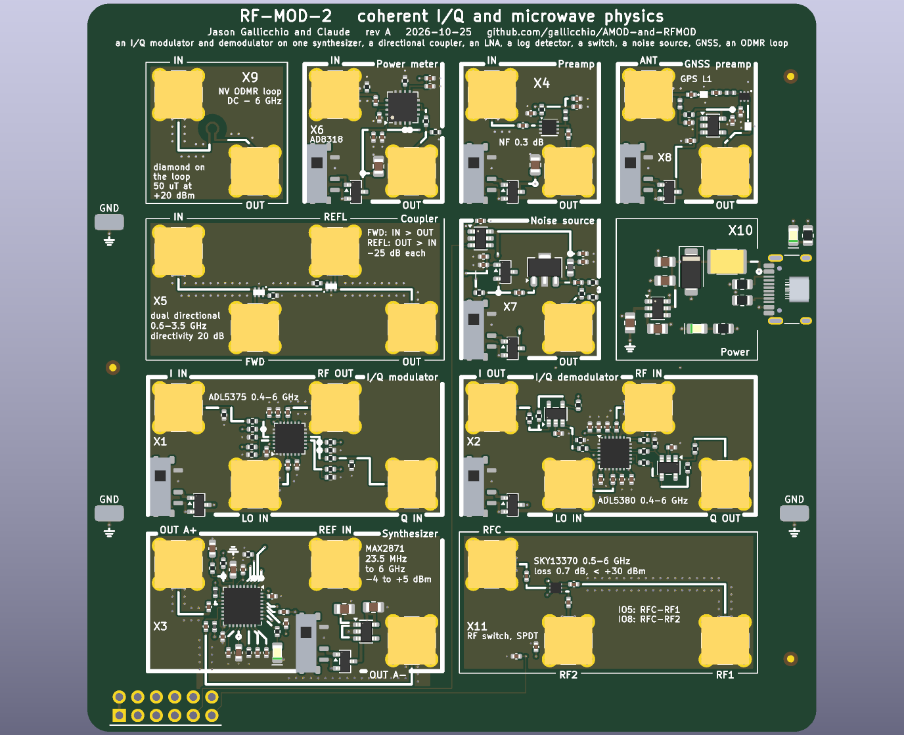

# AMOD and RF-MOD: boards of analog and RF building blocks

Five 100 x 100 mm boards of "tiles" for an FPGA with fast converters: three first-level boards (for the ECP5-2ADC-2DAC
board, or an Icepi Zero with its AD9280/AD9708 module) and two second-level boards built around the ECP5-2ADC-2DAC
board's two DACs and two ADCs.  Each tile is one circuit with its own SMA jacks: cable a DAC to its input and its
output to an ADC, and compare the measurement with the expected result printed beside it.  The silkscreen draws every
tile's wiring as it is laid in copper.  The tutorial they serve is `icepi-zero-dac-adc/tutorial/`, whose Appendix D
specified them.

Rev A, 2026-10-25.  Designed by Claude with Jason Gallicchio, not yet ordered.

| board | what | tiles | layers | parts per board |
|---|---|---|---|---|
| [AMOD-P](docs/HANDBOOK_amod_p.md) | passive: pads, RC and LC filters, resonators, a crystal, a clipper, a delay line, LEDs, an AM loopstick | 13 | 2 | $17.07 |
| [AMOD-A](docs/HANDBOOK_amod_a.md) | active on USB-C: gain blocks, an HF LNA, an HB100 Doppler radar, a one-pin ADC, a 4046 PLL, heat, a mixer, impedance and I-V, ultrasound, audio | 12 | 4 | $50.40 |
| [RF-MOD](docs/HANDBOOK_rf_mod.md) | 915 MHz and 2.4 GHz: a diode-ring mixer, two filters, a QPL9547 LNA, a gain block, two ADL5350 mixers, a synthesizer with two outputs, a TRF3722 I/Q transmitter, power and a 25 MHz reference | 10 | 4 | $66.51 |
| [PhMOD](docs/HANDBOOK_phmod.md) | HF, magnetic resonance and the reflectometer: a 1 W pulse amplifier and duplexer, a two-channel HF receiver, a VLF loop amplifier, a reflection bridge, coupled resonators, a coil driver, a noise source, a laser driver with an RF bias-T | 10 | 4 | $78.19 |
| [RF-MOD-2](docs/HANDBOOK_rf_mod_2.md) | coherent I/Q and microwave physics, 0.4-6 GHz: an I/Q modulator and demodulator on one synthesizer's two outputs, a dual directional coupler, an LNA, a log detector, a switch, a noise source, GNSS, an ODMR loop | 11 | 4 | $99.65 |
| [Icepi adapter](icepi_adapter/README.md) | the tutorial's 2x12 Icepi Zero adapter with a Pmod socket | | 4 | hand-soldered |


Each tile's name and what it does are printed on the board: the jacks' names sit on their own tile's frame beside each
jack, a tile's title in words on its top frame where it fits, its ranges and levels inside it.  Below, each board's
picture and a table of its tiles, each row a summary of the tile's entry in the board's handbook (linked from the tile's
number), where the tile has its own picture, what to expect, the circuit and its parts.  What to buy beside the boards,
with links and prices, is in [docs/KIT.md](docs/KIT.md).

## The boards

<!-- board:amod_p -->
### [AMOD-P](docs/HANDBOOK_amod_p.md): the passive board


| tile | what it does | chip | specs | limits | experiments | how to use it | you need |
|---|---|---|---|---|---|---|---|
| [**P1**](docs/HANDBOOK_amod_p.md#p1) pi pad | Divides the voltage by 10 (-20 dB) and looks like 50 ohm from both ports. | passive | 61.9 / 249 / 61.9 ohm pi; -20.0 dB; DC to well past 30 MHz. | -20 dB only between 50 ohm on both sides (-14 dB into a high impedance); about 0.1 W (+-3 V) at IN. | A known weak signal for a receiver or LNA; padding a mismatched cable; checking the ADC's 50 ohm setting. | DAC to IN, OUT to the ADC set to 50 ohm. | Nothing beyond SMA cables. |
| [**P2**](docs/HANDBOOK_amod_p.md#p2) RC low-pass | A first-order RC low-pass: passes below 159 kHz and falls 20 dB per decade above. | passive | 1 k and 1 nF; -3 dB at 159 kHz; time constant 1 us. | OUT is a 1 k source: read it on the ADC's high-impedance setting (50 ohm divides it by 21). | A Bode plot, 45 degrees at the corner, the step response, the lag plant for feedback control. | DAC to IN, OUT to the ADC on high impedance; sweep the frequency or send a step. | Nothing beyond SMA cables. |
| [**P3**](docs/HANDBOOK_amod_p.md#p3) RC high-pass | A first-order RC high-pass, the mirror image of P2. | passive | 1 nF and 1 k; -3 dB at 159 kHz; +20 dB per decade below. | OUT is a 1 k source: read it on high impedance. | A Bode plot, AC coupling, a differentiator (a step gives a 1 us spike). | DAC to IN, OUT to the ADC on high impedance. | Nothing beyond SMA cables. |
| [**P4**](docs/HANDBOOK_amod_p.md#p4) series RLC | A series 100 uH and 220 pF resonator between 50 ohm ports: a band-pass peak that the DIP switch moves. | passive | 1.07 MHz with both switches off, 0.98 (way 1, +47 pF), 0.89 (way 2, +100 pF), 0.83 (both); Q about 6. | The 50 ohm ports load it: Q is 6, where the coil alone would allow about 60. | Resonance and Q, the phase through resonance, tracking a resonance with a lock-in or a PLL, a resonant plant to control. | Sweep the DAC into IN, OUT to the ADC (50 ohm); set the DIP switch. | Nothing beyond SMA cables. |
| [**P5**](docs/HANDBOOK_amod_p.md#p5) LC low-pass | A 5th-order Butterworth LC low-pass at 9 MHz: the anti-alias filter for a 25 MS/s ADC, or the smoothing filter after a DAC. | passive | -3 dB at 8.9 MHz, -30 dB at 18 MHz; 50 ohm in and out. | The response is as designed only with 50 ohm on both ports. | Aliasing with and without it; a filter's magnitude, phase and group delay; cleaning a DAC's staircase. | Between the DAC and its load, or between a signal and the ADC (50 ohm). | Nothing beyond SMA cables. |
| [**P6**](docs/HANDBOOK_amod_p.md#p6) LC low-pass | A 3rd-order LC low-pass near 120 kHz: turns a one-bit (delta-sigma or PWM) stream into a tone. | passive | 10 nF, 150 uH, 10 nF (C0G); -3 dB at 118 kHz; 50 ohm. | Designed for 50 ohm on both ports. | One-bit DAC reconstruction, delta-sigma noise shaping seen at the output, a slow plant for control. | DAC (or a one-bit stream through 50 ohm) to IN, OUT to the ADC. | Nothing beyond SMA cables. |
| [**P7**](docs/HANDBOOK_amod_p.md#p7) band-pass | A 3rd-order LC band-pass, 4.7-7.5 MHz: the band round the tutorial's 6.25 MHz digital-communications carrier. | passive | Peak at 6.3 MHz, -3 dB from 4.7 to 7.5 MHz; 50 ohm. | Only 3rd order: the skirts fall about 18 dB per octave. | Band-limiting a modem's chips (spread spectrum, LoRa chirps); a transmitter's harmonics removed; a receiver's front end. | In line between the DAC and the ADC, or ahead of a receiver. | Nothing beyond SMA cables. |
| [**P8**](docs/HANDBOOK_amod_p.md#p8) quartz crystal | A 4 MHz quartz crystal in series between the jacks: a very sharp pass at its series resonance and a notch at its parallel resonance about 6 kHz above. | passive | f_s near 4.000 MHz (-3.7 dB); f_p about 6 kHz higher; Q about 50,000 (C_m 15 fF, C_0 4 pF). | Needs frequency steps of a few hertz (the FPGA's NCO); keep the drive under about +-1 V (crystals have a drive-level limit near 100 uW). | Q from the width and from the ring-down; series against parallel resonance; pulling f_p with a capacitor across OUT (an SMA tee); the temperature coefficient. | Sweep the DAC slowly through 4.000 MHz into IN, OUT to the ADC, lock-in detection in the gateware. | An SMA tee and a few capacitors (or open cable stubs) for the pulling experiment. |
| [**P9**](docs/HANDBOOK_amod_p.md#p9) ceramic res. | A 455 kHz ceramic resonator in series: a pass at 455 kHz and a notch a few kHz above; the AM superhet's IF element. | passive | Q of a few hundred: between P4's LC (6) and P8's quartz (50,000). | A two-terminal resonator, not a three-terminal IF filter: one peak, no flat passband. | Q compared across LC, ceramic and quartz; an IF stage for a superhet built in gateware. | Sweep 440-480 kHz into IN, OUT to the ADC. | Nothing beyond SMA cables. |
| [**P10**](docs/HANDBOOK_amod_p.md#p10) clipper | 1 k in series and a 1N4148 diode each way to ground: clips any signal to about +-0.6 V. | passive | Clips at +-0.6 V; a 1 k source. | Read OUT on high impedance; up to +-4 V in (the 1 k holds the diode current to 4 mA). | Harmonics of a clipped sine against amplitude; odd harmonics, and even ones with a DC offset added; distortion. | DAC sine to IN, OUT to the ADC on high impedance, FFT in the gateware or Python. | Nothing beyond SMA cables. |
| [**P11**](docs/HANDBOOK_amod_p.md#p11) delay line | A 400 ns, 50 ohm delay line made of 20 LC sections, with taps every 100 ns: 260 feet of RG-58 on a board. | passive | Z0 51 ohm, 20 ns a section, cut-off 16 MHz, flat to about 10 MHz; taps through 470 ohm. | Disperses near 16 MHz (a chirp spreads); a tap is x1 into a high impedance, /10 into 50 ohm. | Reflections from an open, a short and a matched end; time-domain reflectometry; echoes for an equalizer; a radar target on a cable; a pure-delay plant for control. | A pulse or chirp from the DAC into IN; OUT open, shorted or terminated; the taps and OUT to the ADCs. | An SMA short and a 50 ohm terminator (the kit's ANNE-50+) for the reflection experiments. |
| [**P12**](docs/HANDBOOK_amod_p.md#p12) LEDs | Four LEDs (red, yellow, green, blue) behind 100 ohm, one at a time from the DIP switch: Planck's constant from the voltage where each starts to glow. | passive | 630, 596, 525 and 469 nm (DIP ways 1-4); 100 ohm in series; IN 0-5 V. | The InGaN green and blue sit above the line (their knee is not just hc / e lambda); the colours are not printed, so light them. | Planck's constant; LED I-V curves (with AMOD-A's A10); light against current. | Ramp the DAC (or the host's LED output) into IN and read the LED loop's voltage; one DIP way at a time. | Nothing (a dark room helps). |
| [**P13**](docs/HANDBOOK_amod_p.md#p13) AM loopstick | An AM-band antenna: a ferrite-rod coil screwed into the terminal, tuned by four switched capacitors or an external tuning capacitor on VAR C, its tap on the jack. | passive | With a 330 uH coil: 1.28 MHz (47 pF) down to 0.40 MHz (470 pF), and the sums between; the kit's 240 uH coil tunes about 17 % higher. | The switches tune in 15 steps; continuous tuning needs a capacitor on VAR C (a polyvaricon and its dial are 20 mm square: no room on the tile).  A weak signal that needs A4's gain before the ADC. | Real AM stations; the resonance and Q of a loopstick; the tutorial's AM radio gateware. | Coil ends to GND and HOT, its tap (if it has one) to TAP; rod along the bottom edge with two cable ties; OUT to AMOD-A's A4, A4 to the ADC; the DIP picks the band, or a tuning capacitor on VAR C (frame to GND) tunes within it. | An AM loopstick coil and two cable ties (kit: Atomic-29 240 uH loopstick, Panduit PLT1M-C); optionally a 365 pF tuning capacitor with a knob (kit: Amplified Parts single-section 365 pF). |

More on each tile, with its picture, in the [AMOD-P handbook](docs/HANDBOOK_amod_p.md); what to buy in [KIT.md](docs/KIT.md).

<!-- /board:amod_p -->

<!-- board:amod_a -->
### [AMOD-A](docs/HANDBOOK_amod_a.md): the active board


| tile | what it does | chip | specs | limits | experiments | how to use it | you need |
|---|---|---|---|---|---|---|---|
| [**A1**](docs/HANDBOOK_amod_a.md#a1) power | Power: 5 V from USB-C, and -5 V and 3.3 V made from it; a socket carries the rails to a breadboard. | [LM2664](https://www.ti.com/product/LM2664), [TPS7A20](https://www.ti.com/product/TPS7A20) | +5 V up to 1.5 A, -5 V at 40 mA, +3.3 V at 300 mA; green LED 5 V, red LED -5 V. | -5 V is 40 mA: about four op-amp tiles at once.  The board negotiates nothing: use a plain 5 V supply. | - | Plug in the USB-C; then switch on each tile you use (slider up). | A 5 V USB-C supply, 1.5 A or more (kit: Raspberry Pi 5.1 V 3 A supply). |
| [**A2**](docs/HANDBOOK_amod_a.md#a2) x10 | An op-amp gain block: x10 (20 dB) to 14 MHz, with a 50 ohm input. | [OPA810](https://www.ti.com/product/OPA810) | x10 into a high impedance (x5 into 50 ohm); -3 dB at 14 MHz; IN up to +-0.4 V for +-4 V out. | 140 MHz gain-bandwidth sets the bandwidth; clips at +-4 V. | The gain-bandwidth trade (compare A3); slew rate and clipping; amplifying a photodiode, a noise source or a weak tone. | Signal to IN, OUT to the ADC (high impedance for the full x10). | Nothing beyond SMA cables. |
| [**A3**](docs/HANDBOOK_amod_a.md#a3) x100 | The same op-amp stage at x100 (40 dB), to 1.4 MHz. | [OPA810](https://www.ti.com/product/OPA810) | x100; -3 dB at 1.4 MHz; IN up to +-40 mV. | Only 1.4 MHz wide (gain-bandwidth); for 40 dB at HF use A4. | Gain-bandwidth against A2 and A4; small audio and ultrasonic signals. | Signal to IN, OUT to the ADC. | Nothing beyond SMA cables. |
| [**A4**](docs/HANDBOOK_amod_a.md#a4) LNA | An HF low-noise amplifier: x100 (40 dB) flat from 1 to 30 MHz, about 3 dB noise figure from 50 ohm. | [OPA847](https://www.ti.com/product/OPA847) | x101; flat 1-30 MHz (-3 dB near 39 MHz); 0.85 nV/rtHz. | IN under +-30 mV; the OPA847 is stable only at gains above 12 (do not lower the gain). | AM and shortwave reception with a wire antenna or P13's loopstick; noise figure; weak-signal work. | Antenna (or P13's OUT) to IN, OUT to the ADC. | An antenna for over-the-air use: a few metres of wire on an SMA, or AMOD-P's P13. |
| [**A5**](docs/HANDBOOK_amod_a.md#a5) Doppler | A socket and amplifier for an HB100 10.525 GHz Doppler radar module: the beat between what it sends and what comes back, x101. | [HB100 (module)](https://www.amazon.com/dp/B07YY6FD4T), [OPA810](https://www.ti.com/product/OPA810) | 70 Hz per m/s of speed toward or away (19.4 Hz per km/h); x101 to OUT. | The HB100 has one mixer, not I and Q: it measures speed but not direction, and gives no range (it is a CW radar). | The speed of a hand, a pendulum, a fan's blades, breathing; Doppler spectra (micro-Doppler). | Wire the module's +5 V, IF and GND pins to the +5 / IF / G header with jumper wires (the pin order differs between modules: follow its print); OUT to an ADC (the host's x10 input helps); point it at something moving. | An HB100 module and three female-female jumper wires (kit: MH-ET Live HB100 X, about $14). |
| [**A6**](docs/HANDBOOK_amod_a.md#a6) 1-bit ADC | A one-bit (delta-sigma) ADC made of a comparator and an RC integrator, with the FPGA as the flip-flop: an ADC from one Pmod input and one Pmod output. | [TLV3501](https://www.ti.com/product/TLV3501) | IN 0-3.3 V (or +-1.5 V AC-coupled), 10 k input; integrator 10 k / 10 nF; clock the loop at 1-10 MHz. | First order: about 9 dB more resolution per doubling of the oversampling ratio; works only with its gateware. | Delta-sigma conversion, oversampling and noise shaping, decimation (CIC) filters, trading speed for bits. | The gateware reads the comparator on Pmod IO7 every clock, registers it, and drives the registered bit back out on IO8; low-pass and decimate that bit stream.  Signal to IN. | Nothing (the gateware). |
| [**A7**](docs/HANDBOOK_amod_a.md#a7) PLL 4046 | A 74HC4046 phase-locked loop: its VCO locks to a 50-200 kHz signal on IN. | [74HC4046A](https://www.lcsc.com/product-detail/C546981.html) | VCO near 100 kHz (10 k, 1 nF); phase comparator 2 with a 10 k / 100 nF lag filter; VCO OUT 5 V CMOS through 470 ohm. | Fixed loop filter and VCO range (no switches); locks at x1 (no divider); no test loops: probe pins 9 and 13. | Lock and capture range; FM demodulation (pin 9 is the VCO's control voltage); loop dynamics and ringing; an analog PLL against the FPGA's. | DAC sine or square (more than 0.4 V peak) to IN, VCO OUT to an ADC; sweep or frequency-modulate the DAC. | A scope probe for pins 9 and 13. |
| [**A8**](docs/HANDBOOK_amod_a.md#a8) heat | A 0.83 W heater (two 15 ohm resistors) switched from a Pmod line, with a temperature sensor beside it: a thermal plant to control. | [TMP235](https://www.ti.com/product/TMP235) | 30 ohm, 170 mA, 0.83 W while Pmod IO6 is high; TEMP OUT 10 mV/K + 500 mV (750 mV at 25 C). | On or off from IO6 (PWM it for proportional power); it heats a few square centimetres, with a time constant of tens of seconds.  The heater has no jack: DRIVE IN beside it belongs to A10. | A thermal time constant; bang-bang against PID control; warming a part taped to the heater. | PWM from the FPGA on Pmod IO6; TEMP OUT to an ADC. | Nothing (Kapton tape to hold a part on the heater, if you like). |
| [**A9**](docs/HANDBOOK_amod_a.md#a9) mixer | A Gilbert-cell double-balanced mixer (MC1496): IF OUT is RF times LO, the sum and difference frequencies. | [MC1496](https://www.lcsc.com/product-detail/C7295.html) | RF and LO +-0.3 V into 51 ohm; 1 k emitter degeneration, 1 mA a side; IF OUT single-ended from a 1.5 k load; about 0.3 V of IF per volt of RF at 0.3 V of LO. | IF OUT is a 1.5 k source: a metre of coax (100 pF) rolls it off near 1 MHz, so keep the IF low or the cable short and use high impedance.  LO feedthrough about -40 dB (no null trimmer).  RF and LO are good to a few tens of MHz. | Mixing and images; AM demodulation as a product detector; the AM radio; PSK demodulation with a recovered carrier. | RF and LO from the two DACs (or an antenna through A4 on RF); IF OUT to an ADC on high impedance. | Nothing beyond SMA cables. |
| [**A10**](docs/HANDBOOK_amod_a.md#a10) impedance | Measures a part's impedance and I-V curve: drives it through a known resistor and reads the voltage on both sides. | [OPA810](https://www.ti.com/product/OPA810) | DRIVE IN x2 is node S; the DIP picks R = 47, 470, 4.7 k or 47 k from S to X; the part goes from X (the DUT jack) to ground; S OUT and X OUT give half of each node into 50 ohm; Z = R X / (S - X); +-4 V, up to 40 mA. | DC to a few MHz; most accurate when Z is near the chosen R; calibrate with the DUT open and shorted. | Impedance spectra of resistors, capacitors, inductors, a crystal and a speaker; LED and diode I-V curves (Planck with P12's colours); a low-frequency Smith chart. | DAC to DRIVE IN; S OUT to ADC 1 and X OUT to ADC 2; the part on the DUT jack; one DIP way on (the reference R); the gateware takes the complex ratio at each frequency. | A way to put a part on the DUT jack: an SMA-to-minigrabber lead or a part soldered to an SMA plug. |
| [**A11**](docs/HANDBOOK_amod_a.md#a11) ultrasound | 40 kHz ultrasound: an H-bridge drives the transmitter from two Pmod lines, and the receiver's signal comes out x100. | [DRV8837](https://www.ti.com/product/DRV8837), [OPA810](https://www.ti.com/product/OPA810) | TX gets 10 V p-p from Pmod IO4 / IO3 in antiphase; RX x100 behind a 4 kHz high-pass; 5.8 us per mm there and back.  The slide switch's 5 V powers the two amplifiers: the TX H-bridge (each end of the transducer swings 0-5 V, in antiphase) and the RX op amp's positive rail (its negative rail is the board's -5 V). | Only at the transducers' 40 kHz resonance; the receiver hears the transmitter directly for the first few hundred microseconds. | The speed of sound, echo ranging (sonar), Doppler, beam patterns, an ultrasonic data link. | Transmitter in the TX socket, receiver in the RX socket (pins 1 and 5 of each); the gateware sends 8-20 cycles of 40 kHz on IO4 and IO3 in antiphase; RX OUT to an ADC; hold a reflector above the board. | A pair of 40 kHz transducers (kit: PUI UT-1640K-TT-2-R and UR-1640K-TT-2-R). |
| [**A12**](docs/HANDBOOK_amod_a.md#a12) audio | Audio: a 2.5 W class-D amplifier into a speaker, fed from a DAC or a one-bit Pmod stream, and an electret microphone amplified x100. | [PAM8302A](https://www.diodes.com/assets/Datasheets/PAM8302A.pdf), [OPA810](https://www.ti.com/product/OPA810) | Up to 2.5 W into 4 ohm (about 1.5 W into 8); SPEAKER IN +-1 V; the one-bit stream on Pmod IO2 through 10 k / 10 nF; MIC OUT x100. | Mono; the class-D output is unfiltered (the speaker is the filter); the microphone hears the speaker. | An acoustic modem (FSK, MSK through the air); the speed of sound in air; a room's echoes and impulse response; one-bit (PDM) audio. | Speaker wires in the SPK terminal, the electret in the MIC socket (+ to pin 1); DAC to SPEAKER IN or a one-bit stream on IO2; MIC OUT to an ADC. | A small speaker and an electret capsule (kit: Adafruit 6486 36 mm 8 ohm speaker, SparkFun COM-08635 electret). |

More on each tile, with its picture, in the [AMOD-A handbook](docs/HANDBOOK_amod_a.md); what to buy in [KIT.md](docs/KIT.md).

<!-- /board:amod_a -->

<!-- board:rf_mod -->
### [RF-MOD](docs/HANDBOOK_rf_mod.md): the RF board


| tile | what it does | chip | specs | limits | experiments | how to use it | you need |
|---|---|---|---|---|---|---|---|
| [**R1**](docs/HANDBOOK_rf_mod.md#r1) diode mixer | A double-balanced diode-ring mixer: two baluns and four Schottky diodes (drawn on the silk) multiply RF by a +-1 square wave at the LO rate.  Passive: no power. | [ADEX-10L+](https://www.minicircuits.com/WebStore/dashboard.html?model=ADEX-10L%2B) | RF and LO 10-1000 MHz; IF DC-800 MHz (DC-coupled); LO +4 dBm (+1 to +7); 7.2 dB conversion loss; 60 dB LO-RF isolation; 1 dB compression at +1 dBm RF, IP3 +16 dBm. | Needs +4 dBm of LO (R10 at its top setting); keep RF under -5 dBm for clean products; spec'd from 10 MHz (more loss below); every port wants 50 ohm (an unterminated IF spoils the intermodulation); the LO's odd harmonics mix too. | The diode ring against the Gilbert cell (AMOD-A's A9, at 10-30 MHz) and against the ADL5350 (R8, at 915 MHz): conversion loss, LO leakage, intermodulation; a phase detector (RF and LO at one frequency, DC at IF); a DSB modulator (audio into IF, out at RF). | LO from R10's OUT A+ at its top power (+5 dBm) or a DAC (+4 dBm is 1 V peak into 50 ohm); RF from an antenna, a filter or a DAC; IF to an ADC, or through a filter to anything. | Nothing beyond SMA cables (a 50 ohm terminator on an unused output of R10). |
| [**R2**](docs/HANDBOOK_rf_mod.md#r2) 2.45 GHz filter | A 2.4-2.5 GHz band-pass filter (the Wi-Fi and Bluetooth band). | [LFB212G45](https://www.murata.com/en-us/products/productdetail?partno=LFB212G45SG8A127) | 1.7 dB of loss in the band; 30 dB or more below 2.2 GHz and above 2.7 GHz. | A fixed band, about 100 MHz wide: it does not reject an image 20 MHz away. | A transmitter's image and harmonics removed; a receiver preselected; a filter measured with a swept synthesizer. | In line, either direction. | Nothing beyond SMA cables. |
| [**R4**](docs/HANDBOOK_rf_mod.md#r4) 915 MHz filter | A 902-928 MHz SAW band-pass filter (the 915 MHz ISM band: LoRa, RFID). | [B39921B2672](https://www.lcsc.com/product-detail/C1518004.html) | 1.1 dB of loss in the band; 40 dB or more 30 MHz outside it. | Keep the input under about +10 dBm; a fixed 26 MHz band. | A transmitter cleaned up; a receiver preselected; steep SAW skirts against R2's LTCC. | In line, either direction. | Nothing beyond SMA cables. |
| [**R5**](docs/HANDBOOK_rf_mod.md#r5) LNA | A low-noise amplifier: +19.5 dB with a 0.3 dB noise figure, the first stage of any receiver here. | [QPL9547](https://www.qorvo.com/products/p/QPL9547) | 0.1-6 GHz; 19.5 dB; NF 0.3-0.5 dB from 0.5 to 3 GHz; OIP3 +39 dBm; 65 mA. | Linear below about -20 dBm in; +22 dBm at the input is the absolute maximum: never cable a transmitter into it without 30 dB of attenuation. | Receiver sensitivity; a noise figure with a noise source; Wi-Fi, LoRa, ADS-B and GPS heard over the air. | Antenna to IN, OUT to a filter or a mixer's RF. | An SMA (not RP-SMA) antenna for the band (kit: L-com LCANRBD1044 at 2.4 GHz, LCANRBD1057 at 915 MHz). |
| [**R7**](docs/HANDBOOK_rf_mod.md#r7) TX mixer | A passive mixer: moves a signal between RF and IF with an LO, up or down (the same tile does both). | [ADL5350](https://www.analog.com/en/products/adl5350.html) | RF 0.4-2.5 GHz (to 4 GHz with more loss); IF DC-200 MHz; LO 0 to +6 dBm (+4 dBm best); conversion loss 7-9 dB; IIP3 +25 dBm; RF and IF up to about +10 dBm. | Makes both sidebands (an image): filter the RF side with R2 or R4.  The LO leaks to RF and IF. | A DAC's 5-10 MHz moved to 915 MHz or 2.4 GHz and back; a heterodyne receiver whose I and Q are made in the gateware; a link on a cable or over the air. | Transmit: DAC to IF, R10 to LO, RF through a filter to the antenna.  Receive: antenna through R5 and a filter to RF, R10 (at the carrier minus the IF) to LO, IF to an ADC. | An LO: R10 (or R13's output used as a CW source). |
| [**R8**](docs/HANDBOOK_rf_mod.md#r8) RX mixer | A passive mixer: moves a signal between RF and IF with an LO, up or down (the same tile does both). | [ADL5350](https://www.analog.com/en/products/adl5350.html) | RF 0.4-2.5 GHz (to 4 GHz with more loss); IF DC-200 MHz; LO 0 to +6 dBm (+4 dBm best); conversion loss 7-9 dB; IIP3 +25 dBm; RF and IF up to about +10 dBm. | Makes both sidebands (an image): filter the RF side with R2 or R4.  The LO leaks to RF and IF. | A DAC's 5-10 MHz moved to 915 MHz or 2.4 GHz and back; a heterodyne receiver whose I and Q are made in the gateware; a link on a cable or over the air. | Transmit: DAC to IF, R10 to LO, RF through a filter to the antenna.  Receive: antenna through R5 and a filter to RF, R10 (at the carrier minus the IF) to LO, IF to an ADC. | An LO: R10 (or R13's output used as a CW source). |
| [**R9**](docs/HANDBOOK_rf_mod.md#r9) power | Power from USB-C (+5 V, and +7.8 V boosted for R12) and the board's 25 MHz reference oscillator. | [TC32H4 TCXO](https://www.lcsc.com/product-detail/C5119013.html), [MT3608](https://www.lcsc.com/product-detail/C84817.html), [TPS7A20](https://www.ti.com/product/TPS7A20), [SN74LVC1G17](https://www.ti.com/product/SN74LVC1G17) | TCXO +-2 ppm; REF OUT a 25 MHz square wave, 1.6 V p-p into 50 ohm (3.3 V into a high impedance). | One REF OUT (R10's REF IN passes it on to R13 by a back trace); a second board needs a splitter. | Everything on one reference (the ECP5 board too), so phase means something; the TCXO against GPS. | Plug in the USB-C; REF OUT to R10's REF IN (R13 takes it from there on the back). | A 5 V USB-C supply (kit: Raspberry Pi 5.1 V 3 A supply). |
| [**R10**](docs/HANDBOOK_rf_mod.md#r10) synthesizer | A frequency synthesizer: any frequency from 23.5 MHz to 6 GHz, locked to a 25 MHz reference and set over SPI from the FPGA.  Two outputs, OUT A+ and OUT A-, the same frequency and power 180 degrees apart: two mixers' LOs at once. | [MAX2871](https://www.analog.com/en/products/max2871.html) | -4 to +5 dBm on each of OUT A+ and OUT A-; fractional-N; 80-120 kHz loop; a red LED when locked. | Below 3 GHz the output is divided down: a square-ish wave with strong harmonics (filter it); fractional spurs; about a millisecond to relock. | The mixers' LO; a signal generator; a swept source for filters; FSK and chirps by reprogramming; phase noise. | REF IN from R9's REF OUT; program it over the Pmod (SPI); OUT A+ and OUT A- to two mixers' LOs (R7 and R8, or R8 and R1) or a filter; a 50 ohm terminator on an output left unused. | Nothing (the SPI gateware or driver); the kit's 50 ohm terminator for an unused output. |
| [**R12**](docs/HANDBOOK_rf_mod.md#r12) gain block | A gain block: +20 dB from DC to 6 GHz, up to +20 dBm out. | [GALI-84+](https://www.minicircuits.com/WebStore/dashboard.html?model=GALI-84%2B) | 20 dB (21.9 dB at 1 GHz); 1 dB compression at +20 dBm out; 97 mA from 7.8 V. | Keep the input under 0 dBm; its noise figure (about 4 dB) makes it a driver, not an LNA. | Driving an antenna or a mixer's LO; two-tone intermodulation; the compression curve. | Signal to IN, OUT to the load; 10 dB of attenuation after a synthesizer. | A 10 dB SMA attenuator after a synthesizer (kit: VAT-10A+). |
| [**R13**](docs/HANDBOOK_rf_mod.md#r13) I/Q transmitter | A quadrature (I/Q) transmitter with its own synthesizer: two DAC signals, I and Q, become RF anywhere from 0.4 to 4.2 GHz with no image. | [TRF3722](https://www.ti.com/product/TRF3722) | I and Q +-1 V into 50 ohm; RF about -3 dBm; sideband suppression about 42 dB untrimmed; referenced to the 25 MHz on R10's REF IN. | Its LO is inside the chip, so it cannot feed a demodulator; the carrier leak and the image depend on trimming the DACs' offset, gain and phase. | SSB, QPSK, QAM, OFDM and chirps on a real carrier; image rejection; a coherent link with R8 and R10 as the receiver. | DAC 1 to I IN, DAC 2 to Q IN; program it over SPI (it shares the bus with R10); RF OUT through R2 or R4. | Nothing beyond SMA cables. |

More on each tile, with its picture, in the [RF-MOD handbook](docs/HANDBOOK_rf_mod.md); what to buy in [KIT.md](docs/KIT.md).

<!-- /board:rf_mod -->

<!-- board:phmod -->
### [PhMOD](docs/HANDBOOK_phmod.md): the physics board


| tile | what it does | chip | specs | limits | experiments | how to use it | you need |
|---|---|---|---|---|---|---|---|
| [**Y1**](docs/HANDBOOK_phmod.md#y1) power | Power: 5 V from USB-C, and -5 V and +-15 V made from it (the +-15 V for the pulse amplifier). | [TPS65131](https://www.ti.com/product/TPS65131), [LM2664](https://www.ti.com/product/LM2664) | +5 V up to 2 A; -5 V at 40 mA; +15 V and -15 V at about 150 mA each; LEDs: green 5 V, red -5 V, yellow +15 V. | +-15 V reaches only Y2. | - | Plug in the USB-C; switch on each tile you use. | A 5 V USB-C supply, 2 A or more (kit: Raspberry Pi 5.1 V 3 A supply). |
| [**Y2**](docs/HANDBOOK_phmod.md#y2) pulse amplifier | A pulse amplifier: a DAC's +-1 V becomes +-10 V into 50 ohm (1 W), for NMR and ESR transmit pulses.  Pmod IO1 turns it on. | [THS3491](https://www.ti.com/product/THS3491) | Gain 10.3, DC to 30 MHz (a 900 MHz part); +-10 V into 50 ohm; IO1 high: on. | Pulses only: keep the duty cycle under 10 % (1 W continuous overheats it); never into an open or a short for long. | NMR and ESR excitation pulses; a 1 W HF source for antenna and coil experiments. | DAC 1 to IN; IO1 high only during the pulse; OUT to Y3's TX IN (or a 50 ohm load). | A 2 W 50 ohm termination for tests (kit: TERM-2W-183S+). |
| [**Y3**](docs/HANDBOOK_phmod.md#y3) duplexer and preamp | The pulsed-NMR duplexer and preamplifier: the transmitter reaches the probe through crossed diodes, and the echo, through a quarter-wave cable, reaches a x12 low-noise amplifier. | [OPA847](https://www.ti.com/product/OPA847) | TX IN to PROBE through 1.4 V of diodes; LINE clamped to +-0.7 V and terminated in 50 ohm; RX OUT = x12 (0.85 nV/rtHz), about 200 MHz wide. | Needs the quarter-wave cable cut for your frequency (2.6 m of RG-316 at 20 MHz); without it, a short cable and a 6 dB pad work at a few dB of loss. | The FID, spin echoes, CPMG, T1 by inversion recovery, T2; a one-dimensional image with Y4 on a gradient coil. | Y2's OUT to TX IN; PROBE to the NMR probe; a quarter-wave cable from a tee at the probe back to LINE; RX OUT to ADC 1. | An NMR probe (a coil and trimmer capacitors: kit's magnet wire and BFC280811229 trimmers), a quarter-wave of coax and an SMA tee, a magnet (kit: N52 cubes for a Halbach ring). |
| [**Y4**](docs/HANDBOOK_phmod.md#y4) coil driver | A coil driver (H-bridge): up to about 1.3 A either way into a coil, PWM from Pmod IO6, direction from IO7, current measured on MON. | [DRV8876](https://www.ti.com/product/DRV8876), [OPA810](https://www.ti.com/product/OPA810) | About 1.3 A (cycle-by-cycle limit); MON about 1.5 V per amp; VM from USB (4.6 V) or 12-18 V on the upper terminal; the coil on the lower terminal. | Keep the outside supply at 18 V or less (the 25 V capacitor); USB's 4.6 V is just above the DRV8876's minimum. | Gradient coils for imaging, a Helmholtz sweep for ESR, the Earth's-field NMR polarizing pulse, magnetic field mapping. | The coil in the lower terminal; optionally 12-18 V in the upper; PWM on IO6 and the direction on IO7; MON to an ADC. | The coil (kit's magnet wire); a 12 V supply for more current (kit: Adafruit 4880 and 368). |
| [**Y5**](docs/HANDBOOK_phmod.md#y5) HF receiver | A two-channel HF preamplifier: x9.9 (20 dB) on each channel with 0.7 nV/rtHz input noise, 50 ohm in and out. | [LMH6629](https://www.ti.com/product/LMH6629) | x9.9 each; about 5 kHz to 100 MHz; NF about 2.5 dB; inputs up to about -10 dBm. | Wideband: strong broadcast stations and anything above the ADC's Nyquist fold in unless you filter (the kit's 30 MHz low-pass). | WWV's carrier Doppler (the ionosphere), the phase between two antennas (direction finding), FT8 and WSPR decoded in software. | Two antennas to IN A and IN B; OUT A and OUT B through low-pass filters to the two ADCs. | HF antennas (kit: HAON MLA-30 active loop) and 30 MHz low-pass filters (kit: SLP-30+). |
| [**Y6**](docs/HANDBOOK_phmod.md#y6) VLF loop amplifier | A VLF loop amplifier: x101 from 1.6 to 160 kHz for a loop antenna. | [OPA810](https://www.ti.com/product/OPA810) | Gain 101; 1.6-160 kHz. | Mains hum and its harmonics: work outdoors, away from wiring; the loop sets the sensitivity. | Sferics from lightning thousands of kilometres away; the Navy's MSK stations near 24 kHz and their phase at sunrise; WWVB's 60 kHz time code; solar-flare ionospheric disturbances. | The loop to LOOP; OUT to an ADC. | A loop antenna: about 10 turns of wire on a 1 m square frame, or the kit's 60 kHz ferrite rod. |
| [**Y7**](docs/HANDBOOK_phmod.md#y7) reflection bridge | A reflection bridge: REFL / INC is the reflection coefficient (S11) of whatever is on the DUT jack, magnitude and phase, DC to 30 MHz. | [OPA810](https://www.ti.com/product/OPA810) | REFL / INC = Gamma: 0 for 50 ohm, +1 open, -1 short; better than -35 dB after open-short-load calibration. | DC to about 30 MHz; calibrate at each frequency (three complex numbers). | Impedance and the Smith chart; matching an NMR probe or an antenna; a crystal's motional arm; a cable's length by time-domain reflectometry; ESR as a dip in a loop's S11. | DAC 1 to DRIVE; INC to ADC 1, REFL to ADC 2; the device on DUT. | An SMA open, short and 50 ohm load for calibration (kit: ANNE-50+ and a short). |
| [**Y8**](docs/HANDBOOK_phmod.md#y8) coupled resonators | Two coupled 10 MHz LC resonators with varactor tuning: normal modes, the avoided crossing, an EIT analogue and parametric gain on one tile. | [BB133](https://www.lcsc.com/product-detail/C5334579.html) | Two tanks near 10 MHz, Q about 30; coupling 1, 2.2 or 3.2 pF (DIP) splits them by 0.4-1.2 MHz; TUNE moves tank 2 by +-5 %; a 20 MHz pump on TUNE / PUMP gives parametric gain. | The ports couple through 2.2 pF: -43 dB into 50 ohm, so the ADCs see small signals. | Normal-mode splitting and the avoided crossing; a lossy tank coupled to a sharp one (EIT analogue); phase-sensitive parametric gain and oscillation. | DAC 1 to SIG, DAC 2 to TUNE / PUMP (a slow ramp, a 20 MHz pump, or both); OUT 1 and OUT 2 to the ADCs; the DIP sets coupling and loss. | Nothing beyond SMA cables. |
| [**Y9**](docs/HANDBOOK_phmod.md#y9) noise source | A switched noise source: avalanche noise from a transistor junction, amplified, from 10 kHz to 50 MHz.  Pmod IO8 turns it on. | [LMH6629](https://www.ti.com/product/LMH6629), [TPS22917](https://www.ti.com/product/TPS22917) | On: tens to hundreds of nV/rtHz, flat to about 1 dB; off: the amplifier's own 6 nV/rtHz. | Its level must be calibrated for absolute noise figures. | Y-factor noise figure of Y5 or Y3's preamp; a transfer function from the cross-spectrum of a filter's input and output. | OUT to the amplifier or filter under test; toggle IO8. | Nothing beyond SMA cables. |
| [**Y10**](docs/HANDBOOK_phmod.md#y10) laser driver | A laser-diode driver: 0-100 mA set by a voltage, with an RF input (bias-T) to modulate the current at 20 MHz-3 GHz and a Pmod line to blank it. | [OPA810](https://www.ti.com/product/OPA810) | 100 mA per volt on SET (0-1 V); about 10 kHz loop bandwidth; RF IN 20 MHz-3 GHz, +10 dBm max; IO5 high blanks it in about 1 us; MON = the diode's voltage / 200. | No current limit beyond SET: a VCSEL (about 1.5 mA) needs 30 dB of attenuation on SET; start every laser at a few millivolts. | L-I-V curves and threshold; coherent population trapping in rubidium (3.417 GHz on a 795 nm VCSEL: an atomic clock); pulsed ODMR with RF-MOD-2's X9. | DAC 1 to SET (through 30 dB for a VCSEL); the laser on LD; RF IN from a synthesizer; MON to an ADC. | A laser diode or VCSEL (kit: Thorlabs L650P007, L795VH1) with a socket (S7060R) or soldered to an SMA plug; 10 and 20 dB SMA attenuators; laser goggles. |

More on each tile, with its picture, in the [PhMOD handbook](docs/HANDBOOK_phmod.md); what to buy in [KIT.md](docs/KIT.md).

<!-- /board:phmod -->

<!-- board:rf_mod_2 -->
### [RF-MOD-2](docs/HANDBOOK_rf_mod_2.md): the second-level RF board



| tile | what it does | chip | specs | limits | experiments | how to use it | you need |
|---|---|---|---|---|---|---|---|
| [**X1**](docs/HANDBOOK_rf_mod_2.md#x1) I/Q modulator | An I/Q modulator with an outside LO: the two DACs' I and Q onto a carrier from 0.4 to 6 GHz.  It shares its LO with X2, so the two work as a coherent pair. | [ADL5375](https://www.analog.com/en/products/adl5375.html) | I and Q +-1 V into 50 ohm; LO 0 dBm (-6 to +6 dBm); about 0 dBm of RF; sideband and carrier suppression near 40 dB untrimmed; baseband flat to 95 MHz. | Needs an LO (X3's OUT A+); trim the carrier with DC offsets and the sideband with the DACs' gain and phase. | A QPSK, QAM or OFDM transmitter; the source of a network analyzer or a radar; ODMR sweeps. | DAC 1 to I IN, DAC 2 to Q IN, X3's OUT A+ to LO IN; RF OUT to the antenna, the device under test or X5's IN. | Nothing beyond SMA cables. |
| [**X2**](docs/HANDBOOK_rf_mod_2.md#x2) I/Q demodulator | An I/Q demodulator: brings RF from 0.4 to 6 GHz down to baseband I and Q for the two ADCs. | [ADL5380](https://www.analog.com/en/products/adl5380.html), [OPA810](https://www.ti.com/product/OPA810) | About -4 dBm of RF gives +-1 V at the ADCs; LO 0 dBm (-6 to +6 dBm); baseband from DC past the ADCs' bandwidth. | Zero-IF: DC offsets and I/Q imbalance to calibrate; a strong signal saturates it (use a pad). | Constellations of a real link; a network analyzer's receiver; FMCW and stepped-frequency radar; GPS. | RF IN from X4, an antenna, the device under test or X5's REFL; LO IN from X3's OUT A-; I OUT to ADC 1, Q OUT to ADC 2. | Nothing beyond SMA cables. |
| [**X3**](docs/HANDBOOK_rf_mod_2.md#x3) synthesizer | The synthesizer: any frequency from 23.5 MHz to 6 GHz, locked to 25 MHz, set over SPI.  Its two outputs (OUT A+ and OUT A-, 180 degrees apart) are the LOs of X1 and X2 at once. | [MAX2871](https://www.analog.com/en/products/max2871.html) | -4 to +5 dBm on each of OUT A+ and OUT A- (set -1 dBm: X1 wants 0, X2 -6 to +6); 80-120 kHz loop; red LED when locked. | Divided-down outputs below 3 GHz have strong harmonics; fractional spurs; about a millisecond to relock. | The coherent LO of the transceiver; stepped-frequency radar and network analysis; a signal generator. | REF IN from the ECP5 board's CLK OUT (or RF-MOD's REF OUT); program it over the Pmod; OUT A+ to X1's LO IN, OUT A- to X2's LO IN. | Nothing (the SPI gateware). |
| [**X4**](docs/HANDBOOK_rf_mod_2.md#x4) LNA | A low-noise amplifier: +19.5 dB with a 0.3 dB noise figure (RF-MOD's R5). | [QPL9547](https://www.qorvo.com/products/p/QPL9547) | 0.1-6 GHz; 19.5 dB; NF 0.3-0.5 dB; OIP3 +39 dBm. | Linear below about -20 dBm in; +22 dBm absolute maximum at the input. | The receiver's first stage; noise figure with X7; radiometry. | Antenna to IN, OUT to X2's RF IN or X6. | An SMA antenna for the band (kit: L-com LCANRBD1044 or LCANRBD1057). |
| [**X5**](docs/HANDBOOK_rf_mod_2.md#x5) coupler | A dual directional coupler: a 50 ohm line from IN to OUT that hands a sample of the wave going forward to FWD and of the wave coming back from OUT to REFL.  With X1 and X2, a vector network analyzer that measures reflection (S11) as well as transmission. | [HHM22137A1](https://www.lcsc.com/product-detail/C415328.html) | Two couplers back to back; FWD and REFL 25 dB below their waves from 0.67 to 2.7 GHz (27 dB at 0.6 GHz, 14 dB at 3.5 GHz); about 20 dB of directivity; 0.3 dB through; +35 dBm through. | 0.6 to 3.5 GHz only (above 2.7 GHz the coupling rises and the directivity falls); uncalibrated, about 20 dB of directivity hides reflections under about 0.1 (\|S11\| of -20 dB); calibrating with an open, a short and a load removes most of that; an unused coupled port wants 50 ohm. | An antenna's match (S11 and its resonance) at 915 MHz, 2.4 GHz and GPS; a filter's return loss; the ODMR loop's match at 2.87 GHz; standing waves on a cable; a time-domain reflectometer by stepping X3. | X1's RF OUT to IN, the device under test on OUT, REFL to X2's RF IN (or X6 for power alone), FWD to X6 or through X11 to X2 for the ratio; terminate whichever coupled port is unused. | The kit's 50 ohm terminators (the load, and on an unused port); for calibration an open (a cable's bare end) and an SMA short (a NanoVNA calibration set: see KIT.md). |
| [**X6**](docs/HANDBOOK_rf_mod_2.md#x6) log detector | A power meter: a logarithmic detector whose voltage falls 25 mV for every dB of RF from -60 to 0 dBm, 1 MHz to 8 GHz. | [AD8318](https://www.analog.com/en/products/ad8318.html) | -60 to 0 dBm; 25 mV/dB; 10 ns response; OUT 0.27-0.95 V into a high impedance (half into 50 ohm). | Power only, no phase; the slope and intercept move with frequency: calibrate at the frequency you use. | Antenna patterns; a filter's response with X3 (a scalar network analyzer); pulse envelopes; path loss with distance. | RF to IN, OUT to an ADC on high impedance. | Nothing beyond SMA cables. |
| [**X7**](docs/HANDBOOK_rf_mod_2.md#x7) noise source | A switched noise source: avalanche noise from a transistor junction, amplified, from 50 MHz to 4 GHz.  Pmod IO6 turns it on. | [ADL5611](https://www.analog.com/en/products/adl5611.html), [TPS22917](https://www.ti.com/product/TPS22917) | IO6 high: a flat floor about 15-30 dB above kT (measure its ENR); IO6 low: a 50 ohm load at room temperature (a 20 dB pad keeps OUT matched). | The ENR must be calibrated against a hot and a cold load before it gives absolute noise figures. | The Y-factor noise figure of X4 or the whole receiver; a Dicke radiometer with X11; a filter's shape on a spectrum analyzer. | OUT to the amplifier or receiver under test; toggle IO6 and compare the powers. | For calibration: a 50 ohm load in ice water and in boiling water, or in liquid nitrogen. |
| [**X8**](docs/HANDBOOK_rf_mod_2.md#x8) GNSS front end | A GNSS (GPS L1) front end: SAW filter, low-noise amplifier, SAW filter, with 3.3 V on the antenna jack for an active antenna. | [MAX2659](https://www.analog.com/en/products/max2659.html), [SAFFB1G56](https://www.murata.com/en-us/products/productdetail?partno=SAFFB1G56KB0F0AR1X) | About 19 dB of gain from 1559 to 1606 MHz (GPS L1, Galileo E1, BeiDou B1, GLONASS L1); 1.5 dB noise figure; 50 dB of rejection at 900 MHz and 2.4 GHz. | The L1 band only; a passive antenna sees the 3.3 V (put a DC block in line). | GPS acquisition by correlation, Doppler and code phase, then a position fix in software. | Active antenna on ANT; OUT to X2's RF IN with X3 near 1575.42 MHz; I and Q to the ADCs. | An active GPS antenna with an SMA plug (kit: Adafruit 960) and a DC block for a passive one (BLK-89-S+). |
| [**X9**](docs/HANDBOOK_rf_mod_2.md#x9) ODMR loop | A one-turn, 1.6 mm loop in a 50 ohm through-line: the microwave field for optically detected magnetic resonance (ODMR) of NV centres in diamond. | passive | About 50 uT (0.5 G) at its centre for +20 dBm through it into 50 ohm; DC-6 GHz, no tuning; a Rabi frequency near 1 MHz. | Needs watts-level drive for fast Rabi oscillations; the NV diamond is expensive; copper is cleared round it on every layer. | The ODMR dip at 2.87 GHz, its Zeeman splitting (a magnetometer), Rabi oscillations, a Ramsey sequence. | X3 through X1 and an amplifier into IN; OUT to a 50 ohm load; the diamond on the loop, green light from above (PhMOD's Y10), red light to a photodiode on an ADC. | An NV diamond (kit: Thorlabs DNVB14 or DNVB1, per lab), a 532 nm laser (CPS532), a 600 nm long-pass filter, a 0.7-3.5 GHz amplifier (ZRL-3500+), a 1 W 50 ohm load, a magnet, laser goggles. |
| [**X10**](docs/HANDBOOK_rf_mod_2.md#x10) power | Power: 5 V from USB-C and -5 V made from it. | [LM2664](https://www.ti.com/product/LM2664) | +5 V up to 1.5 A; -5 V at 40 mA (25 used). | - | - | Plug in the USB-C; switch on each tile you use. | A 5 V USB-C supply (kit: Raspberry Pi 5.1 V 3 A supply). |
| [**X11**](docs/HANDBOOK_rf_mod_2.md#x11) switch | An RF switch (single pole, double throw): connects RFC to RF1 or to RF2 under FPGA control; the unused throw is terminated in 50 ohm. | [SKY13370](https://www.skyworksinc.com/Products/Switches/SKY13370-374LF) | 0.5-6 GHz; 0.7 dB through; 31 dB isolation at 2.5 GHz; switches in about 100 ns; up to +30 dBm. | Pmod IO5 and IO8 must be opposite (one high, one low). | A transmit/receive switch for one antenna; an antenna switch for direction finding; a Dicke radiometer (antenna against X7's load); pulse gating. | IO5 high and IO8 low: RFC to RF1; IO5 low and IO8 high: RFC to RF2. | Nothing beyond SMA cables. |

More on each tile, with its picture, in the [RF-MOD-2 handbook](docs/HANDBOOK_rf_mod_2.md); what to buy in [KIT.md](docs/KIT.md).

<!-- /board:rf_mod_2 -->


## Where things are

- `PLAN.md`: every decision with its reason, the tile tables as built, the parts and their stock on the day (the first
  level); `PLAN_LEVEL2.md`: the same for the second level, and the first level checked again in Prompt 13.
- `docs/HANDBOOK_*.md`: each tile with its picture (`docs/images/tiles/`), what to cable, what to expect, what to buy,
  its Pmod lines; the tables above are generated from the same source (`boards/tile_docs.py`) by `scripts/gen_docs.py`.
- `docs/KIT.md`: what a bench needs beside the boards, with prices and links.
- `docs/DOA_*.md`: the assumptions to confirm before ordering; `docs/REVIEW_BRIEF.md`: the brief for a design review.
- `docs/MANUFACTURING.md`: how to order each board at JLCPCB with the files in `out/<board>/`.
- `CLAUDE_CODE_CHAT.md`: every prompt and response of the design session.
- `boards/<board>.py`: each tile's netlist, placement and wires, the one source the schematic and the board are
  generated from; `scripts/`: the generators and checks; `hardware/`: the KiCad 10 files they write.

## Building

KiCad 10 (the AppImage is found by `scripts/kienv.py`) and Python 3:

```
./make.py                     # all five boards: libraries, schematic + ERC, board + DRC, fab files and checks, docs
./make.py --board rf_mod      # one board
./make.py --board amod_a --stage sch --stage pcb
```

A build stops at the first failed gate: ERC, the schematic against the tiles' netlist, DRC, or a fab check (gerbers,
3D models, BOM and placement files, every LCSC code against JLCPCB's description and stock, every Pmod pad against the
Pmod standard).

## License

Open hardware and open source: `LICENSE` says which licence covers what (the hardware is CERN-OHL-P-2.0,
`LICENSE-HARDWARE.txt`).
