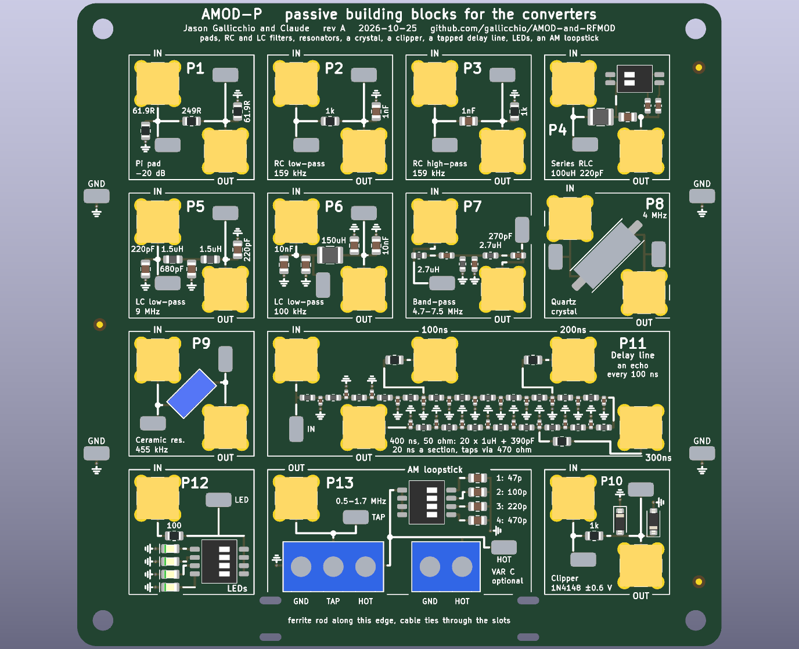
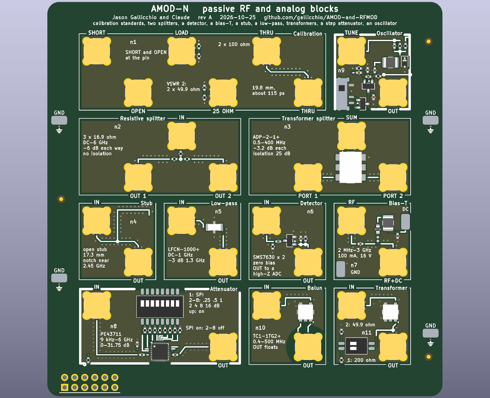
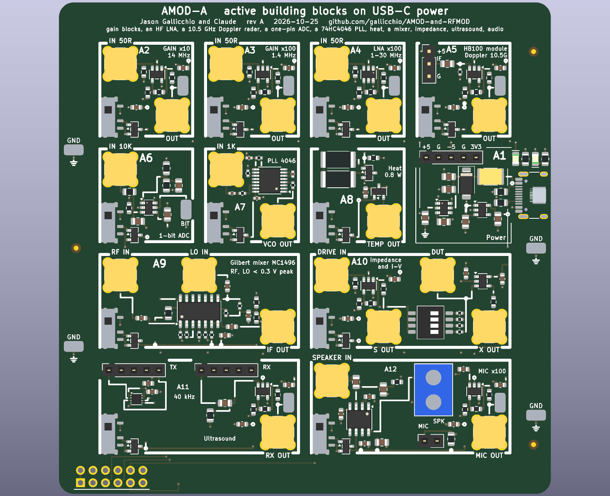
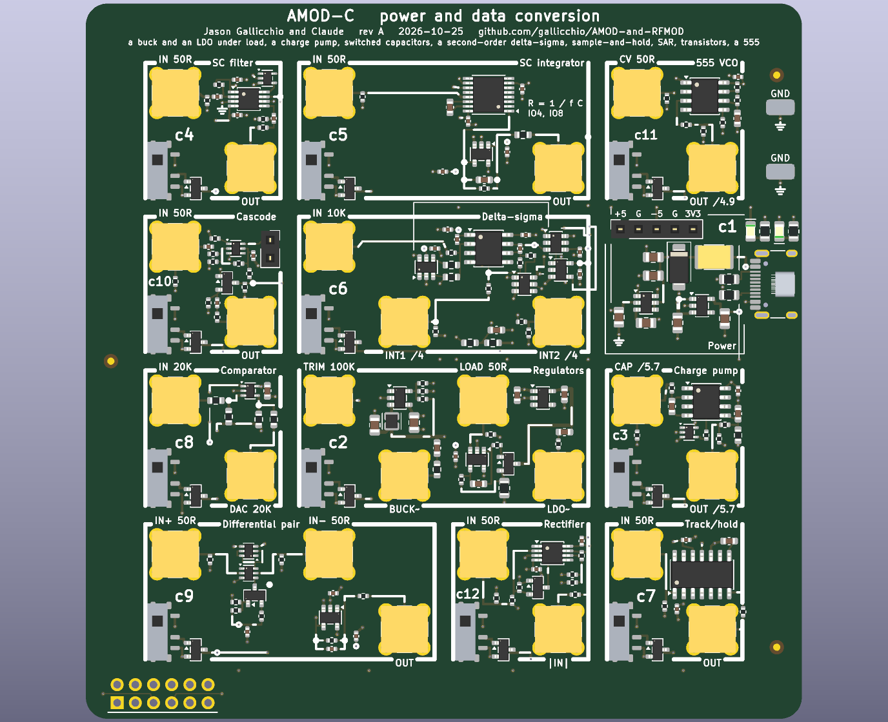
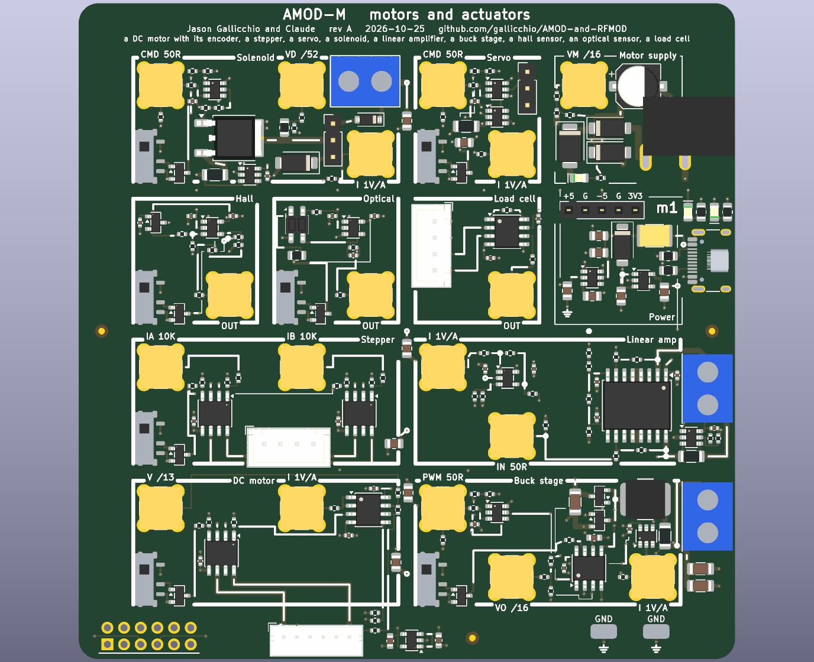
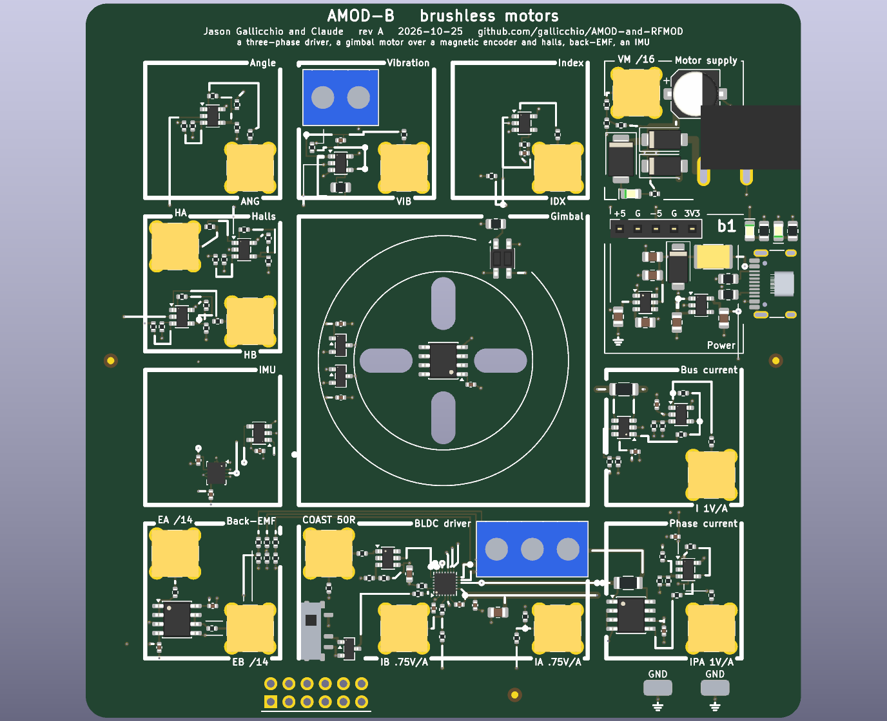
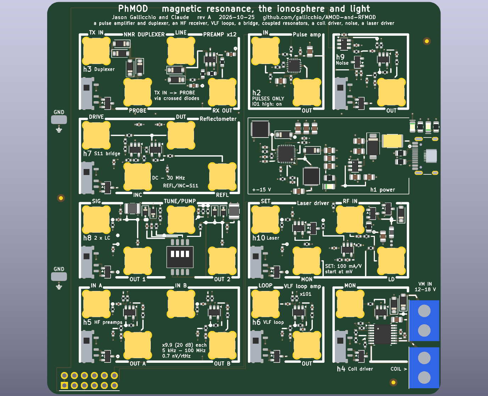
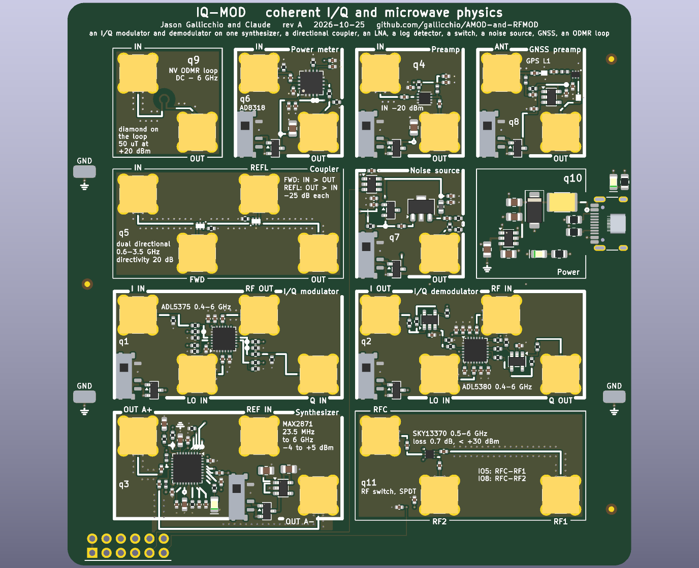

# AMOD and RF-MOD: boards of analog and RF building blocks

Nine 100 x 100 mm boards of "tiles" for an FPGA with fast converters: seven first-level boards (for the ECP5-2ADC-2DAC
board, or an Icepi Zero with its AD9280/AD9708 module), among them AMOD-N, as simple as the first, the conversion board
AMOD-C and two motor boards, AMOD-M (brushed motors and actuators) and AMOD-B (a brushless gimbal motor), and two
second-level boards built around the ECP5-2ADC-2DAC board's two DACs and two ADCs: PhMOD (AMOD-2 until Prompt 17) and
IQ-MOD.  Each tile is one circuit with its own SMA jacks: cable a DAC to its input and its
output to an ADC, and compare the measurement with the expected result printed beside it.  The silkscreen draws every
tile's wiring as it is laid in copper.  The tutorial they serve is `icepi-zero-dac-adc/tutorial/`, whose Appendix D
specified them.

Rev A, 2026-10-25 (AMOD-N, AMOD-C, AMOD-M and AMOD-B added 2026-10-28).  Designed by Claude with Jason Gallicchio, not yet ordered.

| board | what | tiles | layers | parts per board |
|---|---|---|---|---|
| [AMOD-P](docs/HANDBOOK_amod_p.md) | passive: pads, RC and LC filters, resonators, a crystal, a clipper, a delay line, LEDs, an AM loopstick | 13 | 2 | $17.07 |
| [AMOD-N](docs/HANDBOOK_amod_n.md) | the second passive board: calibration standards, two splitters, a quarter-wave stub, a low-pass, a diode detector, a bias-T, a 1:1 balun and a 1:4 transformer; a step attenuator (by hand or the FPGA) and an oscillator on the Pmod's 3.3 V | 11 | 4 | $43.82 |
| [AMOD-A](docs/HANDBOOK_amod_a.md) | active on USB-C: gain blocks, an HF LNA, an HB100 Doppler radar, a one-pin ADC, a 4046 PLL, heat, a mixer, impedance and I-V, ultrasound, audio | 12 | 4 | $50.40 |
| [AMOD-C](docs/HANDBOOK_amod_c.md) | conversion: two regulators and an electronic load, a charge pump, switched capacitors (a filter, a resistor), a delta-sigma modulator, a track-and-hold, a SAR comparator, a differential pair, a cascode, a V-to-F, a precision rectifier | 12 | 4 | $43.57 |
| [AMOD-M](docs/HANDBOOK_amod_m.md) | motors on a 5-16 V supply: a DC motor with its encoder, a stepper, a servo, a solenoid's flyback three ways, a DC-coupled bridge amplifier, a buck power stage, and a hall, an optical and a load-cell sensor for their loops | 11 | 4 | $35.98 |
| [AMOD-B](docs/HANDBOOK_amod_b.md) | a brushless gimbal motor on a 5-12 V supply: a three-phase driver from the FPGA, the motor over a magnetic encoder, two halls and an index sensor, its back-EMF, its phase and bus currents, its vibration, and an IMU | 12 | 4 | $42.11 |
| [RF-MOD](docs/HANDBOOK_rf_mod.md) | 915 MHz and 2.4 GHz: a diode-ring mixer, two filters, a QPL9547 LNA, a gain block, two ADL5350 mixers, a synthesizer with two outputs, a TRF3722 I/Q transmitter, power and a 25 MHz reference | 10 | 4 | $66.51 |
| [PhMOD](docs/HANDBOOK_phmod.md) | physics at HF, magnetic resonance, the ionosphere and light: a 1 W pulse amplifier and duplexer, a two-channel HF receiver, a VLF loop amplifier, a reflection bridge, coupled resonators, a coil driver, a noise source, a laser driver with an RF bias-T | 10 | 4 | $78.19 |
| [IQ-MOD](docs/HANDBOOK_iq_mod.md) | coherent I/Q and microwave physics, 0.4-6 GHz: an I/Q modulator and demodulator on one synthesizer's two outputs, a dual directional coupler, an LNA, a log detector, a switch, a noise source, GNSS, an ODMR loop | 11 | 4 | $99.65 |
| [Icepi adapter](icepi_adapter/README.md) | the tutorial's 2x12 Icepi Zero adapter with a Pmod socket | | 4 | hand-soldered |


Each tile's name and what it does are printed on the board: the jacks' names sit on their own tile's frame beside each
jack, a tile's title in words on its top frame where it fits, its ranges and levels inside it.  Ports are named in
capitals (IN, OUT, LO), tiles in mixed case (Step attenuator, Diode mixer), everything else in lower case.  Turn a board
over and each tile has a panel on the back under it: its limits, its loads, its supply, and where there is room a small
plot of the response to expect, so the board can be cabled without the handbook open.  Below, each board's
picture and a table of its tiles, each row a summary of the tile's entry in the board's handbook (linked from the tile's
number), where the tile has its own picture, what to expect, the circuit and its parts.  What to buy beside the boards,
with links and prices, is in [docs/KIT.md](docs/KIT.md).

## The boards

<!-- board:amod_p -->
### [AMOD-P](docs/HANDBOOK_amod_p.md): the passive board



| tile | what it does | chip | specs | limits | experiments | how to use it | you need |
|---|---|---|---|---|---|---|---|
| [**p1**](docs/HANDBOOK_amod_p.md#p1) pi pad | Divides the voltage by 10 (-20 dB) and looks like 50 ohm from both ports. | passive | 61.9 / 249 / 61.9 ohm pi; -20.0 dB; DC to well past 30 MHz. | -20 dB only between 50 ohm on both sides (-14 dB into a high impedance); about 0.1 W (+-3 V) at IN. | A known weak signal for a receiver or LNA; padding a mismatched cable; checking the ADC's 50 ohm setting. | DAC to IN, OUT to the ADC set to 50 ohm. | Nothing beyond SMA cables. |
| [**p2**](docs/HANDBOOK_amod_p.md#p2) RC low-pass | A first-order RC low-pass: passes below 159 kHz and falls 20 dB per decade above. | passive | 1 k and 1 nF; -3 dB at 159 kHz; time constant 1 us. | OUT is a 1 k source: read it on the ADC's high-impedance setting (50 ohm divides it by 21). | A Bode plot, 45 degrees at the corner, the step response, the lag plant for feedback control. | DAC to IN, OUT to the ADC on high impedance; sweep the frequency or send a step. | Nothing beyond SMA cables. |
| [**p3**](docs/HANDBOOK_amod_p.md#p3) RC high-pass | A first-order RC high-pass, the mirror image of p2. | passive | 1 nF and 1 k; -3 dB at 159 kHz; +20 dB per decade below. | OUT is a 1 k source: read it on high impedance. | A Bode plot, AC coupling, a differentiator (a step gives a 1 us spike). | DAC to IN, OUT to the ADC on high impedance. | Nothing beyond SMA cables. |
| [**p4**](docs/HANDBOOK_amod_p.md#p4) series RLC | A series 100 uH and 220 pF resonator between 50 ohm ports: a band-pass peak that the DIP switch moves. | passive | 1.07 MHz with both switches off, 0.98 (way 1, +47 pF), 0.89 (way 2, +100 pF), 0.83 (both); Q about 6. | The 50 ohm ports load it: Q is 6, where the coil alone would allow about 60. | Resonance and Q, the phase through resonance, tracking a resonance with a lock-in or a PLL, a resonant plant to control. | Sweep the DAC into IN, OUT to the ADC (50 ohm); set the DIP switch. | Nothing beyond SMA cables. |
| [**p5**](docs/HANDBOOK_amod_p.md#p5) LC low-pass | A 5th-order Butterworth LC low-pass at 9 MHz: the anti-alias filter for a 25 MS/s ADC, or the smoothing filter after a DAC. | passive | -3 dB at 8.9 MHz, -30 dB at 18 MHz; 50 ohm in and out. | The response is as designed only with 50 ohm on both ports. | Aliasing with and without it; a filter's magnitude, phase and group delay; cleaning a DAC's staircase. | Between the DAC and its load, or between a signal and the ADC (50 ohm). | Nothing beyond SMA cables. |
| [**p6**](docs/HANDBOOK_amod_p.md#p6) LC low-pass | A 3rd-order LC low-pass near 120 kHz: turns a one-bit (delta-sigma or PWM) stream into a tone. | passive | 10 nF, 150 uH, 10 nF (C0G); -3 dB at 118 kHz; 50 ohm. | Designed for 50 ohm on both ports. | One-bit DAC reconstruction, delta-sigma noise shaping seen at the output, a slow plant for control. | DAC (or a one-bit stream through 50 ohm) to IN, OUT to the ADC. | Nothing beyond SMA cables. |
| [**p7**](docs/HANDBOOK_amod_p.md#p7) band-pass | A 3rd-order LC band-pass, 4.7-7.5 MHz: the band round the tutorial's 6.25 MHz digital-communications carrier. | passive | Peak at 6.3 MHz, -3 dB from 4.7 to 7.5 MHz; 50 ohm. | Only 3rd order: the skirts fall about 18 dB per octave. | Band-limiting a modem's chips (spread spectrum, LoRa chirps); a transmitter's harmonics removed; a receiver's front end. | In line between the DAC and the ADC, or ahead of a receiver. | Nothing beyond SMA cables. |
| [**p8**](docs/HANDBOOK_amod_p.md#p8) quartz crystal | A 4 MHz quartz crystal in series between the jacks: a very sharp pass at its series resonance and a notch at its parallel resonance about 6 kHz above. | passive | f_s near 4.000 MHz (-3.7 dB); f_p about 6 kHz higher; Q about 50,000 (C_m 15 fF, C_0 4 pF). | Needs frequency steps of a few hertz (the FPGA's NCO); keep the drive under about +-1 V (crystals have a drive-level limit near 100 uW). | Q from the width and from the ring-down; series against parallel resonance; pulling f_p with a capacitor across OUT (an SMA tee); the temperature coefficient. | Sweep the DAC slowly through 4.000 MHz into IN, OUT to the ADC, lock-in detection in the gateware. | An SMA tee and a few capacitors (or open cable stubs) for the pulling experiment. |
| [**p9**](docs/HANDBOOK_amod_p.md#p9) ceramic res. | A 455 kHz ceramic resonator in series: a pass at 455 kHz and a notch a few kHz above; the AM superhet's IF element. | passive | Q of a few hundred: between p4's LC (6) and p8's quartz (50,000). | A two-terminal resonator, not a three-terminal IF filter: one peak, no flat passband. | Q compared across LC, ceramic and quartz; an IF stage for a superhet built in gateware. | Sweep 440-480 kHz into IN, OUT to the ADC. | Nothing beyond SMA cables. |
| [**p10**](docs/HANDBOOK_amod_p.md#p10) clipper | 1 k in series and a 1N4148 diode each way to ground: clips any signal to about +-0.6 V. | passive | Clips at +-0.6 V; a 1 k source. | Read OUT on high impedance; up to +-4 V in (the 1 k holds the diode current to 4 mA). | Harmonics of a clipped sine against amplitude; odd harmonics, and even ones with a DC offset added; distortion. | DAC sine to IN, OUT to the ADC on high impedance, FFT in the gateware or Python. | Nothing beyond SMA cables. |
| [**p11**](docs/HANDBOOK_amod_p.md#p11) delay line | A 400 ns, 50 ohm delay line made of 20 LC sections, with taps every 100 ns: 260 feet of RG-58 on a board. | passive | Z0 51 ohm, 20 ns a section, cut-off 16 MHz, flat to about 10 MHz; taps through 470 ohm. | Disperses near 16 MHz (a chirp spreads); a tap is x1 into a high impedance, /10 into 50 ohm. | Reflections from an open, a short and a matched end; time-domain reflectometry; echoes for an equalizer; a radar target on a cable; a pure-delay plant for control. | A pulse or chirp from the DAC into IN; OUT open, shorted or terminated; the taps and OUT to the ADCs. | An SMA short and a 50 ohm terminator (the kit's ANNE-50+) for the reflection experiments. |
| [**p12**](docs/HANDBOOK_amod_p.md#p12) LEDs | Four LEDs (red, yellow, green, blue) behind 100 ohm, one at a time from the DIP switch: Planck's constant from the voltage where each starts to glow. | passive | 630, 596, 525 and 469 nm (DIP ways 1-4); 100 ohm in series; IN 0-5 V. | The InGaN green and blue sit above the line (their knee is not just hc / e lambda); the colours are not printed, so light them. | Planck's constant; LED I-V curves (with AMOD-A's a10); light against current. | Ramp the DAC (or the host's LED output) into IN and read the LED loop's voltage; one DIP way at a time. | Nothing (a dark room helps). |
| [**p13**](docs/HANDBOOK_amod_p.md#p13) AM loopstick | An AM-band antenna: a ferrite-rod coil screwed into the terminal, tuned by four switched capacitors or an external tuning capacitor on VAR C, its tap on the jack. | passive | With a 330 uH coil: 1.28 MHz (47 pF) down to 0.40 MHz (470 pF), and the sums between; the kit's 240 uH coil tunes about 17 % higher. | The switches tune in 15 steps; continuous tuning needs a capacitor on VAR C (a polyvaricon and its dial are 20 mm square: no room on the tile).  A weak signal that needs a4's gain before the ADC. | Real AM stations; the resonance and Q of a loopstick; the tutorial's AM radio gateware. | Coil ends to GND and HOT, its tap (if it has one) to TAP; rod along the bottom edge with two cable ties; OUT to AMOD-A's a4, a4 to the ADC; the DIP picks the band, or a tuning capacitor on VAR C (frame to GND) tunes within it. | An AM loopstick coil and two cable ties (kit: Atomic-29 240 uH loopstick, Panduit PLT1M-C); optionally a 365 pF tuning capacitor with a knob (kit: Amplified Parts single-section 365 pF). |

More on each tile, with its picture, in the [AMOD-P handbook](docs/HANDBOOK_amod_p.md); what to buy in [KIT.md](docs/KIT.md).

<!-- /board:amod_p -->

<!-- board:amod_n -->
### [AMOD-N](docs/HANDBOOK_amod_n.md): the second passive board



| tile | what it does | chip | specs | limits | experiments | how to use it | you need |
|---|---|---|---|---|---|---|---|
| [**n1**](docs/HANDBOOK_amod_n.md#n1) calibration | Calibration standards for a network analyzer, on the board: a short and an open at the jacks' pins, a 50 ohm load, a 25 ohm check standard and a thru. | passive | SHORT: the centre pin poured to ground all round.  OPEN: the bare pin.  LOAD: 2 x 100 ohm at the end of 4 mm of 50 ohm line.  25 OHM: 2 x 49.9 ohm (VSWR 2, \|Gamma\| 1/3, 9.5 dB return loss).  THRU: 19.8 mm of 50 ohm coplanar line, about 115 ps. | The standards are modelled, not measured: the open's fringing (tens of fF) and the short's inductance (tens of pH) count above about 3 GHz, and the 0402 load is a 20 dB return loss at 3 GHz.  Check them once against the NanoVNA's SMA standards. | A full SOLT calibration of IQ-MOD's reflectometer (q1, q2, q5) or of a NanoVNA at the board's surface; the 25 ohm standard as its check; every other tile then measured from its pads with its jacks taken out (they are all the same part). | The analyzer's port to SHORT, OPEN and LOAD in turn; its two ports to THRU A and THRU B for the two-port step; then any tile. | Nothing beyond SMA cables. |
| [**n2**](docs/HANDBOOK_amod_n.md#n2) resistive splitter | A resistive power splitter: three 16.9 ohm in a star, every port 50 ohm, 6 dB from any port to either other, from DC to 6 GHz. | passive | 3 x 16.9 ohm (50 / 3); -6.0 dB each way; DC-6 GHz; OUT 1 and OUT 2 on lines of equal length. | No isolation (OUT 1 to OUT 2 is also -6 dB); 6 dB of loss where a transformer splitter loses 3; about +20 dBm at IN (1/16 W resistors). | One DAC into both ADCs to measure the converters' own gain and skew; the reference and test paths of a scalar network analyzer; its isolation against n3's. | IN from the source; OUT 1 and OUT 2 to two 50 ohm loads.  Symmetric: any port can be IN. | Nothing beyond SMA cables. |
| [**n3**](docs/HANDBOOK_amod_n.md#n3) transformer splitter | A transformer power splitter (and combiner): half the power to each port, 3 dB, with the two ports isolated from each other, 0.5-400 MHz. | [ADP-2-1+](https://www.minicircuits.com/WebStore/dashboard.html?model=ADP-2-1%2B) | 3.1-3.4 dB from SUM to each port; 25-34 dB between port 1 and port 2; 0.5-400 MHz (the datasheet). | A transformer: nothing below 0.5 MHz; the isolation holds only with 50 ohm on all three ports; pins 2 and 5 are joined and must not be grounded. | Two DACs combined into one amplifier for a two-tone intermodulation test (AMOD-A's a4, PhMOD's h5); one reference split to two boards; isolation measured against n2's. | SUM from the source (or to the load when combining); PORT 1 and PORT 2 to two loads (or from two sources). | Nothing beyond SMA cables. |
| [**n4**](docs/HANDBOOK_amod_n.md#n4) quarter-wave stub | A quarter-wave open stub hanging off a 50 ohm line: at 2.45 GHz it is a short circuit at the junction, so the line has a notch there. | passive | 17.3 mm of 50 ohm coplanar waveguide, open at its end; a notch near 2.45 GHz and 7.35 GHz; the line passes at DC and 4.9 GHz. | The notch sits where the line's effective permittivity puts it (3.1 was assumed): within a few percent of 2.45 GHz.  Its depth is set by the line's loss. | Sweep it with RF-MOD's synthesizer into IQ-MOD's log detector, or with a VNA; read the line's effective permittivity from the notch; a Wi-Fi notch ahead of a receiver; the tutorial's coaxial quarter-wave stub at microwave frequencies. | IN from a source, OUT to a detector or a VNA's second port. | Nothing beyond SMA cables. |
| [**n5**](docs/HANDBOOK_amod_n.md#n5) low-pass | A low-pass filter: passes DC to 1 GHz, stops 1.9-5 GHz, so a 915 MHz synthesizer's harmonics are gone. | [LFCN-1000+](https://www.minicircuits.com/WebStore/dashboard.html?model=LFCN-1000%2B) | 0.3 dB at 500 MHz, 0.8 dB at 1 GHz, 3 dB at 1.3 GHz, 26 dB at 1.5 GHz, 30 dB from 1.9 to 5 GHz (the datasheet). | 50 ohm on both sides; the stopband rises again above about 5 GHz (20 dB at 5.5 GHz). | A MAX2871's square-ish 915 MHz made a sine (its harmonics before and after on a spectrum analyzer); an image filter ahead of a receiver below 1 GHz. | IN from the source, OUT to the load. | Nothing beyond SMA cables. |
| [**n6**](docs/HANDBOOK_amod_n.md#n6) detector | A diode detector: RF power in, DC out.  Two zero-bias Schottky diodes as a voltage doubler, square-law at low power and linear at high. | [SMS7630](https://www.skyworksinc.com/Products/Diodes/SMS7630-Series) | 51 ohm across IN; 10 nF in; a SMS7630 pair as a doubler; 100 pF and 100 k on OUT (about 1 us); 10 MHz-6 GHz; square law below about -20 dBm. | OUT must go to a high impedance (the ADC's high-Z setting): 50 ohm shorts it.  Microvolts at the bottom (the x100 input below -40 dBm); temperature moves its zero; +10 dBm at most (the diodes' 1 V breakdown). | Square law against the AD8318's log law (IQ-MOD); an AM envelope detector after AMOD-P's loopstick and AMOD-A's LNA; a radiometer's power detector; the shape of PhMOD's transmit pulses. | IN from the RF; OUT to an ADC on its high-impedance setting. | Nothing beyond SMA cables. |
| [**n7**](docs/HANDBOOK_amod_n.md#n7) bias-T | A bias-T: puts DC from a bench supply onto an RF line and keeps it off the RF side. | passive | 100 nF in series; 27 nH + 330 nH + 10 uH from the DC loop to RF+DC; 100 nF across the DC; about 2 MHz-3 GHz; up to 100 mA and 16 V. | Below about 2 MHz the 10 uH stops blocking; 100 mA (the 330 nH) and 16 V (the capacitors); never put RF+DC into a jack that cannot take the DC. | An active GPS antenna or an LNA at the end of a cable powered through the coax; a varactor or a detector diode biased through its own signal line; the bias-T's own leakage of RF into the supply. | RF to the instrument, RF+DC to the device, the bench supply's clips on the DC and GND loops. | A bench supply with clip leads. |
| [**n8**](docs/HANDBOOK_amod_n.md#n8) step attenuator | A digital step attenuator: 0 to 31.75 dB in 0.25 dB steps from 9 kHz to 6 GHz, set by hand on an 8-way switch or by the FPGA over three Pmod lines. | [PE43711](https://www.lcsc.com/product-detail/C470929.html) | 7 bits, 0-31.75 dB in 0.25 dB; 1.5-2.8 dB of loss at 0 dB.  By hand: switch way 1 (SPI) off, ways 2-8 the bits 0.25, 0.5, 1, 2, 4, 8 and 16 dB (on = that much more), the chip's direct parallel mode.  By the FPGA: ways 2-8 off, way 1 on; SDATA on IO2, SCLK on IO3, LE on IO4, 8 bits (bit 7 = 0, then 4 x dB), least significant first.  3.3 V and 150 uA from the Pmod either way. | +23 dBm above 48 MHz, less below (about +9.5 dBm under 0.5 MHz, +15 dBm at 5 MHz); a few tenths of a dB of step error; dark unless the board is plugged into the host's Pmod (the chip is an active switch array, even when set by hand); in SPI mode every bit switch must be off. | The 1 dB compression point and IP3 of every amplifier and mixer on the boards; noise figure by the Y-factor; bit-error rate against signal-to-noise for the tutorial's modems; the log detector's slope; an automatic gain control loop in gateware. | Plug AMOD-N into the host's Pmod; IN from the source, OUT to the device.  Set the level on the switch with way 1 off, or turn the bits off and way 1 on and write the word from the FPGA (RF-MOD's SPI peripheral with its own LE). | Nothing beyond SMA cables. |
| [**n9**](docs/HANDBOOK_amod_n.md#n9) oscillator | An oscillator made of one transistor and a tank, tunable by a voltage and lockable to an outside tone. | [MMBT3904](https://www.lcsc.com/product-detail/C20526.html), [BB133](https://www.lcsc.com/product-detail/C5334579.html) | A Clapp (series-tuned Colpitts) on an MMBT3904 at about 1.5 mA; 10 uH and a BB133 varactor; 9.6-11.5 MHz for TUNE from -2 to +2 V (10.5 MHz at 0 V); about -22 dBm into 50 ohm; the Pmod's 3.3 V, switched. | Free-running LC: it drifts with temperature; the frequencies are calculated to within about 10 %; the output is small (22 pF from the emitter) so the load does not pull it. | Injection locking: a DAC tone near its frequency on TUNE pulls it in over a range that grows with the tone's amplitude (Adler's equation); FM from a DAC; its phase noise against the MAX2871's and a crystal's; a phase-locked loop closed in the FPGA (phase from an ADC, control on TUNE). | Plug the board into the Pmod and slide the switch up; OUT to an ADC (the x10 input); TUNE from a DAC. | Nothing beyond SMA cables. |
| [**n10**](docs/HANDBOOK_amod_n.md#n10) 1:1 transformer | A 1:1 transformer whose OUT jack floats: a balun for a dipole, and a break in a ground loop. | [TC1-1TG2+](https://www.minicircuits.com/WebStore/dashboard.html?model=TC1-1TG2%2B) | 0.4-500 MHz; 0.3 dB of loss at 10 MHz, 0.5 dB at 100 MHz, 1.8 dB at 500 MHz (the datasheet); OUT's four legs on an island with no ground within 5.6 mm on any layer. | 0.25 W and 30 mA DC (the datasheet); nothing below 0.4 MHz; the island's few pF to the board limit the common-mode isolation as the frequency rises. | The tutorial's HF dipole fed balanced (OUT's pin and shell to its two halves); a ground loop between the host and a mains-powered instrument broken (watch the hum go); a floating measurement. | IN from the source; OUT through an SMA-to-clips lead to the dipole or the floating load. | An SMA-to-two-clips lead (KIT.md) for a dipole. |
| [**n11**](docs/HANDBOOK_amod_n.md#n11) 1:4 transformer | A 1:4 transformer: OUT's impedance is four times IN's and its voltage twice; a DIP switch puts a known load on OUT. | [TC4-1W+](https://www.minicircuits.com/WebStore/dashboard.html?model=TC4-1W%2B) | 3-800 MHz; 0.8 dB mid-band, 1.1 dB at 3 MHz, 2.2 dB at 800 MHz (the datasheet); switch 1: 200 ohm across OUT (IN reads 50); switch 2: 49.9 ohm (IN reads 12.5). | Nothing below 3 MHz; OUT is referenced to ground (the secondary's low end is grounded), so it is a step-up transformer here, not a balun. | The turns ratio squared measured: IN's impedance with each load (PhMOD's h7 or a VNA); a 200 ohm source or load matched to 50 ohm; twice the voltage at OUT. | IN from the source or the analyzer; OUT open, to a load, or loaded by the switch. | Nothing beyond SMA cables. |

More on each tile, with its picture, in the [AMOD-N handbook](docs/HANDBOOK_amod_n.md); what to buy in [KIT.md](docs/KIT.md).

<!-- /board:amod_n -->

<!-- board:amod_a -->
### [AMOD-A](docs/HANDBOOK_amod_a.md): the active board



| tile | what it does | chip | specs | limits | experiments | how to use it | you need |
|---|---|---|---|---|---|---|---|
| [**a1**](docs/HANDBOOK_amod_a.md#a1) power | Power: 5 V from USB-C, and -5 V and 3.3 V made from it; a socket carries the rails to a breadboard. | [LM2664](https://www.ti.com/product/LM2664), [TPS7A20](https://www.ti.com/product/TPS7A20) | +5 V up to 1.5 A, -5 V at 40 mA, +3.3 V at 300 mA; green LED 5 V, red LED -5 V. | -5 V is 40 mA: about four op-amp tiles at once.  The board negotiates nothing: use a plain 5 V supply. | - | Plug in the USB-C; then switch on each tile you use (slider up). | A 5 V USB-C supply, 1.5 A or more (kit: Raspberry Pi 5.1 V 3 A supply). |
| [**a2**](docs/HANDBOOK_amod_a.md#a2) x10 | An op-amp gain block: x10 (20 dB) to 14 MHz, with a 50 ohm input. | [OPA810](https://www.ti.com/product/OPA810) | x10 into a high impedance (x5 into 50 ohm); -3 dB at 14 MHz; IN up to +-0.4 V for +-4 V out. | 140 MHz gain-bandwidth sets the bandwidth; clips at +-4 V. | The gain-bandwidth trade (compare a3); slew rate and clipping; amplifying a photodiode, a noise source or a weak tone. | Signal to IN, OUT to the ADC (high impedance for the full x10). | Nothing beyond SMA cables. |
| [**a3**](docs/HANDBOOK_amod_a.md#a3) x100 | The same op-amp stage at x100 (40 dB), to 1.4 MHz. | [OPA810](https://www.ti.com/product/OPA810) | x100; -3 dB at 1.4 MHz; IN up to +-40 mV. | Only 1.4 MHz wide (gain-bandwidth); for 40 dB at HF use a4. | Gain-bandwidth against a2 and a4; small audio and ultrasonic signals. | Signal to IN, OUT to the ADC. | Nothing beyond SMA cables. |
| [**a4**](docs/HANDBOOK_amod_a.md#a4) LNA | An HF low-noise amplifier: x100 (40 dB) flat from 1 to 30 MHz, about 3 dB noise figure from 50 ohm. | [OPA847](https://www.ti.com/product/OPA847) | x101; flat 1-30 MHz (-3 dB near 39 MHz); 0.85 nV/rtHz. | IN under +-30 mV; the OPA847 is stable only at gains above 12 (do not lower the gain). | AM and shortwave reception with a wire antenna or p13's loopstick; noise figure; weak-signal work. | Antenna (or p13's OUT) to IN, OUT to the ADC. | An antenna for over-the-air use: a few metres of wire on an SMA, or AMOD-P's p13. |
| [**a5**](docs/HANDBOOK_amod_a.md#a5) Doppler | A socket and amplifier for an HB100 10.525 GHz Doppler radar module: the beat between what it sends and what comes back, x101. | [HB100 (module)](https://www.amazon.com/dp/B07YY6FD4T), [OPA810](https://www.ti.com/product/OPA810) | 70 Hz per m/s of speed toward or away (19.4 Hz per km/h); x101 to OUT. | The HB100 has one mixer, not I and Q: it measures speed but not direction, and gives no range (it is a CW radar). | The speed of a hand, a pendulum, a fan's blades, breathing; Doppler spectra (micro-Doppler). | Wire the module's +5 V, IF and GND pins to the +5 / IF / G header with jumper wires (the pin order differs between modules: follow its print); OUT to an ADC (the host's x10 input helps); point it at something moving. | An HB100 module and three female-female jumper wires (kit: MH-ET Live HB100 X, about $14). |
| [**a6**](docs/HANDBOOK_amod_a.md#a6) 1-bit ADC | A one-bit (delta-sigma) ADC made of a comparator and an RC integrator, with the FPGA as the flip-flop: an ADC from one Pmod input and one Pmod output. | [TLV3501](https://www.ti.com/product/TLV3501) | IN 0-3.3 V (or +-1.5 V AC-coupled), 10 k input; integrator 10 k / 10 nF; clock the loop at 1-10 MHz. | First order: about 9 dB more resolution per doubling of the oversampling ratio; works only with its gateware. | Delta-sigma conversion, oversampling and noise shaping, decimation (CIC) filters, trading speed for bits. | The gateware reads the comparator on Pmod IO7 every clock, registers it, and drives the registered bit back out on IO8; low-pass and decimate that bit stream.  Signal to IN. | Nothing (the gateware). |
| [**a7**](docs/HANDBOOK_amod_a.md#a7) PLL 4046 | A 74HC4046 phase-locked loop: its VCO locks to a 50-200 kHz signal on IN. | [74HC4046A](https://www.lcsc.com/product-detail/C546981.html) | VCO near 100 kHz (10 k, 1 nF); phase comparator 2 with a 10 k / 100 nF lag filter; VCO OUT 5 V CMOS through 470 ohm. | Fixed loop filter and VCO range (no switches); locks at x1 (no divider); no test loops: probe pins 9 and 13. | Lock and capture range; FM demodulation (pin 9 is the VCO's control voltage); loop dynamics and ringing; an analog PLL against the FPGA's. | DAC sine or square (more than 0.4 V peak) to IN, VCO OUT to an ADC; sweep or frequency-modulate the DAC. | A scope probe for pins 9 and 13. |
| [**a8**](docs/HANDBOOK_amod_a.md#a8) heat | A 0.83 W heater (two 15 ohm resistors) switched from a Pmod line, with a temperature sensor beside it: a thermal plant to control. | [TMP235](https://www.ti.com/product/TMP235) | 30 ohm, 170 mA, 0.83 W while Pmod IO6 is high; TEMP OUT 10 mV/K + 500 mV (750 mV at 25 C). | On or off from IO6 (PWM it for proportional power); it heats a few square centimetres, with a time constant of tens of seconds.  The heater has no jack: DRIVE IN beside it belongs to a10. | A thermal time constant; bang-bang against PID control; warming a part taped to the heater. | PWM from the FPGA on Pmod IO6; TEMP OUT to an ADC. | Nothing (Kapton tape to hold a part on the heater, if you like). |
| [**a9**](docs/HANDBOOK_amod_a.md#a9) mixer | A Gilbert-cell double-balanced mixer (MC1496): IF OUT is RF times LO, the sum and difference frequencies. | [MC1496](https://www.lcsc.com/product-detail/C7295.html) | RF and LO +-0.3 V into 51 ohm; 1 k emitter degeneration, 1 mA a side; IF OUT single-ended from a 1.5 k load; about 0.3 V of IF per volt of RF at 0.3 V of LO. | IF OUT is a 1.5 k source: a metre of coax (100 pF) rolls it off near 1 MHz, so keep the IF low or the cable short and use high impedance.  LO feedthrough about -40 dB (no null trimmer).  RF and LO are good to a few tens of MHz. | Mixing and images; AM demodulation as a product detector; the AM radio; PSK demodulation with a recovered carrier. | RF and LO from the two DACs (or an antenna through a4 on RF); IF OUT to an ADC on high impedance. | Nothing beyond SMA cables. |
| [**a10**](docs/HANDBOOK_amod_a.md#a10) impedance | Measures a part's impedance and I-V curve: drives it through a known resistor and reads the voltage on both sides. | [OPA810](https://www.ti.com/product/OPA810) | DRIVE IN x2 is node S; the DIP picks R = 47, 470, 4.7 k or 47 k from S to X; the part goes from X (the DUT jack) to ground; S OUT and X OUT give half of each node into 50 ohm; Z = R X / (S - X); +-4 V, up to 40 mA. | DC to a few MHz; most accurate when Z is near the chosen R; calibrate with the DUT open and shorted. | Impedance spectra of resistors, capacitors, inductors, a crystal and a speaker; LED and diode I-V curves (Planck with p12's colours); a low-frequency Smith chart. | DAC to DRIVE IN; S OUT to ADC 1 and X OUT to ADC 2; the part on the DUT jack; one DIP way on (the reference R); the gateware takes the complex ratio at each frequency. | A way to put a part on the DUT jack: an SMA-to-minigrabber lead or a part soldered to an SMA plug. |
| [**a11**](docs/HANDBOOK_amod_a.md#a11) ultrasound | 40 kHz ultrasound: an H-bridge drives the transmitter from two Pmod lines, and the receiver's signal comes out x100. | [DRV8837](https://www.ti.com/product/DRV8837), [OPA810](https://www.ti.com/product/OPA810) | TX gets 10 V p-p from Pmod IO4 / IO3 in antiphase; RX x100 behind a 4 kHz high-pass; 5.8 us per mm there and back.  The slide switch's 5 V powers the two amplifiers: the TX H-bridge (each end of the transducer swings 0-5 V, in antiphase) and the RX op amp's positive rail (its negative rail is the board's -5 V). | Only at the transducers' 40 kHz resonance; the receiver hears the transmitter directly for the first few hundred microseconds. | The speed of sound, echo ranging (sonar), Doppler, beam patterns, an ultrasonic data link. | Transmitter in the TX socket, receiver in the RX socket (pins 1 and 5 of each); the gateware sends 8-20 cycles of 40 kHz on IO4 and IO3 in antiphase; RX OUT to an ADC; hold a reflector above the board. | A pair of 40 kHz transducers (kit: PUI UT-1640K-TT-2-R and UR-1640K-TT-2-R). |
| [**a12**](docs/HANDBOOK_amod_a.md#a12) audio | Audio: a 2.5 W class-D amplifier into a speaker, fed from a DAC or a one-bit Pmod stream, and an electret microphone amplified x100. | [PAM8302A](https://www.diodes.com/assets/Datasheets/PAM8302A.pdf), [OPA810](https://www.ti.com/product/OPA810) | Up to 2.5 W into 4 ohm (about 1.5 W into 8); SPEAKER IN +-1 V; the one-bit stream on Pmod IO2 through 10 k / 10 nF; MIC OUT x100. | Mono; the class-D output is unfiltered (the speaker is the filter); the microphone hears the speaker. | An acoustic modem (FSK, MSK through the air); the speed of sound in air; a room's echoes and impulse response; one-bit (PDM) audio. | Speaker wires in the SPK terminal, the electret in the MIC socket (+ to pin 1); DAC to SPEAKER IN or a one-bit stream on IO2; MIC OUT to an ADC. | A small speaker and an electret capsule (kit: Adafruit 6486 36 mm 8 ohm speaker, SparkFun COM-08635 electret). |

More on each tile, with its picture, in the [AMOD-A handbook](docs/HANDBOOK_amod_a.md); what to buy in [KIT.md](docs/KIT.md).

<!-- /board:amod_a -->

<!-- board:amod_c -->
### [AMOD-C](docs/HANDBOOK_amod_c.md): the conversion board



| tile | what it does | chip | specs | limits | experiments | how to use it | you need |
|---|---|---|---|---|---|---|---|
| [**c1**](docs/HANDBOOK_amod_c.md#c1) power | Power: 5 V from USB-C, and -5 V and 3.3 V made from it; a socket carries the rails to a breadboard (AMOD-A's a1). | [LM2664](https://www.ti.com/product/LM2664), [TPS7A20](https://www.ti.com/product/TPS7A20) | +5 V up to 1.5 A, -5 V at 40 mA, +3.3 V at 300 mA; green LED 5 V, red LED -5 V. | -5 V is 40 mA: the five tiles on +-5 V draw about 25 mA together.  The board negotiates nothing: use a plain 5 V supply. | - | Plug in the USB-C and the host's Pmod; then switch on each tile you use (slider up). | A 5 V USB-C supply, 1.5 A or more (kit: Raspberry Pi 5.1 V 3 A supply). |
| [**c2**](docs/HANDBOOK_amod_c.md#c2) regulators | A buck converter, an LDO after it and an electronic load: the ripple before and after the LDO, load steps, dropout. | [TLV62568](https://www.ti.com/product/TLV62568), [TPS7A20](https://www.ti.com/product/TPS7A20), [OPA810](https://www.ti.com/product/OPA810), [AO3400A](https://www.lcsc.com/product-detail/C20917.html) | Buck: 3.6 V at 1.5 MHz from the switched 5 V, 2.2 uH, 10 uF in and out; TRIM through 100 k into its feedback node: OUT = 4.2 V - TRIM (open: 3.6 V).  LDO: 3.3 V, about 40 dB of rejection at 1.5 MHz.  Load: 100 mA per volt on LOAD (terminated in 49.9 ohm), from the LDO's output through an AO3400A and 10 ohm.  BUCK~ and LDO~ are the two outputs AC-coupled through 1 uF and 49.9 ohm. | LOAD 0 to 1 V (100 mA: the 10 ohm 0805 then dissipates 0.1 W, the FET 0.23 W).  Below about 3.5 V on its input (TRIM above +0.7 V) the LDO drops out.  The buck skips pulses below about 150 mA, so its ripple changes character with load. | Output ripple and its spectrum before and after the LDO; load-step response (a square wave on LOAD); output impedance against frequency (a swept sine on LOAD, LDO~ on an ADC); dropout as TRIM lowers the buck; the buck's pulse-skipping at light load. | LOAD from a DAC (0 to 1 V); TRIM from the other DAC or open; BUCK~ and LDO~ to the two ADCs (the x10 input for the few millivolts of ripple). | Nothing beyond SMA cables. |
| [**c3**](docs/HANDBOOK_amod_c.md#c3) charge pump | A charge pump the FPGA clocks: -5 V from +5 V, whose output resistance is 1 / (f C). | [ICL7660A](https://www.lcsc.com/product-detail/C7881.html), [SN74LV1T34](https://www.ti.com/product/SN74LV1T34) | ICL7660A from the switched 5 V, OSC driven from Pmod IO6 through a 5 V buffer and 1 k (the pump runs at half IO6's frequency); 1 uF flying, 1 uF out, 1 k of load; CAP (the flying capacitor's top, 0-5 V) and OUT (about -5 V) each through 47 k / 10 k, so /5.7. | CAP and OUT are 8.2 k sources: read them at high impedance.  Rout = 1 / (f C) + about 60 ohm: 2 k at 1 kHz on IO6, 80 ohm at 100 kHz.  With no clock on IO6 the pump stops. | Output voltage and ripple against the clock (the 1 / (f C) law); the flying capacitor's charge and dump on CAP; efficiency against load. | A square wave on Pmod IO6 (1 kHz to 100 kHz); OUT and CAP to the ADCs at high impedance. | Gateware on the host (the tutorial's). |
| [**c4**](docs/HANDBOOK_amod_c.md#c4) SC filter | A switched-capacitor filter: a 5th-order Butterworth low-pass whose corner is the FPGA's clock divided by 100. | [MAX7410](https://www.analog.com/en/products/max7410.html), [SN74LV1T34](https://www.ti.com/product/SN74LV1T34) | fc = fCLK / 100, up to 15 kHz (1.5 MHz on IO3, through a 5 V buffer); IN terminated in 49.9 ohm and AC-coupled (1 uF, 100 k: 1.6 Hz); OUT AC-coupled through 1 uF and 49.9 ohm; 5 V from the switch. | IN +-1 V.  There is no anti-alias filter in front: a tone near fCLK folds down into the passband, and the clock's images sit near fCLK at OUT (that is the point).  JLCPCB had 134 MAX7410s on 2026-10-28. | The corner following the clock; aliasing a tone near fCLK; the clock feedthrough on OUT's spectrum; a tracking filter controlled from gateware. | A clock 100 times the corner you want on Pmod IO3; DAC to IN, OUT to an ADC. | Gateware on the host (the tutorial's). |
| [**c5**](docs/HANDBOOK_amod_c.md#c5) SC integrator | A resistor made of a switch and a capacitor, in an integrator: R = 1 / (f C), set by the FPGA's two phases. | [TMUX4053](https://www.ti.com/product/TMUX4053), [OPA810](https://www.ti.com/product/OPA810) | 1 nF switched between IN and ground (phi1, Pmod IO4) and between ground and the summing node (phi2, IO8): the parasitic-insensitive integrator; R = 1 M at 1 kHz, 1 k at 1 MHz.  OPA810 with 10 nF (C0G) and 1 M across it; IN terminated in 49.9 ohm, OUT through 49.9 ohm. | IN +-1 V.  The phases must not overlap (overlap them on purpose to watch IN leak through); the TMUX4053's charge injection shows at high clock rates; the 1 M sets the DC gain (1 M / R). | The 1 / (f C) law measured as the integrator's slope against the clock; a switched-capacitor low-pass (the integrator with the 1 M); overlap and charge injection. | Two non-overlapping square waves on Pmod IO4 and IO8; DAC to IN, OUT to an ADC. | Gateware on the host (the tutorial's). |
| [**c6**](docs/HANDBOOK_amod_c.md#c6) delta-sigma | A second-order delta-sigma modulator with its insides on jacks: a one-bit stream whose density follows IN. | [OPA2810](https://www.ti.com/product/OPA2810), [TLV3501](https://www.ti.com/product/TLV3501), [SN74LVC1G79](https://www.ti.com/product/SN74LVC1G79), [SN74LVC1G3157](https://www.ti.com/product/SN74LVC1G3157) | Two integrators (10 k into 220 pF, 6.8 k into 680 pF) on a 1.65 V virtual ground (the 3.3 V rail halved by 0.1 % resistors); the one-bit DACs switch 10 k between 3.3 V and ground; a TLV3501 and a 74LVC1G79 clocked from Pmod IO1 (about 1 MHz) put the bit on IO7.  Full scale +-1.65 V; INT1 and INT2 through 3.3 k / 1 k (about a quarter, offset 0.38 V). | IN is 10 k (not 50 ohm): drive it from the DAC directly.  Keep IN within +-1.5 V: beyond that the second integrator leaves the comparator's 0-3.3 V input range (10 k protects the comparator; the bits stop meaning anything until IN comes back).  INT1 and INT2 are 770 ohm sources: high impedance.  A DC input near a simple fraction of full scale makes idle tones. | The noise spectrum's 40 dB per decade against AMOD-A's a6 (first order, 20); a sinc3 decimator's bits against the oversampling ratio; idle tones; the integrators' outputs on a scope as the loop runs. | A 1 MHz clock on Pmod IO1; read the bits on IO7 and decimate them; DAC to IN; INT1, INT2 to the ADCs at high impedance. | Gateware on the host (the tutorial's). |
| [**c7**](docs/HANDBOOK_amod_c.md#c7) track and hold | A track-and-hold: OUT follows IN while Pmod IO5 is high and holds when it falls. | [LF398](https://www.ti.com/product/LF398-N) | LF398 on +-5 V, 1 nF C0G hold capacitor; about 4 us to acquire, about 30 mV/s of droop, a few mV of hold step; IN terminated in 49.9 ohm, OUT through 49.9 ohm. | IN +-1 V (on +-5 V the LF398's inputs must stay within +-1.5 V).  The hold step depends on the input level; a sine feeds through while holding. | Acquisition time, droop, pedestal (hold step) against IN, feedthrough, aperture delay against the FPGA's edge; sampling and aliasing with a slow ADC behind it. | A pulse train on Pmod IO5 (high: track); DAC to IN, OUT to an ADC. | Gateware on the host (the tutorial's). |
| [**c8**](docs/HANDBOOK_amod_c.md#c8) comparator | A comparator for a successive-approximation or tracking ADC whose DAC is the host's. | [TLV3201](https://www.ti.com/product/TLV3201) | TLV3201 (40 ns, 1.2 mV of hysteresis) on the 3.3 V rail; IN and DAC each averaged with the rail through matched 0.1 % 10 k, so the comparison is unchanged; BIT on Pmod IO2 (high: IN above DAC). | IN and DAC +-1 V, each 20 k: drive them from 50 ohm sources.  The ADC is as good as the host's DAC: 12 bits needs a 12-bit DAC. | Successive approximation (12 bits in 12 steps), a tracking ADC, single-slope conversion; the host DAC's DNL and INL. | The signal to IN, DAC 2 to DAC; the gateware sets the DAC, reads BIT on IO2 and halves the step. | Gateware on the host (the tutorial's). |
| [**c9**](docs/HANDBOOK_amod_c.md#c9) differential pair | A differential pair on a current mirror: OUT is tanh of the input difference, linear near balance. | [DMMT3904W](https://www.lcsc.com/product-detail/C155305.html), [BCM857BS](https://www.lcsc.com/product-detail/C105896.html), [MMBT3904](https://www.lcsc.com/product-detail/C20526.html), [OPA810](https://www.ti.com/product/OPA810) | A matched NPN pair on a 1 mA tail (an MMBT3904 with -3.4 V on its base), a matched PNP pair as the mirror, an OPA810 transimpedance (1 k) on the output node: OUT = -1 k x (Ic1 - Ic2), +-1 V; gm = Itail / (4 VT), about 10 mS.  IN+ and IN- terminated in 49.9 ohm. | IN+ and IN- +-0.2 V; linear within about +-25 mV of balance; the offset is the pair's VBE match (2 mV). | The tanh transfer and gm; a triangle of +-72 mV into a sine (1.4 % distortion); common-mode rejection (the same signal on both inputs). | DAC 1 to IN+, DAC 2 to IN- (or IN- to a 50 ohm terminator); OUT to an ADC. | Nothing beyond SMA cables. |
| [**c10**](docs/HANDBOOK_amod_c.md#c10) cascode | Common emitter against cascode on one transistor pair: the Miller effect, switched by a jumper. | [DMMT3904W](https://www.lcsc.com/product-detail/C155305.html), [MMBT3904](https://www.lcsc.com/product-detail/C20526.html) | Q1 at about 1.4 mA, 100 ohm in its emitter, 1 k collector load; Q2 its cascode (base at 2.4 V); Q3 an emitter follower into 1 uF and 51 ohm; IN terminated, AC-coupled and through 2.2 k.  Gain about -8 at Q1's collector, -6 from IN, -3 into 50 ohm. | IN +-50 mV.  The jumper on the header shorts the cascode (common emitter, about 2 MHz wide); parked on one pin it leaves the cascode in (several times wider). | Bandwidth with and without the cascode; the Miller capacitance computed from the corner and the 2.2 k; gain against the emitter resistor. | DAC to IN, OUT to an ADC; sweep the frequency once with the jumper on and once parked. | Nothing beyond SMA cables. |
| [**c11**](docs/HANDBOOK_amod_c.md#c11) 555 | A 555 as a voltage-controlled oscillator: CV moves its thresholds and so its frequency. | [TLC555](https://www.ti.com/product/TLC555) | TLC555 astable from the switched 5 V, 1 k and 10 k with 10 nF C0G: about 6.9 kHz; CV terminated and through 2.2 k into the control pin; OUT through 3.9 k / 1 k (about 1 V). | CV +-1 V; OUT is a 800 ohm source, read it at high impedance.  The frequency falls as CV rises. | Frequency against CV; the capacitor's ramp between 1/3 and 2/3 of the supply; a voltage-to-frequency ADC counted in the FPGA. | CV from a DAC; OUT to an ADC. | Nothing beyond SMA cables. |
| [**c12**](docs/HANDBOOK_amod_c.md#c12) rectifier | A precision full-wave rectifier: OUT = \|IN\|, with no diode drop. | [OPA2197](https://www.ti.com/product/OPA2197), [BAT54S](https://www.lcsc.com/product-detail/C8592.html) | An OPA2197 inverts IN through two Schottky diodes so its node X is -IN for positive inputs and 0 for negative ones; the second half sums -(IN + 2 X); IN terminated in 49.9 ohm, OUT through 49.9 ohm. | IN +-1 V; DC to about 100 kHz, above which the first stage's slew across the diodes leaves a glitch at each zero crossing. | Rectifying with no dead zone; the glitch against frequency; an AC voltmeter (rectify and average); AM detection. | DAC to IN, OUT to an ADC. | Nothing beyond SMA cables. |

More on each tile, with its picture, in the [AMOD-C handbook](docs/HANDBOOK_amod_c.md); what to buy in [KIT.md](docs/KIT.md).

<!-- /board:amod_c -->

<!-- board:amod_m -->
### [AMOD-M](docs/HANDBOOK_amod_m.md): the motor board



| tile | what it does | chip | specs | limits | experiments | how to use it | you need |
|---|---|---|---|---|---|---|---|
| [**m1**](docs/HANDBOOK_amod_m.md#m1) power | Power: 5 V from USB-C, and -5 V and 3.3 V made from it; a socket carries the rails to a breadboard (AMOD-A's a1). | [LM2664](https://www.ti.com/product/LM2664), [TPS7A20](https://www.ti.com/product/TPS7A20) | +5 V up to 1.5 A, -5 V at 40 mA, +3.3 V at 300 mA; green LED 5 V, red LED -5 V. | -5 V is 40 mA: the op amps on +-5 V (m3, m7, m9, m10, m11) draw about 15 mA together.  The board negotiates nothing: use a plain 5 V supply. | - | Plug in the USB-C (and the host's Pmod for m3 and m4); then switch on each tile you use (slider up). | A 5 V USB-C supply, 1.5 A or more (kit: Raspberry Pi 5.1 V 3 A supply). |
| [**m2**](docs/HANDBOOK_amod_m.md#m2) motor supply | The motor supply VMOT: a barrel jack (5-16 V) or USB's 5 V, each through a Schottky; its voltage / 16 on a jack. | [SS34](https://www.lcsc.com/product-detail/C8678.html), [SMBJ16A](https://www.lcsc.com/product-detail/C353386.html) | DC-005 5.5 / 2.1 mm jack, centre positive; two SS34 (3 A) into VMOT, so VMOT is the larger input less about 0.4 V; SMBJ16A (clamps near 26 V) and 220 uF on VMOT soak up a motor's braking energy (the diodes stop it reaching the supply); green LED; VM = VMOT / 16 (15 k / 1 k) through 49.9 ohm. | 5-16 V in.  VMOT is not switched and has no fuse: the supply's current limit is the board's.  With USB alone VMOT is about 4.6 V, enough for the small motors (the DRV8251A's lockout is 4.45 V at most).  VM is a 1 k source: read it at high impedance. | The supply's droop and the braking energy coming back onto VMOT (VM on an ADC while m3 brakes). | A 12 V adapter on the barrel jack for anything bigger than a small gearmotor; VM to an ADC to watch VMOT. | From the kit (docs/KIT.md, Motors and actuators): a 12 V 2 A barrel-jack adapter. |
| [**m3**](docs/HANDBOOK_amod_m.md#m3) DC motor | A brushed DC motor with its encoder: drive, brake or coast from two FPGA lines; its current and its terminal voltage on jacks. | [DRV8251A](https://www.ti.com/product/DRV8251A), [OPA2171](https://www.ti.com/product/OPA2171), [TPS7A20](https://www.ti.com/product/TPS7A20) | DRV8251A (4.1 A H-bridge) from VMOT: IN1 on Pmod IO7, IN2 on IO1 (both low: coast, then sleep after 1 ms).  Current limit 2 A (VREF 2.0 V from the switched 5 V, 620 ohm on IPROPI); I = the motor's current, 0.98 V/A, buffered by an OPA2171 through 49.9 ohm; V = (M1 - M2) / 13 through 49.9 ohm.  JST PH 6-way: 1 M1, 2 GND, 3 encoder A (IO5), 4 encoder B (IO6), 5 3.3 V (its own TPS7A2033), 6 M2. | 2 A (cycle by cycle above it); IPROPI reads only while a low-side FET conducts (drive and brake, not coast).  V's +-1 V range covers +-13 V at the motor.  The encoder needs its own pull-ups or the FPGA's.  Encoder motors' pin orders differ: check yours against the PH's. | Speed against duty cycle; drive / brake against drive / coast; the back-EMF in the coast intervals as a speed sensor with no encoder; the motor constant (Kt = Ke) from V and the encoder's speed; speed and position loops in gateware; current limiting under stall. | PWM on IO7 (forward) or IO1 (reverse); the encoder into the gateware from IO5 and IO6; I and V to the ADCs. | From the kit (docs/KIT.md, Motors and actuators): an N20 or 25 mm gearmotor with a hall encoder on a JST PH 6-way lead. |
| [**m4**](docs/HANDBOOK_amod_m.md#m4) stepper | A bipolar stepper: two DRV8251A from four FPGA lines; each coil's current on a jack. | [DRV8251A](https://www.ti.com/product/DRV8251A) | Coil A IN1 on Pmod IO2, IN2 on IO3; coil B IN1 on IO4, IN2 on IO8 (each pulled down: both low is coast).  VREF 1.0 V: 1 A per coil, and the tile's switch takes the limit to zero; IA, IB = each coil's current through 10 k (0.98 V/A, read at high impedance).  JST XH 4-way: 1 A+, 2 A-, 3 B+, 4 B- (each driver's OUT2 on its coil's + pin: a stepper does not notice). | 1 A per coil.  IA and IB read the current's size, not its sign, and only while a low side conducts. | Full, half and PWM microstepping in gateware; resonance and missed steps against the step rate; the coil current's rise against the supply voltage (L / R); stall detection from the current. | The step sequence on IO2, IO3, IO4, IO8; IA and IB to the ADCs at high impedance. | From the kit (docs/KIT.md, Motors and actuators): a NEMA 17 class bipolar stepper under 1 A per phase, with a JST XH 4-way lead. |
| [**m5**](docs/HANDBOOK_amod_m.md#m5) servo | A hobby servo: a DAC's pulse squared to 5 V for the servo, and the servo's supply current on a jack. | [TLV3501](https://www.ti.com/product/TLV3501), [INA181](https://www.ti.com/product/INA181) | CMD (0 / +1 V, terminated in 49.9 ohm) through 10 k into a TLV3501 (threshold 0.49 V) on the switched 5 V; 3-pin header S, +5 V, GND (top to bottom); the servo's ground returns through 0.05 ohm, read by an INA181A1 (x20): I = 1 V/A through 49.9 ohm. | The servo runs from the switched 5 V (USB's): a micro servo's stall current (about 0.7 A) is fine, a big servo's is not.  I reads one way only. | Angle against pulse width (1-2 ms every 20 ms); the servo's current while it slews and when it is held against a load; its internal loop's step response. | A 1-2 ms pulse every 20 ms from a DAC on CMD; I to an ADC. | From the kit (docs/KIT.md, Motors and actuators): an SG90 or MG90S micro servo. |
| [**m6**](docs/HANDBOOK_amod_m.md#m6) solenoid | A solenoid's low-side switch with its flyback chosen by a jumper: a diode, a 24 V TVS, or the FET's own avalanche. | [TLV3501](https://www.ti.com/product/TLV3501), [NCE6020AK](https://www.lcsc.com/product-detail/C108639.html), [B5819W](https://www.lcsc.com/product-detail/C64885.html), [SMAJ24A](https://www.lcsc.com/product-detail/C113962.html), [INA181](https://www.ti.com/product/INA181) | CMD (0 / +1 V, 49.9 ohm) through a TLV3501 into an NCE6020AK's gate (60 V, 20 A; 100 k holds it off); the coil on a screw terminal from VMOT.  Jumper on the 1 x 3 header: 1-2 a B5819W from the drain to VMOT (slow decay), 2-3 an SMAJ24A from the drain to ground (the drain clamps near 30 V: fast decay), none: the FET avalanches near 70 V.  I = the coil current, 1 V/A (0.05 ohm and an INA181A1); VD = the drain / 52 (5.1 k / 100 ohm) through 49.9 ohm. | The coil's current up to about 2 A (the 0.05 ohm shunt's 0.2 W), the Schottky's 1 A average.  'None' puts the coil's whole energy into the FET each time: a demonstration, not a way to run.  VD is a 150 ohm source: high impedance for the true scale. | The coil current's L / R rise and its fall with each flyback; the drain's spike on VD (diode, TVS, avalanche); the release time of the plunger against the flyback; PWM hold-current reduction once the plunger has pulled in. | A pulse on CMD from a DAC; choose the flyback with the jumper (power off); I and VD to the ADCs. | From the kit (docs/KIT.md, Motors and actuators): a 5-12 V solenoid under 1.5 A and a jumper cap. |
| [**m7**](docs/HANDBOOK_amod_m.md#m7) linear amp | A DC-coupled bridge amplifier from VMOT: the load sees 4 x IN, both ways; its current on a jack. | [TCA0372](https://www.onsemi.com/products/amplifiers-comparators/operational-amplifiers-op-amps/tca0372), [INA181](https://www.ti.com/product/INA181), [OPA810](https://www.ti.com/product/OPA810) | TCA0372 (two 1 A power op amps): side A = VMOT / 2 - 2 IN, side B = VMOT / 2 + 2 IN, so the load sees 4 x IN; one chain (2 x 15 k, 20 k, 10 k) sets both references from VMOT.  IN +-1 V, terminated in 49.9 ohm.  The load's current through 0.1 ohm in series, an INA181A1 about 2.5 V and an OPA810 difference amplifier: I = 1 V/A, +-1.2 A, through 49.9 ohm.  The load on a screw terminal in the right margin. | About 1 W in the chip (thermal shutdown beyond): 8 ohm at 5-6 V, 30 ohm or more at 12 V.  Each output swings to about 1.3 V from either rail: at VMOT = 5 V the load gets +-2.4 V at most.  A DC offset of a few tens of millivolts with IN at 0 (the chain's resistors). | A voice coil's force against current; a maglev (with m9 under an electromagnet); a speaker as an actuator; current (force) control closed in gateware on I; the bridge's clipping against VMOT. | DAC on IN; I to an ADC; the load on the terminal. | From the kit (docs/KIT.md, Motors and actuators): a small speaker or voice-coil actuator, 8 ohm or more. |
| [**m8**](docs/HANDBOOK_amod_m.md#m8) buck stage | A synchronous buck's power stage: the FPGA's PWM (through a DAC) in, the output and the inductor current out. | [TLV3501](https://www.ti.com/product/TLV3501), [TPS28225](https://www.ti.com/product/TPS28225), [AO3400A](https://www.lcsc.com/product-detail/C20917.html), [INA181](https://www.ti.com/product/INA181) | PWM (0 / +1 V, 49.9 ohm) squared by a TLV3501 on +5 V into a TPS28225 (adaptive dead time, its own bootstrap diode; EN from the tile's switch) driving two AO3400A from VMOT (22 uF beside them); 47 uH (SWPA6045, 1.2 A) into 2 x 22 uF; output on a screw terminal.  I = the inductor current through 0.05 ohm and an INA181A1: 1 V/A, one way; VO / 16 (15 k / 1 k) through 49.9 ohm. | Up to 1 A of load; VMOT up to 16 V (the FETs are 30 V).  At light load the current dips below zero (the stage is synchronous) and I reads 0 there.  The DAC's PWM: 100-500 kHz.  VO is a 1 k source: high impedance. | VO against duty cycle open loop; voltage-mode and current-mode control in gateware; load-step response; the inductor's ripple against frequency and VMOT; efficiency. | A square wave on PWM from a DAC; VO and I to the ADCs; a load on the terminal (a resistor, an LED string, a motor). | Gateware on the host (the tutorial's).  A load: a power resistor or a small motor. |
| [**m9**](docs/HANDBOOK_amod_m.md#m9) hall | A linear hall sensor for a magnet's distance (a maglev's gap, a position loop's sensor). | [DRV5055](https://www.ti.com/product/DRV5055), [OPA810](https://www.ti.com/product/OPA810) | DRV5055A3 (25 mV/mT about half its 5 V supply, +-85 mT) in the top-left corner; an OPA810 on +-5 V subtracts the half (ratiometric) and scales by 0.39: OUT = 9.75 mV/mT, +-0.83 V, about 20 kHz, through 49.9 ohm. | +-85 mT before the sensor saturates; a magnet's field falls with the cube of distance, so the useful range is a few millimetres to a few centimetres. | Field against distance for a disc magnet; a maglev's gap sensor (with m7); a gear tooth or a magnet on a wheel as a tachometer. | Bring a magnet to the sensor (the small part top left); OUT to an ADC. | From the kit (docs/KIT.md, Motors and actuators): a few neodymium disc magnets. |
| [**m10**](docs/HANDBOOK_amod_m.md#m10) optical | A reflective optical sensor: distance in the first millimetres, a mark on a wheel, an edge. | [QRE1113](https://www.onsemi.com/products/sensors/photo-detectors/reflective-sensors/qre1113), [OPA810](https://www.ti.com/product/OPA810) | QRE1113GR (an IR LED at 21 mA and a phototransistor side by side) in the top-left corner; an OPA810 holds the collector at 0 V: OUT = 1 k x the collector current (0.1-0.9 V with white paper 1 mm above), 100 pF across, through 49.9 ohm. | Best at about 1 mm, useful to a few; sunlight and lamps add to the reading; about 20 us response (the phototransistor). | Output against distance and surface; a tachometer from a striped wheel on m3's motor; an edge or a line. | Hold a surface above the sensor (the small part top left); OUT to an ADC. | Nothing beyond SMA cables. |
| [**m11**](docs/HANDBOOK_amod_m.md#m11) load cell | A load cell's amplifier: a 4-wire bridge excited from 5 V, read at a gain of 201. | [INA828](https://www.ti.com/product/INA828) | INA828 on +-5 V at G = 1 + 50 k / 249 = 201, REF on ground, OUT through 49.9 ohm; the bridge on a JST XH 4-way: 1 E+ red, 2 E- black, 3 S- white, 4 S+ green; always on (no switch: the bridge draws 5 mA). | A 1 mV/V cell gives 5 mV at full load: about 1 V out.  The INA828's offset (about 50 uV, 10 mV out) wants a tare in software. | Weighing with a tare and a calibration weight; a force sensor for a force loop with m7 or m3; the bridge's drift with temperature. | The load cell on the XH; OUT to an ADC. | From the kit (docs/KIT.md, Motors and actuators): a 1-5 kg bar load cell with a JST XH 4-way lead. |

More on each tile, with its picture, in the [AMOD-M handbook](docs/HANDBOOK_amod_m.md); what to buy in [KIT.md](docs/KIT.md).

<!-- /board:amod_m -->

<!-- board:amod_b -->
### [AMOD-B](docs/HANDBOOK_amod_b.md): the brushless board



| tile | what it does | chip | specs | limits | experiments | how to use it | you need |
|---|---|---|---|---|---|---|---|
| [**b1**](docs/HANDBOOK_amod_b.md#b1) power | Power: 5 V from USB-C, and -5 V and 3.3 V made from it; a socket carries the rails to a breadboard (AMOD-A's a1). | [LM2664](https://www.ti.com/product/LM2664), [TPS7A20](https://www.ti.com/product/TPS7A20) | +5 V up to 1.5 A, -5 V at 40 mA, +3.3 V at 300 mA; green LED 5 V, red LED -5 V. | -5 V is 40 mA: the seven OPA810s, the OPA2171, b3's level shifts and b9's sensor draw about 30 mA together.  The board negotiates nothing: use a plain 5 V supply. | - | Plug in the USB-C (and the host's Pmod for b3, b5 and b6); then switch on each tile you use (slider up). | A 5 V USB-C supply, 1.5 A or more (kit: Raspberry Pi 5.1 V 3 A supply). |
| [**b2**](docs/HANDBOOK_amod_b.md#b2) motor supply | The motor supply VMOT: a barrel jack (5-12 V) or USB's 5 V, each through a Schottky; its voltage / 16 on a jack. | [SS34](https://www.lcsc.com/product-detail/C8678.html), [SMBJ12A](https://www.lcsc.com/product-detail/C19077565.html) | DC-005 5.5 / 2.1 mm jack, centre positive; two SS34 (3 A) into VMOT, so VMOT is the larger input less about 0.4 V; SMBJ12A (clamps near 20 V, under the DRV8311's 24 V maximum) and 220 uF on VMOT soak up the motor's braking energy (the diodes stop it reaching the supply); green LED; VM = VMOT / 16 (15 k / 1 k) through 49.9 ohm. | 5-12 V in (the clamp starts to conduct above about 13 V).  VMOT is not switched and has no fuse: the supply's current limit is the board's.  With USB alone VMOT is about 4.6 V: the gimbal motor turns, slowly and weakly.  VM is a 1 k source: read it at high impedance. | The supply's droop as the motor accelerates; the braking energy coming back (VM rises while the motor slows). | A 5-12 V supply on the barrel jack, current limited to about 1 A; VM to an ADC. | From the kit (docs/KIT.md, Motors and actuators): a 3-12 V adjustable supply with a barrel plug. |
| [**b3**](docs/HANDBOOK_amod_b.md#b3) BLDC driver | A three-phase driver for the gimbal motor: each phase high or low from an FPGA line, all three floated by a DAC; two phases' low-side currents on jacks. | [DRV8311H](https://www.ti.com/product/DRV8311), [TLV3501](https://www.ti.com/product/TLV3501) | DRV8311H (3-20 V, 5 A peak, 210 mohm) from VMB in 3x PWM mode: INHA on Pmod IO5, INHB on IO1, INHC on IO2, each phase high when its line is high and low when it is low; the three INL pins are EN.  COAST (0 / +1 V, 49.9 ohm) through a TLV3501 (threshold 0.58 V) on the driver's 3.3 V: high, every phase floats.  Straps left open: 9 A trip, 180 V/us, the current amplifiers at 1 V/A about 1.65 V; IA, IB = phase A's and B's low-side currents shifted to 0 by 3.3 k / 10 k to -5 V: 0.75 V/A from 2.5 k.  The motor on a 3-way screw terminal: C, B, A from the left (phase A out through b11's shunt and back). | About 1.4 A each way at IA and IB (the amplifiers are linear from 0.25 V to 3.05 V), +-1.05 V there; they read only while a phase's low side conducts.  IA and IB are 2.5 k sources: read them at high impedance (an ADC's input or a scope's 1 M).  In 3x PWM mode the driver makes its own dead time: the FPGA only sets each phase high or low. | Six-step commutation from the halls (b10) or the encoder; sinusoidal and field-oriented control from the encoder's angle; the phase currents' PWM ripple; coasting to read the back-EMF on b4; open-loop stepping of the gimbal motor as a slow stepper. | PWM on IO5, IO1, IO2 (A, B, C); COAST from a DAC (0 V to run); IA and IB to the ADCs; the motor's three leads on the terminal. | From the kit (docs/KIT.md, Motors and actuators): the GBM2804H-100T gimbal motor on b5 (its leads on the terminal). |
| [**b4**](docs/HANDBOOK_amod_b.md#b4) back-EMF | The back-EMF: phases A and B against the motor's neutral, divided by 14 and buffered. | [OPA2171](https://www.ti.com/product/OPA2171) | Each phase through 13 k / 1 k; the three dividers' ends join at ground, so with every phase floating they make the motor's neutral; A and B followed by an OPA2171 on +-5 V: EA, EB = the phase / 14 through 49.9 ohm. | +-14 V at a phase reads +-1 V.  While the driver runs, EA and EB show the PWM's square waves (the phase voltages), not the back-EMF: coast (b3's COAST high) to see it. | The back-EMF's sinusoid as the motor is spun by hand; its amplitude against speed (the motor constant); its zero crossings for sensorless commutation; its shape (sinusoidal or trapezoidal). | COAST high and spin the motor by hand, or coast between drive pulses; EA and EB to the ADCs. | From the kit (docs/KIT.md, Motors and actuators): the GBM2804H-100T gimbal motor on b5. |
| [**b5**](docs/HANDBOOK_amod_b.md#b5) gimbal | The gimbal motor on four slots over its sensors: a magnetic encoder under the shaft, two linear halls under the magnets, a reflective sensor under the rim. | [MT6701](https://www.lcsc.com/product-detail/C3003196.html), [DRV5055](https://www.ti.com/product/DRV5055), [QRE1113](https://www.onsemi.com/products/sensors/photo-detectors/reflective-sensors/qre1113) | Four radial slots 3.4 mm wide, 4.3-11.7 mm from the centre (M2-M3 screws on any of the 2804 patterns: 12 mm, 16 / 19 mm, 14 x 14).  MT6701 (14 bits, SSI: CLK on SCK, CSN on CS ENC, DO to b6's buffer; its analog output to b7) at the centre under a 6 x 2.5 mm diametric magnet on the shaft's end, 0.5-2 mm above it.  Two DRV5055A3 under the rotor's magnets 14.5 mm out, 17.1 degrees apart (120 electrical degrees for 7 pole pairs), to b10.  A QRE1113 16.5 mm out under the bell's rim, to b9. | The magnet must be diametric (magnetised across its diameter) and centred over the encoder; the motor sits on spacers to set the gap.  The halls see the rotor's magnets only if they come within about 3 mm of the board. | The encoder's angle against the halls' and the back-EMF's: the motor's electrical angle three ways; the encoder's nonlinearity against the index; cogging (the motor turned by hand, the angle and the current). | Glue the magnet to the shaft's end; screw the motor down on spacers so the magnet is about 1 mm over the encoder; its leads to b3. | From the kit (docs/KIT.md, Motors and actuators): the GBM2804H-100T gimbal motor on b5, a 6 x 2.5 mm diametric magnet, M2.5 screws and spacers. |
| [**b6**](docs/HANDBOOK_amod_b.md#b6) IMU | An IMU on SPI, and the buffer that lets the encoder share its MISO. | [LSM6DSO](https://www.st.com/en/mems-and-sensors/lsm6dso.html), [SN74LVC1G125](https://www.ti.com/product/SN74LVC1G125) | LSM6DSO (gyroscope to 2000 dps, accelerometer to 16 g, both to 6.66 kHz) on SPI mode 3 up to 10 MHz: CS IMU on Pmod IO8, SCK IO4, MOSI IO7, MISO IO3.  A 74LVC1G125 puts the encoder's DO on MISO only while CS ENC (IO6) is low.  3.3 V from the board's rail. | Hold CS IMU and CS ENC never low together.  SPI only (its I2C mode is not wired). | The accelerometer's gravity vector as a level (stand the board on edge: the roll about the motor's axis); the gyroscope's rate against the encoder's speed; a one-axis gimbal that holds a direction as the board tilts. | SPI from the gateware on IO8, IO4, IO7, IO3 (the encoder on IO6). | Gateware on the host (the tutorial's). |
| [**b7**](docs/HANDBOOK_amod_b.md#b7) angle | The encoder's analog angle: a sawtooth once a turn, centred on 0. | [OPA810](https://www.ti.com/product/OPA810) | The MT6701's OUT (0 to its 3.3 V over a turn) less 1.65 V (20 k / 20 k of the same 3.3 V, so it tracks), times 0.51, by an OPA810 on +-5 V: ANG = +-0.84 V through 49.9 ohm. | The MT6701's DAC is 12 bits and updates every few microseconds; its zero is the encoder's (set over SSI, or by where the magnet sits). | The shaft's angle on a scope while the motor turns; speed from the sawtooth's period; the encoder's latency against the halls. | ANG to an ADC. | From the kit (docs/KIT.md, Motors and actuators): the GBM2804H-100T gimbal motor on b5 and its magnet. |
| [**b8**](docs/HANDBOOK_amod_b.md#b8) vibration | A vibration pickup: a piezo disc's charge amplified. | [OPA810](https://www.ti.com/product/OPA810) | The disc on a 2-way screw terminal through 1 k into an OPA810 charge amplifier on +-5 V: VIB = -Q / 1 nF above 160 Hz (1 M across), through 49.9 ohm. | Below 160 Hz the output falls (the 1 M); a hard tap on the disc can clip the amplifier at +-4 V. | The cogging (12 a turn), the commutation's ripple and the PWM's whine, the bearing's noise; the motor mount's resonances; field-oriented control against six-step, heard. | Stick the disc to the motor's mount (tape or wax); its wires on the terminal; VIB to an ADC. | From the kit (docs/KIT.md, Motors and actuators): a 27 mm piezo disc with leads. |
| [**b9**](docs/HANDBOOK_amod_b.md#b9) index | An index: the reflective sensor under the bell's rim sees a white mark once a turn. | [OPA810](https://www.ti.com/product/OPA810) | The QRE1113 on b5 (its LED at 21 mA from 5 V through 180 ohm), its collector held at 0 V by an OPA810 on +-5 V, its emitter on -5 V through 100 ohm: IDX = 4.7 k x the collector current, 100 pF across, through 49.9 ohm. | The rim must pass within a few millimetres of the sensor; lamps and sunlight add to the reading. | An index pulse for the encoder; a tachometer with no encoder; the encoder's angle at each index (its repeatability). | A white mark (tape, paint) on the bell's lower rim; IDX to an ADC. | From the kit (docs/KIT.md, Motors and actuators): the GBM2804H-100T gimbal motor on b5, white tape. |
| [**b10**](docs/HANDBOOK_amod_b.md#b10) halls | The halls' two sinusoids: the rotor's electrical angle without the encoder. | [OPA810](https://www.ti.com/product/OPA810) | Each DRV5055A3 on b5 (25 mV/mT about half its 5 V) less half its supply (20 k / 20 k, ratiometric) times 0.39 by an OPA810 on +-5 V, as AMOD-M's m9: HA, HB = 9.75 mV/mT through 49.9 ohm. | +-85 mT before a sensor saturates; the rotor's field at the board is a few tens of millitesla. | Hall-sensored six-step commutation; the electrical angle from the two sinusoids (atan2) against the encoder's; the pole count from their period against the encoder's turn. | HA and HB to the ADCs. | From the kit (docs/KIT.md, Motors and actuators): the GBM2804H-100T gimbal motor on b5. |
| [**b11**](docs/HANDBOOK_amod_b.md#b11) phase current | Phase A's whole current, in line, both ways and through every PWM state. | [INA240](https://www.ti.com/product/INA240), [OPA810](https://www.ti.com/product/OPA810) | Phase A from b3 through 0.05 ohm and back to the terminal, read by an INA240A1 (x20, common mode -4 to 80 V, built to reject the PWM's edges) about 2.5 V, and an OPA810 that takes the 2.5 V away: IPA = 1 V/A through 49.9 ohm. | +-2.5 A (the INA240's output range); about 400 kHz. | IPA against b3's IA: what a low-side amplifier misses (the high side's share and the coast intervals); the phase current's sinusoid under field-oriented control; the current's rise at each PWM edge (L / R). | IPA to an ADC. | From the kit (docs/KIT.md, Motors and actuators): the GBM2804H-100T gimbal motor on b5. |
| [**b12**](docs/HANDBOOK_amod_b.md#b12) bus current | The driver's supply current, both ways: the power into the motor and the energy it gives back. | [INA181](https://www.ti.com/product/INA181), [OPA810](https://www.ti.com/product/OPA810) | VMOT from b2 through 0.1 ohm (VMB on to b3), read by an INA181A1 (x20) about 2.5 V and an OPA810 difference amplifier, as AMOD-M's m7: I = 1 V/A, +-1.2 A, through 49.9 ohm. | +-1.2 A.  The driver's input capacitors smooth the PWM's pulses: I is the average current, not each pulse. | The electrical power in (I x VM); the driver's losses against the phase currents; the current going negative while the motor brakes. | I to an ADC. | Nothing beyond SMA cables. |

More on each tile, with its picture, in the [AMOD-B handbook](docs/HANDBOOK_amod_b.md); what to buy in [KIT.md](docs/KIT.md).

<!-- /board:amod_b -->

<!-- board:rf_mod -->
### [RF-MOD](docs/HANDBOOK_rf_mod.md): the RF board


| tile | what it does | chip | specs | limits | experiments | how to use it | you need |
|---|---|---|---|---|---|---|---|
| [**r1**](docs/HANDBOOK_rf_mod.md#r1) diode mixer | A double-balanced diode-ring mixer: two baluns and four Schottky diodes (drawn on the silk) multiply RF by a +-1 square wave at the LO rate.  Passive: no power. | [ADEX-10L+](https://www.minicircuits.com/WebStore/dashboard.html?model=ADEX-10L%2B) | RF and LO 10-1000 MHz; IF DC-800 MHz (DC-coupled); LO +4 dBm (+1 to +7); 7.2 dB conversion loss; 60 dB LO-RF isolation; 1 dB compression at +1 dBm RF, IP3 +16 dBm. | Needs +4 dBm of LO (r10 at its top setting); keep RF under -5 dBm for clean products; spec'd from 10 MHz (more loss below); every port wants 50 ohm (an unterminated IF spoils the intermodulation); the LO's odd harmonics mix too. | The diode ring against the Gilbert cell (AMOD-A's a9, at 10-30 MHz) and against the ADL5350 (r8, at 915 MHz): conversion loss, LO leakage, intermodulation; a phase detector (RF and LO at one frequency, DC at IF); a DSB modulator (audio into IF, out at RF). | LO from r10's OUT A+ at its top power (+5 dBm) or a DAC (+4 dBm is 1 V peak into 50 ohm); RF from an antenna, a filter or a DAC; IF to an ADC, or through a filter to anything. | Nothing beyond SMA cables (a 50 ohm terminator on an unused output of r10). |
| [**r2**](docs/HANDBOOK_rf_mod.md#r2) 2.45 GHz filter | A 2.4-2.5 GHz band-pass filter (the Wi-Fi and Bluetooth band). | [LFB212G45](https://www.murata.com/en-us/products/productdetail?partno=LFB212G45SG8A127) | 1.7 dB of loss in the band; 30 dB or more below 2.2 GHz and above 2.7 GHz. | A fixed band, about 100 MHz wide: it does not reject an image 20 MHz away. | A transmitter's image and harmonics removed; a receiver preselected; a filter measured with a swept synthesizer. | In line, either direction. | Nothing beyond SMA cables. |
| [**r4**](docs/HANDBOOK_rf_mod.md#r4) 915 MHz filter | A 902-928 MHz SAW band-pass filter (the 915 MHz ISM band: LoRa, RFID). | [B39921B2672](https://www.lcsc.com/product-detail/C1518004.html) | 1.1 dB of loss in the band; 40 dB or more 30 MHz outside it. | Keep the input under about +10 dBm; a fixed 26 MHz band. | A transmitter cleaned up; a receiver preselected; steep SAW skirts against r2's LTCC. | In line, either direction. | Nothing beyond SMA cables. |
| [**r5**](docs/HANDBOOK_rf_mod.md#r5) LNA | A low-noise amplifier: +19.5 dB with a 0.3 dB noise figure, the first stage of any receiver here. | [QPL9547](https://www.qorvo.com/products/p/QPL9547) | 0.1-6 GHz; 19.5 dB; NF 0.3-0.5 dB from 0.5 to 3 GHz; OIP3 +39 dBm; 65 mA. | Linear below about -20 dBm in; +22 dBm at the input is the absolute maximum: never cable a transmitter into it without 30 dB of attenuation. | Receiver sensitivity; a noise figure with a noise source; Wi-Fi, LoRa, ADS-B and GPS heard over the air. | Antenna to IN, OUT to a filter or a mixer's RF. | An SMA (not RP-SMA) antenna for the band (kit: L-com LCANRBD1044 at 2.4 GHz, LCANRBD1057 at 915 MHz). |
| [**r7**](docs/HANDBOOK_rf_mod.md#r7) TX mixer | A passive mixer: moves a signal between RF and IF with an LO, up or down (the same tile does both). | [ADL5350](https://www.analog.com/en/products/adl5350.html) | RF 0.4-2.5 GHz (to 4 GHz with more loss); IF DC-200 MHz; LO 0 to +6 dBm (+4 dBm best); conversion loss 7-9 dB; IIP3 +25 dBm; RF and IF up to about +10 dBm. | Makes both sidebands (an image): filter the RF side with r2 or r4.  The LO leaks to RF and IF. | A DAC's 5-10 MHz moved to 915 MHz or 2.4 GHz and back; a heterodyne receiver whose I and Q are made in the gateware; a link on a cable or over the air. | Transmit: DAC to IF, r10 to LO, RF through a filter to the antenna.  Receive: antenna through r5 and a filter to RF, r10 (at the carrier minus the IF) to LO, IF to an ADC. | An LO: r10 (or r13's output used as a CW source). |
| [**r8**](docs/HANDBOOK_rf_mod.md#r8) RX mixer | A passive mixer: moves a signal between RF and IF with an LO, up or down (the same tile does both). | [ADL5350](https://www.analog.com/en/products/adl5350.html) | RF 0.4-2.5 GHz (to 4 GHz with more loss); IF DC-200 MHz; LO 0 to +6 dBm (+4 dBm best); conversion loss 7-9 dB; IIP3 +25 dBm; RF and IF up to about +10 dBm. | Makes both sidebands (an image): filter the RF side with r2 or r4.  The LO leaks to RF and IF. | A DAC's 5-10 MHz moved to 915 MHz or 2.4 GHz and back; a heterodyne receiver whose I and Q are made in the gateware; a link on a cable or over the air. | Transmit: DAC to IF, r10 to LO, RF through a filter to the antenna.  Receive: antenna through r5 and a filter to RF, r10 (at the carrier minus the IF) to LO, IF to an ADC. | An LO: r10 (or r13's output used as a CW source). |
| [**r9**](docs/HANDBOOK_rf_mod.md#r9) power | Power from USB-C (+5 V, and +7.8 V boosted for r12) and the board's 25 MHz reference oscillator. | [TC32H4 TCXO](https://www.lcsc.com/product-detail/C5119013.html), [MT3608](https://www.lcsc.com/product-detail/C84817.html), [TPS7A20](https://www.ti.com/product/TPS7A20), [SN74LVC1G17](https://www.ti.com/product/SN74LVC1G17) | TCXO +-2 ppm; REF OUT a 25 MHz square wave, 1.6 V p-p into 50 ohm (3.3 V into a high impedance). | One REF OUT (r10's REF IN passes it on to r13 by a back trace); a second board needs a splitter. | Everything on one reference (the ECP5 board too), so phase means something; the TCXO against GPS. | Plug in the USB-C; REF OUT to r10's REF IN (r13 takes it from there on the back). | A 5 V USB-C supply (kit: Raspberry Pi 5.1 V 3 A supply). |
| [**r10**](docs/HANDBOOK_rf_mod.md#r10) synthesizer | A frequency synthesizer: any frequency from 23.5 MHz to 6 GHz, locked to a 25 MHz reference and set over SPI from the FPGA.  Two outputs, OUT A+ and OUT A-, the same frequency and power 180 degrees apart: two mixers' LOs at once. | [MAX2871](https://www.analog.com/en/products/max2871.html) | -4 to +5 dBm on each of OUT A+ and OUT A-; fractional-N; 80-120 kHz loop; a red LED when locked. | Below 3 GHz the output is divided down: a square-ish wave with strong harmonics (filter it); fractional spurs; about a millisecond to relock. | The mixers' LO; a signal generator; a swept source for filters; FSK and chirps by reprogramming; phase noise. | REF IN from r9's REF OUT; program it over the Pmod (SPI); OUT A+ and OUT A- to two mixers' LOs (r7 and r8, or r8 and r1) or a filter; a 50 ohm terminator on an output left unused. | Nothing (the SPI gateware or driver); the kit's 50 ohm terminator for an unused output. |
| [**r12**](docs/HANDBOOK_rf_mod.md#r12) gain block | A gain block: +20 dB from DC to 6 GHz, up to +20 dBm out. | [GALI-84+](https://www.minicircuits.com/WebStore/dashboard.html?model=GALI-84%2B) | 20 dB (21.9 dB at 1 GHz); 1 dB compression at +20 dBm out; 97 mA from 7.8 V. | Keep the input under 0 dBm; its noise figure (about 4 dB) makes it a driver, not an LNA. | Driving an antenna or a mixer's LO; two-tone intermodulation; the compression curve. | Signal to IN, OUT to the load; 10 dB of attenuation after a synthesizer. | A 10 dB SMA attenuator after a synthesizer (kit: VAT-10A+). |
| [**r13**](docs/HANDBOOK_rf_mod.md#r13) I/Q transmitter | A quadrature (I/Q) transmitter with its own synthesizer: two DAC signals, I and Q, become RF anywhere from 0.4 to 4.2 GHz with no image. | [TRF3722](https://www.ti.com/product/TRF3722) | I and Q +-1 V into 50 ohm; RF about -3 dBm; sideband suppression about 42 dB untrimmed; referenced to the 25 MHz on r10's REF IN. | Its LO is inside the chip, so it cannot feed a demodulator; the carrier leak and the image depend on trimming the DACs' offset, gain and phase. | SSB, QPSK, QAM, OFDM and chirps on a real carrier; image rejection; a coherent link with r8 and r10 as the receiver. | DAC 1 to I IN, DAC 2 to Q IN; program it over SPI (it shares the bus with r10); RF OUT through r2 or r4. | Nothing beyond SMA cables. |

More on each tile, with its picture, in the [RF-MOD handbook](docs/HANDBOOK_rf_mod.md); what to buy in [KIT.md](docs/KIT.md).

<!-- /board:rf_mod -->

<!-- board:phmod -->
### [PhMOD](docs/HANDBOOK_phmod.md): the physics board



| tile | what it does | chip | specs | limits | experiments | how to use it | you need |
|---|---|---|---|---|---|---|---|
| [**h1**](docs/HANDBOOK_phmod.md#h1) power | Power: 5 V from USB-C, and -5 V and +-15 V made from it (the +-15 V for the pulse amplifier). | [TPS65131](https://www.ti.com/product/TPS65131), [LM2664](https://www.ti.com/product/LM2664) | +5 V up to 2 A; -5 V at 40 mA; +15 V and -15 V at about 150 mA each; LEDs: green 5 V, red -5 V, yellow +15 V. | +-15 V reaches only h2. | - | Plug in the USB-C; switch on each tile you use. | A 5 V USB-C supply, 2 A or more (kit: Raspberry Pi 5.1 V 3 A supply). |
| [**h2**](docs/HANDBOOK_phmod.md#h2) pulse amplifier | A pulse amplifier: a DAC's +-1 V becomes +-10 V into 50 ohm (1 W), for NMR and ESR transmit pulses.  Pmod IO1 turns it on. | [THS3491](https://www.ti.com/product/THS3491) | Gain 10.3, DC to 30 MHz (a 900 MHz part); +-10 V into 50 ohm; IO1 high: on. | Pulses only: keep the duty cycle under 10 % (1 W continuous overheats it); never into an open or a short for long. | NMR and ESR excitation pulses; a 1 W HF source for antenna and coil experiments. | DAC 1 to IN; IO1 high only during the pulse; OUT to h3's TX IN (or a 50 ohm load). | A 2 W 50 ohm termination for tests (kit: TERM-2W-183S+). |
| [**h3**](docs/HANDBOOK_phmod.md#h3) duplexer and preamp | The pulsed-NMR duplexer and preamplifier: the transmitter reaches the probe through crossed diodes, and the echo, through a quarter-wave cable, reaches a x12 low-noise amplifier. | [OPA847](https://www.ti.com/product/OPA847) | TX IN to PROBE through 1.4 V of diodes; LINE clamped to +-0.7 V and terminated in 50 ohm; RX OUT = x12 (0.85 nV/rtHz), about 200 MHz wide. | Needs the quarter-wave cable cut for your frequency (2.6 m of RG-316 at 20 MHz); without it, a short cable and a 6 dB pad work at a few dB of loss. | The FID, spin echoes, CPMG, T1 by inversion recovery, T2; a one-dimensional image with h4 on a gradient coil. | h2's OUT to TX IN; PROBE to the NMR probe; a quarter-wave cable from a tee at the probe back to LINE; RX OUT to ADC 1. | An NMR probe (a coil and trimmer capacitors: kit's magnet wire and BFC280811229 trimmers), a quarter-wave of coax and an SMA tee, a magnet (kit: N52 cubes for a Halbach ring). |
| [**h4**](docs/HANDBOOK_phmod.md#h4) coil driver | A coil driver (H-bridge): up to about 1.3 A either way into a coil, PWM from Pmod IO6, direction from IO7, current measured on MON. | [DRV8876](https://www.ti.com/product/DRV8876), [OPA810](https://www.ti.com/product/OPA810) | About 1.3 A (cycle-by-cycle limit); MON about 1.5 V per amp; VM from USB (4.6 V) or 12-18 V on the upper terminal; the coil on the lower terminal. | Keep the outside supply at 18 V or less (the 25 V capacitor); USB's 4.6 V is just above the DRV8876's minimum. | Gradient coils for imaging, a Helmholtz sweep for ESR, the Earth's-field NMR polarizing pulse, magnetic field mapping. | The coil in the lower terminal; optionally 12-18 V in the upper; PWM on IO6 and the direction on IO7; MON to an ADC. | The coil (kit's magnet wire); a 12 V supply for more current (kit: Adafruit 4880 and 368). |
| [**h5**](docs/HANDBOOK_phmod.md#h5) HF receiver | A two-channel HF preamplifier: x9.9 (20 dB) on each channel with 0.7 nV/rtHz input noise, 50 ohm in and out. | [LMH6629](https://www.ti.com/product/LMH6629) | x9.9 each; about 5 kHz to 100 MHz; NF about 2.5 dB; inputs up to about -10 dBm. | Wideband: strong broadcast stations and anything above the ADC's Nyquist fold in unless you filter (the kit's 30 MHz low-pass). | WWV's carrier Doppler (the ionosphere), the phase between two antennas (direction finding), FT8 and WSPR decoded in software. | Two antennas to IN A and IN B; OUT A and OUT B through low-pass filters to the two ADCs. | HF antennas (kit: HAON MLA-30 active loop) and 30 MHz low-pass filters (kit: SLP-30+). |
| [**h6**](docs/HANDBOOK_phmod.md#h6) VLF loop amplifier | A VLF loop amplifier: x101 from 1.6 to 160 kHz for a loop antenna. | [OPA810](https://www.ti.com/product/OPA810) | Gain 101; 1.6-160 kHz. | Mains hum and its harmonics: work outdoors, away from wiring; the loop sets the sensitivity. | Sferics from lightning thousands of kilometres away; the Navy's MSK stations near 24 kHz and their phase at sunrise; WWVB's 60 kHz time code; solar-flare ionospheric disturbances. | The loop to LOOP; OUT to an ADC. | A loop antenna: about 10 turns of wire on a 1 m square frame, or the kit's 60 kHz ferrite rod. |
| [**h7**](docs/HANDBOOK_phmod.md#h7) reflection bridge | A reflection bridge: REFL / INC is the reflection coefficient (S11) of whatever is on the DUT jack, magnitude and phase, DC to 30 MHz. | [OPA810](https://www.ti.com/product/OPA810) | REFL / INC = Gamma: 0 for 50 ohm, +1 open, -1 short; better than -35 dB after open-short-load calibration. | DC to about 30 MHz; calibrate at each frequency (three complex numbers). | Impedance and the Smith chart; matching an NMR probe or an antenna; a crystal's motional arm; a cable's length by time-domain reflectometry; ESR as a dip in a loop's S11. | DAC 1 to DRIVE; INC to ADC 1, REFL to ADC 2; the device on DUT. | An SMA open, short and 50 ohm load for calibration (kit: ANNE-50+ and a short). |
| [**h8**](docs/HANDBOOK_phmod.md#h8) coupled resonators | Two coupled 10 MHz LC resonators with varactor tuning: normal modes, the avoided crossing, an EIT analogue and parametric gain on one tile. | [BB133](https://www.lcsc.com/product-detail/C5334579.html) | Two tanks near 10 MHz, Q about 30; coupling 1, 2.2 or 3.2 pF (DIP) splits them by 0.4-1.2 MHz; TUNE moves tank 2 by +-5 %; a 20 MHz pump on TUNE / PUMP gives parametric gain. | The ports couple through 2.2 pF: -43 dB into 50 ohm, so the ADCs see small signals. | Normal-mode splitting and the avoided crossing; a lossy tank coupled to a sharp one (EIT analogue); phase-sensitive parametric gain and oscillation. | DAC 1 to SIG, DAC 2 to TUNE / PUMP (a slow ramp, a 20 MHz pump, or both); OUT 1 and OUT 2 to the ADCs; the DIP sets coupling and loss. | Nothing beyond SMA cables. |
| [**h9**](docs/HANDBOOK_phmod.md#h9) noise source | A switched noise source: avalanche noise from a transistor junction, amplified, from 10 kHz to 50 MHz.  Pmod IO8 turns it on. | [LMH6629](https://www.ti.com/product/LMH6629), [TPS22917](https://www.ti.com/product/TPS22917) | On: tens to hundreds of nV/rtHz, flat to about 1 dB; off: the amplifier's own 6 nV/rtHz. | Its level must be calibrated for absolute noise figures. | Y-factor noise figure of h5 or h3's preamp; a transfer function from the cross-spectrum of a filter's input and output. | OUT to the amplifier or filter under test; toggle IO8. | Nothing beyond SMA cables. |
| [**h10**](docs/HANDBOOK_phmod.md#h10) laser driver | A laser-diode driver: 0-100 mA set by a voltage, with an RF input (bias-T) to modulate the current at 20 MHz-3 GHz and a Pmod line to blank it. | [OPA810](https://www.ti.com/product/OPA810) | 100 mA per volt on SET (0-1 V); about 10 kHz loop bandwidth; RF IN 20 MHz-3 GHz, +10 dBm max; IO5 high blanks it in about 1 us; MON = the diode's voltage / 200. | No current limit beyond SET: a VCSEL (about 1.5 mA) needs 30 dB of attenuation on SET; start every laser at a few millivolts. | L-I-V curves and threshold; coherent population trapping in rubidium (3.417 GHz on a 795 nm VCSEL: an atomic clock); pulsed ODMR with IQ-MOD's q9. | DAC 1 to SET (through 30 dB for a VCSEL); the laser on LD; RF IN from a synthesizer; MON to an ADC. | A laser diode or VCSEL (kit: Thorlabs L650P007, L795VH1) with a socket (S7060R) or soldered to an SMA plug; 10 and 20 dB SMA attenuators; laser goggles. |

More on each tile, with its picture, in the [PhMOD handbook](docs/HANDBOOK_phmod.md); what to buy in [KIT.md](docs/KIT.md).

<!-- /board:phmod -->

<!-- board:iq_mod -->
### [IQ-MOD](docs/HANDBOOK_iq_mod.md): the second-level RF board



| tile | what it does | chip | specs | limits | experiments | how to use it | you need |
|---|---|---|---|---|---|---|---|
| [**q1**](docs/HANDBOOK_iq_mod.md#q1) I/Q modulator | An I/Q modulator with an outside LO: the two DACs' I and Q onto a carrier from 0.4 to 6 GHz.  It shares its LO with q2, so the two work as a coherent pair. | [ADL5375](https://www.analog.com/en/products/adl5375.html) | I and Q +-1 V into 50 ohm; LO 0 dBm (-6 to +6 dBm); about 0 dBm of RF; sideband and carrier suppression near 40 dB untrimmed; baseband flat to 95 MHz. | Needs an LO (q3's OUT A+); trim the carrier with DC offsets and the sideband with the DACs' gain and phase. | A QPSK, QAM or OFDM transmitter; the source of a network analyzer or a radar; ODMR sweeps. | DAC 1 to I IN, DAC 2 to Q IN, q3's OUT A+ to LO IN; RF OUT to the antenna, the device under test or q5's IN. | Nothing beyond SMA cables. |
| [**q2**](docs/HANDBOOK_iq_mod.md#q2) I/Q demodulator | An I/Q demodulator: brings RF from 0.4 to 6 GHz down to baseband I and Q for the two ADCs. | [ADL5380](https://www.analog.com/en/products/adl5380.html), [OPA810](https://www.ti.com/product/OPA810) | About -4 dBm of RF gives +-1 V at the ADCs; LO 0 dBm (-6 to +6 dBm); baseband from DC past the ADCs' bandwidth. | Zero-IF: DC offsets and I/Q imbalance to calibrate; a strong signal saturates it (use a pad). | Constellations of a real link; a network analyzer's receiver; FMCW and stepped-frequency radar; GPS. | RF IN from q4, an antenna, the device under test or q5's REFL; LO IN from q3's OUT A-; I OUT to ADC 1, Q OUT to ADC 2. | Nothing beyond SMA cables. |
| [**q3**](docs/HANDBOOK_iq_mod.md#q3) synthesizer | The synthesizer: any frequency from 23.5 MHz to 6 GHz, locked to 25 MHz, set over SPI.  Its two outputs (OUT A+ and OUT A-, 180 degrees apart) are the LOs of q1 and q2 at once. | [MAX2871](https://www.analog.com/en/products/max2871.html) | -4 to +5 dBm on each of OUT A+ and OUT A- (set -1 dBm: q1 wants 0, q2 -6 to +6); 80-120 kHz loop; red LED when locked. | Divided-down outputs below 3 GHz have strong harmonics; fractional spurs; about a millisecond to relock. | The coherent LO of the transceiver; stepped-frequency radar and network analysis; a signal generator. | REF IN from the ECP5 board's CLK OUT (or RF-MOD's REF OUT); program it over the Pmod; OUT A+ to q1's LO IN, OUT A- to q2's LO IN. | Nothing (the SPI gateware). |
| [**q4**](docs/HANDBOOK_iq_mod.md#q4) LNA | A low-noise amplifier: +19.5 dB with a 0.3 dB noise figure (RF-MOD's r5). | [QPL9547](https://www.qorvo.com/products/p/QPL9547) | 0.1-6 GHz; 19.5 dB; NF 0.3-0.5 dB; OIP3 +39 dBm. | Linear below about -20 dBm in; +22 dBm absolute maximum at the input. | The receiver's first stage; noise figure with q7; radiometry. | Antenna to IN, OUT to q2's RF IN or q6. | An SMA antenna for the band (kit: L-com LCANRBD1044 or LCANRBD1057). |
| [**q5**](docs/HANDBOOK_iq_mod.md#q5) coupler | A dual directional coupler: a 50 ohm line from IN to OUT that hands a sample of the wave going forward to FWD and of the wave coming back from OUT to REFL.  With q1 and q2, a vector network analyzer that measures reflection (S11) as well as transmission. | [HHM22137A1](https://www.lcsc.com/product-detail/C415328.html) | Two couplers back to back; FWD and REFL 25 dB below their waves from 0.67 to 2.7 GHz (27 dB at 0.6 GHz, 14 dB at 3.5 GHz); about 20 dB of directivity; 0.3 dB through; +35 dBm through. | 0.6 to 3.5 GHz only (above 2.7 GHz the coupling rises and the directivity falls); uncalibrated, about 20 dB of directivity hides reflections under about 0.1 (\|S11\| of -20 dB); calibrating with an open, a short and a load removes most of that; an unused coupled port wants 50 ohm. | An antenna's match (S11 and its resonance) at 915 MHz, 2.4 GHz and GPS; a filter's return loss; the ODMR loop's match at 2.87 GHz; standing waves on a cable; a time-domain reflectometer by stepping q3. | q1's RF OUT to IN, the device under test on OUT, REFL to q2's RF IN (or q6 for power alone), FWD to q6 or through q11 to q2 for the ratio; terminate whichever coupled port is unused. | The kit's 50 ohm terminators (the load, and on an unused port); for calibration AMOD-N's n1 (SHORT, OPEN, LOAD and THRU at the board's surface). |
| [**q6**](docs/HANDBOOK_iq_mod.md#q6) log detector | A power meter: a logarithmic detector whose voltage falls 25 mV for every dB of RF from -60 to 0 dBm, 1 MHz to 8 GHz. | [AD8318](https://www.analog.com/en/products/ad8318.html) | -60 to 0 dBm; 25 mV/dB; 10 ns response; OUT 0.27-0.95 V into a high impedance (half into 50 ohm). | Power only, no phase; the slope and intercept move with frequency: calibrate at the frequency you use. | Antenna patterns; a filter's response with q3 (a scalar network analyzer); pulse envelopes; path loss with distance. | RF to IN, OUT to an ADC on high impedance. | Nothing beyond SMA cables. |
| [**q7**](docs/HANDBOOK_iq_mod.md#q7) noise source | A switched noise source: avalanche noise from a transistor junction, amplified, from 50 MHz to 4 GHz.  Pmod IO6 turns it on. | [ADL5611](https://www.analog.com/en/products/adl5611.html), [TPS22917](https://www.ti.com/product/TPS22917) | IO6 high: a flat floor about 15-30 dB above kT (measure its ENR); IO6 low: a 50 ohm load at room temperature (a 20 dB pad keeps OUT matched). | The ENR must be calibrated against a hot and a cold load before it gives absolute noise figures. | The Y-factor noise figure of q4 or the whole receiver; a Dicke radiometer with q11; a filter's shape on a spectrum analyzer. | OUT to the amplifier or receiver under test; toggle IO6 and compare the powers. | For calibration: a 50 ohm load in ice water and in boiling water, or in liquid nitrogen. |
| [**q8**](docs/HANDBOOK_iq_mod.md#q8) GNSS front end | A GNSS (GPS L1) front end: SAW filter, low-noise amplifier, SAW filter, with 3.3 V on the antenna jack for an active antenna. | [MAX2659](https://www.analog.com/en/products/max2659.html), [SAFFB1G56](https://www.murata.com/en-us/products/productdetail?partno=SAFFB1G56KB0F0AR1X) | About 19 dB of gain from 1559 to 1606 MHz (GPS L1, Galileo E1, BeiDou B1, GLONASS L1); 1.5 dB noise figure; 50 dB of rejection at 900 MHz and 2.4 GHz. | The L1 band only; a passive antenna sees the 3.3 V (put a DC block in line). | GPS acquisition by correlation, Doppler and code phase, then a position fix in software. | Active antenna on ANT; OUT to q2's RF IN with q3 near 1575.42 MHz; I and Q to the ADCs. | An active GPS antenna with an SMA plug (kit: Adafruit 960) and a DC block for a passive one (BLK-89-S+). |
| [**q9**](docs/HANDBOOK_iq_mod.md#q9) ODMR loop | A one-turn, 1.6 mm loop in a 50 ohm through-line: the microwave field for optically detected magnetic resonance (ODMR) of NV centres in diamond. | passive | About 50 uT (0.5 G) at its centre for +20 dBm through it into 50 ohm; DC-6 GHz, no tuning; a Rabi frequency near 1 MHz. | Needs watts-level drive for fast Rabi oscillations; the NV diamond is expensive; copper is cleared round it on every layer. | The ODMR dip at 2.87 GHz, its Zeeman splitting (a magnetometer), Rabi oscillations, a Ramsey sequence. | q3 through q1 and an amplifier into IN; OUT to a 50 ohm load; the diamond on the loop, green light from above (PhMOD's h10), red light to a photodiode on an ADC. | An NV diamond (kit: Thorlabs DNVB14 or DNVB1, per lab), a 532 nm laser (CPS532), a 600 nm long-pass filter, a 0.7-3.5 GHz amplifier (ZRL-3500+), a 1 W 50 ohm load, a magnet, laser goggles. |
| [**q10**](docs/HANDBOOK_iq_mod.md#q10) power | Power: 5 V from USB-C and -5 V made from it. | [LM2664](https://www.ti.com/product/LM2664) | +5 V up to 1.5 A; -5 V at 40 mA (25 used). | - | - | Plug in the USB-C; switch on each tile you use. | A 5 V USB-C supply (kit: Raspberry Pi 5.1 V 3 A supply). |
| [**q11**](docs/HANDBOOK_iq_mod.md#q11) switch | An RF switch (single pole, double throw): connects RFC to RF1 or to RF2 under FPGA control; the unused throw is terminated in 50 ohm. | [SKY13370](https://www.skyworksinc.com/Products/Switches/SKY13370-374LF) | 0.5-6 GHz; 0.7 dB through; 31 dB isolation at 2.5 GHz; switches in about 100 ns; up to +30 dBm. | Pmod IO5 and IO8 must be opposite (one high, one low). | A transmit/receive switch for one antenna; an antenna switch for direction finding; a Dicke radiometer (antenna against q7's load); pulse gating. | IO5 high and IO8 low: RFC to RF1; IO5 low and IO8 high: RFC to RF2. | Nothing beyond SMA cables. |

More on each tile, with its picture, in the [IQ-MOD handbook](docs/HANDBOOK_iq_mod.md); what to buy in [KIT.md](docs/KIT.md).

<!-- /board:iq_mod -->


## Where things are

- `PLAN.md`: every decision with its reason, the tile tables as built, the parts and their stock on the day (the first
  level, AMOD-N in its section 11); `PLAN_LEVEL2.md`: the same for the second level, and the first level checked again in Prompt 13.
- `docs/HANDBOOK_*.md`: each tile with its picture (`docs/images/tiles/`), what to cable, what to expect, what to buy,
  its Pmod lines; the tables above are generated from the same source (`boards/tile_docs.py`) by `scripts/gen_docs.py`.
- `docs/KIT.md`: what a bench needs beside the boards, with prices and links.
- `docs/DOA_*.md`: the assumptions to confirm before ordering; `docs/REVIEW_BRIEF.md`: the brief for a design review.
- `docs/MANUFACTURING.md`: how to order each board at JLCPCB with the files in `out/<board>/`.
- `CLAUDE_CODE_CHAT.md`: every prompt and response of the design session.
- `boards/<board>.py`: each tile's netlist, placement and wires, the one source the schematic and the board are
  generated from; `scripts/`: the generators and checks; `hardware/`: the KiCad 10 files they write.

## Building

KiCad 10 (the AppImage is found by `scripts/kienv.py`) and Python 3:

```
./make.py                     # all nine boards: libraries, schematic + ERC, board + DRC, fab files and checks, docs
./make.py --board rf_mod      # one board
./make.py --board amod_a --stage sch --stage pcb
```

A build stops at the first failed gate: ERC, the schematic against the tiles' netlist, DRC, or a fab check (gerbers,
3D models, BOM and placement files, every LCSC code against JLCPCB's description and stock, every Pmod pad against the
Pmod standard).  `scripts/check_rotations.py` fits JLCPCB's own drawing of every part onto its footprint and reports
any turn or origin the placement table does not apply.

## License

Open hardware and open source: `LICENSE` says which licence covers what (the hardware is CERN-OHL-P-2.0,
`LICENSE-HARDWARE.txt`).
