# Every visit of the bring-up, board by board

Written by `python3 bringup/run.py plan` from `bringup/tiles.py`; do not edit by hand.  The procedure, the instruments and the cables' names are in [`../BRINGUP.md`](../BRINGUP.md).  A cable keeps its name for the whole bring-up: G1 and G2 are the generator's channels, S1 to S4 the scope's, P1 and P2 the network analyzer's ports, SA the spectrum analyzer's input.

## AMOD-P: passive blocks

### P.inspect

```
P.inspect: AMOD-P, unpowered, with a loupe.  Photograph both sides first.
   [ ] The four DIP switches' ON marks are toward the top edge (p4, p12, p13).
   [ ] p8's crystal and p9's resonator stand at 45 degrees, flat on the board, both leads soldered.
   [ ] p11: twenty 0603 inductors in two rows, no tombstones (a lifted end opens the whole line).
   [ ] p12: four LEDs, their cathode marks all the same way.
   [ ] p13: the two screw terminals' wire openings face the bottom edge.
Then say: "P.inspect done" (or what you saw that differs; a photo helps).
```

### P.setup

```
P.setup: set on AMOD-P, once:
   [ ] p4 DIP (2 ways): both OFF
   [ ] p12 DIP (4 ways): all OFF
   [ ] p13 DIP (4 ways): all OFF
Then say: "P.setup done".
```

### P.v1

```
== P.v1 ==  AMOD-P (passive blocks), generator and scope; tiles p1, p2
Hookup (every cable of this visit):
   G1    generator CH1 (BNC to SMA)    ->  tile p1 "pi pad", jack printed "IN": row 1, column 1, the cell's top-left
   S1    scope CH1 (SMA to BNC)        ->  tile p1 "pi pad", jack printed "OUT": row 1, column 1, the cell's bottom-right -- 50 ohm input
   G2    generator CH2 (BNC to SMA)    ->  tile p2 "RC low-pass", jack printed "IN": row 1, column 2, the cell's top-left
   S2    scope CH2 (SMA to BNC)        ->  tile p2 "RC low-pass", jack printed "OUT": row 1, column 2, the cell's bottom-right -- 1 Mohm input
What I then run, and what passes:
   - p1.response  (61.9 / 249 / 61.9 ohm: -20.0 dB)
        gain at 10 kHz: -19.95 dB (-20.65 to -19.25 dB)
        gain at 1 MHz: -19.95 dB (-20.65 to -19.25 dB)
        gain at 10 MHz: -19.95 dB (-20.95 to -18.95 dB)
        gain at 30 MHz: -19.95 dB (-21.95 to -17.95 dB)
   - p2.response  (1 k and 1 nF with the cable's capacitance across it)
        gain at 1 kHz: 6.011 dB (5.311 to 6.711 dB)
        -3 dB corner (high side): 137.7 kHz (121.2 kHz to 154.2 kHz)
Then say: "P.v1 cabled" (you can leave; I report when it is done).
```

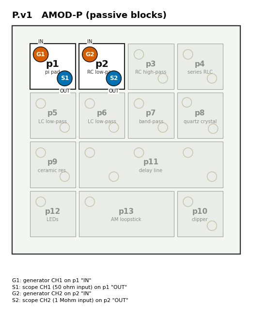

### P.v2

```
== P.v2 ==  AMOD-P (passive blocks), generator and scope; tiles p3, p4
Cables to move: G1, S1, G2, S2
Hookup (every cable of this visit):
   G1    generator CH1 (BNC to SMA)    ->  tile p3 "RC high-pass", jack printed "IN": row 1, column 3, the cell's top-left
   S1    scope CH1 (SMA to BNC)        ->  tile p3 "RC high-pass", jack printed "OUT": row 1, column 3, the cell's bottom-right -- 1 Mohm input
   G2    generator CH2 (BNC to SMA)    ->  tile p4 "series RLC", jack printed "IN": row 1, column 4, the cell's top-left
   S2    scope CH2 (SMA to BNC)        ->  tile p4 "series RLC", jack printed "OUT": row 1, column 4, the cell's bottom-right -- 50 ohm input
What I then run, and what passes:
   - p3.response
        gain at 2 MHz: 4.992 dB (3.992 to 5.992 dB)
        -3 dB corner (low side): 143.6 kHz (126.3 kHz to 160.8 kHz)
   - p4.response  (100 uH and 220 pF: 1.07 MHz, Q about 6)
        peak frequency: 1.064 MHz (1.001 MHz to 1.128 MHz)
        peak gain: -0.8697 dB (-3.37 to 1.63 dB)
Then say: "P.v2 cabled" (you can leave; I report when it is done).
```

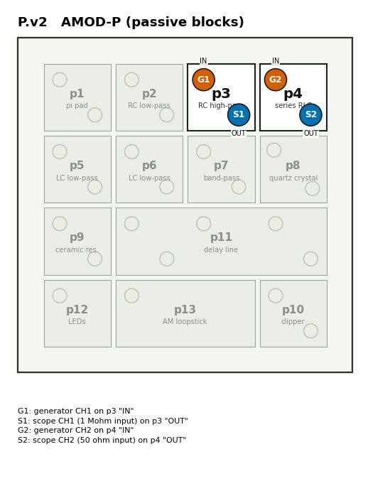

### P.v3

```
== P.v3 ==  AMOD-P (passive blocks), generator and scope; tiles p5, p6
Cables to move: G1, S1, G2, S2
Hookup (every cable of this visit):
   G1    generator CH1 (BNC to SMA)    ->  tile p5 "LC low-pass", jack printed "IN": row 2, column 1, the cell's top-left
   S1    scope CH1 (SMA to BNC)        ->  tile p5 "LC low-pass", jack printed "OUT": row 2, column 1, the cell's bottom-right -- 50 ohm input
   G2    generator CH2 (BNC to SMA)    ->  tile p6 "LC low-pass", jack printed "IN": row 2, column 2, the cell's top-left
   S2    scope CH2 (SMA to BNC)        ->  tile p6 "LC low-pass", jack printed "OUT": row 2, column 2, the cell's bottom-right -- 50 ohm input
What I then run, and what passes:
   - p5.response  (5th-order Butterworth, 8.9 MHz)
        gain at 1 MHz: -0.0006765 dB (-1.001 to 0.9993 dB)
        -3 dB corner (high side): 8.728 MHz (7.68 MHz to 9.775 MHz)
        gain at 18 MHz: -70 to -22 dB
   - p6.response  (2 x 10 nF, 150 uH, 2 x 10 nF)
        gain at 10 kHz: -0.177 dB (-1.177 to 0.823 dB)
        -3 dB corner (high side): 117.9 kHz (100.3 kHz to 135.6 kHz)
        gain at 1 MHz: -95 to -25 dB
Then say: "P.v3 cabled" (you can leave; I report when it is done).
```

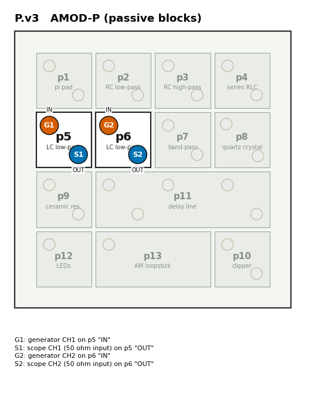

### P.v4

```
== P.v4 ==  AMOD-P (passive blocks), generator and scope; tiles p7, p8
Cables to move: G1, S1, G2, S2
Hookup (every cable of this visit):
   G1    generator CH1 (BNC to SMA)    ->  tile p7 "band-pass", jack printed "IN": row 2, column 3, the cell's top-left
   S1    scope CH1 (SMA to BNC)        ->  tile p7 "band-pass", jack printed "OUT": row 2, column 3, the cell's bottom-right -- 50 ohm input
   G2    generator CH2 (BNC to SMA)    ->  tile p8 "quartz crystal", jack printed "IN": row 2, column 4, the cell's top-left
   S2    scope CH2 (SMA to BNC)        ->  tile p8 "quartz crystal", jack printed "OUT": row 2, column 4, the cell's bottom-right -- 50 ohm input
What I then run, and what passes:
   - p7.response
        gain at 6 MHz: -0.001051 dB (-1.501 to 1.499 dB)
        -3 dB corner (high side): 7.521 MHz (6.769 MHz to 8.273 MHz)
        -3 dB corner (low side): 4.637 MHz (4.173 MHz to 5.101 MHz)
        gain at 20 MHz: -70 to -15 dB
   - p8.response  (series resonance a little under 4.000 MHz, the parallel one a few kHz above)
        peak frequency: 3.997 MHz to 4.001 MHz
        peak gain: -12 to -1 dB
        notch above the peak: 1.5 kHz to 15 kHz
Then say: "P.v4 cabled" (you can leave; I report when it is done).
```

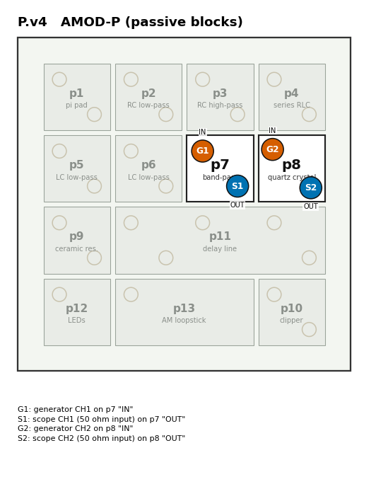

### P.v5

```
== P.v5 ==  AMOD-P (passive blocks), generator and scope; tiles p9, p10
Cables to move: G1, S1, G2, S2
Hookup (every cable of this visit):
   G1    generator CH1 (BNC to SMA)    ->  tile p9 "ceramic res.", jack printed "IN": row 3, column 1, the cell's top-left
   S1    scope CH1 (SMA to BNC)        ->  tile p9 "ceramic res.", jack printed "OUT": row 3, column 1, the cell's bottom-right -- 50 ohm input
   G2    generator CH2 (BNC to SMA)    ->  tile p10 "clipper", jack printed "IN": row 4, column 4, the cell's top-left
   S2    scope CH2 (SMA to BNC)        ->  tile p10 "clipper", jack printed "OUT": row 4, column 4, the cell's bottom-right -- 1 Mohm input
What I then run, and what passes:
   - p9.response
        peak frequency: 440 kHz to 462 kHz
        peak gain: -10 to -0.3 dB
        notch above the peak: 2 kHz to 25 kHz
   - p10.clipping  (+-3 V in, a diode drop out)
        vmax: 0.45 to 0.8 V
        vmin: -0.8 to -0.45 V
   - p10.small signal
        vpp: 0.17 to 0.21 V
Then say: "P.v5 cabled" (you can leave; I report when it is done).
```

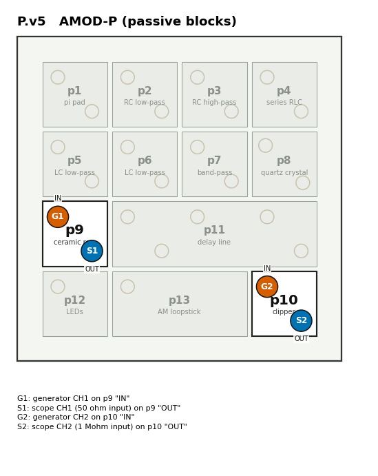

### P.v6

```
== P.v6 ==  AMOD-P (passive blocks), generator and scope; tiles p11
Cables to move: G1, S1, S2, S3, S4; take off: G2
Hookup (every cable of this visit):
   G1    generator CH1 (BNC to SMA)    ->  tile p11 "delay line", jack printed "IN": row 3, column 2, the cell's top-left
   S1    scope CH1 (SMA to BNC)        ->  tile p11 "delay line", jack printed "100ns": row 3, column 3, the cell's top-left -- 1 Mohm input
   S2    scope CH2 (SMA to BNC)        ->  tile p11 "delay line", jack printed "200ns": row 3, column 4, the cell's top-left -- 1 Mohm input
   S3    scope CH3 (SMA to BNC)        ->  tile p11 "delay line", jack printed "300ns": row 3, column 4, the cell's bottom-right -- 1 Mohm input
   S4    scope CH4 (SMA to BNC)        ->  tile p11 "delay line", jack printed "OUT": row 3, column 2, the cell's bottom-right -- 50 ohm input
What I then run, and what passes:
   - p11.delays  (20 ns a section: 99 ns between taps)
        delay t100 to t200: 1.01e-07 s (8.903e-08 to 1.13e-07 s)
        delay t200 to t300: 1.009e-07 s (8.893e-08 to 1.129e-07 s)
        delay t100 to out: 2.762e-07 s (2.562e-07 to 2.962e-07 s)
        vpp (out): 2.911 V (2.183 to 3.639 V)
        vpp (t100): 2.857 V (2 to 3.714 V)
   - p11.through  (flat to the 16 MHz cut-off)
        gain at 1 MHz (out): -0.263 dB (-1.263 to 0.737 dB)
        -3 dB corner (high side): 14.43 MHz (12.26 MHz to 16.59 MHz)
Then say: "P.v6 cabled" (you can leave; I report when it is done).
```

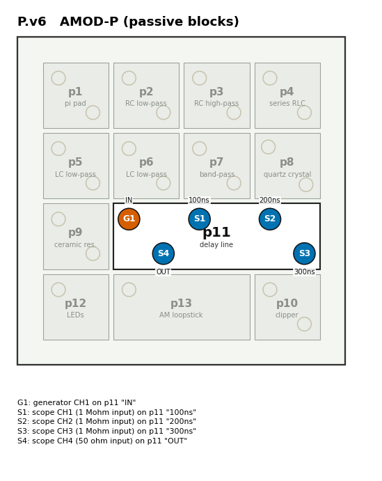

### P.hands1

```
== P.hands1 ==  AMOD-P (passive blocks), with you at the bench; tiles p4
Hookup (every cable of this visit):
   G1    generator CH1 (BNC to SMA)    ->  tile p4 "series RLC", jack printed "IN": row 1, column 4, the cell's top-left
   S1    scope CH1 (SMA to BNC)        ->  tile p4 "series RLC", jack printed "OUT": row 1, column 4, the cell's bottom-right -- 50 ohm input
What I then run, and what passes:
   * you: p4 DIP: way 1 ON, way 2 OFF
   - p4.DIP 1
        peak frequency: 948.7 kHz (891.8 kHz to 1.006 MHz)
   * you: p4 DIP: way 1 OFF, way 2 ON
   - p4.DIP 2
        peak frequency: 895.6 kHz (841.9 kHz to 949.4 kHz)
   * you: p4 DIP: both ON
   - p4.DIP 1+2
        peak frequency: 845.5 kHz (794.8 kHz to 896.2 kHz)
Then say: "P.hands1 cabled" and stay: I run one part at a time and say what to change before the next.
```

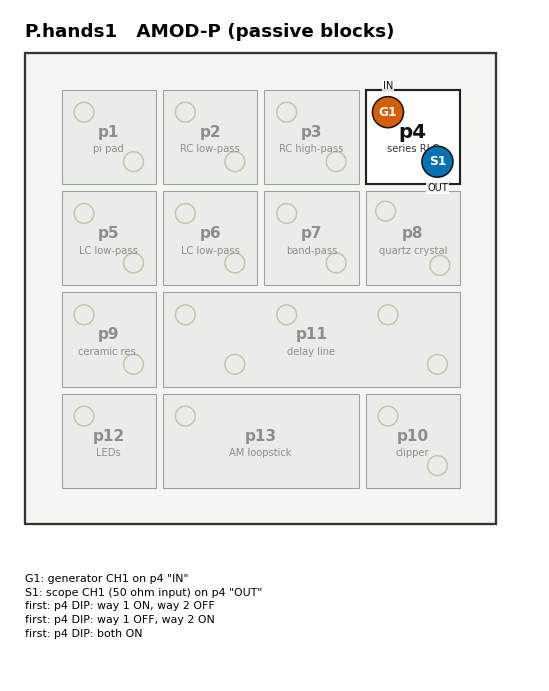

### P.hands2

```
== P.hands2 ==  AMOD-P (passive blocks), with you at the bench; tiles p12
Cables to move: G1, S1
Hookup (every cable of this visit):
   G1    generator CH1 (BNC to SMA)    ->  tile p12 "LEDs", jack printed "IN": row 4, column 1, the cell's top-left
   S1    scope CH1 (SMA to BNC)        ->  tile p12 "LEDs", jack printed "IN": row 4, column 1, the cell's top-left -- 1 Mohm input
What I then run, and what passes:
   * you: a BNC tee on the scope's CH1 input: generator CH1 to one side of the tee with a BNC cable, cable S1 from the other side to p12 IN (the two hookup lines above share that one cable; G1 itself is not used)
   * you: p12 DIP: only way 1 ON; tell me which colour lights
   - p12.way 1 (red)
        LED volts: 1.6 to 2.3 V
        mA at 5 V: 8 to 25 mA
   * you: p12 DIP: only way 2 ON; tell me which colour lights
   - p12.way 2 (yellow)
        LED volts: 1.7 to 2.4 V
        mA at 5 V: 8 to 25 mA
   * you: p12 DIP: only way 3 ON; tell me which colour lights
   - p12.way 3 (green)
        LED volts: 2.3 to 3.5 V
        mA at 5 V: 8 to 25 mA
   * you: p12 DIP: only way 4 ON; tell me which colour lights
   - p12.way 4 (blue)
        LED volts: 2.4 to 3.6 V
        mA at 5 V: 8 to 25 mA
Then say: "P.hands2 cabled" and stay: I run one part at a time and say what to change before the next.
```

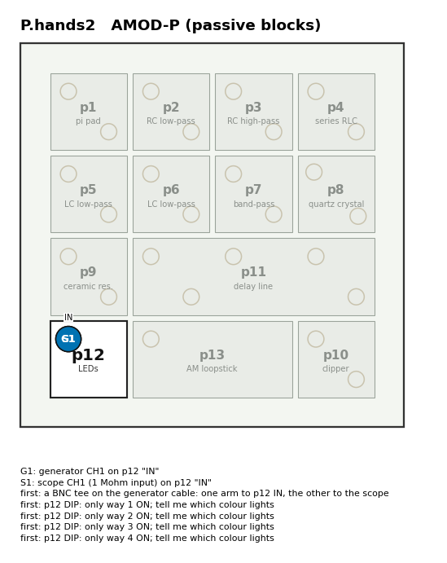

### P.kit1

```
== P.kit1 ==  AMOD-P (passive blocks), with parts from the kit; tiles p13
From the kit: 330 uH AM loopstick coil (KIT.md); a 5-turn loop of hookup wire on a BNC clip lead
What I then run, and what passes:
   - p13.loopstick: With a 330 uH ferrite-rod coil on the COIL terminal (HOT, TAP, GND as printed) and a 5-turn wire loop on the generator held near the rod, I sweep 0.3-2 MHz and read OUT: one peak per DIP way (1.28, 0.88, 0.59, 0.40 MHz).
Then say: "P.kit1 cabled" and stay: I run one part at a time and say what to change before the next.
```

## AMOD-A: active blocks

### A.inspect

```
A.inspect: AMOD-A, unpowered, with a loupe.  Photograph both sides first.
   [ ] a1: USB-C shell soldered on all four posts; the 5.1 k CC resistors present; D101 (SMAJ5.0A) by the fuse.
   [ ] Every SOT-23 P-FET beside a slide switch has its single pin toward the tile's inside (pin 1 at the dot).
   [ ] a4: U401 (OPA847, SOT-23-6) pin 1 dot at the silkscreen dot.
   [ ] a7: U701 (TSSOP-16) pin 1; a9: U901 (SOIC-14) pin 1; a11: U1101 (WSON-8) pin 1.
   [ ] a12: U1201 is an MSOP-8 sitting squarely on its pads (rev A's first order had a SOIC-8 footprint here).
   [ ] a8: the two 2512 heater resistors, flat.  a12: the screw terminal's openings face the right edge.
   [ ] The Pmod plug hangs off the bottom edge under a11; its pins straight.
Then say: "A.inspect done" (or what you saw that differs; a photo helps).
```

### A.setup

```
A.setup: set on AMOD-A, once:
   [ ] a10 DIP (4 ways): only way 2 (470 ohm) ON
   [ ] every tile's slide switch DOWN (off)
Then say: "A.setup done".
```

### A.power

```
A.power: first power for AMOD-A.  Every tile's slide switch DOWN (off) to begin with.
Hookup:
   PWR   supply output 1 (+ and -) -> the USB-C power lead -> the board's USB-C jack (right edge, tile a1)
   S1    scope CH1, a BNC-to-clip lead (x1) on a jumper pin in the rails socket hole printed "+5" (top edge of tile a1)
   S2    scope CH2, the same, in the hole printed "-5"
   S3    scope CH3, the same, in the hole printed "3V3"; all three ground clips on a pin in a hole printed "G"
What I run: 1.0 V, 3.0 V, then 5.00 V with a low current limit, reading the current at each; the rails; then the walk:
   the supply's display shows a tile's name ("ON a2"): slide THAT tile's switch UP; the display moves on by itself.
   Order: a2, a3, a4, a5, a6, a7, a8, a9, a10, a11, a12.  Expected steps (mA): a2 5-14, a3 5-14, a4 25-50, a5 5-14, a6 2-8, a7 0.2-6, a8 0-1.5, a9 4-14, a10 10-28, a11 5-16, a12 8-28.
Leave every switch UP after the walk: the later visits expect their tiles on (the rails are read again with all of them on).
Tell me which LEDs are lit on tile a1 when the supply first reaches 5 V.
Then say: "A.power cabled" and stay for the walk (about two minutes).
```

### A.v1

```
== A.v1 ==  AMOD-A (active blocks), generator and scope; tiles a2, a3
Hookup (every cable of this visit):
   G1    generator CH1 (BNC to SMA)    ->  tile a2 "x10", jack printed "IN 50R": row 1, column 1, the cell's top-left
   S1    scope CH1 (SMA to BNC)        ->  tile a2 "x10", jack printed "OUT": row 1, column 1, the cell's bottom-right -- 1 Mohm input
   G2    generator CH2 (BNC to SMA)    ->  tile a3 "x100", jack printed "IN 50R": row 1, column 2, the cell's top-left
   S2    scope CH2 (SMA to BNC)        ->  tile a3 "x100", jack printed "OUT": row 1, column 2, the cell's bottom-right -- 1 Mohm input
What I then run, and what passes:
   - a2.response  (1 + 10 k / 1.1 k = 10.1; corner 70 MHz / 10.1 = 6.9 MHz (the silk says 14 MHz))
        gain at 10 kHz: 20.08 dB (19.48 to 20.68 dB)
        gain at 1 MHz: 19.97 dB (19.17 to 20.77 dB)
        -3 dB corner (high side): 6.674 MHz (4.004 MHz to 9.344 MHz)
   - a3.response  (1 + 10 k / 100 = 101; corner 70 MHz / 101 = 0.69 MHz (the silk says 1.4 MHz))
        gain at 10 kHz: 40.09 dB (39.29 to 40.89 dB)
        -3 dB corner (high side): 681.2 kHz (408.7 kHz to 953.7 kHz)
Then say: "A.v1 cabled" (you can leave; I report when it is done).
```

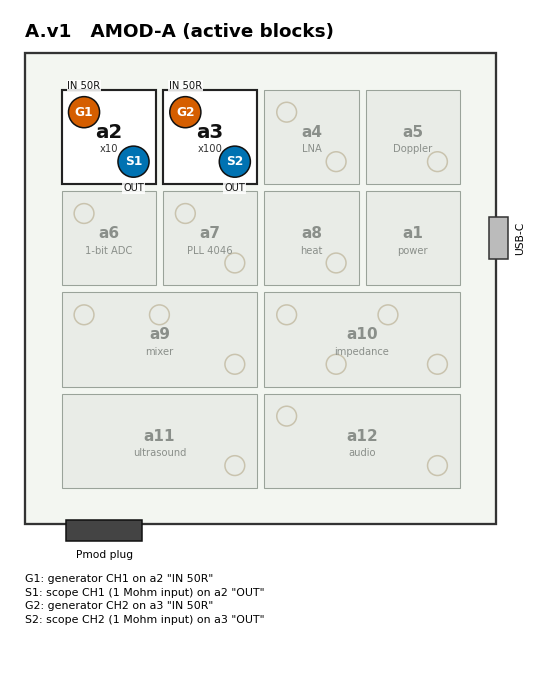

### A.v2

```
== A.v2 ==  AMOD-A (active blocks), generator and scope; tiles a4, a5, a7, a8
Cables to move: G1, S1, S2, G2, S3, S4
Hookup (every cable of this visit):
   G1    generator CH1 (BNC to SMA)    ->  tile a4 "LNA", jack printed "IN 50R": row 1, column 3, the cell's top-left
   S1    scope CH1 (SMA to BNC)        ->  tile a4 "LNA", jack printed "OUT": row 1, column 3, the cell's bottom-right -- 1 Mohm input
   S2    scope CH2 (SMA to BNC)        ->  tile a5 "Doppler", jack printed "OUT": row 1, column 4, the cell's bottom-right -- 1 Mohm input
   G2    generator CH2 (BNC to SMA)    ->  tile a7 "PLL 4046", jack printed "IN 1K": row 2, column 2, the cell's top-left
   S3    scope CH3 (SMA to BNC)        ->  tile a7 "PLL 4046", jack printed "VCO OUT": row 2, column 2, the cell's bottom-right -- 1 Mohm input
   S4    scope CH4 (SMA to BNC)        ->  tile a8 "heat", jack printed "TEMP OUT": row 2, column 3, the cell's bottom-right -- 1 Mohm input
What I then run, and what passes:
   - a4.response  (OPA847, 1 k / 10 ohm)
        gain at 100 kHz: 40.09 dB (39.09 to 41.09 dB)
        gain at 10 MHz: 39.54 dB (37.54 to 41.54 dB)
        gain at 30 MHz: 34 to 42 dB
   - a5.output at rest  (x101 of the op amp's offset with no HB100)
        mean: -0.3 to 0.3 V
        rms: 0 to 0.15 V
   - a7.lock at 80 kHz  (the VCO follows the input: 74HC4046A, R1 10 k, C1 1 nF)
        freq: 80 kHz (79.68 kHz to 80.32 kHz)
        vpp: 3.5 to 5.6 V
   - a7.lock at 100 kHz  (the VCO follows the input: 74HC4046A, R1 10 k, C1 1 nF)
        freq: 100 kHz (99.6 kHz to 100.4 kHz)
        vpp: 3.5 to 5.6 V
   - a7.lock at 130 kHz  (the VCO follows the input: 74HC4046A, R1 10 k, C1 1 nF)
        freq: 130 kHz (129.5 kHz to 130.5 kHz)
        vpp: 3.5 to 5.6 V
   - a8.temperature at rest  (TMP235: 500 mV + 10 mV per degree C)
        mean: 0.69 to 0.8 V
Then say: "A.v2 cabled" (you can leave; I report when it is done).
```

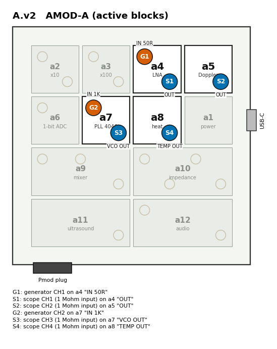

### A.v3

```
== A.v3 ==  AMOD-A (active blocks), generator and scope; tiles a9
Cables to move: G1, G2, S1; take off: S2, S3, S4
Hookup (every cable of this visit):
   G1    generator CH1 (BNC to SMA)    ->  tile a9 "mixer", jack printed "RF IN": row 3, column 1, the cell's top-left
   G2    generator CH2 (BNC to SMA)    ->  tile a9 "mixer", jack printed "LO IN": row 3, column 1, the cell's top-right
   S1    scope CH1 (SMA to BNC)        ->  tile a9 "mixer", jack printed "IF OUT": row 3, column 2, the cell's bottom-right -- 1 Mohm input
What I then run, and what passes:
   - a9.product  (1.0 MHz x 1.1 MHz: the difference at 100 kHz, and the LO's leak at 1.1 MHz)
        tone at 100 kHz: 0.012 to 0.09 V
        tone at 1.1 MHz: 0 to 0.05 V
        PREDICTED ON PAPER: REVB 1.4: R904 returns the MC1496's bias pin to -5 V (its VEE) instead of ground, so the tail current is zero and no 100 kHz product is expected.  If so, the rework is R904's -5 V end lifted and wired to ground
Then say: "A.v3 cabled" (you can leave; I report when it is done).
```

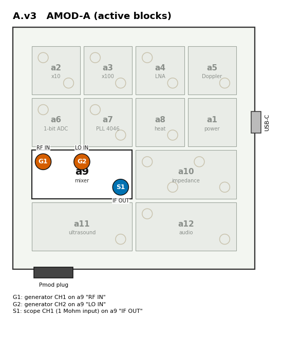

### A.v4

```
== A.v4 ==  AMOD-A (active blocks), generator and scope; tiles a10, a11, a12
Cables to move: G1, S1, S2, S3, S4; take off: G2
Hookup (every cable of this visit):
   G1    generator CH1 (BNC to SMA)    ->  tile a10 "impedance", jack printed "DRIVE IN": row 3, column 3, the cell's top-left
   S1    scope CH1 (SMA to BNC)        ->  tile a10 "impedance", jack printed "S OUT": row 3, column 3, the cell's bottom-right -- 50 ohm input
   S2    scope CH2 (SMA to BNC)        ->  tile a10 "impedance", jack printed "X OUT": row 3, column 4, the cell's bottom-right -- 50 ohm input
   S3    scope CH3 (SMA to BNC)        ->  tile a11 "ultrasound", jack printed "RX OUT": row 4, column 2, the cell's bottom-right -- 1 Mohm input
   S4    scope CH4 (SMA to BNC)        ->  tile a12 "audio", jack printed "MIC OUT": row 4, column 4, the cell's bottom-right -- 1 Mohm input
What I then run, and what passes:
   - a10.DUT open  (no current in R: X = S)
        gain at 10 kHz (s): 0.00869 dB (-0.5913 to 0.6087 dB)
        gain at 10 kHz (x): 0.00869 dB (-0.5913 to 0.6087 dB)
        X - S at 10 kHz: -0.3 to 0.3 dB
   - a11.output at rest
        mean: -0.3 to 0.3 V
        rms: 0 to 0.15 V
   - a12.output at rest
        mean: -0.5 to 0.5 V
        rms: 0 to 0.3 V
Then say: "A.v4 cabled" (you can leave; I report when it is done).
```

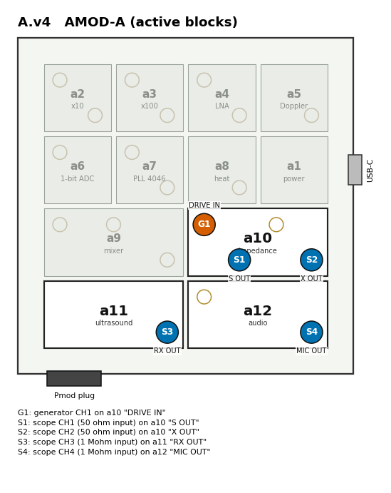

### A.plug

```
A.plug: is the plug the right way round?  Both boards unpowered: no USB on either, no SMA cable, no supply lead.
   1. Plug AMOD-A's Pmod plug (its bottom edge, under tile a11) into the ECP5-2ADC-2DAC board's Pmod A socket (the lower of its two
      sockets on its right edge), pins straight in, the two boards flat on the bench.
   2. Meter on ohms: one lead on the shell of any SMA jack on the ECP5 board's left edge, the other on the shell of any
      SMA jack of AMOD-A.  It must read under 1 ohm: the two grounds meet only through the plug's pins 5 and 11.
      If it reads high (or a diode's drop on the diode range), the plug is mirrored against the socket: STOP,
      unplug, and tell me (REVB 1.15).  Nothing is powered, so nothing is harmed.
   The rev A plugs mate only with ECP5-2ADC-2DAC rev A's sockets (both non-standard, REVB 1.15): never a standard Pmod
   host, a Digilent module or a Pmod cable.
Then say: "A.plug done" with the reading.
```

### A.host1

```
== A.host1 ==  AMOD-A (active blocks), on the Pmod host; tiles a6, a8, a11
First, on the board:
   * a male-male jumper wire from a11's TX socket pin 1 to its RX socket pin 1 (the left pin of each, as printed TX and RX)
Hookup (every cable of this visit):
   G1    generator CH1 (BNC to SMA)    ->  tile a6 "1-bit ADC", jack printed "IN 10K": row 2, column 1, the cell's top-left
   S1    scope CH1 (SMA to BNC)        ->  tile a8 "heat", jack printed "TEMP OUT": row 2, column 3, the cell's bottom-right -- 1 Mohm input
   S2    scope CH2 (SMA to BNC)        ->  tile a11 "ultrasound", jack printed "RX OUT": row 4, column 2, the cell's bottom-right -- 1 Mohm input
   HOST  the board's Pmod plug (bottom edge) straight into the ECP5-2ADC-2DAC **rev A** board's **Pmod A** socket; its USB PROG to this PC through the labelled D+/D- crossed USB-A-to-C cable, pmodbench.bit loaded into its FPGA (the tool checks).  Rev A plugs are non-standard: never a standard Pmod host or cable
What I then run, and what passes:
   - a6.ones density against IN  (first-order delta-sigma closed through the FPGA: density = IN / 3.3 V)
        density@0.5: 0.1515 (0.1015 to 0.2015)
        density@1.65: 0.5 (0.45 to 0.55)
        density@2.8: 0.8485 (0.7985 to 0.8985)
   - a8.heater  (30 ohm on the switched 5 V: 170 mA, 0.83 W; 10 mV per kelvin)
        heater current: 0.12 to 0.21 A
        temperature rise: 0.008 to 0.6 V
   - a11.bridge into the receiver  (5 V squares through 10 nF into x100: RX OUT clips at the rails at 40 kHz)
        freq: 39.5 kHz to 40.5 kHz
        vpp: 2 to 9.5 V
Then say: "A.host1 cabled" (you can leave; I report when it is done).
```

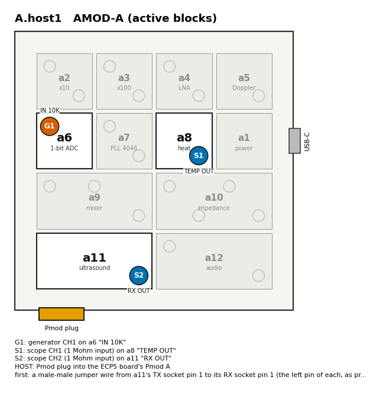

### A.hands1

```
== A.hands1 ==  AMOD-A (active blocks), with you at the bench; tiles a10
Hookup (every cable of this visit):
   G1    generator CH1 (BNC to SMA)    ->  tile a10 "impedance", jack printed "DRIVE IN": row 3, column 3, the cell's top-left
   S1    scope CH1 (SMA to BNC)        ->  tile a10 "impedance", jack printed "S OUT": row 3, column 3, the cell's bottom-right -- 50 ohm input
   S2    scope CH2 (SMA to BNC)        ->  tile a10 "impedance", jack printed "X OUT": row 3, column 4, the cell's bottom-right -- 50 ohm input
What I then run, and what passes:
   * you: a 50 ohm SMA terminator on a10's DUT jack
   - a10.DUT 50 ohm  (50 / (470 + 50))
        X - S at 10 kHz: -21.3 to -19.3 dB
Then say: "A.hands1 cabled" and stay: I run one part at a time and say what to change before the next.
```

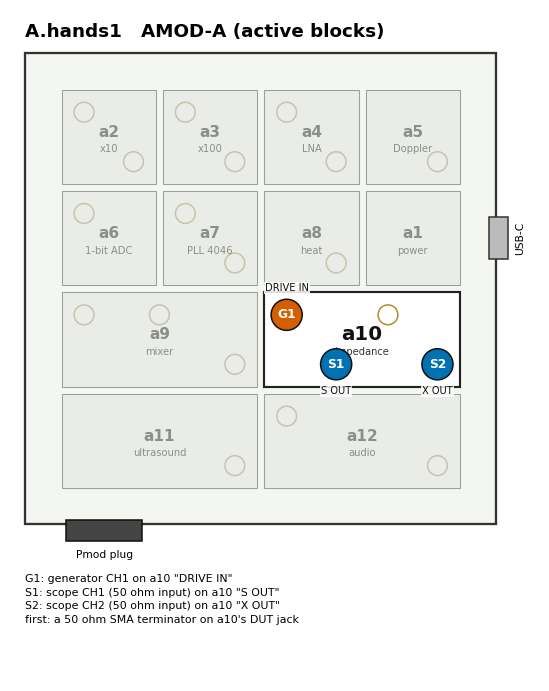

### A.kit1

```
== A.kit1 ==  AMOD-A (active blocks), with parts from the kit; tiles a5
From the kit: HB100 Doppler module, three jumper wires
What I then run, and what passes:
   - a5.HB100: With an HB100 on the +5 / G / IF socket (read the module's own print: its pin order varies) I record OUT while you wave a hand a metre in front of it: tens of hertz, tens of millivolts.
Then say: "A.kit1 cabled" and stay: I run one part at a time and say what to change before the next.
```

### A.kit2

```
== A.kit2 ==  AMOD-A (active blocks), with parts from the kit; tiles a12
From the kit: 4-8 ohm speaker, 2 W; electret capsule
What I then run, and what passes:
   - a12.speaker and microphone: Speaker on SPK, electret in MIC (its + pin to pin 1): I play 1 kHz into SPEAKER IN (you hear it), then a one-bit tone from IO2, then record MIC OUT while you clap.
Then say: "A.kit2 cabled" and stay: I run one part at a time and say what to change before the next.
```

## AMOD-N: network analyzer pieces

### N.inspect

```
N.inspect: AMOD-N, unpowered, with a loupe.  Photograph both sides first.
   [ ] n8: U801 (PE43711, QFN-24) pin-1 dot at the chip's top-left as the board reads; the 8-way DIP's ON toward the top edge.
   [ ] n3 (ADP-2-1+), n10 (TC1-1TG2+), n11 (TC4-1W+): each transformer's dot as the silkscreen draws it.
   [ ] n6: D601 (SOT-23); n9: Q902 and the BB133 varactor (its cathode band toward the 10 uH inductor).
   [ ] n1 SHORT: the centre pin soldered into copper all round (no clearance ring).  n4: the stub is copper, 17.3 mm long.
   [ ] n10's OUT jack: no copper bridge from its legs to the ground pour (it floats).
Then say: "N.inspect done" (or what you saw that differs; a photo helps).
```

### N.setup

```
N.setup: set on AMOD-N, once:
   [ ] n8 DIP (8 ways): way 1 (SPI) ON, ways 2-8 OFF
   [ ] n11 DIP (2 ways): way 1 (200 ohm) ON, way 2 OFF
   [ ] n9's slide switch UP (on)
Then say: "N.setup done".
```

### N.v1

```
== N.v1 ==  AMOD-N (network analyzer pieces), generator and scope; tiles n1, n2
Hookup (every cable of this visit):
   G1    generator CH1 (BNC to SMA)    ->  tile n1 "calibration", jack printed "THRU": row 1, column 3, the cell's top-left
   S1    scope CH1 (SMA to BNC)        ->  tile n1 "calibration", jack printed "THRU": row 1, column 3, the cell's bottom-right -- 50 ohm input
   G2    generator CH2 (BNC to SMA)    ->  tile n2 "resistive splitter", jack printed "IN": row 2, column 2, the cell's top-left
   S2    scope CH2 (SMA to BNC)        ->  tile n2 "resistive splitter", jack printed "OUT 1": row 2, column 1, the cell's bottom-right -- 50 ohm input
   S3    scope CH3 (SMA to BNC)        ->  tile n2 "resistive splitter", jack printed "OUT 2": row 2, column 2, the cell's bottom-right -- 50 ohm input
What I then run, and what passes:
   - n1.THRU  (19.8 mm of 50 ohm line)
        gain at 1 MHz (b): 0 dB (-0.5 to 0.5 dB)
        gain at 30 MHz (b): 0 dB (-1 to 1 dB)
   - n2.response  (three 16.9 ohm: half the voltage to each)
        gain at 1 MHz (o1): -6.02 dB (-6.52 to -5.52 dB)
        gain at 1 MHz (o2): -6.02 dB (-6.52 to -5.52 dB)
        gain at 30 MHz (o1): -6.02 dB (-7.02 to -5.02 dB)
Then say: "N.v1 cabled" (you can leave; I report when it is done).
```

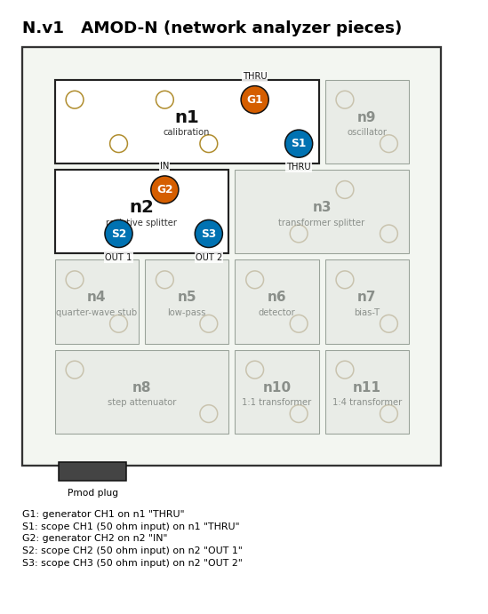

### N.v2

```
== N.v2 ==  AMOD-N (network analyzer pieces), generator and scope; tiles n3, n5
Cables to move: G1, S1, S2, G2, S3
Hookup (every cable of this visit):
   G1    generator CH1 (BNC to SMA)    ->  tile n3 "transformer splitter", jack printed "SUM": row 2, column 4, the cell's top-left
   S1    scope CH1 (SMA to BNC)        ->  tile n3 "transformer splitter", jack printed "PORT 1": row 2, column 3, the cell's bottom-right -- 50 ohm input
   S2    scope CH2 (SMA to BNC)        ->  tile n3 "transformer splitter", jack printed "PORT 2": row 2, column 4, the cell's bottom-right -- 50 ohm input
   G2    generator CH2 (BNC to SMA)    ->  tile n5 "low-pass", jack printed "IN": row 3, column 2, the cell's top-left
   S3    scope CH3 (SMA to BNC)        ->  tile n5 "low-pass", jack printed "OUT": row 3, column 2, the cell's bottom-right -- 50 ohm input
What I then run, and what passes:
   - n3.response  (ADP-2-1+: 3.0 dB of split and 0.3 dB of loss)
        gain at 3 MHz (p1): -3.3 dB (-4.1 to -2.5 dB)
        gain at 3 MHz (p2): -3.3 dB (-4.1 to -2.5 dB)
        gain at 30 MHz (p1): -3.3 dB (-4.3 to -2.3 dB)
   - n5.passband  (LFCN-1000+ far below its corner)
        gain at 10 MHz: -0.2 dB (-0.8 to 0.4 dB)
Then say: "N.v2 cabled" (you can leave; I report when it is done).
```

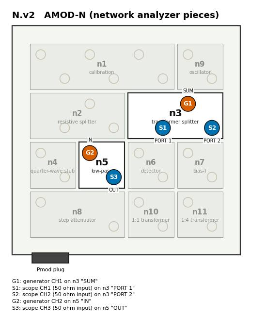

### N.v3

```
== N.v3 ==  AMOD-N (network analyzer pieces), generator and scope; tiles n7, n10
Cables to move: G1, S1, G2, S2; take off: S3
Hookup (every cable of this visit):
   G1    generator CH1 (BNC to SMA)    ->  tile n7 "bias-T", jack printed "RF": row 3, column 4, the cell's top-left
   S1    scope CH1 (SMA to BNC)        ->  tile n7 "bias-T", jack printed "RF+DC": row 3, column 4, the cell's bottom-right -- 50 ohm input
   G2    generator CH2 (BNC to SMA)    ->  tile n10 "1:1 transformer", jack printed "IN": row 4, column 3, the cell's top-left
   S2    scope CH2 (SMA to BNC)        ->  tile n10 "1:1 transformer", jack printed "OUT": row 4, column 3, the cell's bottom-right -- 50 ohm input
What I then run, and what passes:
   - n7.RF path  (100 nF in series; 10 uH to the DC loop's 100 nF)
        gain at 10 MHz: -0.006028 dB (-0.806 to 0.794 dB)
        gain at 30 MHz: -0.0006544 dB (-1.001 to 0.9993 dB)
   - n10.response  (TC1-1TG2+, 0.3 dB at 10 MHz)
        gain at 10 MHz: -0.4 dB (-1.2 to 0.4 dB)
Then say: "N.v3 cabled" (you can leave; I report when it is done).
```

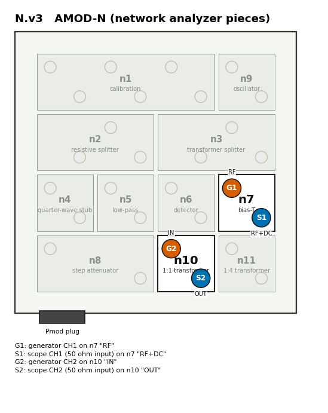

### N.v4

```
== N.v4 ==  AMOD-N (network analyzer pieces), generator and scope; tiles n6, n11
Cables to move: G1, S1, G2, S2
Hookup (every cable of this visit):
   G1    generator CH1 (BNC to SMA)    ->  tile n11 "1:4 transformer", jack printed "IN": row 4, column 4, the cell's top-left
   S1    scope CH1 (SMA to BNC)        ->  tile n11 "1:4 transformer", jack printed "OUT": row 4, column 4, the cell's bottom-right -- 1 Mohm input
   G2    generator CH2 (BNC to SMA)    ->  tile n6 "detector", jack printed "IN": row 3, column 3, the cell's top-left
   S2    scope CH2 (SMA to BNC)        ->  tile n6 "detector", jack printed "OUT": row 3, column 3, the cell's bottom-right -- 1 Mohm input
What I then run, and what passes:
   - n11.1:4, 200 ohm on  (matched: twice the voltage, 0.8 dB of loss)
        gain at 10 MHz: 5.2 dB (4 to 6.4 dB)
   - n6.-10 dBm at 20 MHz  (a doubler of two zero-bias diodes: about 0.1 V at -10 dBm; positive)
        mean: 0.035 to 0.22 V
   - n6.+0 dBm at 20 MHz  (a doubler of two zero-bias diodes: about 0.1 V at -10 dBm; positive)
        mean: 0.14 to 0.75 V
Then say: "N.v4 cabled" (you can leave; I report when it is done).
```

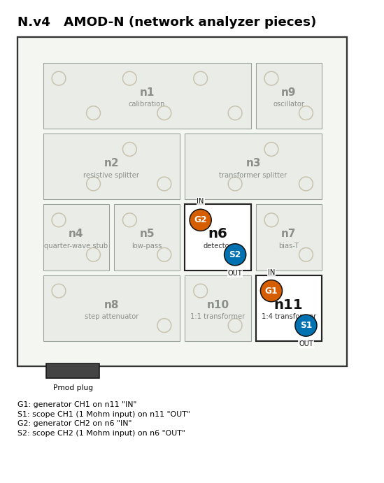

### N.plug

```
N.plug: is the plug the right way round?  Both boards unpowered: no USB on either, no SMA cable, no supply lead.
   1. Plug AMOD-N's Pmod plug (its bottom edge, under tile n8) into the ECP5-2ADC-2DAC board's Pmod A socket (the lower of its two
      sockets on its right edge), pins straight in, the two boards flat on the bench.
   2. Meter on ohms: one lead on the shell of any SMA jack on the ECP5 board's left edge, the other on the shell of any
      SMA jack of AMOD-N.  It must read under 1 ohm: the two grounds meet only through the plug's pins 5 and 11.
      If it reads high (or a diode's drop on the diode range), the plug is mirrored against the socket: STOP,
      unplug, and tell me (REVB 1.15).  Nothing is powered, so nothing is harmed.
   The rev A plugs mate only with ECP5-2ADC-2DAC rev A's sockets (both non-standard, REVB 1.15): never a standard Pmod
   host, a Digilent module or a Pmod cable.
Then say: "N.plug done" with the reading.
```

### N.host1

```
== N.host1 ==  AMOD-N (network analyzer pieces), on the Pmod host; tiles n8, n9
Hookup (every cable of this visit):
   G1    generator CH1 (BNC to SMA)    ->  tile n8 "step attenuator", jack printed "IN": row 4, column 1, the cell's top-left
   S1    scope CH1 (SMA to BNC)        ->  tile n8 "step attenuator", jack printed "OUT": row 4, column 2, the cell's bottom-right -- 50 ohm input
   G2    generator CH2 (BNC to SMA)    ->  tile n9 "oscillator", jack printed "TUNE": row 1, column 4, the cell's top-left
   S2    scope CH2 (SMA to BNC)        ->  tile n9 "oscillator", jack printed "OUT": row 1, column 4, the cell's bottom-right -- 50 ohm input
   HOST  the board's Pmod plug (bottom edge) straight into the ECP5-2ADC-2DAC **rev A** board's **Pmod A** socket; its USB PROG to this PC through the labelled D+/D- crossed USB-A-to-C cable, pmodbench.bit loaded into its FPGA (the tool checks).  Rev A plugs are non-standard: never a standard Pmod host or cable
What I then run, and what passes:
   - n8.every bit, by the FPGA  (PE43711 over the Pmod: each of the seven bits alone, then all of them)
        loss at 0 dB: 0.8 to 3.2 dB
        step to 0.25 dB: -0.1075 to 0.6075 dB
        step to 0.5 dB: 0.135 to 0.865 dB
        step to 1 dB: 0.62 to 1.38 dB
        step to 2 dB: 1.59 to 2.41 dB
        step to 4 dB: 3.53 to 4.47 dB
        step to 8 dB: 7.41 to 8.59 dB
        step to 16 dB: 15.17 to 16.83 dB
        step to 31.75 dB: 30.45 to 33.05 dB
   - n9.oscillator and its tuning  (Clapp: 10 uH and the BB133 between 220 pF and 220 pF; TUNE through 100 k)
        f@0: 9.3 MHz to 11.7 MHz
        f(-2 V) / f(0): 0.85 to 0.975
        f(+2 V) / f(0): 1.025 to 1.16
        vpp@0: 0.015 to 0.2 V
Then say: "N.host1 cabled" (you can leave; I report when it is done).
```

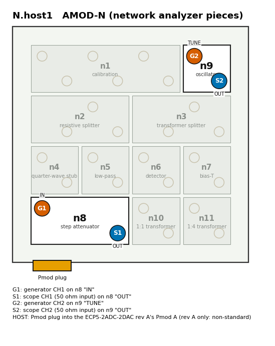

### N.hands1

```
== N.hands1 ==  AMOD-N (network analyzer pieces), with you at the bench; tiles n11
Hookup (every cable of this visit):
   G1    generator CH1 (BNC to SMA)    ->  tile n11 "1:4 transformer", jack printed "IN": row 4, column 4, the cell's top-left
   S1    scope CH1 (SMA to BNC)        ->  tile n11 "1:4 transformer", jack printed "OUT": row 4, column 4, the cell's bottom-right -- 1 Mohm input
What I then run, and what passes:
   * you: n11 DIP: way 2 (49.9 ohm) ON as well as way 1
   - n11.1:4, 200 and 49.9 ohm on  (40 ohm across OUT is 10 ohm at IN)
        gain at 10 MHz: -4.336 dB (-5.836 to -2.836 dB)
Then say: "N.hands1 cabled" and stay: I run one part at a time and say what to change before the next.
```

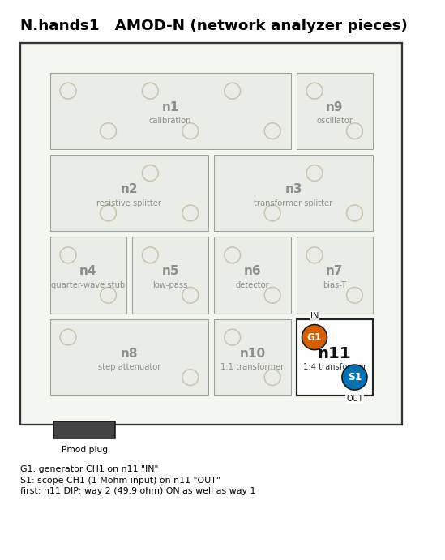

### N.hands2

```
== N.hands2 ==  AMOD-N (network analyzer pieces), with you at the bench; tiles n7
Cables to move: none; take off: G1, S1
What I then run, and what passes:
   - n7.DC path: Bench supply output 2 at 5.0 V, 20 mA limit, clipped to n7's DC and GND loops; the scope on RF+DC reads 5 V and on RF 0 V.
Then say: "N.hands2 cabled" and stay: I run one part at a time and say what to change before the next.
```

### N.hands3

```
== N.hands3 ==  AMOD-N (network analyzer pieces), with you at the bench; tiles n10
What I then run, and what passes:
   - n10.OUT floats: A meter between n10's OUT jack shell and any other jack's shell reads open (over 1 Mohm), and the same from OUT's centre pin.
Then say: "N.hands3 cabled" and stay: I run one part at a time and say what to change before the next.
```

### N.hands4

```
== N.hands4 ==  AMOD-N (network analyzer pieces), with you at the bench; tiles n8
Hookup (every cable of this visit):
   G1    generator CH1 (BNC to SMA)    ->  tile n8 "step attenuator", jack printed "IN": row 4, column 1, the cell's top-left
   S1    scope CH1 (SMA to BNC)        ->  tile n8 "step attenuator", jack printed "OUT": row 4, column 2, the cell's bottom-right -- 50 ohm input
   HOST  the board's Pmod plug (bottom edge) straight into the ECP5-2ADC-2DAC **rev A** board's **Pmod A** socket; its USB PROG to this PC through the labelled D+/D- crossed USB-A-to-C cable, pmodbench.bit loaded into its FPGA (the tool checks).  Rev A plugs are non-standard: never a standard Pmod host or cable
What I then run, and what passes:
   * you: n8 DIP: way 1 (SPI) OFF, way 8 (16 dB) ON, ways 2-7 OFF
   - n8.by the switches  (direct parallel mode: 16 dB by hand)
        loss: 16.3 to 19.5 dB
Then say: "N.hands4 cabled" and stay: I run one part at a time and say what to change before the next.
```

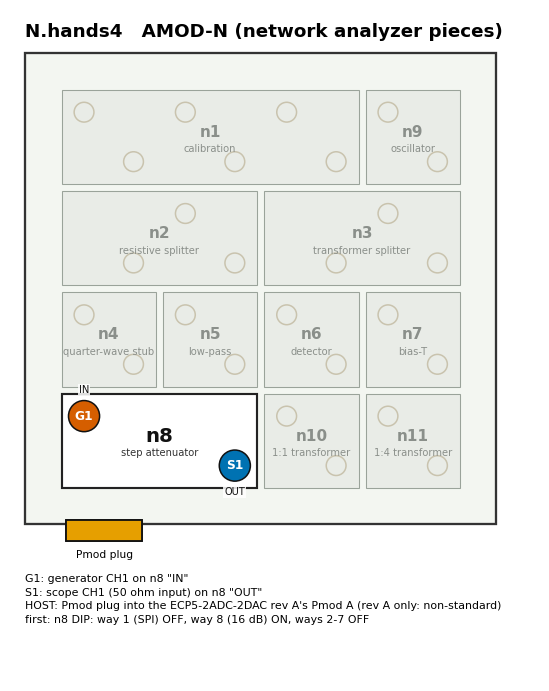

### N.rf1

```
== N.rf1 ==  AMOD-N (network analyzer pieces), network analyzer; tiles n1
Hookup (every cable of this visit):
   P1    network analyzer port 1       ->  tile n1 "calibration", jack printed "THRU": row 1, column 3, the cell's top-left
   P2    network analyzer port 2       ->  tile n1 "calibration", jack printed "THRU": row 1, column 3, the cell's bottom-right
What I then run, and what passes:
   - n1.THRU, S21
        gain at 1 GHz: -1 to 0.2 dB
        gain at 3 GHz: -1.8 to 0.2 dB
        gain at 6 GHz: -4 to 0.3 dB
Then say: "N.rf1 cabled" (you can leave; I report when it is done).
```

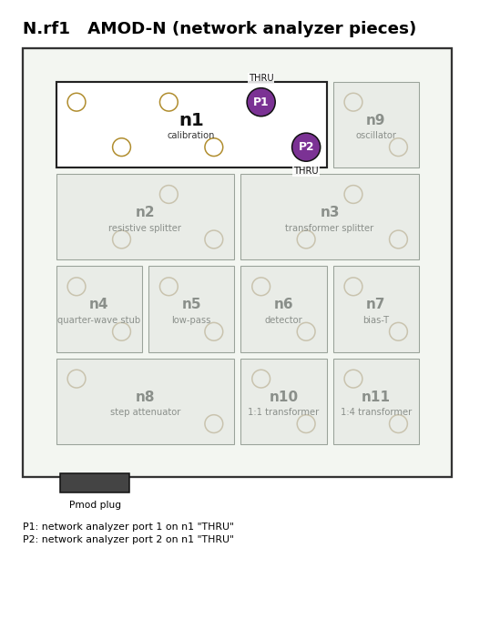

### N.rf2

```
== N.rf2 ==  AMOD-N (network analyzer pieces), network analyzer; tiles n1
Cables to move: P1; take off: P2
Hookup (every cable of this visit):
   P1    network analyzer port 1       ->  tile n1 "calibration", jack printed "LOAD": row 1, column 2, the cell's top-left
What I then run, and what passes:
   - n1.LOAD, S11
        gain at 1 GHz: -80 to -17 dB
        gain at 3 GHz: -80 to -12 dB
Then say: "N.rf2 cabled" (you can leave; I report when it is done).
```

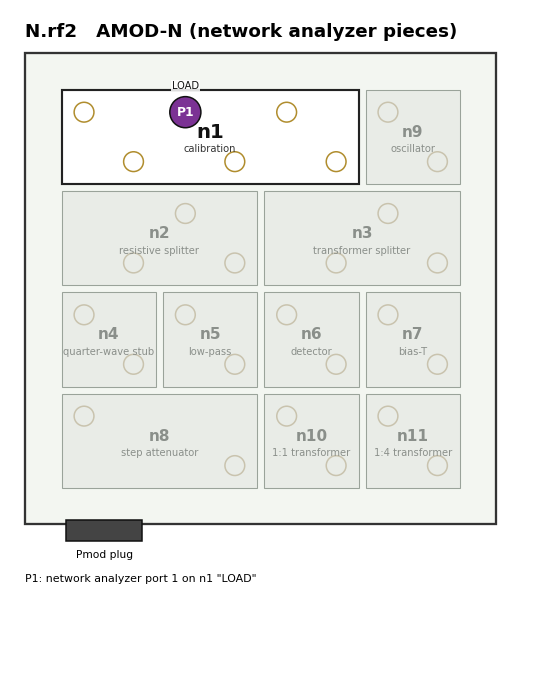

### N.rf3

```
== N.rf3 ==  AMOD-N (network analyzer pieces), network analyzer; tiles n1
Cables to move: P1
Hookup (every cable of this visit):
   P1    network analyzer port 1       ->  tile n1 "calibration", jack printed "25 OHM": row 1, column 2, the cell's bottom-right
What I then run, and what passes:
   - n1.25 OHM, S11
        gain at 500 MHz: -11 to -8.2 dB
        gain at 2 GHz: -12.5 to -7 dB
Then say: "N.rf3 cabled" (you can leave; I report when it is done).
```

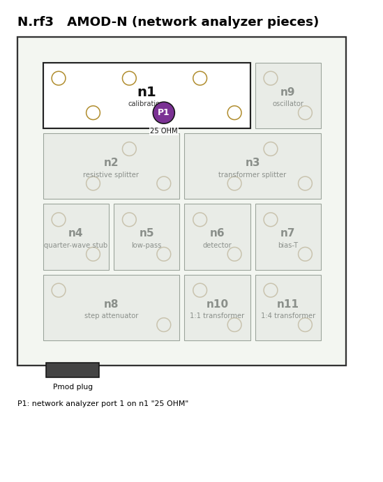

### N.rf4

```
== N.rf4 ==  AMOD-N (network analyzer pieces), network analyzer; tiles n1
Cables to move: P1
Hookup (every cable of this visit):
   P1    network analyzer port 1       ->  tile n1 "calibration", jack printed "SHORT": row 1, column 1, the cell's top-left
What I then run, and what passes:
   - n1.SHORT, S11
        gain at 1 GHz: -1.5 to 0.3 dB
Then say: "N.rf4 cabled" (you can leave; I report when it is done).
```

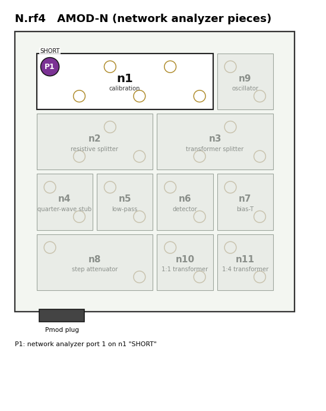

### N.rf5

```
== N.rf5 ==  AMOD-N (network analyzer pieces), network analyzer; tiles n1
Cables to move: P1
Hookup (every cable of this visit):
   P1    network analyzer port 1       ->  tile n1 "calibration", jack printed "OPEN": row 1, column 1, the cell's bottom-right
What I then run, and what passes:
   - n1.OPEN, S11
        gain at 1 GHz: -1.5 to 0.3 dB
Then say: "N.rf5 cabled" (you can leave; I report when it is done).
```

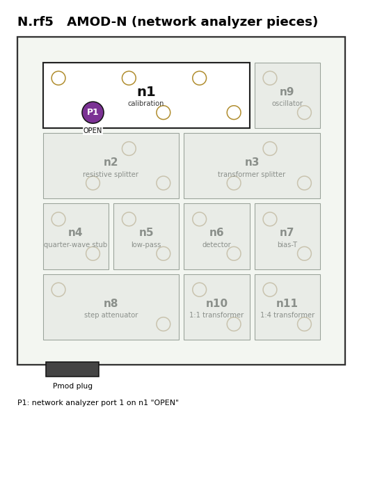

### N.rf6

```
== N.rf6 ==  AMOD-N (network analyzer pieces), network analyzer; tiles n2
Cables to move: P1, P2
First, on the board:
   * a 50 ohm terminator on n2 OUT 2
Hookup (every cable of this visit):
   P1    network analyzer port 1       ->  tile n2 "resistive splitter", jack printed "IN": row 2, column 2, the cell's top-left
   P2    network analyzer port 2       ->  tile n2 "resistive splitter", jack printed "OUT 1": row 2, column 1, the cell's bottom-right
What I then run, and what passes:
   - n2.S21 IN to OUT 1
        gain at 1 GHz: -7 to -5.3 dB
        gain at 3 GHz: -8 to -5 dB
Then say: "N.rf6 cabled" (you can leave; I report when it is done).
```

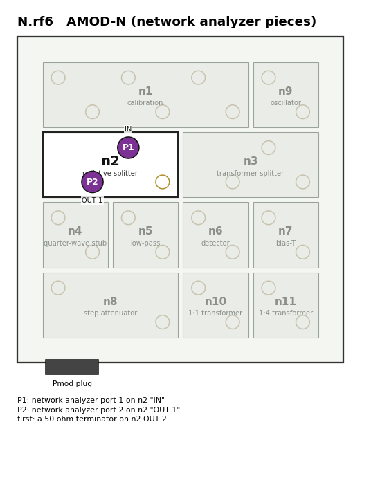

### N.rf7

```
== N.rf7 ==  AMOD-N (network analyzer pieces), network analyzer; tiles n2
Cables to move: P2
First, on the board:
   * a 50 ohm terminator on n2 OUT 1
Hookup (every cable of this visit):
   P1    network analyzer port 1       ->  tile n2 "resistive splitter", jack printed "IN": row 2, column 2, the cell's top-left
   P2    network analyzer port 2       ->  tile n2 "resistive splitter", jack printed "OUT 2": row 2, column 2, the cell's bottom-right
What I then run, and what passes:
   - n2.S21 IN to OUT 2
        gain at 1 GHz: -7 to -5.3 dB
        gain at 3 GHz: -8 to -5 dB
Then say: "N.rf7 cabled" (you can leave; I report when it is done).
```

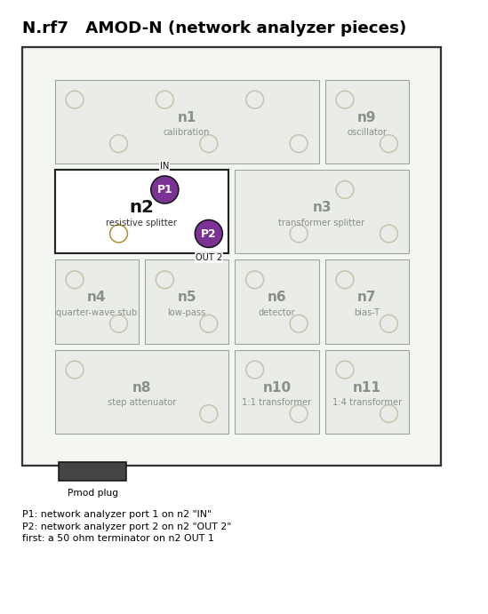

### N.rf8

```
== N.rf8 ==  AMOD-N (network analyzer pieces), network analyzer; tiles n3
Cables to move: P1, P2
First, on the board:
   * a 50 ohm terminator on n3 PORT 2
Hookup (every cable of this visit):
   P1    network analyzer port 1       ->  tile n3 "transformer splitter", jack printed "SUM": row 2, column 4, the cell's top-left
   P2    network analyzer port 2       ->  tile n3 "transformer splitter", jack printed "PORT 1": row 2, column 3, the cell's bottom-right
What I then run, and what passes:
   - n3.S21 SUM to PORT 1
        gain at 100 MHz: -4.2 to -2.8 dB
        gain at 400 MHz: -5 to -2.8 dB
Then say: "N.rf8 cabled" (you can leave; I report when it is done).
```

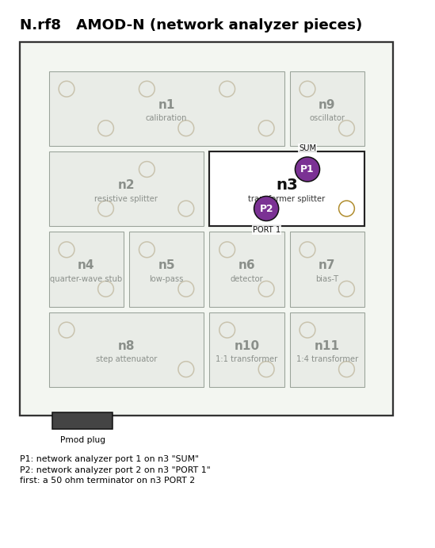

### N.rf9

```
== N.rf9 ==  AMOD-N (network analyzer pieces), network analyzer; tiles n3
Cables to move: P1, P2
First, on the board:
   * a 50 ohm terminator on n3 SUM
Hookup (every cable of this visit):
   P1    network analyzer port 1       ->  tile n3 "transformer splitter", jack printed "PORT 1": row 2, column 3, the cell's bottom-right
   P2    network analyzer port 2       ->  tile n3 "transformer splitter", jack printed "PORT 2": row 2, column 4, the cell's bottom-right
What I then run, and what passes:
   - n3.isolation, PORT 1 to PORT 2
        gain at 100 MHz: -80 to -18 dB
Then say: "N.rf9 cabled" (you can leave; I report when it is done).
```

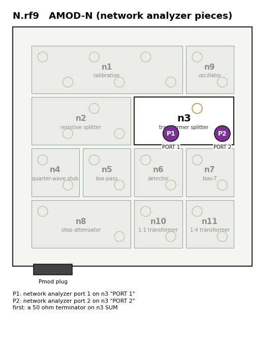

### N.rf10

```
== N.rf10 ==  AMOD-N (network analyzer pieces), network analyzer; tiles n4
Cables to move: P1, P2
Hookup (every cable of this visit):
   P1    network analyzer port 1       ->  tile n4 "quarter-wave stub", jack printed "IN": row 3, column 1, the cell's top-left
   P2    network analyzer port 2       ->  tile n4 "quarter-wave stub", jack printed "OUT": row 3, column 1, the cell's bottom-right
What I then run, and what passes:
   - n4.S21 IN to OUT
        notch frequency: 2.449 GHz (2.253 GHz to 2.644 GHz)
        gain at 300 MHz: -1.5 to 0.2 dB
        notch depth: under -15 dB
Then say: "N.rf10 cabled" (you can leave; I report when it is done).
```

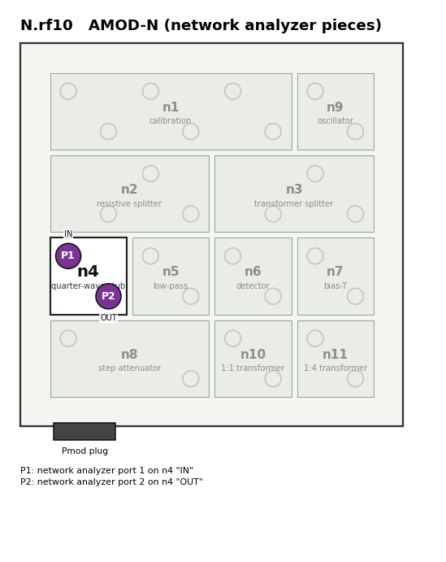

### N.rf11

```
== N.rf11 ==  AMOD-N (network analyzer pieces), network analyzer; tiles n5
Cables to move: P1, P2
Hookup (every cable of this visit):
   P1    network analyzer port 1       ->  tile n5 "low-pass", jack printed "IN": row 3, column 2, the cell's top-left
   P2    network analyzer port 2       ->  tile n5 "low-pass", jack printed "OUT": row 3, column 2, the cell's bottom-right
What I then run, and what passes:
   - n5.S21 IN to OUT
        gain at 500 MHz: -1.5 to 0.1 dB
        gain at 1 GHz: -2.5 to 0 dB
        gain at 2.5 GHz: -80 to -20 dB
Then say: "N.rf11 cabled" (you can leave; I report when it is done).
```

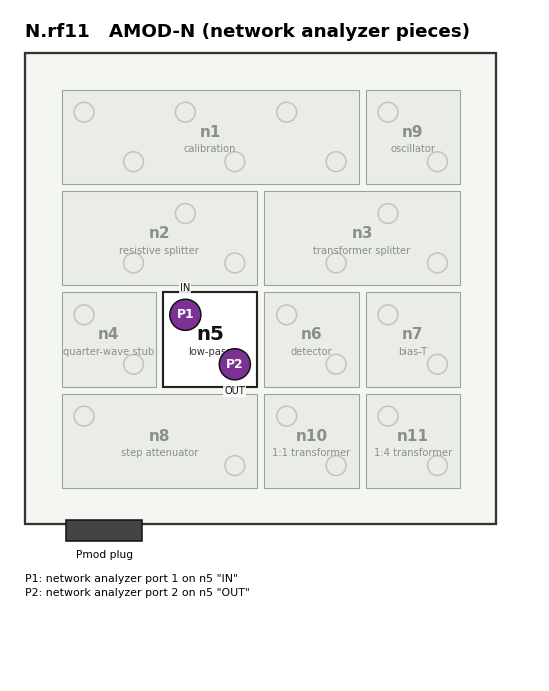

### N.rf12

```
== N.rf12 ==  AMOD-N (network analyzer pieces), network analyzer; tiles n7
Cables to move: P1, P2
Hookup (every cable of this visit):
   P1    network analyzer port 1       ->  tile n7 "bias-T", jack printed "RF": row 3, column 4, the cell's top-left
   P2    network analyzer port 2       ->  tile n7 "bias-T", jack printed "RF+DC": row 3, column 4, the cell's bottom-right
What I then run, and what passes:
   - n7.S21 RF to RF+DC
        gain at 100 MHz: -1.5 to 0.2 dB
        gain at 2.4 GHz: -2.5 to 0.2 dB
Then say: "N.rf12 cabled" (you can leave; I report when it is done).
```

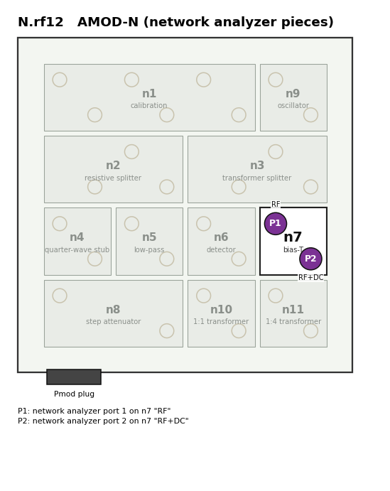

### N.rf13

```
== N.rf13 ==  AMOD-N (network analyzer pieces), network analyzer; tiles n10
Cables to move: P1, P2
Hookup (every cable of this visit):
   P1    network analyzer port 1       ->  tile n10 "1:1 transformer", jack printed "IN": row 4, column 3, the cell's top-left
   P2    network analyzer port 2       ->  tile n10 "1:1 transformer", jack printed "OUT": row 4, column 3, the cell's bottom-right
What I then run, and what passes:
   - n10.S21 IN to OUT
        gain at 100 MHz: -1.5 to 0.1 dB
        gain at 500 MHz: -3.5 to 0.1 dB
Then say: "N.rf13 cabled" (you can leave; I report when it is done).
```

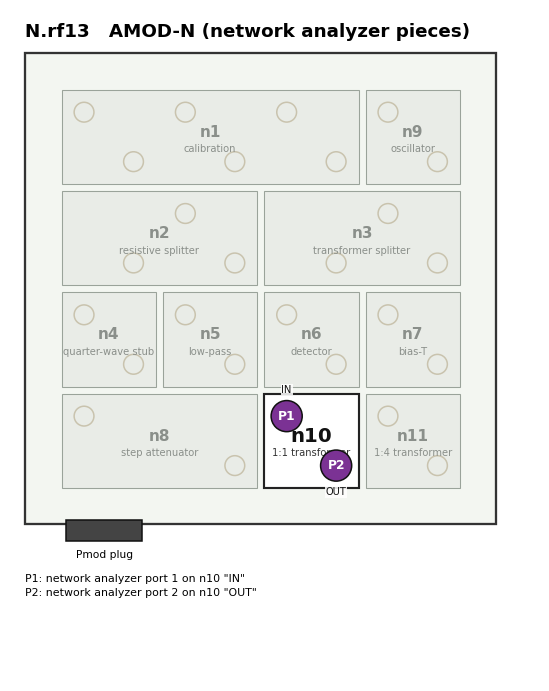

### N.rf14

```
== N.rf14 ==  AMOD-N (network analyzer pieces), network analyzer; tiles n11
Cables to move: P1; take off: P2
Hookup (every cable of this visit):
   P1    network analyzer port 1       ->  tile n11 "1:4 transformer", jack printed "IN": row 4, column 4, the cell's top-left
What I then run, and what passes:
   - n11.IN matched by 200 ohm, S11
        gain at 100 MHz: -80 to -11 dB
        gain at 500 MHz: -80 to -8 dB
Then say: "N.rf14 cabled" (you can leave; I report when it is done).
```

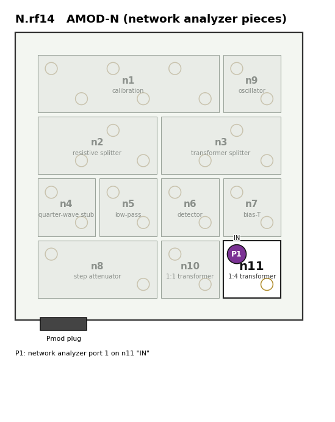

### N.rf15

```
== N.rf15 ==  AMOD-N (network analyzer pieces), network analyzer; tiles n8
Cables to move: P1, P2, HOST
Hookup (every cable of this visit):
   P1    network analyzer port 1       ->  tile n8 "step attenuator", jack printed "IN": row 4, column 1, the cell's top-left
   P2    network analyzer port 2       ->  tile n8 "step attenuator", jack printed "OUT": row 4, column 2, the cell's bottom-right
   HOST  the board's Pmod plug (bottom edge) straight into the ECP5-2ADC-2DAC **rev A** board's **Pmod A** socket; its USB PROG to this PC through the labelled D+/D- crossed USB-A-to-C cable, pmodbench.bit loaded into its FPGA (the tool checks).  Rev A plugs are non-standard: never a standard Pmod host or cable
What I then run, and what passes:
   - n8.S21 at 0 dB
        gain at 1 GHz: -3.2 to -1 dB
        gain at 3 GHz: -4.5 to -1 dB
   - n8.S21 at 16 dB
        gain at 1 GHz: -19.8 to -16.6 dB
Then say: "N.rf15 cabled" (you can leave; I report when it is done).
```

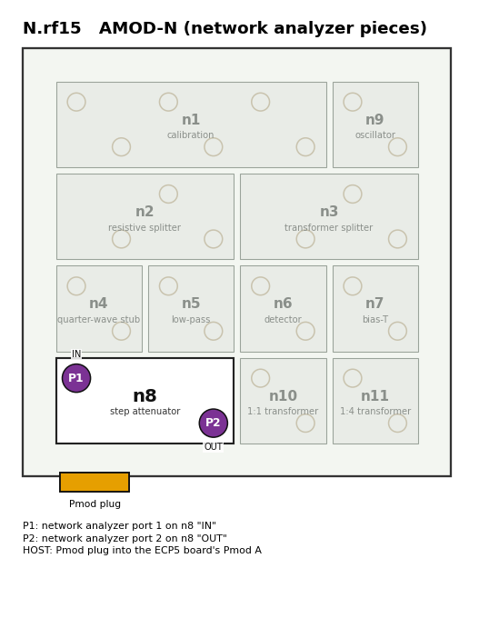

## RF-MOD: RF blocks

### R.inspect

```
R.inspect: RF-MOD, unpowered, with a loupe.  Photograph both sides first.
   [ ] r10: U1002 (MAX2871, QFN-32) pin-1 dot; r13: U1301 (TRF3722, VQFN-48) pin-1 dot; solder bridges on both.
   [ ] r12: U1201 (GALI-84+, SOT-89): its tab toward the top edge.  r5: U501 (QPL9547, DFN 2 x 2) pin-1 dot.
   [ ] r9: X901 (the TCXO) pad 1 mark; U901 (MT3608) and the SS34's cathode bar toward the output capacitor.
   [ ] r7, r8: U702 / U802 (ADL5350, 8-lead) pad 1.  r1: the ADEX-10L+'s dot.  r2 (LTCC) and r4 (SAW): lying along their lines.
   [ ] The Pmod plug hangs off the bottom edge under r10 and does not cover the OUT A- line above its pins.
Then say: "R.inspect done" (or what you saw that differs; a photo helps).
```

### R.setup

```
R.setup: set on RF-MOD, once:
   [ ] every tile's slide switch DOWN (off)
   [ ] a 50 ohm terminator ready for r10's unused output
Then say: "R.setup done".
```

### R.power

```
R.power: first power for RF-MOD.  Every tile's slide switch DOWN (off) to begin with.
Hookup:
   PWR   supply output 1 (+ and -) -> the USB-C power lead -> the board's USB-C jack (right edge, tile r9)
   (this board has no rails socket: its rails are judged by the LEDs and by the supply current)
What I run: 1.0 V, 3.0 V, then 5.00 V with a low current limit, reading the current at each; the rails; then the walk:
   the supply's display shows a tile's name ("ON r5"): slide THAT tile's switch UP; the display moves on by itself.
   Order: r5, r7, r8, r10, r12, r13.  Expected steps (mA): r5 50-85, r7 12-35, r8 12-35, r10 15-140, r12 130-220, r13 20-220.
Leave every switch UP after the walk: the later visits expect their tiles on (the rails are read again with all of them on).
Tell me which LEDs are lit on tile r9 when the supply first reaches 5 V.
Then say: "R.power cabled" and stay for the walk (about two minutes).
```

### R.v1

```
== R.v1 ==  RF-MOD (RF blocks), generator and scope; tiles r1, r9
Hookup (every cable of this visit):
   S1    scope CH1 (SMA to BNC)        ->  tile r9 "power", jack printed "REF OUT": row 2, column 3, the cell's top-left -- 50 ohm input
   G1    generator CH1 (BNC to SMA)    ->  tile r1 "diode mixer", jack printed "LO": row 1, column 1, the cell's top-left
   G2    generator CH2 (BNC to SMA)    ->  tile r1 "diode mixer", jack printed "RF": row 1, column 2, the cell's top-left
   S2    scope CH2 (SMA to BNC)        ->  tile r1 "diode mixer", jack printed "IF": row 1, column 1, the cell's bottom-right -- 50 ohm input
What I then run, and what passes:
   - r9.25 MHz reference  (TC32H4 through a 74LVC1G17 and 51 ohm: 1.6 V p-p into 50 ohm)
        freq: 24.97 MHz to 25.03 MHz
        vpp: 1 to 2.2 V
   - r1.20 MHz LO, 21 MHz RF  (+4 dBm of LO, -20 dBm of RF: -27 dBm at 1 MHz (7 dB of loss))
        tone at 1 MHz: 0.006 to 0.024 V
Then say: "R.v1 cabled" (you can leave; I report when it is done).
```

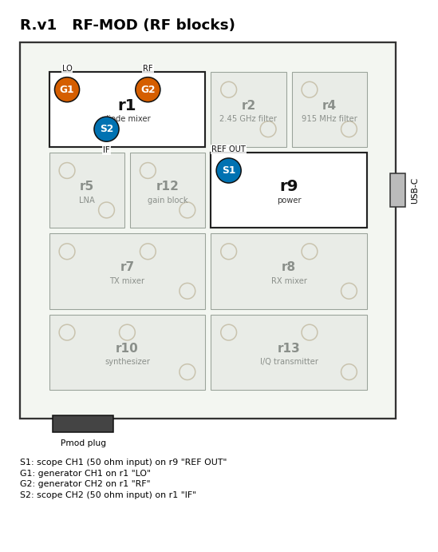

### R.rf1

```
== R.rf1 ==  RF-MOD (RF blocks), network analyzer; tiles r2
Hookup (every cable of this visit):
   P1    network analyzer port 1       ->  tile r2 "2.45 GHz filter", jack printed "IN": row 1, column 3, the cell's top-left
   P2    network analyzer port 2       ->  tile r2 "2.45 GHz filter", jack printed "OUT": row 1, column 3, the cell's bottom-right
What I then run, and what passes:
   - r2.S21 IN to OUT
        gain at 2.45 GHz: -3.8 to -0.8 dB
        gain at 1.9 GHz: -90 to -18 dB
        gain at 3.1 GHz: -90 to -15 dB
Then say: "R.rf1 cabled" (you can leave; I report when it is done).
```

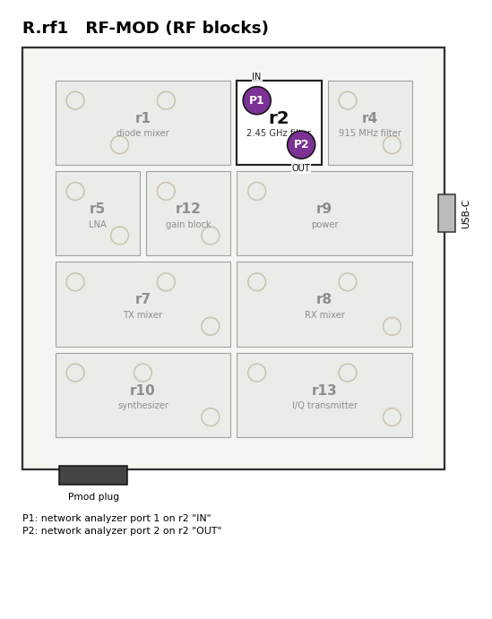

### R.rf2

```
== R.rf2 ==  RF-MOD (RF blocks), network analyzer; tiles r4
Cables to move: P1, P2
Hookup (every cable of this visit):
   P1    network analyzer port 1       ->  tile r4 "915 MHz filter", jack printed "IN": row 1, column 4, the cell's top-left
   P2    network analyzer port 2       ->  tile r4 "915 MHz filter", jack printed "OUT": row 1, column 4, the cell's bottom-right
What I then run, and what passes:
   - r4.S21 IN to OUT
        gain at 915 MHz: -3.6 to -0.5 dB
        gain at 860 MHz: -95 to -25 dB
        gain at 970 MHz: -95 to -25 dB
Then say: "R.rf2 cabled" (you can leave; I report when it is done).
```

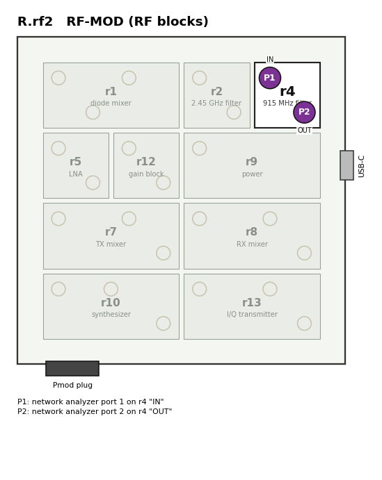

### R.rf3

```
== R.rf3 ==  RF-MOD (RF blocks), network analyzer; tiles r5
Cables to move: P1, P2
First, on the board:
   * r5's slide switch UP
Hookup (every cable of this visit):
   P1    network analyzer port 1       ->  tile r5 "LNA", jack printed "IN": row 2, column 1, the cell's top-left
   P2    network analyzer port 2       ->  tile r5 "LNA", jack printed "OUT": row 2, column 1, the cell's bottom-right
What I then run, and what passes:
   - r5.S21 IN to OUT  (QPL9547: never more than -20 dBm in)
        gain at 1 GHz: 15 to 23.5 dB
        gain at 2.4 GHz: 11 to 21 dB
Then say: "R.rf3 cabled" (you can leave; I report when it is done).
```

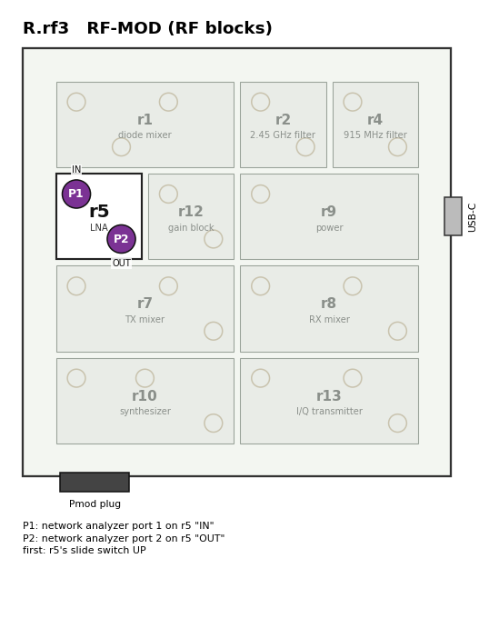

### R.rf4

```
== R.rf4 ==  RF-MOD (RF blocks), network analyzer; tiles r12
Cables to move: P1, P2
First, on the board:
   * r12's slide switch UP
Hookup (every cable of this visit):
   P1    network analyzer port 1       ->  tile r12 "gain block", jack printed "IN": row 2, column 2, the cell's top-left
   P2    network analyzer port 2       ->  tile r12 "gain block", jack printed "OUT": row 2, column 2, the cell's bottom-right
What I then run, and what passes:
   - r12.S21 IN to OUT  (GALI-84+ from 7.8 V through 22 ohm)
        gain at 1 GHz: 17 to 24.5 dB
        gain at 2.4 GHz: 13 to 22 dB
Then say: "R.rf4 cabled" (you can leave; I report when it is done).
```

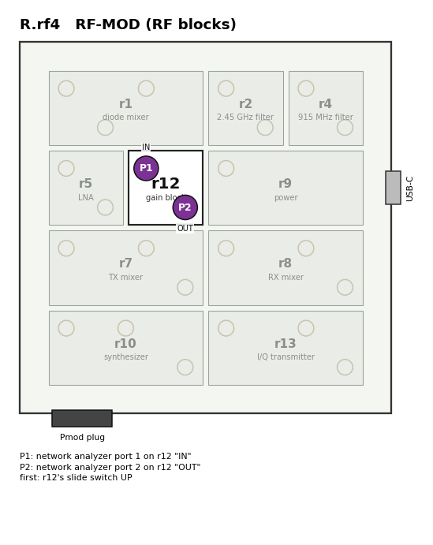

### R.plug

```
R.plug: is the plug the right way round?  Both boards unpowered: no USB on either, no SMA cable, no supply lead.
   1. Plug RF-MOD's Pmod plug (its bottom edge, under tile r10) into the ECP5-2ADC-2DAC board's Pmod A socket (the lower of its two
      sockets on its right edge), pins straight in, the two boards flat on the bench.
   2. Meter on ohms: one lead on the shell of any SMA jack on the ECP5 board's left edge, the other on the shell of any
      SMA jack of RF-MOD.  It must read under 1 ohm: the two grounds meet only through the plug's pins 5 and 11.
      If it reads high (or a diode's drop on the diode range), the plug is mirrored against the socket: STOP,
      unplug, and tell me (REVB 1.15).  Nothing is powered, so nothing is harmed.
   The rev A plugs mate only with ECP5-2ADC-2DAC rev A's sockets (both non-standard, REVB 1.15): never a standard Pmod
   host, a Digilent module or a Pmod cable.
Then say: "R.plug done" with the reading.
```

### R.sa1

```
== R.sa1 ==  RF-MOD (RF blocks), spectrum analyzer; tiles r10
First, on the board:
   * an SMA cable from r9 REF OUT to r10 REF IN
   * a 50 ohm terminator on r10's other output
   * r10's slide switch UP
Hookup (every cable of this visit):
   SA    spectrum analyzer input       ->  tile r10 "synthesizer", jack printed "OUT A+": row 4, column 1, the cell's top-left
   HOST  the board's Pmod plug (bottom edge) straight into the ECP5-2ADC-2DAC **rev A** board's **Pmod A** socket; its USB PROG to this PC through the labelled D+/D- crossed USB-A-to-C cable, pmodbench.bit loaded into its FPGA (the tool checks).  Rev A plugs are non-standard: never a standard Pmod host or cable
What I then run, and what passes:
   - r10.OUT A+ at 915 MHz  (MAX2871 at its top power step (+5 dBm), locked to the TCXO)
        frequency near 915 MHz: 914.9 MHz to 915.1 MHz
        level near 915 MHz: -6 to 9 dBm
   - r10.OUT A+ at 2440 MHz  (MAX2871 at its top power step (+5 dBm), locked to the TCXO)
        frequency near 2.44 GHz: 2.44 GHz to 2.44 GHz
        level near 2.44 GHz: -6 to 9 dBm
   - r10.OUT A+ at 100 MHz  (MAX2871 at its top power step (+5 dBm), locked to the TCXO)
        frequency near 100 MHz: 99.94 MHz to 100.1 MHz
        level near 100 MHz: -6 to 9 dBm
   - r10.OUT A+ at 5800 MHz  (MAX2871 at its top power step (+5 dBm), locked to the TCXO)
        frequency near 5.8 GHz: 5.8 GHz to 5.8 GHz
        level near 5.8 GHz: -12 to 9 dBm
Then say: "R.sa1 cabled" (you can leave; I report when it is done).
```

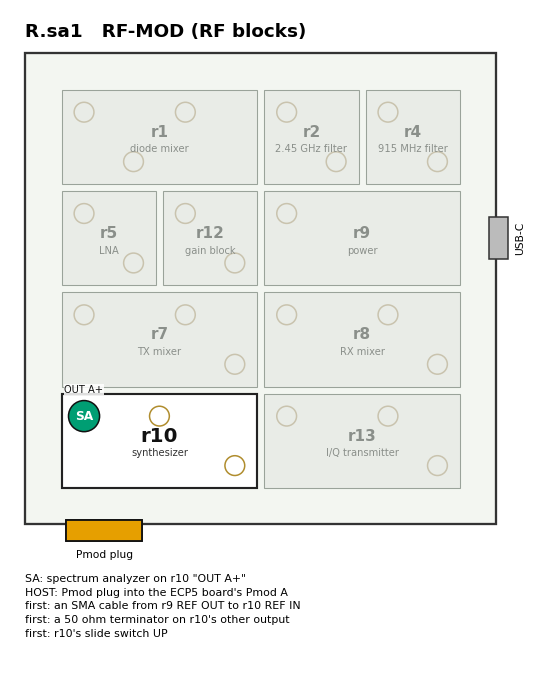

### R.sa2

```
== R.sa2 ==  RF-MOD (RF blocks), spectrum analyzer; tiles r10
Cables to move: SA
First, on the board:
   * an SMA cable from r9 REF OUT to r10 REF IN
   * a 50 ohm terminator on r10's other output
   * r10's slide switch UP
Hookup (every cable of this visit):
   SA    spectrum analyzer input       ->  tile r10 "synthesizer", jack printed "OUT A-": row 4, column 2, the cell's bottom-right
   HOST  the board's Pmod plug (bottom edge) straight into the ECP5-2ADC-2DAC **rev A** board's **Pmod A** socket; its USB PROG to this PC through the labelled D+/D- crossed USB-A-to-C cable, pmodbench.bit loaded into its FPGA (the tool checks).  Rev A plugs are non-standard: never a standard Pmod host or cable
What I then run, and what passes:
   - r10.OUT A- at 915 MHz  (the complementary output: the same power within a dB or two)
        level near 915 MHz: -6 to 9 dBm
Then say: "R.sa2 cabled" (you can leave; I report when it is done).
```

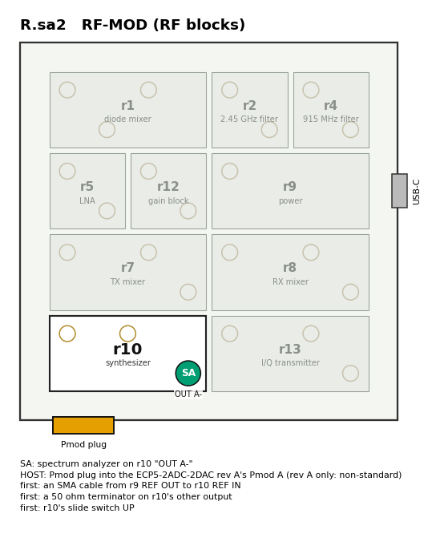

### R.sa3

```
== R.sa3 ==  RF-MOD (RF blocks), spectrum analyzer; tiles r7
Cables to move: G1, SA
First, on the board:
   * an SMA cable from r10 OUT A+ to r7 LO
   * an SMA cable from r9 REF OUT to r10 REF IN
   * a 50 ohm terminator on r10 OUT A-
Hookup (every cable of this visit):
   G1    generator CH1 (BNC to SMA)    ->  tile r7 "TX mixer", jack printed "IF": row 3, column 2, the cell's bottom-right
   SA    spectrum analyzer input       ->  tile r7 "TX mixer", jack printed "RF": row 3, column 1, the cell's top-left
   HOST  the board's Pmod plug (bottom edge) straight into the ECP5-2ADC-2DAC **rev A** board's **Pmod A** socket; its USB PROG to this PC through the labelled D+/D- crossed USB-A-to-C cable, pmodbench.bit loaded into its FPGA (the tool checks).  Rev A plugs are non-standard: never a standard Pmod host or cable
What I then run, and what passes:
   - r7.up-conversion at 915 MHz  (0 dBm at 6.25 MHz on IF: both sidebands about 8 dB down)
        level near 921.25 MHz: -18 to -3 dBm
        level near 908.75 MHz: -18 to -3 dBm
Then say: "R.sa3 cabled" (you can leave; I report when it is done).
```

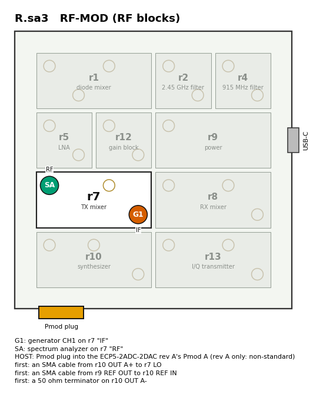

### R.sa4

```
== R.sa4 ==  RF-MOD (RF blocks), spectrum analyzer; tiles r8
Cables to move: G1, SA
First, on the board:
   * an SMA cable from r10 OUT A+ to r8 LO
   * an SMA cable from r9 REF OUT to r10 REF IN
   * a 50 ohm terminator on r10 OUT A-
Hookup (every cable of this visit):
   G1    generator CH1 (BNC to SMA)    ->  tile r8 "RX mixer", jack printed "IF": row 3, column 4, the cell's bottom-right
   SA    spectrum analyzer input       ->  tile r8 "RX mixer", jack printed "RF": row 3, column 3, the cell's top-left
   HOST  the board's Pmod plug (bottom edge) straight into the ECP5-2ADC-2DAC **rev A** board's **Pmod A** socket; its USB PROG to this PC through the labelled D+/D- crossed USB-A-to-C cable, pmodbench.bit loaded into its FPGA (the tool checks).  Rev A plugs are non-standard: never a standard Pmod host or cable
What I then run, and what passes:
   - r8.up-conversion at 915 MHz  (0 dBm at 6.25 MHz on IF: both sidebands about 8 dB down)
        level near 921.25 MHz: -18 to -3 dBm
        level near 908.75 MHz: -18 to -3 dBm
Then say: "R.sa4 cabled" (you can leave; I report when it is done).
```

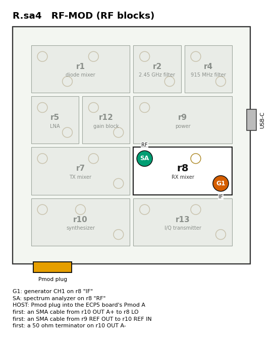

### R.sa5

```
== R.sa5 ==  RF-MOD (RF blocks), spectrum analyzer; tiles r13
Cables to move: G1, SA
First, on the board:
   * an SMA cable from r9 REF OUT to r10 REF IN (the back trace carries it on to r13)
   * r13's slide switch UP
   * r10's slide switch UP too: with r10 off, r13's programming and the reference back-power it (REVB 1.13)
Hookup (every cable of this visit):
   G1    generator CH1 (BNC to SMA)    ->  tile r13 "I/Q transmitter", jack printed "I IN": row 4, column 3, the cell's top-left
   SA    spectrum analyzer input       ->  tile r13 "I/Q transmitter", jack printed "RF OUT": row 4, column 4, the cell's bottom-right
   HOST  the board's Pmod plug (bottom edge) straight into the ECP5-2ADC-2DAC **rev A** board's **Pmod A** socket; its USB PROG to this PC through the labelled D+/D- crossed USB-A-to-C cable, pmodbench.bit loaded into its FPGA (the tool checks).  Rev A plugs are non-standard: never a standard Pmod host or cable
What I then run, and what passes:
   - r13.carrier at 915 MHz  (DC on I alone is a CW carrier; about -3 dBm at full scale)
        level near 915 MHz: -20 to 3 dBm
Then say: "R.sa5 cabled" (you can leave; I report when it is done).
```

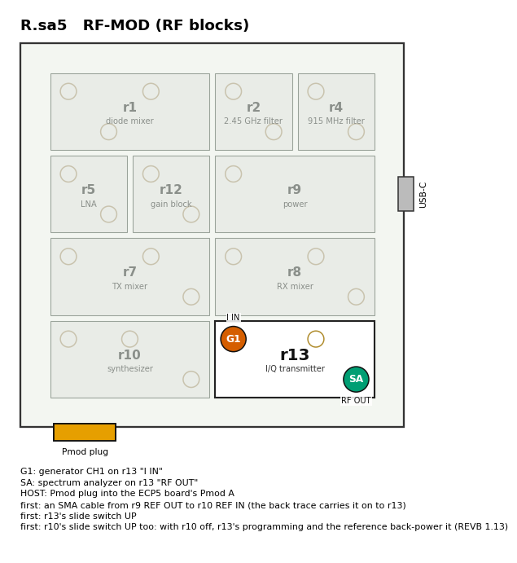

## AMOD-C: conversion

### C.inspect

```
C.inspect: AMOD-C, unpowered, with a loupe.  Photograph both sides first.
   [ ] c9 Q903 and c10 Q1002 (DMMT3904W, SOT-363): the pin-1 mark at the BOTTOM-RIGHT corner as the board reads (they are turned 180).
   [ ] c7: U701 (LF398, SOIC-14) pin 1; c4: U401 (MAX7410, MSOP-8) pin 1; c5: U501 (TSSOP-16) pin 1.
   [ ] c2: the 2.2 uH inductor and the three SOT-23-5 parts; c3: U302 (ICL7660A, SOIC-8) pin 1.
   [ ] c10: the 1 x 2 header; the Pmod plug hangs off the bottom edge under c9.
Then say: "C.inspect done" (or what you saw that differs; a photo helps).
```

### C.setup

```
C.setup: set on AMOD-C, once:
   [ ] c10: no jumper on the CE header (parked on one pin, or off)
   [ ] every tile's slide switch DOWN (off)
Then say: "C.setup done".
```

### C.power

```
C.power: first power for AMOD-C.  Every tile's slide switch DOWN (off) to begin with.
Hookup:
   PWR   supply output 1 (+ and -) -> the USB-C power lead -> the board's USB-C jack (right edge, tile c1)
   S1    scope CH1, a BNC-to-clip lead (x1) on a jumper pin in the rails socket hole printed "+5" (top edge of tile c1)
   S2    scope CH2, the same, in the hole printed "-5"
   S3    scope CH3, the same, in the hole printed "3V3"; all three ground clips on a pin in a hole printed "G"
What I run: 1.0 V, 3.0 V, then 5.00 V with a low current limit, reading the current at each; the rails; then the walk:
   the supply's display shows a tile's name ("ON c2"): slide THAT tile's switch UP; the display moves on by itself.
   Order: c2, c3, c4, c5, c6, c7, c8, c9, c10, c11, c12.  Expected steps (mA): c2 1-12, c3 0.1-5, c4 1-8, c5 5-14, c6 8-30, c7 3-16, c8 0.02-3, c9 6-18, c10 2-12, c11 0.2-8, c12 2-10.
Leave every switch UP after the walk: the later visits expect their tiles on (the rails are read again with all of them on).
Tell me which LEDs are lit on tile c1 when the supply first reaches 5 V.
Then say: "C.power cabled" and stay for the walk (about two minutes).
```

### C.v1

```
== C.v1 ==  AMOD-C (conversion), generator and scope; tiles c2, c9
Hookup (every cable of this visit):
   G1    generator CH1 (BNC to SMA)    ->  tile c2 "regulators", jack printed "LOAD 50R": row 3, column 3, the cell's top-left
   S1    scope CH1 (SMA to BNC)        ->  tile c2 "regulators", jack printed "BUCK~": row 3, column 2, the cell's bottom-right -- 1 Mohm input
   S2    scope CH2 (SMA to BNC)        ->  tile c2 "regulators", jack printed "LDO~": row 3, column 3, the cell's bottom-right -- 1 Mohm input
   G2    generator CH2 (BNC to SMA)    ->  tile c9 "differential pair", jack printed "IN+ 50R": row 4, column 1, the cell's top-left
   S3    scope CH3 (SMA to BNC)        ->  tile c9 "differential pair", jack printed "OUT": row 4, column 2, the cell's bottom-right -- 1 Mohm input
What I then run, and what passes:
   - c2.electronic load  (LOAD 0.5 V: 50 mA from the LDO: 50 mA x 3.6 V / (5 V x 0.88))
        input current for 50 mA of load: 0.026 to 0.058 A
   - c2.load step  (a 0 to 50 mA step: the buck's transient, and the LDO's smaller one)
        vpp (buck): 0.002 to 0.4 V
        LDO~ / BUCK~: 0 to 0.9
   - c9.DC transfer  (-1 k x 0.98 mA x tanh(Vd / 52 mV); IN- rests at 0 V on its own 49.9 ohm)
        OUT@0.1: -0.939 (-1.069 to -0.809)
        OUT@-0.1: 0.939 (0.809 to 1.069)
        OUT@0.01: -0.1862 (-0.2562 to -0.1162)
        OUT@-0.01: 0.1862 (0.1162 to 0.2562)
        OUT@0: -0.15 to 0.15 V
Then say: "C.v1 cabled" (you can leave; I report when it is done).
```

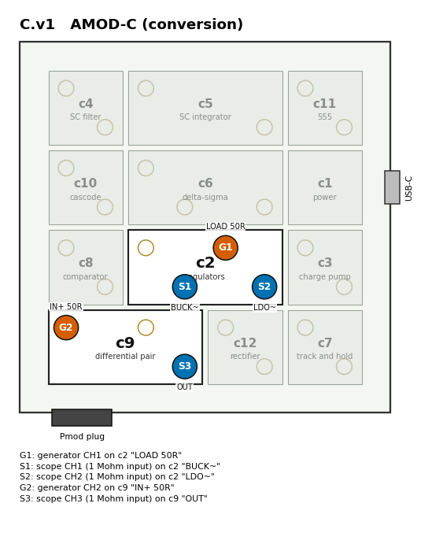

### C.v2

```
== C.v2 ==  AMOD-C (conversion), generator and scope; tiles c10, c11
Cables to move: G1, S1, G2, S2; take off: S3
Hookup (every cable of this visit):
   G1    generator CH1 (BNC to SMA)    ->  tile c10 "cascode", jack printed "IN 50R": row 2, column 1, the cell's top-left
   S1    scope CH1 (SMA to BNC)        ->  tile c10 "cascode", jack printed "OUT": row 2, column 1, the cell's bottom-right -- 1 Mohm input
   G2    generator CH2 (BNC to SMA)    ->  tile c11 "555", jack printed "CV 50R": row 1, column 4, the cell's top-left
   S2    scope CH2 (SMA to BNC)        ->  tile c11 "555", jack printed "OUT /4.9": row 1, column 4, the cell's bottom-right -- 1 Mohm input
What I then run, and what passes:
   - c10.cascode  (no jumper: Q1's collector held still)
        gain at 100 kHz: 11.5 to 19 dB
        -3 dB corner: 3.5 MHz to 60 MHz
   - c11.free running  (silk says 6.9 kHz; the netlist predicts 11-14 kHz with CV unconnected: record which)
        freq: 5.5 kHz to 17 kHz
        vpp: 0.6 to 1.3 V
   - c11.CV moves it  (a higher control voltage: a longer charge, a lower frequency)
        f(+1 V) / f(0 V): 0.4 to 0.985
Then say: "C.v2 cabled" (you can leave; I report when it is done).
```

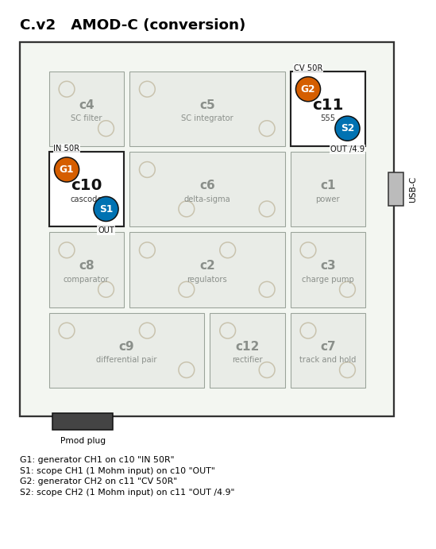

### C.v3

```
== C.v3 ==  AMOD-C (conversion), generator and scope; tiles c12
Cables to move: G1, S1; take off: G2, S2
Hookup (every cable of this visit):
   G1    generator CH1 (BNC to SMA)    ->  tile c12 "rectifier", jack printed "IN 50R": row 4, column 3, the cell's top-left
   S1    scope CH1 (SMA to BNC)        ->  tile c12 "rectifier", jack printed "|IN|": row 4, column 3, the cell's bottom-right -- 1 Mohm input
What I then run, and what passes:
   - c12.waveform  (OUT = |IN|: twice the frequency)
        vmax: 0.43 to 0.56 V
        vmin: -0.03 to 0.06 V
        freq: 1.9 kHz to 2.1 kHz
Then say: "C.v3 cabled" (you can leave; I report when it is done).
```

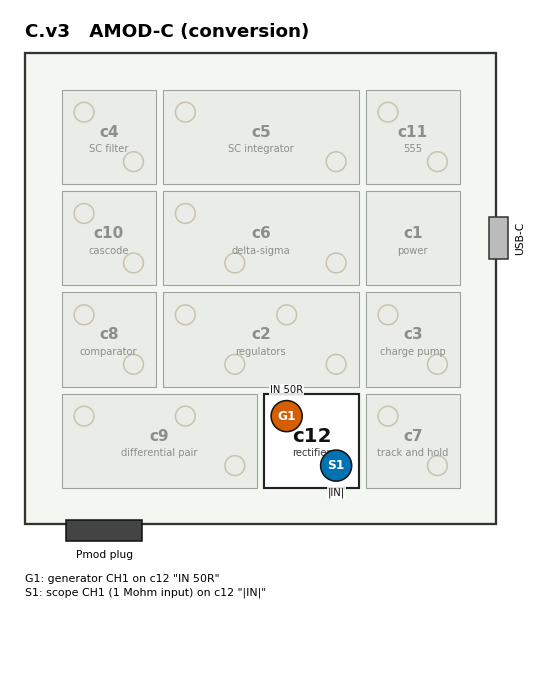

### C.plug

```
C.plug: is the plug the right way round?  Both boards unpowered: no USB on either, no SMA cable, no supply lead.
   1. Plug AMOD-C's Pmod plug (its bottom edge, under tile c9) into the ECP5-2ADC-2DAC board's Pmod A socket (the lower of its two
      sockets on its right edge), pins straight in, the two boards flat on the bench.
   2. Meter on ohms: one lead on the shell of any SMA jack on the ECP5 board's left edge, the other on the shell of any
      SMA jack of AMOD-C.  It must read under 1 ohm: the two grounds meet only through the plug's pins 5 and 11.
      If it reads high (or a diode's drop on the diode range), the plug is mirrored against the socket: STOP,
      unplug, and tell me (REVB 1.15).  Nothing is powered, so nothing is harmed.
   The rev A plugs mate only with ECP5-2ADC-2DAC rev A's sockets (both non-standard, REVB 1.15): never a standard Pmod
   host, a Digilent module or a Pmod cable.
Then say: "C.plug done" with the reading.
```

### C.host1

```
== C.host1 ==  AMOD-C (conversion), on the Pmod host; tiles c3, c4, c5
Hookup (every cable of this visit):
   S1    scope CH1 (SMA to BNC)        ->  tile c3 "charge pump", jack printed "OUT /5.7": row 3, column 4, the cell's bottom-right -- 1 Mohm input
   S2    scope CH2 (SMA to BNC)        ->  tile c3 "charge pump", jack printed "CAP /5.7": row 3, column 4, the cell's top-left -- 1 Mohm input
   G1    generator CH1 (BNC to SMA)    ->  tile c4 "SC filter", jack printed "IN 50R": row 1, column 1, the cell's top-left
   S3    scope CH3 (SMA to BNC)        ->  tile c4 "SC filter", jack printed "OUT": row 1, column 1, the cell's bottom-right -- 1 Mohm input
   G2    generator CH2 (BNC to SMA)    ->  tile c5 "SC integrator", jack printed "IN 50R": row 1, column 2, the cell's top-left
   S4    scope CH4 (SMA to BNC)        ->  tile c5 "SC integrator", jack printed "OUT": row 1, column 3, the cell's bottom-right -- 1 Mohm input
   HOST  the board's Pmod plug (bottom edge) straight into the ECP5-2ADC-2DAC **rev A** board's **Pmod A** socket; its USB PROG to this PC through the labelled D+/D- crossed USB-A-to-C cable, pmodbench.bit loaded into its FPGA (the tool checks).  Rev A plugs are non-standard: never a standard Pmod host or cable
What I then run, and what passes:
   - c3.pump against its clock  (Rout = 1 / (f C) + 60 ohm into 1 k: -4.6 V at 100 kHz, -2.4 V at 2 kHz, each / 5.7)
        out 100 kHz: -0.92 to -0.68 V
        out 2 kHz: -0.6 to -0.25 V
        cap vpp: 0.3 to 1.2 V
   - c4.clock 1000 kHz  (corner = clock / 100)
        gain at 1.5 kHz: -3.127e-08 dB (-1 to 1 dB)
        -3 dB corner (high side): 9.977 kHz (9.179 kHz to 10.78 kHz)
        gain two corners up: -50 to -22 dB
   - c4.clock 500 kHz  (corner = clock / 100)
        gain at 1.5 kHz: -3.202e-05 dB (-1 to 1 dB)
        -3 dB corner (high side): 4.928 kHz (4.534 kHz to 5.322 kHz)
        gain two corners up: -50 to -22 dB
   - c5.response  (R = 1 / (100 kHz x 1 nF) = 10 k into 10 nF: 1592 / f)
        gain at 1 kHz: 4.027 dB (2.527 to 5.527 dB)
        gain at 3 kHz: -5.515 dB (-7.015 to -4.015 dB)
        PREDICTED ON PAPER: REVB 1.7: the TMUX4053 runs below its 5 V minimum; expected to work with more on-resistance
Then say: "C.host1 cabled" (you can leave; I report when it is done).
```

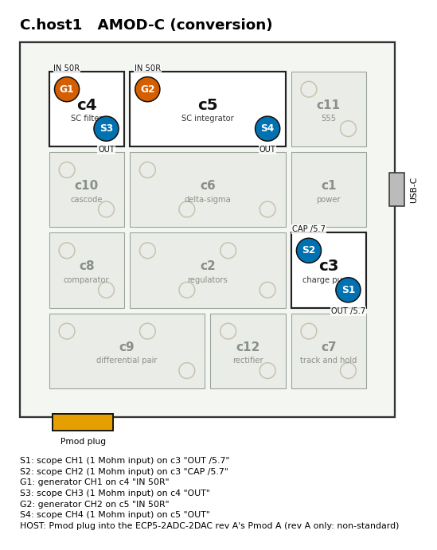

### C.host2

```
== C.host2 ==  AMOD-C (conversion), on the Pmod host; tiles c6, c7
Cables to move: G1, G2, S1; take off: S2, S3, S4
Hookup (every cable of this visit):
   G1    generator CH1 (BNC to SMA)    ->  tile c6 "delta-sigma", jack printed "IN 10K": row 2, column 2, the cell's top-left
   G2    generator CH2 (BNC to SMA)    ->  tile c7 "track and hold", jack printed "IN 50R": row 4, column 4, the cell's top-left
   S1    scope CH1 (SMA to BNC)        ->  tile c7 "track and hold", jack printed "OUT": row 4, column 4, the cell's bottom-right -- 1 Mohm input
   HOST  the board's Pmod plug (bottom edge) straight into the ECP5-2ADC-2DAC **rev A** board's **Pmod A** socket; its USB PROG to this PC through the labelled D+/D- crossed USB-A-to-C cable, pmodbench.bit loaded into its FPGA (the tool checks).  Rev A plugs are non-standard: never a standard Pmod host or cable
What I then run, and what passes:
   - c6.ones density against IN  (second order: density = 0.5 + IN / 3.3 V)
        density@-1: 0.197 (0.147 to 0.247)
        density@0: 0.5 (0.46 to 0.54)
        density@1: 0.803 (0.753 to 0.853)
   - c7.track  (IO5 high: OUT follows IN)
        tone at 1 kHz: 0.44 to 0.53 V
   - c7.hold  (IO5 low: OUT stands still (30 mV/s of droop))
        vpp: 0 to 0.06 V
        PREDICTED ON PAPER: REVB 1.8: the LF398 runs below +-5 V; IN here stays within +-0.5 V, inside the -0.8 to +1.2 V it still promises
Then say: "C.host2 cabled" (you can leave; I report when it is done).
```


### C.host3

```
== C.host3 ==  AMOD-C (conversion), on the Pmod host; tiles c8
Cables to move: G1, G2; take off: S1
Hookup (every cable of this visit):
   G1    generator CH1 (BNC to SMA)    ->  tile c8 "comparator", jack printed "IN 20K": row 3, column 1, the cell's top-left
   G2    generator CH2 (BNC to SMA)    ->  tile c8 "comparator", jack printed "DAC 20K": row 3, column 1, the cell's bottom-right
   HOST  the board's Pmod plug (bottom edge) straight into the ECP5-2ADC-2DAC **rev A** board's **Pmod A** socket; its USB PROG to this PC through the labelled D+/D- crossed USB-A-to-C cable, pmodbench.bit loaded into its FPGA (the tool checks).  Rev A plugs are non-standard: never a standard Pmod host or cable
What I then run, and what passes:
   - c8.the bit against the DAC  (IN +0.5 V; DAC at -0.2 V, then +1.2 V)
        bit, DAC below IN: 1 to 1
        bit, DAC above IN: 0 to 0
Then say: "C.host3 cabled" (you can leave; I report when it is done).
```


### C.hands1

```
== C.hands1 ==  AMOD-C (conversion), with you at the bench; tiles c10
Hookup (every cable of this visit):
   G1    generator CH1 (BNC to SMA)    ->  tile c10 "cascode", jack printed "IN 50R": row 2, column 1, the cell's top-left
   S1    scope CH1 (SMA to BNC)        ->  tile c10 "cascode", jack printed "OUT": row 2, column 1, the cell's bottom-right -- 1 Mohm input
What I then run, and what passes:
   * you: c10: jumper ON the CE header's two pins
   - c10.common emitter  (the Miller capacitance back: about 2 MHz)
        -3 dB corner: 700 kHz to 4 MHz
Then say: "C.hands1 cabled" and stay: I run one part at a time and say what to change before the next.
```


## PhMOD: physics

### H.inspect

```
H.inspect: PhMOD, unpowered, with a loupe.  Photograph both sides first.
   [ ] h1: U101 (TPS65131, VQFN-24) pin 1; the inverter's B5819W points from the inductor's node to -15 V as drawn.
   [ ] h2: U201 (THS3491, VQFN-16 3 x 3) pin-1 dot.  h4: U401 (DRV8876, HTSSOP-16) pin 1; both B5819W bars toward VM.
   [ ] h3: four pairs of 1N4148W, each pair with one bar each way.  h8: four BB133, in pairs cathode to cathode.
   [ ] h10: the three SOT-23 FETs; the B5819W's bar toward the inductors.  h9: Q902 (MMBT3904).
   [ ] h4: both screw terminals' openings toward the right edge, not overhanging it.  The Pmod plug under h5.
Then say: "H.inspect done" (or what you saw that differs; a photo helps).
```

### H.setup

```
H.setup: set on PhMOD, once:
   [ ] h8 DIP (4 ways): all OFF
   [ ] every tile's slide switch DOWN (off)
   [ ] nothing on h4's terminals, no laser anywhere near h10
Then say: "H.setup done".
```

### H.power

```
H.power: first power for PhMOD.  Every tile's slide switch DOWN (off) to begin with.
Hookup:
   PWR   supply output 1 (+ and -) -> the USB-C power lead -> the board's USB-C jack (right edge, tile h1)
   (this board has no rails socket: its rails are judged by the LEDs and by the supply current)
What I run: 1.0 V, 3.0 V, then 5.00 V with a low current limit, reading the current at each; the rails; then the walk:
   the supply's display shows a tile's name ("ON h3"): slide THAT tile's switch UP; the display moves on by itself.
   Order: h3, h4, h5, h6, h7, h8, h9, h10.  Expected steps (mA): h3 14-40, h4 2-16, h5 22-60, h6 3-12, h7 10-28, h8 0.02-3, h9 10-34, h10 4-20.
Leave every switch UP after the walk: the later visits expect their tiles on (the rails are read again with all of them on).
Tell me which LEDs are lit on tile h1 when the supply first reaches 5 V.
Then say: "H.power cabled" and stay for the walk (about two minutes).
```

### H.v1

```
== H.v1 ==  PhMOD (physics), generator and scope; tiles h3, h4
Hookup (every cable of this visit):
   G1    generator CH1 (BNC to SMA)    ->  tile h3 "duplexer and preamp", jack printed "LINE": row 1, column 2, the cell's top-left
   G2    generator CH2 (BNC to SMA)    ->  tile h3 "duplexer and preamp", jack printed "TX IN": row 1, column 1, the cell's top-left
   S1    scope CH1 (SMA to BNC)        ->  tile h3 "duplexer and preamp", jack printed "RX OUT": row 1, column 2, the cell's bottom-right -- 1 Mohm input
   S2    scope CH2 (SMA to BNC)        ->  tile h3 "duplexer and preamp", jack printed "PROBE": row 1, column 1, the cell's bottom-right -- 50 ohm input
   S3    scope CH3 (SMA to BNC)        ->  tile h4 "coil driver", jack printed "MON": row 4, column 4, the cell's top-left -- 1 Mohm input
What I then run, and what passes:
   - h3.preamplifier  (OPA847 at 1 + 1.1 k / 100 = 12 behind the clamp)
        gain at 1 MHz: 21.58 dB (20.58 to 22.58 dB)
        gain at 10 MHz: 21.32 dB (19.82 to 22.82 dB)
   - h3.large pulse passes  (two crossed pairs in series: 8 V p-p of drive less 2.5 V, halved into 50 ohm)
        vpp (probe): 2 to 3.5 V
   - h3.small signal blocked  (0.4 V p-p never turns the diodes on: the transmitter's noise stays out)
        vpp (probe): 0 to 0.03 V
   - h4.no coil
        mean: -0.05 to 0.08 V
Then say: "H.v1 cabled" (you can leave; I report when it is done).
```


### H.v2

```
== H.v2 ==  PhMOD (physics), generator and scope; tiles h5
Cables to move: G1, G2, S1, S2; take off: S3
Hookup (every cable of this visit):
   G1    generator CH1 (BNC to SMA)    ->  tile h5 "HF receiver", jack printed "IN A": row 4, column 1, the cell's top-left
   G2    generator CH2 (BNC to SMA)    ->  tile h5 "HF receiver", jack printed "IN B": row 4, column 2, the cell's top-left
   S1    scope CH1 (SMA to BNC)        ->  tile h5 "HF receiver", jack printed "OUT A": row 4, column 1, the cell's bottom-right -- 1 Mohm input
   S2    scope CH2 (SMA to BNC)        ->  tile h5 "HF receiver", jack printed "OUT B": row 4, column 2, the cell's bottom-right -- 1 Mohm input
What I then run, and what passes:
   - h5.channel A
        gain at 1 MHz: 19.9 dB (19.1 to 20.7 dB)
        gain at 10 MHz: 19.65 dB (18.65 to 20.65 dB)
        gain at 30 MHz: 17 to 21.5 dB
   - h5.channel B
        gain at 1 MHz: 19.9 dB (19.1 to 20.7 dB)
        gain at 10 MHz: 19.65 dB (18.65 to 20.65 dB)
        gain at 30 MHz: 17 to 21.5 dB
Then say: "H.v2 cabled" (you can leave; I report when it is done).
```


### H.v3

```
== H.v3 ==  PhMOD (physics), generator and scope; tiles h6, h7
Cables to move: G1, S1, G2, S2, S3
Hookup (every cable of this visit):
   G1    generator CH1 (BNC to SMA)    ->  tile h6 "VLF loop amplifier", jack printed "LOOP": row 4, column 3, the cell's top-left
   S1    scope CH1 (SMA to BNC)        ->  tile h6 "VLF loop amplifier", jack printed "OUT": row 4, column 3, the cell's bottom-right -- 1 Mohm input
   G2    generator CH2 (BNC to SMA)    ->  tile h7 "reflection bridge", jack printed "DRIVE": row 2, column 1, the cell's top-left
   S2    scope CH2 (SMA to BNC)        ->  tile h7 "reflection bridge", jack printed "INC": row 2, column 1, the cell's bottom-right -- 50 ohm input
   S3    scope CH3 (SMA to BNC)        ->  tile h7 "reflection bridge", jack printed "REFL": row 2, column 2, the cell's bottom-right -- 50 ohm input
What I then run, and what passes:
   - h6.response  (x101, 1.6 kHz to 160 kHz; the input is 50 k, so it sees the generator's open-circuit voltage)
        gain at 20 kHz: 46 dB (44.7 to 47.3 dB)
        -3 dB corner (high side): 160.6 kHz (112.4 kHz to 208.8 kHz)
        -3 dB corner (low side): 1.579 kHz (1.105 kHz to 2.053 kHz)
   - h7.DUT open  (an open reflects everything: REFL / INC = +1)
        gain at 100 kHz (inc): -3.519 dB (-4.319 to -2.719 dB)
        gain at 100 kHz (refl): -3.519 dB (-4.319 to -2.719 dB)
        REFL - INC at 1 MHz: -0.6 to 0.6 dB
        REFL - INC at 10 MHz: -1.5 to 1.5 dB
Then say: "H.v3 cabled" (you can leave; I report when it is done).
```


### H.v4

```
== H.v4 ==  PhMOD (physics), generator and scope; tiles h8, h10
Cables to move: G1, S1, G2, S2; take off: S3
First, on the board:
   * a 50 ohm SMA terminator on h10's LD jack (never a laser for this test)
Hookup (every cable of this visit):
   G1    generator CH1 (BNC to SMA)    ->  tile h8 "coupled resonators", jack printed "SIG": row 3, column 1, the cell's top-left
   S1    scope CH1 (SMA to BNC)        ->  tile h8 "coupled resonators", jack printed "OUT 1": row 3, column 1, the cell's bottom-right -- 50 ohm input
   G2    generator CH2 (BNC to SMA)    ->  tile h10 "laser driver", jack printed "SET": row 3, column 3, the cell's top-left
   S2    scope CH2 (SMA to BNC)        ->  tile h10 "laser driver", jack printed "MON": row 3, column 3, the cell's bottom-right -- 1 Mohm input
What I then run, and what passes:
   - h8.tank 1 alone  (10 uH and about 25 pF: near 10 MHz, Q about 30, -43 dB into 50 ohm through 2.2 pF)
        tank 1 resonance: 8.3 MHz to 11.7 MHz
        level at resonance: -62 to -28 dB
   - h10.current into 50 ohm  (100 mA per volt of SET: 10 mA makes 0.5 V across 50 ohm)
        mon@0: -0.03 to 0.03 V
        mon@0.05: 0.25 (0.2 to 0.3)
        mon@0.1: 0.5 (0.42 to 0.58)
        supply step: 0.007 to 0.014 A
Then say: "H.v4 cabled" (you can leave; I report when it is done).
```


### H.plug

```
H.plug: is the plug the right way round?  Both boards unpowered: no USB on either, no SMA cable, no supply lead.
   1. Plug PhMOD's Pmod plug (its bottom edge, under tile h5) into the ECP5-2ADC-2DAC board's Pmod A socket (the lower of its two
      sockets on its right edge), pins straight in, the two boards flat on the bench.
   2. Meter on ohms: one lead on the shell of any SMA jack on the ECP5 board's left edge, the other on the shell of any
      SMA jack of PhMOD.  It must read under 1 ohm: the two grounds meet only through the plug's pins 5 and 11.
      If it reads high (or a diode's drop on the diode range), the plug is mirrored against the socket: STOP,
      unplug, and tell me (REVB 1.15).  Nothing is powered, so nothing is harmed.
   The rev A plugs mate only with ECP5-2ADC-2DAC rev A's sockets (both non-standard, REVB 1.15): never a standard Pmod
   host, a Digilent module or a Pmod cable.
Then say: "H.plug done" with the reading.
```

### H.host1

```
== H.host1 ==  PhMOD (physics), on the Pmod host; tiles h2, h9
First, on the board:
   * h2 OUT straight into the scope's 50 ohm input: never open, never a tee
Hookup (every cable of this visit):
   G1    generator CH1 (BNC to SMA)    ->  tile h2 "pulse amplifier", jack printed "IN": row 1, column 3, the cell's top-left
   S1    scope CH1 (SMA to BNC)        ->  tile h2 "pulse amplifier", jack printed "OUT": row 1, column 3, the cell's bottom-right -- 50 ohm input
   S2    scope CH2 (SMA to BNC)        ->  tile h9 "noise source", jack printed "OUT": row 1, column 4, the cell's bottom-right -- 50 ohm input
   HOST  the board's Pmod plug (bottom edge) straight into the ECP5-2ADC-2DAC **rev A** board's **Pmod A** socket; its USB PROG to this PC through the labelled D+/D- crossed USB-A-to-C cable, pmodbench.bit loaded into its FPGA (the tool checks).  Rev A plugs are non-standard: never a standard Pmod host or cable
What I then run, and what passes:
   - h2.enabled  (THS3491 at 1 + 698 / 75 = 10.3; 0.1 V p-p in, 1 V p-p out: small enough to run continuously)
        gain at 1 MHz: 20.23 dB (19.43 to 21.03 dB)
        gain at 10 MHz: 20.22 dB (19.02 to 21.42 dB)
        gain at 30 MHz: 20.2 dB (18.2 to 22.2 dB)
   - h2.powered down  (IO1 low: PD holds it off)
        gain at 1 MHz: -120 to -15 dB
   - h9.noise on and off  (the avalanche junction's noise times 9.9, against the amplifier's own)
        on / off: 1.5 to 1e+04
Then say: "H.host1 cabled" (you can leave; I report when it is done).
```


### H.hands1

```
== H.hands1 ==  PhMOD (physics), with you at the bench; tiles h7
Hookup (every cable of this visit):
   G1    generator CH1 (BNC to SMA)    ->  tile h7 "reflection bridge", jack printed "DRIVE": row 2, column 1, the cell's top-left
   S1    scope CH1 (SMA to BNC)        ->  tile h7 "reflection bridge", jack printed "INC": row 2, column 1, the cell's bottom-right -- 50 ohm input
   S2    scope CH2 (SMA to BNC)        ->  tile h7 "reflection bridge", jack printed "REFL": row 2, column 2, the cell's bottom-right -- 50 ohm input
What I then run, and what passes:
   * you: a 50 ohm SMA terminator on h7's DUT jack
   - h7.DUT 50 ohm  (a match reflects nothing)
        REFL - INC at 1 MHz: under -25 dB
Then say: "H.hands1 cabled" and stay: I run one part at a time and say what to change before the next.
```


### H.hands2

```
== H.hands2 ==  PhMOD (physics), with you at the bench; tiles h8
Cables to move: none; take off: G1, S1, S2
What I then run, and what passes:
   - h8.coupled tanks: With DIP way 1 or 2 ON (1 pF, 2.2 pF between the tanks) the single peak splits in two; TUNE / PUMP's DC moves tank 2.
Then say: "H.hands2 cabled" and stay: I run one part at a time and say what to change before the next.
```

### H.kit1

```
== H.kit1 ==  PhMOD (physics), with parts from the kit; tiles h4
From the kit: 22 ohm, 10 W resistor; two clip leads from supply output 2
What I then run, and what passes:
   - h4.coil driver: Supply output 2 at 12.0 V, 1.0 A limit, on h4's VM IN terminal (+ to the pin printed +); a 22 ohm, 10 W resistor on the COIL terminal.  IO6 high gives 0.55 A and about 0.8 V on MON; IO7 reverses it.  Not on USB alone: the DRV8876 and its MON amplifier are below their minimum supply there (REVB 1.6).
Then say: "H.kit1 cabled" and stay: I run one part at a time and say what to change before the next.
```

## IQ-MOD: quadrature

### Q.inspect

```
Q.inspect: IQ-MOD, unpowered, with a loupe.  Photograph both sides first.
   [ ] q1 (ADL5375), q2 (ADL5380), q6 (AD8318): LFCSP pin-1 dots; q3: the MAX2871's.
   [ ] q8: the MAX2659 (1.5 x 1.0 mm) and the two 1.1 x 0.9 mm SAW filters sit square on their pads (three footprints made from JLCPCB's drawings).
   [ ] q11: U1101 (SKY13370, 1.5 mm DFN).  q5: the two TDK couplers, their marks at opposite ends.
   [ ] q7: U702 (ADL5611, SOT-89) tab; q4: the QPL9547's dot.  q9: a clean one-turn loop, nothing near it.
   [ ] The Pmod plug hangs off the bottom edge under q3.
Then say: "Q.inspect done" (or what you saw that differs; a photo helps).
```

### Q.setup

```
Q.setup: set on IQ-MOD, once:
   [ ] every tile's slide switch DOWN (off)
   [ ] two 50 ohm terminators ready (q5's unused ports, q3's unused output)
Then say: "Q.setup done".
```

### Q.power

```
Q.power: first power for IQ-MOD.  Every tile's slide switch DOWN (off) to begin with.
Hookup:
   PWR   supply output 1 (+ and -) -> the USB-C power lead -> the board's USB-C jack (right edge, tile q10)
   (this board has no rails socket: its rails are judged by the LEDs and by the supply current)
What I run: 1.0 V, 3.0 V, then 5.10 V with a low current limit, reading the current at each; the rails; then the walk:
   the supply's display shows a tile's name ("ON q1"): slide THAT tile's switch UP; the display moves on by itself.
   Order: q1, q2, q3, q4, q6, q7, q8.  Expected steps (mA): q1 120-240, q2 180-330, q3 15-140, q4 50-85, q6 45-90, q7 0.02-6, q8 3-14.
Leave every switch UP after the walk: the later visits expect their tiles on (the rails are read again with all of them on).
Tell me which LEDs are lit on tile q10 when the supply first reaches 5 V.
Then say: "Q.power cabled" and stay for the walk (about two minutes).
```

### Q.v1

```
== Q.v1 ==  IQ-MOD (quadrature), generator and scope; tiles q6
Hookup (every cable of this visit):
   G1    generator CH1 (BNC to SMA)    ->  tile q6 "log detector", jack printed "IN": row 1, column 2, the cell's top-left
   S1    scope CH1 (SMA to BNC)        ->  tile q6 "log detector", jack printed "OUT": row 1, column 2, the cell's bottom-right -- 1 Mohm input
What I then run, and what passes:
   - q6.volts against power at 20 MHz  (AD8318: -25 mV/dB at the chip, 0.45 of it at the jack)
        slope: 8.5 to 14 mV/dB
        0 dBm: 0.19 to 0.37 V
Then say: "Q.v1 cabled" (you can leave; I report when it is done).
```


### Q.plug

```
Q.plug: is the plug the right way round?  Both boards unpowered: no USB on either, no SMA cable, no supply lead.
   1. Plug IQ-MOD's Pmod plug (its bottom edge, under tile q3) into the ECP5-2ADC-2DAC board's Pmod A socket (the lower of its two
      sockets on its right edge), pins straight in, the two boards flat on the bench.
   2. Meter on ohms: one lead on the shell of any SMA jack on the ECP5 board's left edge, the other on the shell of any
      SMA jack of IQ-MOD.  It must read under 1 ohm: the two grounds meet only through the plug's pins 5 and 11.
      If it reads high (or a diode's drop on the diode range), the plug is mirrored against the socket: STOP,
      unplug, and tell me (REVB 1.15).  Nothing is powered, so nothing is harmed.
   The rev A plugs mate only with ECP5-2ADC-2DAC rev A's sockets (both non-standard, REVB 1.15): never a standard Pmod
   host, a Digilent module or a Pmod cable.
Then say: "Q.plug done" with the reading.
```

### Q.host1

```
== Q.host1 ==  IQ-MOD (quadrature), on the Pmod host; tiles q2
First, on the board:
   * SMA cables: q3 OUT A+ to q1 LO IN, q3 OUT A- to q2 LO IN, q1 RF OUT to q2 RF IN
   * q1's, q2's and q3's slide switches UP
Hookup (every cable of this visit):
   G1    generator CH1 (BNC to SMA)    ->  tile q3 "synthesizer", jack printed "REF IN": row 4, column 2, the cell's top-left
   G2    generator CH2 (BNC to SMA)    ->  tile q1 "I/Q modulator", jack printed "I IN": row 3, column 1, the cell's top-left
   S1    scope CH1 (SMA to BNC)        ->  tile q2 "I/Q demodulator", jack printed "I OUT": row 3, column 3, the cell's top-left -- 50 ohm input
   S2    scope CH2 (SMA to BNC)        ->  tile q2 "I/Q demodulator", jack printed "Q OUT": row 3, column 4, the cell's bottom-right -- 50 ohm input
   HOST  the board's Pmod plug (bottom edge) straight into the ECP5-2ADC-2DAC **rev A** board's **Pmod A** socket; its USB PROG to this PC through the labelled D+/D- crossed USB-A-to-C cable, pmodbench.bit loaded into its FPGA (the tool checks).  Rev A plugs are non-standard: never a standard Pmod host or cable
What I then run, and what passes:
   - q2.the loop: q3, q1, q2  (a 1 MHz tone on I goes up to 915 MHz and comes back down on the same LO: one coherent radio)
        root sum square of I and Q: 0.006 to 2 V
Then say: "Q.host1 cabled" (you can leave; I report when it is done).
```


### Q.rf1

```
== Q.rf1 ==  IQ-MOD (quadrature), network analyzer; tiles q4
First, on the board:
   * q4's slide switch UP
Hookup (every cable of this visit):
   P1    network analyzer port 1       ->  tile q4 "LNA", jack printed "IN": row 1, column 3, the cell's top-left
   P2    network analyzer port 2       ->  tile q4 "LNA", jack printed "OUT": row 1, column 3, the cell's bottom-right
What I then run, and what passes:
   - q4.S21 IN to OUT
        gain at 1 GHz: 15 to 23.5 dB
        gain at 2.4 GHz: 11 to 21 dB
Then say: "Q.rf1 cabled" (you can leave; I report when it is done).
```


### Q.rf2

```
== Q.rf2 ==  IQ-MOD (quadrature), network analyzer; tiles q5
Cables to move: P1, P2
First, on the board:
   * 50 ohm terminators on q5 FWD and REFL
Hookup (every cable of this visit):
   P1    network analyzer port 1       ->  tile q5 "coupler", jack printed "IN": row 2, column 1, the cell's top-left
   P2    network analyzer port 2       ->  tile q5 "coupler", jack printed "OUT": row 2, column 2, the cell's bottom-right
What I then run, and what passes:
   - q5.through
        gain at 1 GHz: -1.5 to 0.1 dB
        gain at 2.4 GHz: -2.5 to 0.1 dB
Then say: "Q.rf2 cabled" (you can leave; I report when it is done).
```


### Q.rf3

```
== Q.rf3 ==  IQ-MOD (quadrature), network analyzer; tiles q5
Cables to move: P2
First, on the board:
   * 50 ohm terminators on q5 OUT and REFL
Hookup (every cable of this visit):
   P1    network analyzer port 1       ->  tile q5 "coupler", jack printed "IN": row 2, column 1, the cell's top-left
   P2    network analyzer port 2       ->  tile q5 "coupler", jack printed "FWD": row 2, column 1, the cell's bottom-right
What I then run, and what passes:
   - q5.forward coupling
        gain at 1 GHz: -29 to -21 dB
        gain at 2.4 GHz: -29 to -20 dB
Then say: "Q.rf3 cabled" (you can leave; I report when it is done).
```


### Q.rf4

```
== Q.rf4 ==  IQ-MOD (quadrature), network analyzer; tiles q5
Cables to move: P2
First, on the board:
   * 50 ohm terminators on q5 OUT and FWD
Hookup (every cable of this visit):
   P1    network analyzer port 1       ->  tile q5 "coupler", jack printed "IN": row 2, column 1, the cell's top-left
   P2    network analyzer port 2       ->  tile q5 "coupler", jack printed "REFL": row 2, column 2, the cell's top-left
What I then run, and what passes:
   - q5.directivity
        gain at 1 GHz: -90 to -36 dB
Then say: "Q.rf4 cabled" (you can leave; I report when it is done).
```


### Q.rf5

```
== Q.rf5 ==  IQ-MOD (quadrature), network analyzer; tiles q8
Cables to move: P1, P2
First, on the board:
   * q8's slide switch UP
   * ANT carries 3.3 V DC: fine for the 8720ES's port, NOT for a NanoVNA without a DC block
Hookup (every cable of this visit):
   P1    network analyzer port 1       ->  tile q8 "GNSS front end", jack printed "ANT": row 1, column 4, the cell's top-left
   P2    network analyzer port 2       ->  tile q8 "GNSS front end", jack printed "OUT": row 1, column 4, the cell's bottom-right
What I then run, and what passes:
   - q8.S21 ANT to OUT  (SAW, MAX2659, SAW)
        gain at 1.575 GHz: 13 to 23.5 dB
        gain at 1.1 GHz: -95 to -15 dB
        gain at 2.4 GHz: -95 to -15 dB
Then say: "Q.rf5 cabled" (you can leave; I report when it is done).
```


### Q.rf6

```
== Q.rf6 ==  IQ-MOD (quadrature), network analyzer; tiles q9
Cables to move: P1, P2
Hookup (every cable of this visit):
   P1    network analyzer port 1       ->  tile q9 "ODMR loop", jack printed "IN": row 1, column 1, the cell's top-left
   P2    network analyzer port 2       ->  tile q9 "ODMR loop", jack printed "OUT": row 1, column 1, the cell's bottom-right
What I then run, and what passes:
   - q9.S21 IN to OUT
        gain at 1 GHz: -1.5 to 0.2 dB
        gain at 3 GHz: -2.5 to 0.2 dB
Then say: "Q.rf6 cabled" (you can leave; I report when it is done).
```


### Q.rf7

```
== Q.rf7 ==  IQ-MOD (quadrature), network analyzer; tiles q11
Cables to move: P1, P2, HOST
First, on the board:
   * a 50 ohm terminator on q11 RF2
Hookup (every cable of this visit):
   P1    network analyzer port 1       ->  tile q11 "switch", jack printed "RFC": row 4, column 3, the cell's top-left
   P2    network analyzer port 2       ->  tile q11 "switch", jack printed "RF1": row 4, column 4, the cell's bottom-right
   HOST  the board's Pmod plug (bottom edge) straight into the ECP5-2ADC-2DAC **rev A** board's **Pmod A** socket; its USB PROG to this PC through the labelled D+/D- crossed USB-A-to-C cable, pmodbench.bit loaded into its FPGA (the tool checks).  Rev A plugs are non-standard: never a standard Pmod host or cable
What I then run, and what passes:
   - q11.RFC to RF1, on
        gain at 2.5 GHz: -2.5 to -0.2 dB
   - q11.RFC to RF1, off
        gain at 2.5 GHz: -90 to -20 dB
Then say: "Q.rf7 cabled" (you can leave; I report when it is done).
```


### Q.sa1

```
== Q.sa1 ==  IQ-MOD (quadrature), spectrum analyzer; tiles q3
First, on the board:
   * q3's slide switch UP
   * a 50 ohm terminator on q3's other output
Hookup (every cable of this visit):
   G1    generator CH1 (BNC to SMA)    ->  tile q3 "synthesizer", jack printed "REF IN": row 4, column 2, the cell's top-left
   SA    spectrum analyzer input       ->  tile q3 "synthesizer", jack printed "OUT A+": row 4, column 1, the cell's top-left
   HOST  the board's Pmod plug (bottom edge) straight into the ECP5-2ADC-2DAC **rev A** board's **Pmod A** socket; its USB PROG to this PC through the labelled D+/D- crossed USB-A-to-C cable, pmodbench.bit loaded into its FPGA (the tool checks).  Rev A plugs are non-standard: never a standard Pmod host or cable
What I then run, and what passes:
   - q3.OUT A+ at 915 MHz  (the generator's 25 MHz square (0 to 3 V at the unterminated jack) is the reference)
        frequency near 915 MHz: 914.9 MHz to 915.1 MHz
        level near 915 MHz: -6 to 9 dBm
   - q3.OUT A+ at 2440 MHz  (the generator's 25 MHz square (0 to 3 V at the unterminated jack) is the reference)
        frequency near 2.44 GHz: 2.44 GHz to 2.44 GHz
        level near 2.44 GHz: -6 to 9 dBm
Then say: "Q.sa1 cabled" (you can leave; I report when it is done).
```


### Q.sa2

```
== Q.sa2 ==  IQ-MOD (quadrature), spectrum analyzer; tiles q1
Cables to move: G2, SA
First, on the board:
   * an SMA cable from q3 OUT A+ to q1 LO IN
   * a 50 ohm terminator on q3 OUT A-
   * q1's and q3's slide switches UP
Hookup (every cable of this visit):
   G1    generator CH1 (BNC to SMA)    ->  tile q3 "synthesizer", jack printed "REF IN": row 4, column 2, the cell's top-left
   G2    generator CH2 (BNC to SMA)    ->  tile q1 "I/Q modulator", jack printed "I IN": row 3, column 1, the cell's top-left
   SA    spectrum analyzer input       ->  tile q1 "I/Q modulator", jack printed "RF OUT": row 3, column 2, the cell's top-left
   HOST  the board's Pmod plug (bottom edge) straight into the ECP5-2ADC-2DAC **rev A** board's **Pmod A** socket; its USB PROG to this PC through the labelled D+/D- crossed USB-A-to-C cable, pmodbench.bit loaded into its FPGA (the tool checks).  Rev A plugs are non-standard: never a standard Pmod host or cable
What I then run, and what passes:
   - q1.carrier from DC on I  (0.5 V on I: a carrier a few dB under the 0 dBm full scale)
        level near 915 MHz: -18 to 4 dBm
Then say: "Q.sa2 cabled" (you can leave; I report when it is done).
```


### Q.sa3

```
== Q.sa3 ==  IQ-MOD (quadrature), spectrum analyzer; tiles q7
Cables to move: SA; take off: G1, G2
First, on the board:
   * an SMA cable from q7 OUT to q4 IN
   * q4's and q7's slide switches UP
Hookup (every cable of this visit):
   SA    spectrum analyzer input       ->  tile q4 "LNA", jack printed "OUT": row 1, column 3, the cell's bottom-right
   HOST  the board's Pmod plug (bottom edge) straight into the ECP5-2ADC-2DAC **rev A** board's **Pmod A** socket; its USB PROG to this PC through the labelled D+/D- crossed USB-A-to-C cable, pmodbench.bit loaded into its FPGA (the tool checks).  Rev A plugs are non-standard: never a standard Pmod host or cable
What I then run, and what passes:
   - q7.noise through the LNA  (15-30 dB of excess noise, lifted 19.5 dB by q4 over the analyzer's floor)
        rise: 5 to 50 dB
Then say: "Q.sa3 cabled" (you can leave; I report when it is done).
```


## AMOD-M: motors

### M.inspect

```
M.inspect: AMOD-M, unpowered, with a loupe.  Photograph both sides first.
   [ ] m6: Q602 (NCE6020AK, TO-252) tab to the right; m7: U701 (TCA0372, SOIC-16W) pin 1; m8: U802 (TPS28225) pin 1.
   [ ] m3, m4: the DRV8251A's exposed pad under the body, pin 1 at the dot.
   [ ] The JST connectors (m3 PH 6-way, m4 and m11 XH 4-way) and the barrel jack soldered through.
   [ ] m2: the 220 uF electrolytic's stripe (negative) as the silkscreen marks it; D (SMBJ16A) and the two SS34.
   [ ] The Pmod plug hangs off the bottom edge under m3.
Then say: "M.inspect done" (or what you saw that differs; a photo helps).
```

### M.setup

```
M.setup: set on AMOD-M, once:
   [ ] m6: no jumper on the D / Z header
   [ ] every tile's slide switch DOWN (off)
   [ ] nothing on the barrel jack yet
Then say: "M.setup done".
```

### M.power

```
M.power: first power for AMOD-M.  Every tile's slide switch DOWN (off) to begin with.
Hookup:
   PWR   supply output 1 (+ and -) -> the USB-C power lead -> the board's USB-C jack (right edge, tile m1)
   S1    scope CH1, a BNC-to-clip lead (x1) on a jumper pin in the rails socket hole printed "+5" (top edge of tile m1)
   S2    scope CH2, the same, in the hole printed "-5"
   S3    scope CH3, the same, in the hole printed "3V3"; all three ground clips on a pin in a hole printed "G"
What I run: 1.0 V, 3.0 V, then 5.00 V with a low current limit, reading the current at each; the rails; then the walk:
   the supply's display shows a tile's name ("ON m3"): slide THAT tile's switch UP; the display moves on by itself.
   Order: m3, m4, m5, m6, m8, m9, m10.  Expected steps (mA): m3 3-16, m4 0.5-12, m5 1-9, m6 1-9, m8 1-12, m9 6-22, m10 18-36.
Leave every switch UP after the walk: the later visits expect their tiles on (the rails are read again with all of them on).
Tell me which LEDs are lit on tile m1 when the supply first reaches 5 V.
Then say: "M.power cabled" and stay for the walk (about two minutes).
```

### M.v1

```
== M.v1 ==  AMOD-M (motors), generator and scope; tiles m2, m4, m5
Hookup (every cable of this visit):
   S1    scope CH1 (SMA to BNC)        ->  tile m2 "motor supply", jack printed "VM /16": row 1, column 4, the cell's top-left -- 1 Mohm input
   S2    scope CH2 (SMA to BNC)        ->  tile m4 "stepper", jack printed "IA 10K": row 3, column 1, the cell's top-left -- 1 Mohm input
   S3    scope CH3 (SMA to BNC)        ->  tile m4 "stepper", jack printed "IB 10K": row 3, column 2, the cell's top-left -- 1 Mohm input
   S4    scope CH4 (SMA to BNC)        ->  tile m5 "servo", jack printed "I 1V/A": row 1, column 3, the cell's bottom-right -- 1 Mohm input
   MOT   supply output 2 (the motor supply; I set it, 0 V between tests) -> m2's barrel jack "5-16V" (5.5 x 2.1 mm plug, centre +)
What I then run, and what passes:
   - m2.VMOT on USB power  ((5 V less a Schottky) / 16)
        mean: 0.24 to 0.33 V
   - m2.VMOT from the barrel jack  (9.0 V on the jack: (9.0 V less the SS34) / 16)
        VM: 0.48 to 0.58 V
   - m4.output at rest
        mean (ia): -0.05 to 0.05 V
        mean (ib): -0.05 to 0.05 V
   - m5.output at rest
        mean: -0.06 to 0.06 V
Then say: "M.v1 cabled" (you can leave; I report when it is done).
```


### M.v2

```
== M.v2 ==  AMOD-M (motors), generator and scope; tiles m6, m7, m9
Cables to move: S1, S2, S3, S4; take off: MOT
Hookup (every cable of this visit):
   S1    scope CH1 (SMA to BNC)        ->  tile m6 "solenoid", jack printed "I 1V/A": row 1, column 2, the cell's bottom-right -- 1 Mohm input
   S2    scope CH2 (SMA to BNC)        ->  tile m6 "solenoid", jack printed "VD /52": row 1, column 2, the cell's top-left -- 1 Mohm input
   S3    scope CH3 (SMA to BNC)        ->  tile m7 "linear amp", jack printed "I 1V/A": row 3, column 3, the cell's top-left -- 1 Mohm input
   S4    scope CH4 (SMA to BNC)        ->  tile m9 "hall", jack printed "OUT": row 2, column 1, the cell's bottom-right -- 1 Mohm input
What I then run, and what passes:
   - m6.output at rest
        mean (i): -0.06 to 0.06 V
        mean (vd): -0.05 to 0.12 V
   - m7.output at rest  (no load: within 10 mA of zero, at 1 V/A)
        mean: -0.04 to 0.04 V
   - m9.output at rest  (no magnet: the DRV5055's half-supply subtracted away)
        mean: -0.12 to 0.12 V
Then say: "M.v2 cabled" (you can leave; I report when it is done).
```


### M.v3

```
== M.v3 ==  AMOD-M (motors), generator and scope; tiles m8, m10, m11
Cables to move: S1, S2, G1, S3, S4
Hookup (every cable of this visit):
   S1    scope CH1 (SMA to BNC)        ->  tile m10 "optical", jack printed "OUT": row 2, column 2, the cell's bottom-right -- 1 Mohm input
   S2    scope CH2 (SMA to BNC)        ->  tile m11 "load cell", jack printed "OUT": row 2, column 3, the cell's bottom-right -- 1 Mohm input
   G1    generator CH1 (BNC to SMA)    ->  tile m8 "buck stage", jack printed "PWM 50R": row 4, column 3, the cell's top-left
   S3    scope CH3 (SMA to BNC)        ->  tile m8 "buck stage", jack printed "VO /16": row 4, column 3, the cell's bottom-right -- 1 Mohm input
   S4    scope CH4 (SMA to BNC)        ->  tile m8 "buck stage", jack printed "I 1V/A": row 4, column 4, the cell's bottom-right -- 1 Mohm input
What I then run, and what passes:
   - m10.output at rest  (nothing over the sensor)
        mean: -0.05 to 0.2 V
   - m11.no cell (recorded only)
        mean: -5.5 to 5.5 V
   - m8.half duty, no load  (a synchronous stage with no load: VO = duty x VMOT; the jack is VO / 16)
        mean (vo): 0.1438 V (0.1179 to 0.1696 V)
   - m8.quarter duty, no load  (a synchronous stage with no load: VO = duty x VMOT; the jack is VO / 16)
        mean (vo): 0.07188 V (0.05894 to 0.08481 V)
Then say: "M.v3 cabled" (you can leave; I report when it is done).
```


### M.plug

```
M.plug: is the plug the right way round?  Both boards unpowered: no USB on either, no SMA cable, no supply lead.
   1. Plug AMOD-M's Pmod plug (its bottom edge, under tile m3) into the ECP5-2ADC-2DAC board's Pmod A socket (the lower of its two
      sockets on its right edge), pins straight in, the two boards flat on the bench.
   2. Meter on ohms: one lead on the shell of any SMA jack on the ECP5 board's left edge, the other on the shell of any
      SMA jack of AMOD-M.  It must read under 1 ohm: the two grounds meet only through the plug's pins 5 and 11.
      If it reads high (or a diode's drop on the diode range), the plug is mirrored against the socket: STOP,
      unplug, and tell me (REVB 1.15).  Nothing is powered, so nothing is harmed.
   The rev A plugs mate only with ECP5-2ADC-2DAC rev A's sockets (both non-standard, REVB 1.15): never a standard Pmod
   host, a Digilent module or a Pmod cable.
Then say: "M.plug done" with the reading.
```

### M.host1

```
== M.host1 ==  AMOD-M (motors), on the Pmod host; tiles m3
Hookup (every cable of this visit):
   S1    scope CH1 (SMA to BNC)        ->  tile m3 "DC motor", jack printed "V /13": row 4, column 1, the cell's top-left -- 1 Mohm input
   S2    scope CH2 (SMA to BNC)        ->  tile m3 "DC motor", jack printed "I 1V/A": row 4, column 2, the cell's top-left -- 1 Mohm input
   MOT   supply output 2 (the motor supply; I set it, 0 V between tests) -> m2's barrel jack "5-16V" (5.5 x 2.1 mm plug, centre +)
   HOST  the board's Pmod plug (bottom edge) straight into the ECP5-2ADC-2DAC **rev A** board's **Pmod A** socket; its USB PROG to this PC through the labelled D+/D- crossed USB-A-to-C cable, pmodbench.bit loaded into its FPGA (the tool checks).  Rev A plugs are non-standard: never a standard Pmod host or cable
What I then run, and what passes:
   - m3.bridge with no motor  (IN1 on IO7, IN2 on IO1: (M1 - M2) / 13 = +-VMOT / 13, with 9.0 V on the jack (REVB 1.5: on USB alone the DRV8251A is below its 4.5 V minimum))
        forward: 0.58 to 0.72 V
        reverse: -0.72 to -0.58 V
        brake: -0.04 to 0.04 V
        current: -0.04 to 0.04 V
Then say: "M.host1 cabled" (you can leave; I report when it is done).
```


### M.hands1

```
== M.hands1 ==  AMOD-M (motors), with you at the bench; tiles m9
What I then run, and what passes:
   - m9.hall: Bring a magnet's pole to the small part at the tile's top left: OUT swings one way, the other pole the other way.
Then say: "M.hands1 cabled" and stay: I run one part at a time and say what to change before the next.
```

### M.hands2

```
== M.hands2 ==  AMOD-M (motors), with you at the bench; tiles m10
What I then run, and what passes:
   - m10.optical: White paper 1 mm over the sensor (top left of the tile): OUT rises to 0.1-0.9 V.
Then say: "M.hands2 cabled" and stay: I run one part at a time and say what to change before the next.
```

### M.kit1

```
== M.kit1 ==  AMOD-M (motors), with parts from the kit; tiles m3
From the kit: N20 gear motor with encoder, PH 6-way cable; 12 V on the barrel jack
What I then run, and what passes:
   - m3.motor and encoder: A 6 V gear motor with an encoder on the PH connector (M1 G A B 3V3 M2): I run it both ways at three duties and read its current, its back-EMF in coast and the encoder's count.
Then say: "M.kit1 cabled" and stay: I run one part at a time and say what to change before the next.
```

### M.kit2

```
== M.kit2 ==  AMOD-M (motors), with parts from the kit; tiles m4
From the kit: NEMA 17 stepper, XH 4-way cable; 12 V on the barrel jack
What I then run, and what passes:
   - m4.stepper: A NEMA 17 on the XH connector: I step it 200 full steps each way and read IA and IB (0.98 V/A, 1 A limit).
Then say: "M.kit2 cabled" and stay: I run one part at a time and say what to change before the next.
```

### M.kit3

```
== M.kit3 ==  AMOD-M (motors), with parts from the kit; tiles m5
From the kit: SG90 or MG90S servo
What I then run, and what passes:
   - m5.servo: A hobby servo on the S + - header: I send 1.0, 1.5 and 2.0 ms pulses on CMD and read I.
Then say: "M.kit3 cabled" and stay: I run one part at a time and say what to change before the next.
```

### M.kit4

```
== M.kit4 ==  AMOD-M (motors), with parts from the kit; tiles m6
From the kit: 5 V or 12 V solenoid; jumper cap; 12 V on the barrel jack
What I then run, and what passes:
   - m6.solenoid and flyback: A solenoid (or a 12 ohm, 5 W resistor) on the coil terminal, 12 V on the barrel jack: I pulse CMD and read I and VD with the jumper on 1-2 (diode), then 2-3 (TVS).  The no-jumper (avalanche) case only after the coil's energy is checked.
Then say: "M.kit4 cabled" and stay: I run one part at a time and say what to change before the next.
```

### M.kit5

```
== M.kit5 ==  AMOD-M (motors), with parts from the kit; tiles m7
From the kit: 8 ohm, 5 W resistor or speaker
What I then run, and what passes:
   - m7.bridge amplifier: An 8 ohm resistor or speaker on the load terminal: IN at 0.2 V gives 0.8 V across it and 0.1 V on I.
Then say: "M.kit5 cabled" and stay: I run one part at a time and say what to change before the next.
```

### M.kit6

```
== M.kit6 ==  AMOD-M (motors), with parts from the kit; tiles m11
From the kit: 1 kg load cell, XH 4-way
What I then run, and what passes:
   - m11.load cell: A 1 kg bar load cell on the XH connector (red E+, black E-, white S-, green S+): OUT moves with a finger's push.
Then say: "M.kit6 cabled" and stay: I run one part at a time and say what to change before the next.
```

## AMOD-B: brushless

### B.inspect

```
B.inspect: AMOD-B, unpowered, with a loupe.  Photograph both sides first.
   [ ] b3: U301 (DRV8311H, WQFN-24, 0.4 mm pitch) pin 1 at the dot; look for bridges along all four sides.
   [ ] b5: U501 (MT6701, SOP-8) at the centre of the four slots, pin 1; the two DRV5055 and the QRE1113 between the slots.
   [ ] b6: U601 (LSM6DSO, LGA-14) pin-1 dot; U602 (SOT-23-5).
   [ ] b11: U1101 (INA240, SOIC-8) pin 1 and the 0.05 ohm shunt; b12: the 0.1 ohm shunt.
   [ ] b2: the 220 uF electrolytic's stripe; the barrel jack; b3 and b8: the screw terminals' openings toward the top edge.
   [ ] The four motor slots are clean ovals; the Pmod plug hangs off the bottom edge under b3.
Then say: "B.inspect done" (or what you saw that differs; a photo helps).
```

### B.setup

```
B.setup: set on AMOD-B, once:
   [ ] b3's slide switch DOWN (off)
   [ ] nothing on the barrel jack, no motor yet
Then say: "B.setup done".
```

### B.power

```
B.power: first power for AMOD-B.  Every tile's slide switch DOWN (off) to begin with.
Hookup:
   PWR   supply output 1 (+ and -) -> the USB-C power lead -> the board's USB-C jack (right edge, tile b1)
   S1    scope CH1, a BNC-to-clip lead (x1) on a jumper pin in the rails socket hole printed "+5" (top edge of tile b1)
   S2    scope CH2, the same, in the hole printed "-5"
   S3    scope CH3, the same, in the hole printed "3V3"; all three ground clips on a pin in a hole printed "G"
What I run: 1.0 V, 3.0 V, then 5.00 V with a low current limit, reading the current at each; the rails; then the walk:
   the supply's display shows a tile's name ("ON b3"): slide THAT tile's switch UP; the display moves on by itself.
   Order: b3.  Expected steps (mA): b3 3-30.
Leave every switch UP after the walk: the later visits expect their tiles on (the rails are read again with all of them on).
Tell me which LEDs are lit on tile b1 when the supply first reaches 5 V.
Then say: "B.power cabled" and stay for the walk (about two minutes).
```

### B.v1

```
== B.v1 ==  AMOD-B (brushless), generator and scope; tiles b2, b3, b8
Hookup (every cable of this visit):
   S1    scope CH1 (SMA to BNC)        ->  tile b2 "motor supply", jack printed "VM /16": row 1, column 4, the cell's top-left -- 1 Mohm input
   S2    scope CH2 (SMA to BNC)        ->  tile b3 "BLDC driver", jack printed "IA .75V/A": row 4, column 3, the cell's bottom-right -- 1 Mohm input
   S3    scope CH3 (SMA to BNC)        ->  tile b3 "BLDC driver", jack printed "IB .75V/A": row 4, column 2, the cell's bottom-right -- 1 Mohm input
   S4    scope CH4 (SMA to BNC)        ->  tile b8 "vibration", jack printed "VIB": row 1, column 2, the cell's bottom-right -- 1 Mohm input
What I then run, and what passes:
   - b2.VMOT on USB power
        mean: 0.24 to 0.33 V
   - b3.output at rest  (no current: SOA and SOB shifted to 0 V by 3.3 k / 10 k)
        mean (ia): -0.08 to 0.08 V
        mean (ib): -0.08 to 0.08 V
   - b8.output at rest
        mean: -0.2 to 0.2 V
Then say: "B.v1 cabled" (you can leave; I report when it is done).
```


### B.v2

```
== B.v2 ==  AMOD-B (brushless), generator and scope; tiles b9, b10, b11
Cables to move: S1, S2, S3, S4
Hookup (every cable of this visit):
   S1    scope CH1 (SMA to BNC)        ->  tile b9 "index", jack printed "IDX": row 1, column 3, the cell's bottom-right -- 1 Mohm input
   S2    scope CH2 (SMA to BNC)        ->  tile b10 "halls", jack printed "HA": row 2, column 1, the cell's top-left -- 1 Mohm input
   S3    scope CH3 (SMA to BNC)        ->  tile b10 "halls", jack printed "HB": row 2, column 1, the cell's bottom-right -- 1 Mohm input
   S4    scope CH4 (SMA to BNC)        ->  tile b11 "phase current", jack printed "IPA 1V/A": row 4, column 4, the cell's bottom-right -- 1 Mohm input
What I then run, and what passes:
   - b9.output at rest
        mean: -0.1 to 0.4 V
   - b10.output at rest
        mean (ha): -0.12 to 0.12 V
        mean (hb): -0.12 to 0.12 V
   - b11.output at rest
        mean: -0.08 to 0.08 V
Then say: "B.v2 cabled" (you can leave; I report when it is done).
```


### B.v3

```
== B.v3 ==  AMOD-B (brushless), generator and scope; tiles b7, b12
Cables to move: S1, S2; take off: S3, S4
Hookup (every cable of this visit):
   S1    scope CH1 (SMA to BNC)        ->  tile b12 "bus current", jack printed "I 1V/A": row 3, column 4, the cell's bottom-right -- 1 Mohm input
   S2    scope CH2 (SMA to BNC)        ->  tile b7 "angle", jack printed "ANG": row 1, column 1, the cell's bottom-right -- 1 Mohm input
What I then run, and what passes:
   - b12.output at rest
        mean: -0.08 to 0.08 V
   - b7.no magnet (recorded only)
        mean: -1 to 1 V
Then say: "B.v3 cabled" (you can leave; I report when it is done).
```


### B.plug

```
B.plug: is the plug the right way round?  Both boards unpowered: no USB on either, no SMA cable, no supply lead.
   1. Plug AMOD-B's Pmod plug (its bottom edge, under tile b3) into the ECP5-2ADC-2DAC board's Pmod A socket (the lower of its two
      sockets on its right edge), pins straight in, the two boards flat on the bench.
   2. Meter on ohms: one lead on the shell of any SMA jack on the ECP5 board's left edge, the other on the shell of any
      SMA jack of AMOD-B.  It must read under 1 ohm: the two grounds meet only through the plug's pins 5 and 11.
      If it reads high (or a diode's drop on the diode range), the plug is mirrored against the socket: STOP,
      unplug, and tell me (REVB 1.15).  Nothing is powered, so nothing is harmed.
   The rev A plugs mate only with ECP5-2ADC-2DAC rev A's sockets (both non-standard, REVB 1.15): never a standard Pmod
   host, a Digilent module or a Pmod cable.
Then say: "B.plug done" with the reading.
```

### B.host1

```
== B.host1 ==  AMOD-B (brushless), on the Pmod host; tiles b4, b6
Hookup (every cable of this visit):
   G1    generator CH1 (BNC to SMA)    ->  tile b3 "BLDC driver", jack printed "COAST 50R": row 4, column 2, the cell's top-left
   S1    scope CH1 (SMA to BNC)        ->  tile b4 "back-EMF", jack printed "EA /14": row 4, column 1, the cell's top-left -- 1 Mohm input
   S2    scope CH2 (SMA to BNC)        ->  tile b4 "back-EMF", jack printed "EB /14": row 4, column 1, the cell's bottom-right -- 1 Mohm input
   HOST  the board's Pmod plug (bottom edge) straight into the ECP5-2ADC-2DAC **rev A** board's **Pmod A** socket; its USB PROG to this PC through the labelled D+/D- crossed USB-A-to-C cable, pmodbench.bit loaded into its FPGA (the tool checks).  Rev A plugs are non-standard: never a standard Pmod host or cable
What I then run, and what passes:
   - b4.each phase high in turn, no motor  (INHA IO5, INHB IO1, INHC IO2: a phase at VMOT reads (VMOT - VMOT / 3) / 14, the others -(VMOT / 3) / 14)
        EA, A high: 0.219 (0.169 to 0.269)
        EB, A high: -0.1095 (-0.1495 to -0.06952)
        EA, B high: -0.1095 (-0.1495 to -0.06952)
        EB, B high: 0.219 (0.169 to 0.269)
        EA, C high: -0.1095 (-0.1495 to -0.06952)
        EB, C high: -0.1095 (-0.1495 to -0.06952)
   - b6.IMU and encoder answer  (LSM6DSO on CS IMU (IO8), MT6701 on CS ENC (IO6) through the buffer: one MISO)
        WHO_AM_I: 108 to 108
        encoder CRC ok: 1 to 1
Then say: "B.host1 cabled" (you can leave; I report when it is done).
```


### B.kit1

```
== B.kit1 ==  AMOD-B (brushless), with parts from the kit; tiles b5
From the kit: GBM2804H-100T gimbal motor; 6 x 2.5 mm diametric magnet; M2 / M2.5 screws; 12 V on the barrel jack; a piezo disc for b8
What I then run, and what passes:
   - b5.gimbal motor: GBM2804H-100T on the four slots with a 6 x 2.5 mm diametric magnet on its shaft, 1 mm over the MT6701; its three wires in b3's terminal (C B A).  I turn it open loop, then read the angle, the halls, the index, the currents and the back-EMF.
Then say: "B.kit1 cabled" and stay: I run one part at a time and say what to change before the next.
```
