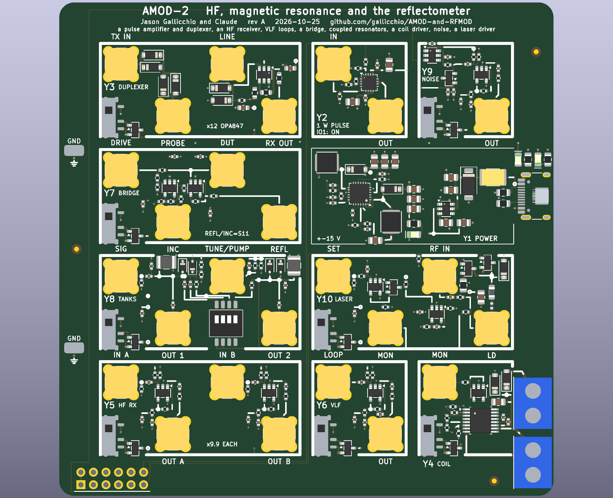

# AMOD-2 handbook: the second-level HF board

Generated by `scripts/gen_docs.py` from the tiles' own declarations (`boards/amod_2.py`); the expected results come from
the same text the silkscreen quotes.  Rev A, 2026-10-25.

## The board

Ten tiles on sixteen 20 mm cells, four layers, USB-C power on Y1, built for the ECP5-2ADC-2DAC board, whose converters sample
DC to 30 MHz directly: two DACs and two ADCs, so most tiles take one or two DAC channels and give one or two ADC channels.
Every tile's input is its top-left jack and its output its bottom-right jack; a two-cell tile has two of each.  The powered
tiles have the AMOD-A slide switch (up: on).  +5 V is everywhere on L3; -5 V (40 mA, the LM2664) reaches the tiles above and
below the gutter under row 0 (Y3, Y7, Y9); +-15 V from the TPS65131 reach only Y2, on two tracks on the back.  Nothing here
needs more than USB's 5 V except Y4's coil, which may have 12-18 V of its own on its upper terminal.

### Pmod lines

The 2 x 6 plug on Y5's bottom edge (pins 1-4 are IO1-4, 7-10 are IO5-8, 5 and 11 ground, 6 and 12 the FPGA's 3.3 V,
which the board does not use: every chip here runs from its own 3.3 V, so the lines are 3.3 V CMOS both ways):

- Pmod pin 1 (PMOD1): Y2's PD (high: the pulse amplifier on), Y2
- Pmod pin 7 (PMOD5): Y10's shunt (high: the laser's current diverted), Y10
- Pmod pin 8 (PMOD6): Y4's EN (high: the bridge on; PWM it), Y4
- Pmod pin 9 (PMOD7): Y4's PH (the current's direction), Y4
- Pmod pin 10 (PMOD8): Y9's load switch (high: noise on), Y9

## The tiles together

Every experiment below uses the ECP5 board's converters directly: DAC 1 and DAC 2 make the stimulus, ADC 1 and ADC 2 read the
response, and the gateware does the rest (quadrature demodulation, averaging, lock-in).  One clock, so phase means something.

1. **Pulsed NMR, 5-25 MHz.**  DAC 1 into Y2 (IO1 high only during the pulse: +-1 V becomes +-10 V, 1 W into 50 ohm), Y2's
   OUT into Y3's TX IN, Y3's PROBE to the probe (match it first with Y7: S11 below -20 dB at the Larmor frequency), a
   quarter-wave cable from a tee at the probe back to LINE; Y3's RX OUT (the OPA847, x12) into ADC 1, demodulated at the
   Larmor frequency in the gateware.  A Halbach or yoke magnet of N52
   cubes (0.3-0.5 T, protons at 13-21 MHz), a 5 mm vial of water with a little copper sulphate: the FID, the spin echo, CPMG,
   T1 by inversion recovery, T2.  Y4 on a gradient coil during the echo: a one-dimensional image.
2. **Earth's-field NMR, 2 kHz.**  Y4 drives a polarizing coil round a litre of water for a few seconds (12 V, an amp), then
   stops (IO6 low); a second, receive coil round the same bottle into Y6 (gain 101) and ADC 1: the protons' precession in the
   Earth's 50 uT, outdoors, away from mains wiring.
3. **ESR of DPPH, 10-100 MHz.**  A small loop round the sample, tuned to the DAC's frequency and read by Y7 (DRIVE from DAC 1,
   INC and REFL into the ADCs); Y4 sweeps a Helmholtz pair through g = 2 (1.07 mT at 30 MHz): the loop's S11 dips on resonance.
4. **The ionosphere.**  Two HF antennas into Y5's IN A and IN B (gain 9.9 each, 0.7 nV/rtHz): WWV's carrier Doppler at 5, 10
   and 15 MHz (HamSCI), the phase between the channels as a bearing, FT8 and WSPR decoded in software.  A VLF loop into Y6:
   sferics from lightning thousands of kilometres away, the Navy's MSK stations near 24 kHz (and their daily phase change at
   sunrise and sunset), sudden ionospheric disturbances from solar flares, WWVB's 60 kHz time code.
5. **Impedance and the Smith chart.**  Y7: DRIVE from DAC 1, REFL and INC into the ADCs; REFL / INC = Gamma at every
   frequency the DAC makes.  Calibrate with an open, a short and 50 ohm on DUT, then a crystal's motional arm, an antenna's
   match, a cable's length (time-domain reflectometry from a step), an NMR probe's tuning.
6. **Coupled and parametric resonators.**  Y8: DAC 1 into SIG, DAC 2 into TUNE / PUMP (a slow ramp, a 20 MHz pump, or both
   added), OUT 1 and OUT 2 into the ADCs.  Normal-mode splitting and the avoided crossing as TUNE sweeps tank 2 through tank
   1 (the DIP's 1 and 2.2 pF set the coupling); damp tank 1 (the DIP's 2 k) and its response shows a transparency window: the
   EIT analogue; pump at twice the frequency: phase-sensitive gain and de-amplification, then parametric oscillation.
7. **Noise.**  Y9 into Y5 (or Y3's preamp) with IO8 toggled: the Y-factor gives the amplifier's noise figure; Y9's noise into
   a filter with ADC 1 on its input and ADC 2 on its output: the transfer function from the cross-spectrum.
8. **Lasers and atoms.**  Y10 drives a VCSEL or a laser diode on its LD jack (SET from DAC 1: 100 mA per volt; start at a few
   millivolts); RF-MOD-2's synthesizer on RF IN puts sidebands on the light: 3.417 GHz on a 795 nm VCSEL through a rubidium
   cell is coherent population trapping, the chip-scale atomic clock's physics; IO5 blanks the light for pulsed ODMR with
   RF-MOD-2's X9 loop; MON (the diode's voltage) with a photodiode on an ADC gives the L-I-V curve and the threshold.

Levels to remember: Y2 gives 1 W into 50 ohm from +-1 V and is for pulses (keep the duty cycle under 10 %); Y3 lets through
the transmitter above about 0.7 V and gives x12 on the way back; Y5's channels give x9.9 (20 dB); Y6 x101; Y7's REFL and INC
reach the ADCs at half (49.9 ohm into 50 ohm), and so does every output here; Y8's ports are -43 dB; Y10 stops at 100 mA (1 V);
Y4 chops at about 1.3 A.

## The tiles

### Y1  power, USB-C 5 V in: +5, -5, +15, -15 out

Cells (2,1), (3,1).

**Expect:** +5 V from the USB-C (up to 2 A), -5 V at 40 mA, +15 V and -15 V at about 150 mA each for the pulse amplifier; green: 5 V in, red: -5 V up, yellow: +15 V up

USB-C power only (5.1 k on each CC).  The TPS65131 runs both converters at 1.25 MHz with power-save off (quieter); +15 V = 1.213 V x (1 + 1 M / 88.7 k) = 14.9 V, -15 V = -1.213 V x 1.3 M / 105 k = -15.0 V.  Only Y2 draws them, through two back-side tracks; everything else runs from +5 V and the LM2664's -5 V (40 mA: Y3, Y7 and Y9 draw about 30).

Parts: B5819W (C64885), SWPA4030S4R7MT (C57269), KT-0805G (C2297), NCD0805R1 (C84256), KT-0805Y (C2296), LM2664M6X/NOPB (C108573), MF-MSMF200-2 (C210837), TPS65131RGER (C87663), SMAJ5.0A (C78401), TYPE-C-31-M-12 (C165948).

### Y2  pulse amplifier, THS3491

Cell (2,0); +-15 V.
Jacks: TL IN (+-1 V); BR OUT (+-10 V into 50 ohm).

**Expect:** gain 10.3 to 30 MHz: a DAC's +-1 V to +-10 V into 50 ohm (1 W); off (PD low) unless Pmod IO1 is high

TI THS3491, current feedback, 900 MHz and 420 mA from +-15 V.  698 ohm from the FB pin (the output, inside) to -IN and 75 ohm to ground set gain 10.3.  The 49.9 ohm input termination makes the DAC's +-1 V into 50 ohm the full +-10 V output. PD from Pmod IO1 (4.7 k, 10 k to ground): high = on.  Pulse it: 1 W continuous heats the 3 x 3 mm package past its limit.

Parts: THS3491IRGTR (C2058688).

### Y3  duplexer and preamp, OPA847

Cells (0,0), (1,0); +5 V.
Jacks: TL0 TX IN (+-15 V); BR0 PROBE; TL1 LINE; BR1 RX OUT.

**Expect:** TX IN passes to PROBE through 1.4 V of diodes; the echo at LINE gains 12 (OPA847, 0.85 nV/rtHz) to RX OUT, about 200 MHz wide; LINE is clamped to +-0.7 V and terminated in 50 ohm

The classic pulsed-NMR duplexer, broadband except for its one cable: crossed diodes in series with the transmitter, and a quarter wave of coax from PROBE to LINE (2.6 m of RG-316 at 20 MHz) whose far end the clamp diodes short during the pulse. Between pulses the diodes are off: the PA's noise does not reach the probe, the echo reaches the OPA847 (1.1 k / 100 ohm: x12, its minimum stable gain).  Without the cable, a short one and a 6 dB pad work at a few dB of loss.

Parts: 1N4148W (C81598), OPA847IDBVR (C160422).

### Y4  coil driver, DRV8876

Cell (3,3); +5 V or 12-18 V.
Jacks: TL MON (IPROPI).

**Expect:** about 1.3 A either way into a coil, PWM on IO6; MON about 1.5 V per amp

DRV8876 in PH/EN mode: IO6 enables (PWM), IO7 the direction; VM = USB or 12-18 V (two B5819W); IPROPI buffered to MON.

Parts: B5819W (C64885), DRV8876PWPR (C575551), OPA810IDBVR (C2833513).

### Y5  HF receiver, 2 x LMH6629

Cells (0,3), (1,3); +5 V.
Jacks: TL0 IN A (-10 dBm); BR0 OUT A; TL1 IN B (-10 dBm); BR1 OUT B.

**Expect:** gain 9.9 (20 dB) on each channel, 50 ohm in and out, about 5 kHz to 100 MHz; 0.7 nV/rtHz at the input (NF about 2.5 dB)

Two TI LMH6629 (0.69 nV/rtHz, 4 GHz at gain 10) on one 5 V: 49.9 ohm terminates each input, 1 uF couples it to +IN at half the supply, 240 / 27 ohm (the 27 ohm to ground through 1 uF) set the gain, 1 uF and 49.9 ohm feed the output jack.  Two antennas into IN A and IN B and the host's two ADCs: a coherent two-channel HF receiver (WWV Doppler, direction finding).

Parts: LMH6629MFX/NOPB (C2059678).

### Y6  VLF loop amplifier, OPA810 x101

Cell (2,3); +5 V.
Jacks: TL LOOP (mV); BR OUT.

**Expect:** gain 101 from 1.6 kHz to 160 kHz (the loop's EMF rises with frequency on top): sferics, the Navy's MSK stations near 24 kHz, WWVB at 60 kHz

A loop's EMF is N A dB/dt: a 1 m square of 10 turns gives about 1 uV for 1 pT at 20 kHz.  1 uF into an OPA810 at half the supply (100 k / 100 k), gain 101 (10 k / 100 ohm to ground through 1 uF), 100 pF across 10 k: 1.6 - 160 kHz.  Sferics (lightning, thousands of kilometres away), NAA's 24 kHz MSK, WWVB's 60 kHz time code.  Two loops at right angles (this and Y5's IN A, or two boards) give a lightning stroke's bearing from the ratio of the two signals.

Parts: OPA810IDBVR (C2833513).

### Y7  reflection bridge, 2 x OPA810

Cells (0,1), (1,1); +-5 V.
Jacks: TL0 DRIVE (+-1 V into 50 ohm); BR0 INC; TL1 DUT; BR1 REFL.

**Expect:** REFL / INC = Gamma (S11) from DC to about 30 MHz: 0 for 50 ohm, +1 open, -1 short; after open-short-load calibration, better than -35 dB

A 50 ohm resistive bridge: D from DRIVE, 49.9 ohm to A (the DUT jack) and 49.9 + 49.9 ohm from D to ground with B between. A - B = B x Gamma.  OPA810 U1 at gain 2 on B gives INC; U2, +IN on A and 499 / 499 ohm from U1's output, gives 2 A - 2 B, REFL; each leaves through 49.9 ohm, so into the host's 50 ohm inputs REFL / INC = Gamma, magnitude and phase.  Calibrate with an open, a short and a 50 ohm load on DUT (three complex numbers per frequency), then match an NMR probe or an antenna.

Parts: OPA810IDBVR (C2833513).

### Y8  coupled resonators, 2 x LC + BB133

Cells (0,2), (1,2); +5 V.
Jacks: TL0 SIG (+-1 V into 50 ohm); BR0 OUT 1; TL1 TUNE/PUMP (+-2 V open); BR1 OUT 2.

**Expect:** two 10 MHz tanks (Q about 30); coupled by 1, 2.2 or 3.2 pF they split by 0.4 - 1.2 MHz; TUNE moves tank 2 by +-5 %; a 20 MHz pump on it gives parametric gain

Two LC tanks, 10 uH and about 25 pF each (fixed, two BB133 back to back at 2.5 V, the ports), near 10 MHz, Q about 30. SIG drives tank 1 through 2.2 pF; each tank feeds its OUT jack through 2.2 pF, -43 dB into the host's 50 ohm.  The DIP: 1 pF and 2.2 pF between the tanks (normal modes, the avoided crossing as TUNE sweeps tank 2), 2 k across tank 1 or tank 2 (a lossy tank coupled to a sharp one: the EIT analogue).  A pump at twice the frequency on TUNE / PUMP: parametric gain.

Parts: BB133 (C5334579), DSHP04TSGET (C40736).

### Y9  noise source, MMBT3904 + LMH6629

Cell (3,0); +5 V.
Jacks: BR OUT.

**Expect:** off: the amplifier's own noise (about 6 nV/rtHz at OUT); on: tens to hundreds of nV/rtHz from 10 kHz to 50 MHz, flat to about 1 dB

An MMBT3904's emitter-base junction breaks down near 8 V; between -5 V and the switched 5 V through 680 ohm it carries 2-3 mA and its avalanche noise, many times kT's, goes straight into an LMH6629 at gain 9.9 and out through 49.9 ohm.  IO8 high turns it on (a TPS22917 switches its 5 V): hot and cold for a Y-factor noise figure, or a broadband stimulus whose cross-spectrum against the response on the host's second ADC is a transfer function.

Parts: LMH6629MFX/NOPB (C2059678), MMBT3904(RANGE:100-300) (C20526), TPS22917DBVR (C2681320).

### Y10  laser driver, current source + bias-T

Cells (2,2), (3,2); +5 V.
Jacks: TL0 SET (0-1 V: 0-100 mA); BR0 MON; TL1 RF IN (+10 dBm max); BR1 LD (100 mA max).

**Expect:** 0-100 mA from 0-1 V on SET, about 10 kHz of loop bandwidth; IO5 blanks it in about 1 us; RF from about 20 MHz to 3 GHz rides on the current

A high-side current source: REF = VS - SET (OPA810 and a 2N7002 through 1 k / 1 k), OPA810 holds the AO3401's source at REF so 10 ohm carries SET / 10 ohm, 100 mA per volt (start a VCSEL at a few millivolts).  The drain feeds the diode through 330 nH + 27 nH; RF IN joins through 100 pF + 47 ohm: the modulation for a rubidium CPT clock (3.4 GHz) or NV ODMR.  IO5 high shorts the drain (the AO3400) for pulses.  MON = the diode's voltage / 200 into 50 ohm: with SET swept, its I-V curve.

Parts: B5819W (C64885), AO3400A (C20917), 2N7002 (C8545), OPA810IDBVR (C2833513).

## Ground, loops and probing

Two ground loops stand in the margins; every tile's loops are on the signal they name.  The RH-5019
loops take a scope's grabber.  The SMA jacks are 50 ohm; where an input is not 50 ohm the jack's silk says so.
