# AMOD-A handbook: the active board

Generated by `scripts/gen_docs.py` from the tiles' own declarations (`boards/amod_a.py`); the expected results come from
the same text the silkscreen quotes.  Rev A, 2026-10-25.

## The board

Cells are 20 mm on a 21.5 mm pitch.  A tile's input is its top-left jack and its output its bottom-right jack;
each jack's name is printed on its own tile's frame, beside it.  Cable the DAC to IN and OUT to the ADC.

Every powered tile has a slide switch along its left edge (slider up: on) feeding a P-FET, so a tile's own rail is
dead until you switch it on; -5 V is not switched (an op amp with no +5 V draws nothing).  The power tile (A1)
takes 5 V from its USB-C; its socket along the top edge carries +5, ground, -5, ground, +3.3 V for a breadboard.

### Pmod lines

The 2 x 6 plug on the bottom edge (pins 1-4 are IO1-4, 7-10 are IO5-8, 5 and 11 ground, 6 and 12 the FPGA's 3.3 V):

- Pmod pin 2 (PMOD2): A12
- Pmod pin 3 (PMOD3): A11
- Pmod pin 4 (PMOD4): A11
- Pmod pin 8 (PMOD6): A8
- Pmod pin 9 (PMOD7): A6
- Pmod pin 10 (PMOD8): A6

## The tiles

Each tile in a table: its picture, then what it does, its jacks, what to expect, how to cable it, what to buy
(the links are in [KIT.md](KIT.md)), its numbers and limits, the experiments it is for and the circuit.

### A1  power, USB-C 5 V in: +5, -5, +3.3 out

<table><tr>
<td valign="top" width="270">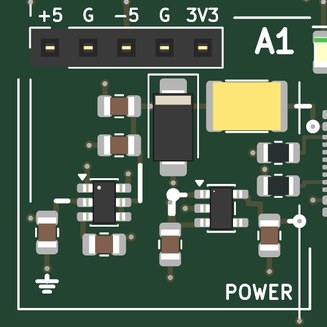</td>
<td valign="top">

<b>Power: 5 V from USB-C, and -5 V and 3.3 V made from it; a socket carries the rails to a breadboard.</b>  
<b>Expect:</b> +5 V from the USB-C (up to 1.5 A), -5 V at 40 mA, +3.3 V at 300 mA; the green LED says 5 V is in, the red one that -5 V is up  
<b>How to use it:</b> Plug in the USB-C; then switch on each tile you use (slider up).  
<b>You need:</b> A 5 V USB-C supply, 1.5 A or more (kit: Raspberry Pi 5.1 V 3 A supply). (<a href="KIT.md">KIT.md</a>)  
<b>Specs:</b> +5 V up to 1.5 A, -5 V at 40 mA, +3.3 V at 300 mA; green LED 5 V, red LED -5 V.  
<b>Limits:</b> -5 V is 40 mA: about four op-amp tiles at once.  The board negotiates nothing: use a plain 5 V supply.  
<b>Chip:</b> <a href="https://www.ti.com/product/LM2664">LM2664</a>, <a href="https://www.ti.com/product/TPS7A20">TPS7A20</a>  
<b>Tutorial pages:</b> A counter on the LEDs.  
<b>The circuit:</b> USB-C power only: 5.1 k on each CC asks any source for 5 V.  A 2 A PTC, a 5 V TVS (clamps at 9.2 V) and 20 uF. The LM2664 charge pump makes -5 V for the op-amp tiles (40 mA: four tiles at 10 mA); it is not switched per tile, an op amp with its +5 V removed draws nothing.  The TPS7A2033 makes 3.3 V for the comparator and the lines that meet the FPGA. The socket along the top carries +5, ground, -5, ground, +3.3: the bench's rails for a breadboard experiment.  
<b>Parts:</b> KT-0805G (C2297), NCD0805R1 (C84256), LM2664M6X/NOPB (C108573), MF-MSMF200-2 (C210837), TPS7A2033PDBVR (C2862740), SMAJ5.0A (C78401), TYPE-C-31-M-12 (C165948).

</td></tr></table>

### A2  x10, 14 MHz

<table><tr>
<td valign="top" width="270">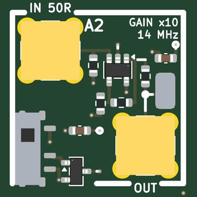</td>
<td valign="top">

<b>An op-amp gain block: x10 (20 dB) to 14 MHz, with a 50 ohm input.</b>  
<b>Jacks:</b> IN 50R, top left (±0.4 V); OUT, bottom right.  
<b>Supply:</b> +-5 V  
<b>Expect:</b> x10 (20 dB) into a high impedance, x5 into 50 ohm, -3 dB near 14 MHz; clips at about +-4 V  
<b>How to use it:</b> Signal to IN, OUT to the ADC (high impedance for the full x10).  
<b>You need:</b> Nothing beyond SMA cables.  
<b>Specs:</b> x10 into a high impedance (x5 into 50 ohm); -3 dB at 14 MHz; IN up to +-0.4 V for +-4 V out.  
<b>Limits:</b> 140 MHz gain-bandwidth sets the bandwidth; clips at +-4 V.  
<b>Experiments:</b> The gain-bandwidth trade (compare A3); slew rate and clipping; amplifying a photodiode, a noise source or a weak tone.  
<b>Chip:</b> <a href="https://www.ti.com/product/OPA810">OPA810</a>  
<b>Tutorial pages:</b> The speed of sound at 40 kHz; Warming a crystal.  
<b>The circuit:</b> Non-inverting OPA810: gain 1 + 10 k / 1.1 k = 10.1, bandwidth 140 MHz / 10 = 14 MHz.  50 ohm at the input, 49.9 ohm in series with the output (a 50 ohm load halves it: x5).  Keep the input under 0.4 V peak: the output clips at 4 V.  
<b>Parts:</b> OPA810IDBVR (C2833513).

</td></tr></table>

### A3  x100, 1.4MHz

<table><tr>
<td valign="top" width="270">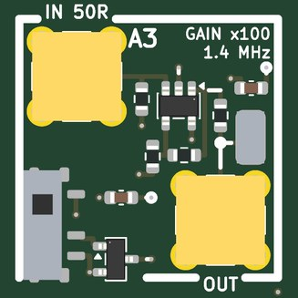</td>
<td valign="top">

<b>The same op-amp stage at x100 (40 dB), to 1.4 MHz.</b>  
<b>Jacks:</b> IN 50R, top left (±40 mV); OUT, bottom right.  
<b>Supply:</b> +-5 V  
<b>Expect:</b> x100 (40 dB) into a high impedance, -3 dB near 1.4 MHz; keep the input under 40 mV peak  
<b>How to use it:</b> Signal to IN, OUT to the ADC.  
<b>You need:</b> Nothing beyond SMA cables.  
<b>Specs:</b> x100; -3 dB at 1.4 MHz; IN up to +-40 mV.  
<b>Limits:</b> Only 1.4 MHz wide (gain-bandwidth); for 40 dB at HF use A4.  
<b>Experiments:</b> Gain-bandwidth against A2 and A4; small audio and ultrasonic signals.  
<b>Chip:</b> <a href="https://www.ti.com/product/OPA810">OPA810</a>  
<b>Tutorial pages:</b> The speed of sound at 40 kHz; Warming a crystal.  
<b>The circuit:</b> Non-inverting OPA810: gain 1 + 10 k / 100 = 101, bandwidth 140 MHz / 100 = 1.4 MHz.  50 ohm at the input, 49.9 ohm in series with the output.  For 40 dB out to 30 MHz use A4 (the OPA847 LNA); this tile is the FET-input, high-impedance friendly x100 for everything slower.  (The plan's two stages of x10 did not fit the cell.)  
<b>Parts:</b> OPA810IDBVR (C2833513).

</td></tr></table>

### A4  LNA, 30 MHz

<table><tr>
<td valign="top" width="270">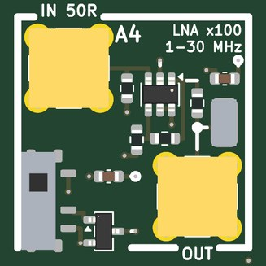</td>
<td valign="top">

<b>An HF low-noise amplifier: x100 (40 dB) flat from 1 to 30 MHz, about 3 dB noise figure from 50 ohm.</b>  
<b>Jacks:</b> IN 50R, top left (±30 mV); OUT, bottom right.  
<b>Supply:</b> +-5 V  
<b>Expect:</b> x100 (40 dB) from 50 ohm, flat 1-30 MHz, about 3 dB noise figure from 50 ohm; keep the input under 30 mV peak  
<b>How to use it:</b> Antenna (or P13's OUT) to IN, OUT to the ADC.  
<b>You need:</b> An antenna for over-the-air use: a few metres of wire on an SMA, or AMOD-P's P13.  
<b>Specs:</b> x101; flat 1-30 MHz (-3 dB near 39 MHz); 0.85 nV/rtHz.  
<b>Limits:</b> IN under +-30 mV; the OPA847 is stable only at gains above 12 (do not lower the gain).  
<b>Experiments:</b> AM and shortwave reception with a wire antenna or P13's loopstick; noise figure; weak-signal work.  
<b>Chip:</b> <a href="https://www.ti.com/product/OPA847">OPA847</a>  
<b>Tutorial pages:</b> The speed of sound at 40 kHz; What time is it over there?.  
<b>The circuit:</b> Non-inverting OPA847 (3.9 GHz GBW at this gain, 0.85 nV/rtHz): 1 k / 10 ohm, so x101 and about 39 MHz.  Its input noise with the 50 ohm termination's own noise gives a noise figure near 3 dB.  The op amp is stable only at gains above 12 (it is decompensated): do not change Rg upward.  SOT-23-6, DIS tied to +VS (enabled).  
<b>Parts:</b> OPA847IDBVR (C160422).

</td></tr></table>

### A5  Doppler, HB100

<table><tr>
<td valign="top" width="270">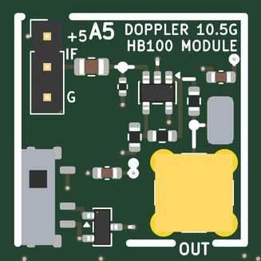</td>
<td valign="top">

<b>A socket and amplifier for an HB100 10.525 GHz Doppler radar module: the beat between what it sends and what comes back, x101.</b>  
<b>Jacks:</b> OUT, bottom right.  
<b>Supply:</b> +-5 V  
<b>Expect:</b> the Doppler beat of a target moving toward or away: 70 Hz per m/s (19.4 Hz per km/h), tens of mV after x101  
<b>How to use it:</b> Wire the module's +5 V, IF and GND pins to the +5 / IF / G header with jumper wires (the pin order differs between modules: follow its print); OUT to an ADC (the host's x10 input helps); point it at something moving.  
<b>You need:</b> An HB100 module and three female-female jumper wires (kit: MH-ET Live HB100 X, about $14). (<a href="KIT.md">KIT.md</a>)  
<b>Specs:</b> 70 Hz per m/s of speed toward or away (19.4 Hz per km/h); x101 to OUT.  
<b>Limits:</b> The HB100 has one mixer, not I and Q: it measures speed but not direction, and gives no range (it is a CW radar).  
<b>Experiments:</b> The speed of a hand, a pendulum, a fan's blades, breathing; Doppler spectra (micro-Doppler).  
<b>Chip:</b> <a href="https://www.amazon.com/dp/B07YY6FD4T">HB100 (module)</a>, <a href="https://www.ti.com/product/OPA810">OPA810</a>  
<b>Tutorial pages:</b> With a little more hardware.  
<b>The circuit:</b> HB100: a 10.525 GHz oscillator and mixer on one board; its IF is the beat between what it sends and what comes back, 2v/lambda = 70 Hz per m/s.  Wire its +5, IF and GND pins to the header; point it at something that moves. The host's x10 input after this tile's x101 brings a hand at 1 m to the ADC's range.  
<b>Parts:</b> OPA810IDBVR (C2833513).

</td></tr></table>

### A6  1-bit ADC

<table><tr>
<td valign="top" width="270">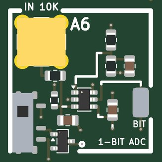</td>
<td valign="top">

<b>A one-bit (delta-sigma) ADC made of a comparator and an RC integrator, with the FPGA as the flip-flop: an ADC from one Pmod input and one Pmod output.</b>  
<b>Jacks:</b> IN 10K, top left (±1.5 V).  
<b>Pmod:</b> IO7 (Pmod pin 9); IO8 (Pmod pin 10)  
<b>Supply:</b> +3.3 V  
<b>Expect:</b> a one-bit stream on Pmod IO7 whose density follows IN; the FPGA closes the loop through Pmod IO8 (the handbook's gateware)  
<b>How to use it:</b> The gateware reads the comparator on Pmod IO7 every clock, registers it, and drives the registered bit back out on IO8; low-pass and decimate that bit stream.  Signal to IN.  
<b>You need:</b> Nothing (the gateware).  
<b>Specs:</b> IN 0-3.3 V (or +-1.5 V AC-coupled), 10 k input; integrator 10 k / 10 nF; clock the loop at 1-10 MHz.  
<b>Limits:</b> First order: about 9 dB more resolution per doubling of the oversampling ratio; works only with its gateware.  
<b>Experiments:</b> Delta-sigma conversion, oversampling and noise shaping, decimation (CIC) filters, trading speed for bits.  
<b>Chip:</b> <a href="https://www.ti.com/product/TLV3501">TLV3501</a>  
<b>Tutorial pages:</b> Trading speed for bits.  
<b>The circuit:</b> First-order delta-sigma: the comparator decides, the FPGA registers the bit and feeds it back through 10 k into the 10 k / 10 nF integrator (1.6 kHz; clock the loop at 1-10 MHz).  IN takes 0 to 3.3 V, or +-1.5 V about the 1.65 V reference if you AC-couple.  Both Pmod lines are 3.3 V logic; the tile runs on the 3.3 V rail.  
<b>Parts:</b> TLV3501AIDBVR (C193413).

</td></tr></table>

### A7  PLL 4046

<table><tr>
<td valign="top" width="270">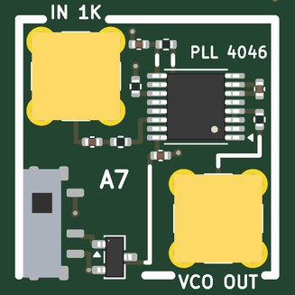</td>
<td valign="top">

<b>A 74HC4046 phase-locked loop: its VCO locks to a 50-200 kHz signal on IN.</b>  
<b>Jacks:</b> IN 1K, top left (±1 V); VCO OUT, bottom right.  
<b>Supply:</b> +5 V  
<b>Expect:</b> VCO OUT locks to a 50-200 kHz square or sine on IN; pin 9 is the demodulated FM, pin 13 the phase detector  
<b>How to use it:</b> DAC sine or square (more than 0.4 V peak) to IN, VCO OUT to an ADC; sweep or frequency-modulate the DAC.  
<b>You need:</b> A scope probe for pins 9 and 13.  
<b>Specs:</b> VCO near 100 kHz (10 k, 1 nF); phase comparator 2 with a 10 k / 100 nF lag filter; VCO OUT 5 V CMOS through 470 ohm.  
<b>Limits:</b> Fixed loop filter and VCO range (no switches); locks at x1 (no divider); no test loops: probe pins 9 and 13.  
<b>Experiments:</b> Lock and capture range; FM demodulation (pin 9 is the VCO's control voltage); loop dynamics and ringing; an analog PLL against the FPGA's.  
<b>Chip:</b> <a href="https://www.lcsc.com/product-detail/C546981.html">74HC4046A</a>  
<b>Tutorial pages:</b> A faster DAC: PLLs.  
<b>The circuit:</b> 74HC4046A: R1 10 k, C1 1 nF put the VCO near 100 kHz (R2 open: it can go down to 0).  PC2 (the edge-triggered tri-state detector) through 10 k / 100 n into VCOin: a lag filter, so expect ringing on lock.  IN self-biases through 100 n / 1 k (any level above 0.4 V peak).  VCO OUT is 5 V CMOS through 470 ohm.  Probe pins 9 and 13.  
<b>Parts:</b> 74HC4046APW-Q100J (C546981).

</td></tr></table>

### A8  heat

<table><tr>
<td valign="top" width="270">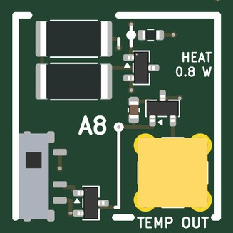</td>
<td valign="top">

<b>A 0.83 W heater (two 15 ohm resistors) switched from a Pmod line, with a temperature sensor beside it: a thermal plant to control.</b>  
<b>Jacks:</b> TEMP OUT, bottom right.  
<b>Pmod:</b> IO6 (Pmod pin 8)  
<b>Supply:</b> +5 V  
<b>Expect:</b> 0.83 W into the board when Pmod IO6 is high (the FET's drain), 10 mV/K + 500 mV on OUT  
<b>How to use it:</b> PWM from the FPGA on Pmod IO6; TEMP OUT to an ADC.  
<b>You need:</b> Nothing (Kapton tape to hold a part on the heater, if you like).  
<b>Specs:</b> 30 ohm, 170 mA, 0.83 W while Pmod IO6 is high; TEMP OUT 10 mV/K + 500 mV (750 mV at 25 C).  
<b>Limits:</b> On or off from IO6 (PWM it for proportional power); it heats a few square centimetres, with a time constant of tens of seconds.  The heater has no jack: DRIVE IN beside it belongs to A10.  
<b>Experiments:</b> A thermal time constant; bang-bang against PID control; warming a part taped to the heater.  
<b>Chip:</b> <a href="https://www.ti.com/product/TMP235">TMP235</a>  
<b>Tutorial pages:</b> Warming a crystal; Control at the speed of the cable.  
<b>The circuit:</b> Two 15 ohm in series: 30 ohm, 170 mA, 0.83 W from the switched 5 V when Pmod IO6 is high (10 k keeps it off otherwise). The TMP235 reads 750 mV at 25 C and climbs 10 mV per kelvin.  A feedback-control experiment: hold the TMP235 at a set point with the FPGA's PWM.  (The plan's NTC divider did not fit the cell beside the two 2512s.)  
<b>Parts:</b> AO3400A (C20917), 25121WF150JT4E (C20087), TMP235A4DBZR (C2868809).

</td></tr></table>

### A9  mixer, MC1496

<table><tr>
<td valign="top" width="528">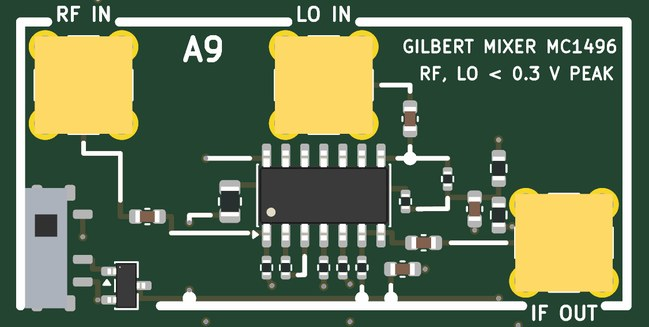</td>
<td valign="top">

<b>A Gilbert-cell double-balanced mixer (MC1496): IF OUT is RF times LO, the sum and difference frequencies.</b>  
<b>Jacks:</b> RF IN, top left (±0.3 V); LO IN, top middle (±0.3 V); IF OUT, bottom right.  
<b>Supply:</b> +-5 V  
<b>Expect:</b> IF OUT = RF x LO (sum and difference frequencies, about 0.3 V peak per volt of RF at 0.3 V of LO); a balanced mixer, the carrier mostly cancels  
<b>How to use it:</b> RF and LO from the two DACs (or an antenna through A4 on RF); IF OUT to an ADC on high impedance.  
<b>You need:</b> Nothing beyond SMA cables.  
<b>Specs:</b> RF and LO +-0.3 V into 51 ohm; 1 k emitter degeneration, 1 mA a side; IF OUT single-ended from a 1.5 k load; about 0.3 V of IF per volt of RF at 0.3 V of LO.  
<b>Limits:</b> IF OUT is a 1.5 k source: a metre of coax (100 pF) rolls it off near 1 MHz, so keep the IF low or the cable short and use high impedance.  LO feedthrough about -40 dB (no null trimmer).  RF and LO are good to a few tens of MHz.  
<b>Experiments:</b> Mixing and images; AM demodulation as a product detector; the AM radio; PSK demodulation with a recovered carrier.  
<b>Chip:</b> <a href="https://www.lcsc.com/product-detail/C7295.html">MC1496</a>  
<b>Tutorial pages:</b> An AM radio; PSK and QPSK.  
<b>The circuit:</b> Gilbert cell on +-5 V: signal pair at ground (51 ohm), carrier pair at 2.5 V (51 ohm to the 10 k / 10 k bias), 1 mA per side (3.9 k), 1.5 k loads.  Keep RF under 0.3 V and LO near 0.3 V peak (above that the carrier pair just switches, which is fine for a product detector).  IF OUT is single-ended from pin 6 through 100 n: a 1.5 k source, so read it with a high-impedance input, not 50 ohm.  No carrier-null trimmer: expect -40 dB of LO feedthrough.  
<b>Parts:</b> MC1496DR2G (C7295).

</td></tr></table>

### A10  impedance, V and I

<table><tr>
<td valign="top" width="528">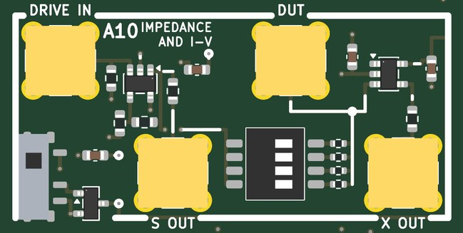</td>
<td valign="top">

<b>Measures a part's impedance and I-V curve: drives it through a known resistor and reads the voltage on both sides.</b>  
<b>Jacks:</b> DRIVE IN, top left (+-1 V into 50 ohm); S OUT, bottom of the left cell; DUT, top of the right cell; X OUT, bottom right.  
<b>Supply:</b> +-5 V  
<b>Expect:</b> S OUT and X OUT (each half the node's voltage into 50 ohm): Z = R X / (S - X); +-4 V and up to 40 mA for an I-V curve  
<b>How to use it:</b> DAC to DRIVE IN; S OUT to ADC 1 and X OUT to ADC 2; the part on the DUT jack; one DIP way on (the reference R); the gateware takes the complex ratio at each frequency.  
<b>You need:</b> A way to put a part on the DUT jack: an SMA-to-minigrabber lead or a part soldered to an SMA plug.  
<b>Specs:</b> DRIVE IN x2 is node S; the DIP picks R = 47, 470, 4.7 k or 47 k from S to X; the part goes from X (the DUT jack) to ground; S OUT and X OUT give half of each node into 50 ohm; Z = R X / (S - X); +-4 V, up to 40 mA.  
<b>Limits:</b> DC to a few MHz; most accurate when Z is near the chosen R; calibrate with the DUT open and shorted.  
<b>Experiments:</b> Impedance spectra of resistors, capacitors, inductors, a crystal and a speaker; LED and diode I-V curves (Planck with P12's colours); a low-frequency Smith chart.  
<b>Chip:</b> <a href="https://www.ti.com/product/OPA810">OPA810</a>  
<b>Tutorial pages:</b> RC and LC circuits; More ideas for one board.  
<b>The circuit:</b> DRIVE IN x2 is S.  The DIP picks R between S and X (47 ohm for LEDs and diodes, 470 for most parts, 4.7 k and 47 k for high impedances); the part goes on the DUT jack.  Calibrate with the DUT open and shorted.  An LED's knee against its colour (P12) gives Planck's constant; a crystal (P8) shows its series and parallel resonances.  
<b>Parts:</b> DSHP04TSGET (C40736), OPA810IDBVR (C2833513).

</td></tr></table>

### A11  ultrasound

<table><tr>
<td valign="top" width="528">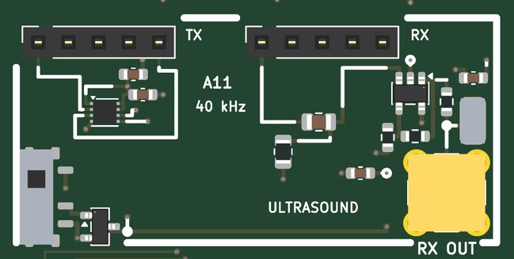</td>
<td valign="top">

<b>40 kHz ultrasound: an H-bridge drives the transmitter from two Pmod lines, and the receiver's signal comes out x100.</b>  
<b>Jacks:</b> RX OUT, bottom right.  
<b>Pmod:</b> IO3 (Pmod pin 3); IO4 (Pmod pin 4)  
<b>Supply:</b> +-5 V  
<b>Expect:</b> a 40 kHz burst from Pmod IO4/IO3 leaves the TX transducer; its echo arrives x100 on RX OUT (hold a reflector over the board)  
<b>How to use it:</b> Transmitter in the TX socket, receiver in the RX socket (pins 1 and 5 of each); the gateware sends 8-20 cycles of 40 kHz on IO4 and IO3 in antiphase; RX OUT to an ADC; hold a reflector above the board.  
<b>You need:</b> A pair of 40 kHz transducers (kit: PUI UT-1640K-TT-2-R and UR-1640K-TT-2-R). (<a href="KIT.md">KIT.md</a>)  
<b>Specs:</b> TX gets 10 V p-p from Pmod IO4 / IO3 in antiphase; RX x100 behind a 4 kHz high-pass; 5.8 us per mm there and back.  
<b>Limits:</b> Only at the transducers' 40 kHz resonance; the receiver hears the transmitter directly for the first few hundred microseconds.  
<b>Experiments:</b> The speed of sound, echo ranging (sonar), Doppler, beam patterns, an ultrasonic data link.  
<b>Chip:</b> <a href="https://www.ti.com/product/DRV8837">DRV8837</a>, <a href="https://www.ti.com/product/OPA810">OPA810</a>  
<b>Tutorial pages:</b> The speed of sound at 40 kHz.  
<b>The circuit:</b> Drive IN1/IN2 (Pmod IO4, IO3) in antiphase at 40 kHz for 8-20 cycles: the bridge puts 10 V peak to peak across the TX transducer.  The RX transducer's 10 nF / 3.9 k high-pass (4 kHz) feeds an OPA810 at x100 (1.4 MHz: the transducer's own resonance sets the band).  Time of flight at 343 m/s: 5.8 us per mm there and back.  Put the two transducers in pins 1 and 5 (10.16 mm; their leads are 10 mm apart).  
<b>Parts:</b> DRV8837DSGR (C39159), OPA810IDBVR (C2833513).

</td></tr></table>

### A12  audio

<table><tr>
<td valign="top" width="528">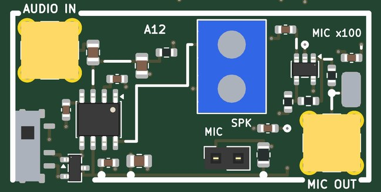</td>
<td valign="top">

<b>Audio: a 2.5 W class-D amplifier into a speaker, fed from a DAC or a one-bit Pmod stream, and an electret microphone amplified x100.</b>  
<b>Jacks:</b> AUDIO IN, top left (±1 V); MIC OUT, bottom right.  
<b>Pmod:</b> IO2 (Pmod pin 2)  
<b>Supply:</b> +-5 V  
<b>Expect:</b> a speaker on SPK follows AUDIO IN (2.5 W into 4 ohm) or the one-bit stream on Pmod IO2 (10 k / 10 n); MIC OUT is the electret x100  
<b>How to use it:</b> Speaker wires in the SPK terminal, the electret in the MIC socket (+ to pin 1); DAC to AUDIO IN or a one-bit stream on IO2; MIC OUT to an ADC.  
<b>You need:</b> A small speaker and an electret capsule (kit: Adafruit 6486 36 mm 8 ohm speaker, SparkFun COM-08635 electret). (<a href="KIT.md">KIT.md</a>)  
<b>Specs:</b> Up to 2.5 W into 4 ohm (about 1.5 W into 8); AUDIO IN +-1 V; the one-bit stream on Pmod IO2 through 10 k / 10 nF; MIC OUT x100.  
<b>Limits:</b> Mono; the class-D output is unfiltered (the speaker is the filter); the microphone hears the speaker.  
<b>Experiments:</b> An acoustic modem (FSK, MSK through the air); the speed of sound in air; a room's echoes and impulse response; one-bit (PDM) audio.  
<b>Chip:</b> <a href="https://www.diodes.com/assets/Datasheets/PAM8302A.pdf">PAM8302A</a>, <a href="https://www.ti.com/product/OPA810">OPA810</a>  
<b>Tutorial pages:</b> ADC samples to Python; MSK and GMSK.  
<b>The circuit:</b> PAM8302A: 1 u couples AUDIO IN to IN+ (IN- grounded through 1 u), the one-bit DAC on Pmod IO2 arrives through 10 k into 10 n (1.6 kHz) at the same node, so both play.  BYP 1 u, SD high: on with the tile.  The electret (pin 1 is the + side, 2.2 k from VS) through 1 u into an OPA810 at x100: a few hundred millivolts for speech.  
<b>Parts:</b> OPA810IDBVR (C2833513), PAM8302AASCR (C113367).

</td></tr></table>

## Ground, loops and probing

Four ground loops stand in the margins; every tile's loops are on the signal they name.  The RH-5019
loops take a scope's grabber.  The SMA jacks are 50 ohm; where an input is not 50 ohm the jack's silk says so.
