# AMOD-B handbook: the brushless board

Generated by `scripts/gen_docs.py` from the tiles' own declarations (`boards/amod_b.py`); the expected results come from
the same text the silkscreen quotes.  Rev A, 2026-10-25.

## The board

Twelve tiles on sixteen 20 mm cells (the gimbal takes four), four layers.  b1 takes 5 V from its USB-C and makes -5 V
(40 mA) and 3.3 V, as AMOD-A's a1 does; b2 takes the motor supply, 5-12 V on a 5.5 / 2.1 mm barrel jack (centre
positive), and joins the USB's 5 V to it through Schottky diodes, so the gimbal motor turns, weakly, with no supply.
That rail, VMOT, runs down the back to b12's shunt and on from it (as VMB) to the driver; it is not switched.  The
driver's three phases and the two SPI sensors take their commands from the FPGA on the Pmod plug in the bottom margin
under b3; COAST comes from a DAC and everything else answers to an ADC over SMA, as on the other boards.  A powered
tile has a slide switch along its left edge (slider up: on).  A port's name is in capitals on its tile's frame, a
terminated input says so (COAST 50R) and an output read through a divider says its ratio (EA /14).  The back of each
tile says what to know while cabling it.

### Pmod lines

The 2 x 6 plug on the bottom margin under b3's left cell (pins 1-4 are IO1-4, 7-10 are IO5-8, 5 and 11 ground, 6 and 12 the FPGA's 3.3 V,
which the board does not use: every chip here runs from its own 3.3 V, so the lines are 3.3 V CMOS both ways):

- Pmod pin 1 (PMOD1): b3's INHB (phase B high or low), b3
- Pmod pin 2 (PMOD2): b3's INHC (phase C), b3
- Pmod pin 3 (PMOD3): MISO (b6's IMU and, through b6's buffer, b5's encoder), b6
- Pmod pin 4 (PMOD4): SCK (the IMU and the encoder), b5, b6
- Pmod pin 7 (PMOD5): b3's INHA (phase A), b3
- Pmod pin 8 (PMOD6): CS ENC (the encoder's select, low to read it), b5, b6
- Pmod pin 9 (PMOD7): MOSI (the IMU), b6
- Pmod pin 10 (PMOD8): CS IMU (the IMU's select, low to talk to it), b6

## The tiles together

1. **The motor.**  b5 holds a GBM2804H-100T class gimbal motor (12 slots, 14 poles, 10 ohm) on four slots over its
   sensors: an MT6701 magnetic encoder under the shaft (a magnet glued to its end), two linear halls under the
   rotor's magnets, a reflective sensor under the bell's rim.  Its three leads go to b3's terminal.
2. **The drive.**  b3's DRV8311H sets each phase high or low from INHA, INHB, INHC (Pmod IO5, IO1, IO2) at the
   gateware's PWM: six-step commutation from the halls or the encoder, or sinusoidal and field-oriented control from
   the encoder's angle.  COAST from a DAC floats all three phases.  IA and IB are two phases' low-side currents (the
   driver's own amplifiers); b11 reads phase A's whole current in line, b12 the current from the supply.
3. **The feedback.**  The encoder's angle over SPI (14 bits; b6's buffer shares MISO with the IMU) and as a
   sawtooth on b7; the halls' sinusoids on b10; the back-EMF on b4 (coast and spin the motor); an index on b9; the
   IMU on b6; the motor's vibration on b8.

A one-axis gimbal: stand the board on edge with the motor's shaft horizontal and a load on the bell; the IMU's
accelerometer gives the board's roll, the encoder the motor's angle, and the gateware turns the motor against the
roll.  Every motor tile's supply is VMOT: a bench supply's current limit, or the USB's, is the board's only fuse.

## The tiles

Each tile in a table: its picture, then what it does, its jacks, what to expect, how to cable it, what to buy
(the links are in [KIT.md](KIT.md)), its numbers and limits, the experiments it is for and the circuit.

### b1  power, USB-C 5 V in: +5, -5, +3.3 out

<table><tr>
<td valign="top" width="270">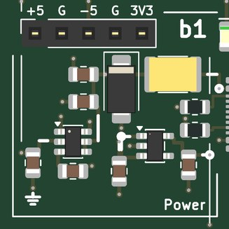</td>
<td valign="top">

<b>Power: 5 V from USB-C, and -5 V and 3.3 V made from it; a socket carries the rails to a breadboard (AMOD-A's a1).</b>  
<b>Expect:</b> +5 V from the USB-C (up to 1.5 A), -5 V at 40 mA, +3.3 V at 300 mA; the green LED says 5 V is in, the red one that -5 V is up  
<b>How to use it:</b> Plug in the USB-C (and the host's Pmod for b3, b5 and b6); then switch on each tile you use (slider up).  
<b>You need:</b> A 5 V USB-C supply, 1.5 A or more (kit: Raspberry Pi 5.1 V 3 A supply). (<a href="KIT.md">KIT.md</a>)  
<b>Specs:</b> +5 V up to 1.5 A, -5 V at 40 mA, +3.3 V at 300 mA; green LED 5 V, red LED -5 V.  
<b>Limits:</b> -5 V is 40 mA: the seven OPA810s, the OPA2171, b3's level shifts and b9's sensor draw about 30 mA together.  The board negotiates nothing: use a plain 5 V supply.  
<b>Chip:</b> <a href="https://www.ti.com/product/LM2664">LM2664</a>, <a href="https://www.ti.com/product/TPS7A20">TPS7A20</a>  
<b>Tutorial pages:</b> Motors.  
<b>The circuit:</b> USB-C power only: 5.1 k on each CC asks any source for 5 V.  A 2 A PTC, a 5 V TVS (clamps at 9.2 V) and 20 uF. The LM2664 charge pump makes -5 V for the op-amp tiles (40 mA: four tiles at 10 mA); it is not switched per tile, an op amp with its +5 V removed draws nothing.  The TPS7A2033 makes 3.3 V for the comparator and the lines that meet the FPGA. The socket along the top carries +5, ground, -5, ground, +3.3: the bench's rails for a breadboard experiment.  
<b>Parts:</b> KT-0805G (C2297), NCD0805R1 (C84256), LM2664M6X/NOPB (C108573), MF-MSMF200-2 (C210837), TPS7A2033PDBVR (C2862740), SMAJ5.0A (C78401), TYPE-C-31-M-12 (C165948).

</td></tr></table>

### b2  motor supply, 5-12 V in

<table><tr>
<td valign="top" width="270">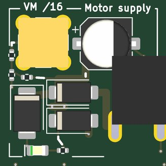</td>
<td valign="top">

<b>The motor supply VMOT: a barrel jack (5-12 V) or USB's 5 V, each through a Schottky; its voltage / 16 on a jack.</b>  
<b>Jacks:</b> VM /16, top left.  
<b>Expect:</b> VMOT = the larger of the barrel jack (5-12 V) and USB 5 V, each less a Schottky's 0.3-0.5 V; VM jack VMOT / 16  
<b>How to use it:</b> A 5-12 V supply on the barrel jack, current limited to about 1 A; VM to an ADC.  
<b>You need:</b> From the kit (docs/KIT.md, Motors and actuators): a 3-12 V adjustable supply with a barrel plug. (<a href="KIT.md">KIT.md</a>)  
<b>Specs:</b> DC-005 5.5 / 2.1 mm jack, centre positive; two SS34 (3 A) into VMOT, so VMOT is the larger input less about 0.4 V; SMBJ12A (clamps near 20 V, under the DRV8311's 24 V maximum) and 220 uF on VMOT soak up the motor's braking energy (the diodes stop it reaching the supply); green LED; VM = VMOT / 16 (15 k / 1 k) through 49.9 ohm.  
<b>Limits:</b> 5-12 V in (the clamp starts to conduct above about 13 V).  VMOT is not switched and has no fuse: the supply's current limit is the board's.  With USB alone VMOT is about 4.6 V: the gimbal motor turns, slowly and weakly.  VM is a 1 k source: read it at high impedance.  
<b>Experiments:</b> The supply's droop as the motor accelerates; the braking energy coming back (VM rises while the motor slows).  
<b>Chip:</b> <a href="https://www.lcsc.com/product-detail/C8678.html">SS34</a>, <a href="https://www.lcsc.com/product-detail/C19077565.html">SMBJ12A</a>  
<b>Tutorial pages:</b> Motors.  
<b>The circuit:</b> Barrel jack (centre +), 5-12 V, through an SS34 into VMOT, as is USB's 5 V, so VMOT is about 4.6 V with no supply. SMBJ12A and 220 uF on VMOT take the braking energy a motor returns.  VM: VMOT / 16 at high impedance.  
<b>Parts:</b> XT220UF25V90RV0075 (C2992606), KT-0805G (C2297), SMBJ12A (C19077565), SS34 (C8678).

</td></tr></table>

### b3  BLDC driver, DRV8311H

<table><tr>
<td valign="top" width="528">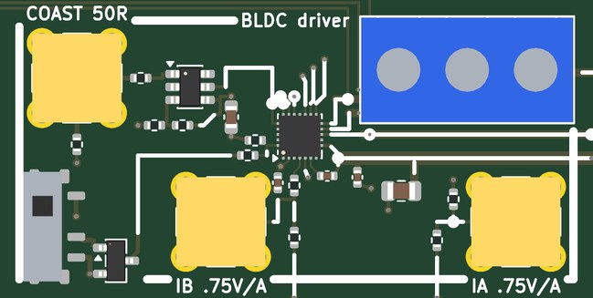</td>
<td valign="top">

<b>A three-phase driver for the gimbal motor: each phase high or low from an FPGA line, all three floated by a DAC; two phases' low-side currents on jacks.</b>  
<b>Jacks:</b> COAST 50R, top left (0/+1 V); IB .75V/A, bottom of the left cell; IA .75V/A, bottom right.  
<b>Pmod:</b> IO1 (Pmod pin 1): b3's INHB (phase B high or low); IO2 (Pmod pin 2): b3's INHC (phase C); IO5 (Pmod pin 7): b3's INHA (phase A)  
<b>Supply:</b> +5 V, VMOT, +-5 V  
<b>Expect:</b> the motor's phases at the duty cycles of IO5, IO1, IO2 (A, B, C); IA, IB = phase A's and B's currents (low side), 0.75 V/A; COAST high floats them  
<b>How to use it:</b> PWM on IO5, IO1, IO2 (A, B, C); COAST from a DAC (0 V to run); IA and IB to the ADCs; the motor's three leads on the terminal.  
<b>You need:</b> From the kit (docs/KIT.md, Motors and actuators): the GBM2804H-100T gimbal motor on b5 (its leads on the terminal). (<a href="KIT.md">KIT.md</a>)  
<b>Specs:</b> DRV8311H (3-20 V, 5 A peak, 210 mohm) from VMB in 3x PWM mode: INHA on Pmod IO5, INHB on IO1, INHC on IO2, each phase high when its line is high and low when it is low; the three INL pins are EN.  COAST (0 / +1 V, 49.9 ohm) through a TLV3501 (threshold 0.58 V) on the driver's 3.3 V: high, every phase floats.  Straps left open: 9 A trip, 180 V/us, the current amplifiers at 1 V/A about 1.65 V; IA, IB = phase A's and B's low-side currents shifted to 0 by 3.3 k / 10 k to -5 V: 0.75 V/A from 2.5 k.  The motor on a 3-way screw terminal: C, B, A from the left (phase A out through b11's shunt and back).  
<b>Limits:</b> About 1.4 A each way at IA and IB (the amplifiers are linear from 0.25 V to 3.05 V), +-1.05 V there; they read only while a phase's low side conducts.  IA and IB are 2.5 k sources: read them at high impedance (an ADC's input or a scope's 1 M).  In 3x PWM mode the driver makes its own dead time: the FPGA only sets each phase high or low.  
<b>Experiments:</b> Six-step commutation from the halls (b10) or the encoder; sinusoidal and field-oriented control from the encoder's angle; the phase currents' PWM ripple; coasting to read the back-EMF on b4; open-loop stepping of the gimbal motor as a slow stepper.  
<b>Chip:</b> <a href="https://www.ti.com/product/DRV8311">DRV8311H</a>, <a href="https://www.ti.com/product/TLV3501">TLV3501</a>  
<b>Tutorial pages:</b> Motors.  
<b>The circuit:</b> DRV8311H in 3x PWM from VMB: INHA IO5, INHB IO1, INHC IO2; EN from COAST through a TLV3501 (high: every phase floats). IA, IB = SOA, SOB shifted to 0 by 3.3 k / 10 k to -5 V: 0.75 V/A from 2.5 k while each low side conducts.  The motor on the terminal: C, B, A from the left.  
<b>Parts:</b> DRV8311HRRWR (C5218862), TLV3501AIDBVR (C193413).

</td></tr></table>

### b4  back-EMF, OPA2171

<table><tr>
<td valign="top" width="270">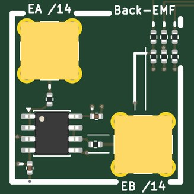</td>
<td valign="top">

<b>The back-EMF: phases A and B against the motor's neutral, divided by 14 and buffered.</b>  
<b>Jacks:</b> EA /14, top left; EB /14, bottom right.  
<b>Supply:</b> +-5 V  
<b>Expect:</b> EA, EB = phase A's and B's voltage / 14 against the neutral: with COAST high and the motor spun, its back-EMF  
<b>How to use it:</b> COAST high and spin the motor by hand, or coast between drive pulses; EA and EB to the ADCs.  
<b>You need:</b> From the kit (docs/KIT.md, Motors and actuators): the GBM2804H-100T gimbal motor on b5. (<a href="KIT.md">KIT.md</a>)  
<b>Specs:</b> Each phase through 13 k / 1 k; the three dividers' ends join at ground, so with every phase floating they make the motor's neutral; A and B followed by an OPA2171 on +-5 V: EA, EB = the phase / 14 through 49.9 ohm.  
<b>Limits:</b> +-14 V at a phase reads +-1 V.  While the driver runs, EA and EB show the PWM's square waves (the phase voltages), not the back-EMF: coast (b3's COAST high) to see it.  
<b>Experiments:</b> The back-EMF's sinusoid as the motor is spun by hand; its amplitude against speed (the motor constant); its zero crossings for sensorless commutation; its shape (sinusoidal or trapezoidal).  
<b>Chip:</b> <a href="https://www.ti.com/product/OPA2171">OPA2171</a>  
<b>Tutorial pages:</b> Motors.  
<b>The circuit:</b> Each phase through 13 k / 1 k; with every phase floating the three dividers are the motor's ground, so EA and EB read the back-EMF against the neutral (14 x EA in volts).  Followed by an OPA2171.  A spun gimbal motor makes a few volts.  
<b>Parts:</b> OPA2171AIDR (C40904).

</td></tr></table>

### b5  gimbal, MT6701

<table><tr>
<td valign="top" width="528">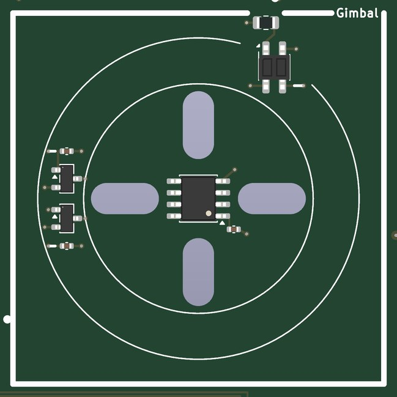</td>
<td valign="top">

<b>The gimbal motor on four slots over its sensors: a magnetic encoder under the shaft, two linear halls under the magnets, a reflective sensor under the rim.</b>  
<b>Pmod:</b> IO4 (Pmod pin 4): SCK (the IMU and the encoder); IO6 (Pmod pin 8): CS ENC (the encoder's select, low to read it)  
<b>Supply:</b> +3.3 V, +5 V  
<b>Expect:</b> the MT6701's angle on SSI (14 bits a turn) and as a sawtooth to b7; two hall signals 120 electrical degrees apart to b10; an index pulse to b9  
<b>How to use it:</b> Glue the magnet to the shaft's end; screw the motor down on spacers so the magnet is about 1 mm over the encoder; its leads to b3.  
<b>You need:</b> From the kit (docs/KIT.md, Motors and actuators): the GBM2804H-100T gimbal motor on b5, a 6 x 2.5 mm diametric magnet, M2.5 screws and spacers. (<a href="KIT.md">KIT.md</a>)  
<b>Specs:</b> Four radial slots 3.4 mm wide, 4.3-11.7 mm from the centre (M2-M3 screws on any of the 2804 patterns: 12 mm, 16 / 19 mm, 14 x 14).  MT6701 (14 bits, SSI: CLK on SCK, CSN on CS ENC, DO to b6's buffer; its analog output to b7) at the centre under a 6 x 2.5 mm diametric magnet on the shaft's end, 0.5-2 mm above it.  Two DRV5055A3 under the rotor's magnets 14.5 mm out, 17.1 degrees apart (120 electrical degrees for 7 pole pairs), to b10.  A QRE1113 16.5 mm out under the bell's rim, to b9.  
<b>Limits:</b> The magnet must be diametric (magnetised across its diameter) and centred over the encoder; the motor sits on spacers to set the gap.  The halls see the rotor's magnets only if they come within about 3 mm of the board.  
<b>Experiments:</b> The encoder's angle against the halls' and the back-EMF's: the motor's electrical angle three ways; the encoder's nonlinearity against the index; cogging (the motor turned by hand, the angle and the current).  
<b>Chip:</b> <a href="https://www.lcsc.com/product-detail/C3003196.html">MT6701</a>, <a href="https://www.ti.com/product/DRV5055">DRV5055</a>, <a href="https://www.onsemi.com/products/sensors/photo-detectors/reflective-sensors/qre1113">QRE1113</a>  
<b>Tutorial pages:</b> Motors.  
<b>The circuit:</b> A GBM2804H-100T class gimbal motor on four slots over an MT6701 (SSI on the Pmod; DO through b6's buffer onto MISO); a 6 x 2.5 mm diametric magnet on the shaft 0.5-2 mm above it.  Two DRV5055A3 under the magnets, a QRE1113 under the rim.  
<b>Parts:</b> DRV5055A3QDBZR (C266128), MT6701CT-STD-R (C3003196), QRE1113GR (C232862).

</td></tr></table>

### b6  IMU, LSM6DSO

<table><tr>
<td valign="top" width="270">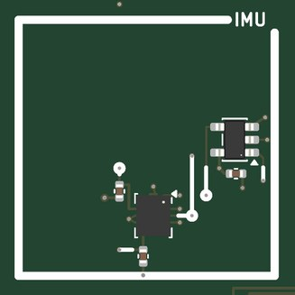</td>
<td valign="top">

<b>An IMU on SPI, and the buffer that lets the encoder share its MISO.</b>  
<b>Pmod:</b> IO3 (Pmod pin 3): MISO (b6's IMU and, through b6's buffer, b5's encoder); IO4 (Pmod pin 4): SCK (the IMU and the encoder); IO6 (Pmod pin 8): CS ENC (the encoder's select, low to read it); IO7 (Pmod pin 9): MOSI (the IMU); IO8 (Pmod pin 10): CS IMU (the IMU's select, low to talk to it)  
<b>Supply:</b> +3.3 V  
<b>Expect:</b> six axes on SPI (the tutorial's gateware reads them): with the board on edge, the roll about the motor's axis  
<b>How to use it:</b> SPI from the gateware on IO8, IO4, IO7, IO3 (the encoder on IO6).  
<b>You need:</b> Gateware on the host (the tutorial's).  
<b>Specs:</b> LSM6DSO (gyroscope to 2000 dps, accelerometer to 16 g, both to 6.66 kHz) on SPI mode 3 up to 10 MHz: CS IMU on Pmod IO8, SCK IO4, MOSI IO7, MISO IO3.  A 74LVC1G125 puts the encoder's DO on MISO only while CS ENC (IO6) is low.  3.3 V from the board's rail.  
<b>Limits:</b> Hold CS IMU and CS ENC never low together.  SPI only (its I2C mode is not wired).  
<b>Experiments:</b> The accelerometer's gravity vector as a level (stand the board on edge: the roll about the motor's axis); the gyroscope's rate against the encoder's speed; a one-axis gimbal that holds a direction as the board tilts.  
<b>Chip:</b> <a href="https://www.st.com/en/mems-and-sensors/lsm6dso.html">LSM6DSO</a>, <a href="https://www.ti.com/product/SN74LVC1G125">SN74LVC1G125</a>  
<b>Tutorial pages:</b> Motors.  
<b>The circuit:</b> LSM6DSO on SPI (mode 3): CS IMU on IO8, SCK IO4, MOSI IO7, MISO IO3, shared with the encoder through a 74LVC1G125 (CS ENC on IO6).  Gyro to 2000 dps, accelerometer to 16 g, to 6.66 kHz.  On edge: a one-axis gimbal's level reference.  
<b>Parts:</b> LSM6DSOTR (C2655100), SN74LVC1G125DBVR (C23654).

</td></tr></table>

### b7  angle, MT6701

<table><tr>
<td valign="top" width="270">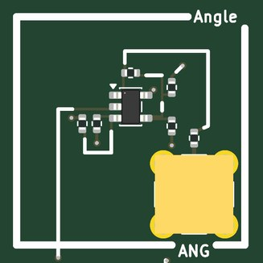</td>
<td valign="top">

<b>The encoder's analog angle: a sawtooth once a turn, centred on 0.</b>  
<b>Jacks:</b> ANG, bottom right.  
<b>Supply:</b> +-5 V  
<b>Expect:</b> ANG = a sawtooth, -0.84 V to +0.84 V, once a turn of the shaft (0 at half a turn from the MT6701's zero)  
<b>How to use it:</b> ANG to an ADC.  
<b>You need:</b> From the kit (docs/KIT.md, Motors and actuators): the GBM2804H-100T gimbal motor on b5 and its magnet. (<a href="KIT.md">KIT.md</a>)  
<b>Specs:</b> The MT6701's OUT (0 to its 3.3 V over a turn) less 1.65 V (20 k / 20 k of the same 3.3 V, so it tracks), times 0.51, by an OPA810 on +-5 V: ANG = +-0.84 V through 49.9 ohm.  
<b>Limits:</b> The MT6701's DAC is 12 bits and updates every few microseconds; its zero is the encoder's (set over SSI, or by where the magnet sits).  
<b>Experiments:</b> The shaft's angle on a scope while the motor turns; speed from the sawtooth's period; the encoder's latency against the halls.  
<b>Chip:</b> <a href="https://www.ti.com/product/OPA810">OPA810</a>  
<b>Tutorial pages:</b> Motors.  
<b>The circuit:</b> The MT6701's analog output (0-3.3 V a turn) less 1.65 V, times 0.51, by an OPA810: the shaft's angle without SSI. Its zero is the MT6701's (set by its registers over the SSI, or where the magnet sits).  
<b>Parts:</b> OPA810IDBVR (C2833513).

</td></tr></table>

### b8  vibration, OPA810

<table><tr>
<td valign="top" width="270">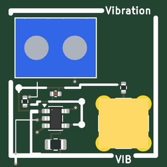</td>
<td valign="top">

<b>A vibration pickup: a piezo disc's charge amplified.</b>  
<b>Jacks:</b> VIB, bottom right.  
<b>Supply:</b> +-5 V  
<b>Expect:</b> VIB = -the piezo's charge / 1 nF above 160 Hz: the motor's cogging, its commutation ripple, the bearing  
<b>How to use it:</b> Stick the disc to the motor's mount (tape or wax); its wires on the terminal; VIB to an ADC.  
<b>You need:</b> From the kit (docs/KIT.md, Motors and actuators): a 27 mm piezo disc with leads. (<a href="KIT.md">KIT.md</a>)  
<b>Specs:</b> The disc on a 2-way screw terminal through 1 k into an OPA810 charge amplifier on +-5 V: VIB = -Q / 1 nF above 160 Hz (1 M across), through 49.9 ohm.  
<b>Limits:</b> Below 160 Hz the output falls (the 1 M); a hard tap on the disc can clip the amplifier at +-4 V.  
<b>Experiments:</b> The cogging (12 a turn), the commutation's ripple and the PWM's whine, the bearing's noise; the motor mount's resonances; field-oriented control against six-step, heard.  
<b>Chip:</b> <a href="https://www.ti.com/product/OPA810">OPA810</a>  
<b>Tutorial pages:</b> Motors.  
<b>The circuit:</b> A piezo disc on the terminal into an OPA810 charge amplifier (1 nF, 1 M: from 160 Hz).  Stick the disc to the motor's mount: the cogging at 12 a turn, the commutation's ripple, the bearing, the frame's resonances.  
<b>Parts:</b> OPA810IDBVR (C2833513).

</td></tr></table>

### b9  index, QRE1113

<table><tr>
<td valign="top" width="270">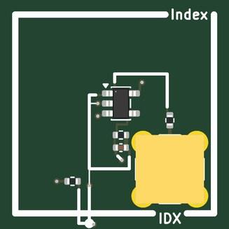</td>
<td valign="top">

<b>An index: the reflective sensor under the bell's rim sees a white mark once a turn.</b>  
<b>Jacks:</b> IDX, bottom right.  
<b>Supply:</b> +-5 V  
<b>Expect:</b> IDX = 4.7 k x the sensor's current: a pulse once a turn as a white mark on the bell's rim passes  
<b>How to use it:</b> A white mark (tape, paint) on the bell's lower rim; IDX to an ADC.  
<b>You need:</b> From the kit (docs/KIT.md, Motors and actuators): the GBM2804H-100T gimbal motor on b5, white tape. (<a href="KIT.md">KIT.md</a>)  
<b>Specs:</b> The QRE1113 on b5 (its LED at 21 mA from 5 V through 180 ohm), its collector held at 0 V by an OPA810 on +-5 V, its emitter on -5 V through 100 ohm: IDX = 4.7 k x the collector current, 100 pF across, through 49.9 ohm.  
<b>Limits:</b> The rim must pass within a few millimetres of the sensor; lamps and sunlight add to the reading.  
<b>Experiments:</b> An index pulse for the encoder; a tachometer with no encoder; the encoder's angle at each index (its repeatability).  
<b>Chip:</b> <a href="https://www.ti.com/product/OPA810">OPA810</a>  
<b>Tutorial pages:</b> Motors.  
<b>The circuit:</b> The QRE1113 under the gimbal's rim (on b5), its collector held at 0 V by an OPA810: IDX = 4.7 k x Ic.  Put a white mark (tape, paint) on the bell's lower rim: an index pulse a turn, a tachometer with no encoder.  
<b>Parts:</b> OPA810IDBVR (C2833513).

</td></tr></table>

### b10  halls, DRV5055A3

<table><tr>
<td valign="top" width="270">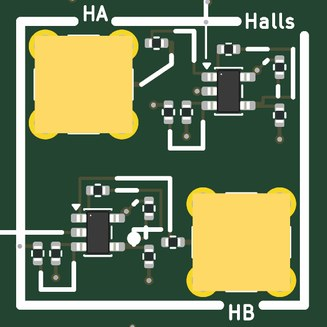</td>
<td valign="top">

<b>The halls' two sinusoids: the rotor's electrical angle without the encoder.</b>  
<b>Jacks:</b> HA, top left; HB, bottom right.  
<b>Supply:</b> +-5 V  
<b>Expect:</b> HA, HB = 9.75 mV/mT from the two halls under the rotor: two sinusoids 120 electrical degrees apart as it turns  
<b>How to use it:</b> HA and HB to the ADCs.  
<b>You need:</b> From the kit (docs/KIT.md, Motors and actuators): the GBM2804H-100T gimbal motor on b5. (<a href="KIT.md">KIT.md</a>)  
<b>Specs:</b> Each DRV5055A3 on b5 (25 mV/mT about half its 5 V) less half its supply (20 k / 20 k, ratiometric) times 0.39 by an OPA810 on +-5 V, as AMOD-M's m9: HA, HB = 9.75 mV/mT through 49.9 ohm.  
<b>Limits:</b> +-85 mT before a sensor saturates; the rotor's field at the board is a few tens of millitesla.  
<b>Experiments:</b> Hall-sensored six-step commutation; the electrical angle from the two sinusoids (atan2) against the encoder's; the pole count from their period against the encoder's turn.  
<b>Chip:</b> <a href="https://www.ti.com/product/OPA810">OPA810</a>  
<b>Tutorial pages:</b> Motors.  
<b>The circuit:</b> Two DRV5055A3 under the gimbal's magnets (b5), 17.1 degrees apart (120 electrical for 7 pole pairs); each less half its 5 V, times 0.39 (as AMOD-M's m9).  The rotor's electrical angle without the encoder; hall-sensored commutation.  
<b>Parts:</b> OPA810IDBVR (C2833513).

</td></tr></table>

### b11  phase current, INA240

<table><tr>
<td valign="top" width="270">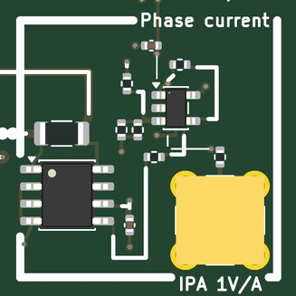</td>
<td valign="top">

<b>Phase A's whole current, in line, both ways and through every PWM state.</b>  
<b>Jacks:</b> IPA 1V/A, bottom right.  
<b>Supply:</b> +-5 V  
<b>Expect:</b> IPA = phase A's whole current, 1 V/A both ways, through every PWM state (compare b3's IA: the low side only)  
<b>How to use it:</b> IPA to an ADC.  
<b>You need:</b> From the kit (docs/KIT.md, Motors and actuators): the GBM2804H-100T gimbal motor on b5. (<a href="KIT.md">KIT.md</a>)  
<b>Specs:</b> Phase A from b3 through 0.05 ohm and back to the terminal, read by an INA240A1 (x20, common mode -4 to 80 V, built to reject the PWM's edges) about 2.5 V, and an OPA810 that takes the 2.5 V away: IPA = 1 V/A through 49.9 ohm.  
<b>Limits:</b> +-2.5 A (the INA240's output range); about 400 kHz.  
<b>Experiments:</b> IPA against b3's IA: what a low-side amplifier misses (the high side's share and the coast intervals); the phase current's sinusoid under field-oriented control; the current's rise at each PWM edge (L / R).  
<b>Chip:</b> <a href="https://www.ti.com/product/INA240">INA240</a>, <a href="https://www.ti.com/product/OPA810">OPA810</a>  
<b>Tutorial pages:</b> Motors.  
<b>The circuit:</b> Phase A through 0.05 ohm between the driver and the motor; an INA240A1 (PWM rejection, common mode to 80 V) about 2.5 V and an OPA810 that takes the 2.5 V away: IPA = 1 V/A, the whole current.  b3's IA sees only the low side's share.  
<b>Parts:</b> INA240A1DR (C2060769), OPA810IDBVR (C2833513).

</td></tr></table>

### b12  bus current, INA181

<table><tr>
<td valign="top" width="270">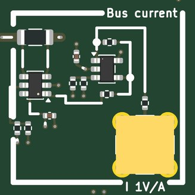</td>
<td valign="top">

<b>The driver's supply current, both ways: the power into the motor and the energy it gives back.</b>  
<b>Jacks:</b> I 1V/A, bottom right.  
<b>Supply:</b> +-5 V  
<b>Expect:</b> I = the driver's supply current, 1 V/A (+-1.2 A), negative while the motor brakes  
<b>How to use it:</b> I to an ADC.  
<b>You need:</b> Nothing beyond SMA cables.  
<b>Specs:</b> VMOT from b2 through 0.1 ohm (VMB on to b3), read by an INA181A1 (x20) about 2.5 V and an OPA810 difference amplifier, as AMOD-M's m7: I = 1 V/A, +-1.2 A, through 49.9 ohm.  
<b>Limits:</b> +-1.2 A.  The driver's input capacitors smooth the PWM's pulses: I is the average current, not each pulse.  
<b>Experiments:</b> The electrical power in (I x VM); the driver's losses against the phase currents; the current going negative while the motor brakes.  
<b>Chip:</b> <a href="https://www.ti.com/product/INA181">INA181</a>, <a href="https://www.ti.com/product/OPA810">OPA810</a>  
<b>Tutorial pages:</b> Motors.  
<b>The circuit:</b> VMOT through 0.1 ohm to the driver; an INA181A1 (2.5 V on REF) and an OPA810 give I = 1 V/A both ways.  With VM: the electrical power in; against the phase currents: the driver's losses; negative while the motor's energy comes back.  
<b>Parts:</b> INA181A1IDBVR (C2058943), OPA810IDBVR (C2833513).

</td></tr></table>

## Ground, loops and probing

Two ground loops stand in the margins; every tile's loops are on the signal they name.  The RH-5019
loops take a scope's grabber.  The SMA jacks are 50 ohm; where an input is not 50 ohm the jack's silk says so.
