# AMOD-C handbook: the conversion board

Generated by `scripts/gen_docs.py` from the tiles' own declarations (`boards/amod_c.py`); the expected results come from
the same text the silkscreen quotes.  Rev A, 2026-10-25.

## The board

Twelve tiles on sixteen 20 mm cells, four layers.  c1 takes 5 V from its USB-C and makes -5 V (40 mA) and 3.3 V, as
AMOD-A's a1 does; every other tile has a slide switch along its left edge (slider up: on).  Seven tiles take a clock,
a phase or a control from the FPGA, or hand it a bit, on the Pmod plug in the bottom margin under c9, so plug in both
the USB-C and the host's Pmod.  A tile's input is its top-left jack and its output its bottom-right jack.  A port's
name is in capitals on its tile's frame; an input that is not 50 ohm says its impedance (IN 10K, DAC 20K) and an
output read through a divider its ratio (OUT /5.7): read those at high impedance.  The back of each tile says what
to know while cabling it.

### Pmod lines

The 2 x 6 plug on the bottom margin under c9 (pins 1-4 are IO1-4, 7-10 are IO5-8, 5 and 11 ground, 6 and 12 the FPGA's 3.3 V,
which the board does not use: every chip here runs from its own 3.3 V, so the lines are 3.3 V CMOS both ways):

- Pmod pin 1 (PMOD1): c6's clock (about 1 MHz, to the register), c6
- Pmod pin 2 (PMOD2): c8's BIT (high: IN above DAC), c8
- Pmod pin 3 (PMOD3): c4's clock (100 x the corner), c4
- Pmod pin 4 (PMOD4): c5's phi1 (IN onto the capacitor), c5
- Pmod pin 7 (PMOD5): c7's LOGIC (high: track, low: hold), c7
- Pmod pin 8 (PMOD6): c3's clock (the pump runs at half of it), c3
- Pmod pin 9 (PMOD7): c6's bit (the modulator's output), c6
- Pmod pin 10 (PMOD8): c5's phi2 (the capacitor into the summing node), c5

## The tiles together

1. **Power** (Regulators).  c2's buck makes 3.6 V at 1.5 MHz and its LDO 3.3 V from it; c2's own electronic load
   draws 100 mA per volt on LOAD, so a DAC step is a load step.  TRIM moves the buck from 2.2 to 5 V and pushes the
   LDO into dropout.  c3's charge pump makes -5 V the way c1's LM2664 does, but at the FPGA's clock.
2. **Switched capacitors.**  One law three times: c5's capacitor is a resistor of 1 / (f C), c4's filter is a ladder
   of such resistors whose corner follows the clock, and c3's output resistance is 1 / (f C) again.
3. **Trading speed for bits.**  c7 samples, c8 compares against the host's DAC (a successive-approximation ADC in
   gateware), c6 modulates (second order: its noise rises at 40 dB per decade against AMOD-A's a6's 20) and c11
   turns a voltage into a frequency (count it and it is an ADC).
4. **Transistors.**  c9's differential pair (tanh, and a triangle into a sine), c10's common emitter against its
   cascode (the Miller effect, on a jumper), c12's precision rectifier (an op amp hiding two diode drops).

The -5 V rail is c1's 40 mA: the five tiles on +-5 V (c5, c6, c7, c9, c12) draw about 25 mA together.

## The tiles

Each tile in a table: its picture, then what it does, its jacks, what to expect, how to cable it, what to buy
(the links are in [KIT.md](KIT.md)), its numbers and limits, the experiments it is for and the circuit.

### c1  power, USB-C 5 V in: +5, -5, +3.3 out

<table><tr>
<td valign="top" width="270">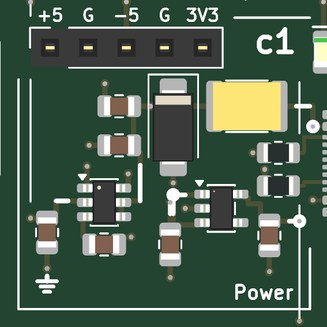</td>
<td valign="top">

<b>Power: 5 V from USB-C, and -5 V and 3.3 V made from it; a socket carries the rails to a breadboard (AMOD-A's a1).</b>  
<b>Expect:</b> +5 V from the USB-C (up to 1.5 A), -5 V at 40 mA, +3.3 V at 300 mA; the green LED says 5 V is in, the red one that -5 V is up  
<b>How to use it:</b> Plug in the USB-C and the host's Pmod; then switch on each tile you use (slider up).  
<b>You need:</b> A 5 V USB-C supply, 1.5 A or more (kit: Raspberry Pi 5.1 V 3 A supply). (<a href="KIT.md">KIT.md</a>)  
<b>Specs:</b> +5 V up to 1.5 A, -5 V at 40 mA, +3.3 V at 300 mA; green LED 5 V, red LED -5 V.  
<b>Limits:</b> -5 V is 40 mA: the five tiles on +-5 V draw about 25 mA together.  The board negotiates nothing: use a plain 5 V supply.  
<b>Chip:</b> <a href="https://www.ti.com/product/LM2664">LM2664</a>, <a href="https://www.ti.com/product/TPS7A20">TPS7A20</a>  
<b>Tutorial pages:</b> Regulators; Switched capacitors.  
<b>The circuit:</b> USB-C power only: 5.1 k on each CC asks any source for 5 V.  A 2 A PTC, a 5 V TVS (clamps at 9.2 V) and 20 uF. The LM2664 charge pump makes -5 V for the op-amp tiles (40 mA: four tiles at 10 mA); it is not switched per tile, an op amp with its +5 V removed draws nothing.  The TPS7A2033 makes 3.3 V for the comparator and the lines that meet the FPGA. The socket along the top carries +5, ground, -5, ground, +3.3: the bench's rails for a breadboard experiment.  
<b>Parts:</b> KT-0805G (C2297), NCD0805R1 (C84256), LM2664M6X/NOPB (C108573), MF-MSMF200-2 (C210837), TPS7A2033PDBVR (C2862740), SMAJ5.0A (C78401), TYPE-C-31-M-12 (C165948).

</td></tr></table>

### c2  regulators, buck, LDO, load

<table><tr>
<td valign="top" width="528">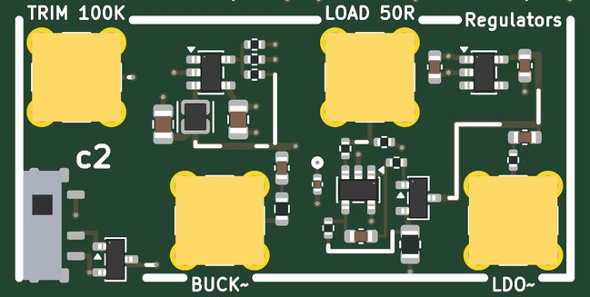</td>
<td valign="top">

<b>A buck converter, an LDO after it and an electronic load: the ripple before and after the LDO, load steps, dropout.</b>  
<b>Jacks:</b> TRIM 100K, top left (±2 V); BUCK~, bottom of the left cell; LOAD 50R, top of the right cell (0-1 V); LDO~, bottom right.  
<b>Supply:</b> +5 V  
<b>Expect:</b> BUCK~ shows the buck's 1.5 MHz ripple (a few mV, pulse-skipping below about 150 mA); LDO~ the same after the LDO, 40 dB smaller; LOAD sets 100 mA per volt  
<b>How to use it:</b> LOAD from a DAC (0 to 1 V); TRIM from the other DAC or open; BUCK~ and LDO~ to the two ADCs (the x10 input for the few millivolts of ripple).  
<b>You need:</b> Nothing beyond SMA cables.  
<b>Specs:</b> Buck: 3.6 V at 1.5 MHz from the switched 5 V, 2.2 uH, 10 uF in and out; TRIM through 100 k into its feedback node: OUT = 4.2 V - TRIM (open: 3.6 V).  LDO: 3.3 V, about 40 dB of rejection at 1.5 MHz.  Load: 100 mA per volt on LOAD (terminated in 49.9 ohm), from the LDO's output through an AO3400A and 10 ohm.  BUCK~ and LDO~ are the two outputs AC-coupled through 1 uF and 49.9 ohm.  
<b>Limits:</b> LOAD 0 to 1 V (100 mA: the 10 ohm 0805 then dissipates 0.1 W, the FET 0.23 W).  Below about 3.5 V on its input (TRIM above +0.7 V) the LDO drops out.  The buck skips pulses below about 150 mA, so its ripple changes character with load.  
<b>Experiments:</b> Output ripple and its spectrum before and after the LDO; load-step response (a square wave on LOAD); output impedance against frequency (a swept sine on LOAD, LDO~ on an ADC); dropout as TRIM lowers the buck; the buck's pulse-skipping at light load.  
<b>Chip:</b> <a href="https://www.ti.com/product/TLV62568">TLV62568</a>, <a href="https://www.ti.com/product/TPS7A20">TPS7A20</a>, <a href="https://www.ti.com/product/OPA810">OPA810</a>, <a href="https://www.lcsc.com/product-detail/C20917.html">AO3400A</a>  
<b>Tutorial pages:</b> Regulators.  
<b>The circuit:</b> TLV62568: 3.6 V from 100 k / 20 k; TRIM through 100 k into the feedback node moves it (0 V: 4.2 V, +1 V: 3.2 V, open: 3.6 V). TPS7A2033: 3.3 V, about 92 dB of PSRR at 1 kHz and 40 dB at 1 MHz; below 3.5 V in it drops out (lower TRIM's voltage). The load: an OPA810 servos 10 ohm to LOAD's voltage through an AO3400A (1 k and 1 nF slow its loop): a square on LOAD is a load step.  Keep it under 100 mA for long (the shunt is 1/8 W), steps can be larger.  Both outputs are AC-coupled.  
<b>Parts:</b> WPN201610H2R2MT (C97005), AO3400A (C20917), OPA810IDBVR (C2833513), TLV62568DBVR (C163219), TPS7A2033PDBVR (C2862740).

</td></tr></table>

### c3  charge pump, ICL7660A

<table><tr>
<td valign="top" width="270">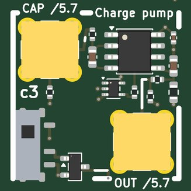</td>
<td valign="top">

<b>A charge pump the FPGA clocks: -5 V from +5 V, whose output resistance is 1 / (f C).</b>  
<b>Jacks:</b> CAP /5.7, top left; OUT /5.7, bottom right.  
<b>Pmod:</b> IO6 (Pmod pin 8): c3's clock (the pump runs at half of it)  
<b>Supply:</b> +5 V  
<b>Expect:</b> about -5 V on the output, falling with load as 1 / (f C) + the switches: 2 k at 1 kHz, 80 ohm at 100 kHz (the pump at half IO6's clock)  
<b>How to use it:</b> A square wave on Pmod IO6 (1 kHz to 100 kHz); OUT and CAP to the ADCs at high impedance.  
<b>You need:</b> Gateware on the host (the tutorial's).  
<b>Specs:</b> ICL7660A from the switched 5 V, OSC driven from Pmod IO6 through a 5 V buffer and 1 k (the pump runs at half IO6's frequency); 1 uF flying, 1 uF out, 1 k of load; CAP (the flying capacitor's top, 0-5 V) and OUT (about -5 V) each through 47 k / 10 k, so /5.7.  
<b>Limits:</b> CAP and OUT are 8.2 k sources: read them at high impedance.  Rout = 1 / (f C) + about 60 ohm: 2 k at 1 kHz on IO6, 80 ohm at 100 kHz.  With no clock on IO6 the pump stops.  
<b>Experiments:</b> Output voltage and ripple against the clock (the 1 / (f C) law); the flying capacitor's charge and dump on CAP; efficiency against load.  
<b>Chip:</b> <a href="https://www.lcsc.com/product-detail/C7881.html">ICL7660A</a>, <a href="https://www.ti.com/product/SN74LV1T34">SN74LV1T34</a>  
<b>Tutorial pages:</b> Regulators.  
<b>The circuit:</b> ICL7660A: switches charge the flying 1 uF across the supply and dump it, upside down, into the output's 1 uF.  IO6 clocks it through an SN74LV1T34 and 1 k; with 1 k of load, sweep the clock and read OUT: Rout = 1 / (f C) + 60 ohm.  
<b>Parts:</b> ICL7660AIBAZA-T (C7881), SN74LV1T34DCKR (C78541).

</td></tr></table>

### c4  SC filter, MAX7410

<table><tr>
<td valign="top" width="270">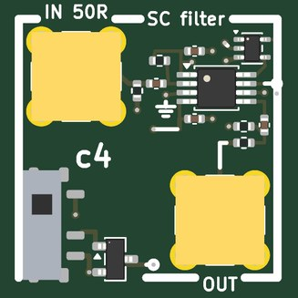</td>
<td valign="top">

<b>A switched-capacitor filter: a 5th-order Butterworth low-pass whose corner is the FPGA's clock divided by 100.</b>  
<b>Jacks:</b> IN 50R, top left (±1 V); OUT, bottom right.  
<b>Pmod:</b> IO3 (Pmod pin 3): c4's clock (100 x the corner)  
<b>Supply:</b> +5 V  
<b>Expect:</b> a 5th-order Butterworth low-pass at fCLK / 100 (up to 15 kHz from a 1.5 MHz clock on IO3); the clock's images near fCLK  
<b>How to use it:</b> A clock 100 times the corner you want on Pmod IO3; DAC to IN, OUT to an ADC.  
<b>You need:</b> Gateware on the host (the tutorial's).  
<b>Specs:</b> fc = fCLK / 100, up to 15 kHz (1.5 MHz on IO3, through a 5 V buffer); IN terminated in 49.9 ohm and AC-coupled (1 uF, 100 k: 1.6 Hz); OUT AC-coupled through 1 uF and 49.9 ohm; 5 V from the switch.  
<b>Limits:</b> IN +-1 V.  There is no anti-alias filter in front: a tone near fCLK folds down into the passband, and the clock's images sit near fCLK at OUT (that is the point).  JLCPCB had 134 MAX7410s on 2026-10-28.  
<b>Experiments:</b> The corner following the clock; aliasing a tone near fCLK; the clock feedthrough on OUT's spectrum; a tracking filter controlled from gateware.  
<b>Chip:</b> <a href="https://www.analog.com/en/products/max7410.html">MAX7410</a>, <a href="https://www.ti.com/product/SN74LV1T34">SN74LV1T34</a>  
<b>Tutorial pages:</b> Switched capacitors.  
<b>The circuit:</b> MAX7410: a switched-capacitor ladder whose corner is the clock divided by 100, clocked from IO3 through an SN74LV1T34. IN and OUT sit at COM (2.5 V), so both are AC-coupled.  Sweep the clock and watch the corner follow; alias a tone.  
<b>Parts:</b> SN74LV1T34DCKR (C78541), MAX7410EUA+T (C17492626).

</td></tr></table>

### c5  SC integrator, TMUX4053

<table><tr>
<td valign="top" width="528">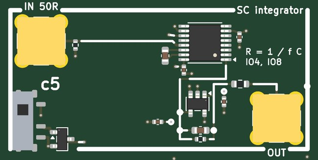</td>
<td valign="top">

<b>A resistor made of a switch and a capacitor, in an integrator: R = 1 / (f C), set by the FPGA's two phases.</b>  
<b>Jacks:</b> IN 50R, top left (±1 V); OUT, bottom right.  
<b>Pmod:</b> IO4 (Pmod pin 4): c5's phi1 (IN onto the capacitor); IO8 (Pmod pin 10): c5's phi2 (the capacitor into the summing node)  
<b>Supply:</b> +-5 V  
<b>Expect:</b> an integrator whose input resistor is 1 / (f x 1 nF): 1 M at 1 kHz, 1 k at 1 MHz; OUT = -(1 / R C) x the integral of IN  
<b>How to use it:</b> Two non-overlapping square waves on Pmod IO4 and IO8; DAC to IN, OUT to an ADC.  
<b>You need:</b> Gateware on the host (the tutorial's).  
<b>Specs:</b> 1 nF switched between IN and ground (phi1, Pmod IO4) and between ground and the summing node (phi2, IO8): the parasitic-insensitive integrator; R = 1 M at 1 kHz, 1 k at 1 MHz.  OPA810 with 10 nF (C0G) and 1 M across it; IN terminated in 49.9 ohm, OUT through 49.9 ohm.  
<b>Limits:</b> IN +-1 V.  The phases must not overlap (overlap them on purpose to watch IN leak through); the TMUX4053's charge injection shows at high clock rates; the 1 M sets the DC gain (1 M / R).  
<b>Experiments:</b> The 1 / (f C) law measured as the integrator's slope against the clock; a switched-capacitor low-pass (the integrator with the 1 M); overlap and charge injection.  
<b>Chip:</b> <a href="https://www.ti.com/product/TMUX4053">TMUX4053</a>, <a href="https://www.ti.com/product/OPA810">OPA810</a>  
<b>Tutorial pages:</b> Switched capacitors.  
<b>The circuit:</b> phi1 (IO4) connects the 1 nF's top plate to IN, phi2 (IO8) its bottom plate to the summing node: C x Vin per cycle at f, a resistor of 1 / (f C).  Make the phases non-overlapping, or overlap them and watch IN leak through.  1 M sets the DC gain.  
<b>Parts:</b> OPA810IDBVR (C2833513), TMUX4053PWR (C5377936).

</td></tr></table>

### c6  delta-sigma, second order

<table><tr>
<td valign="top" width="528">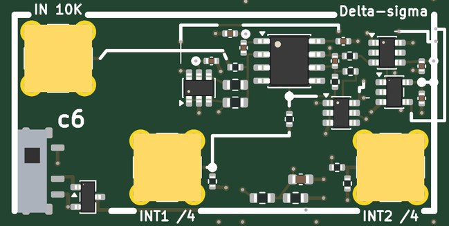</td>
<td valign="top">

<b>A second-order delta-sigma modulator with its insides on jacks: a one-bit stream whose density follows IN.</b>  
<b>Jacks:</b> IN 10K, top left (±1 V); INT1 /4, bottom of the left cell; INT2 /4, bottom right.  
<b>Pmod:</b> IO1 (Pmod pin 1): c6's clock (about 1 MHz, to the register); IO7 (Pmod pin 9): c6's bit (the modulator's output)  
<b>Supply:</b> +-5 V  
<b>Expect:</b> a one-bit stream on IO7 whose density follows IN (+-1.65 V full scale), its noise shaped at 40 dB per decade  
<b>How to use it:</b> A 1 MHz clock on Pmod IO1; read the bits on IO7 and decimate them; DAC to IN; INT1, INT2 to the ADCs at high impedance.  
<b>You need:</b> Gateware on the host (the tutorial's).  
<b>Specs:</b> Two integrators (10 k into 220 pF, 6.8 k into 680 pF) on a 1.65 V virtual ground (the 3.3 V rail halved by 0.1 % resistors); the one-bit DACs switch 10 k between 3.3 V and ground; a TLV3501 and a 74LVC1G79 clocked from Pmod IO1 (about 1 MHz) put the bit on IO7.  Full scale +-1.65 V; INT1 and INT2 through 3.3 k / 1 k (about a quarter, offset 0.38 V).  
<b>Limits:</b> IN is 10 k (not 50 ohm): drive it from the DAC directly.  Keep IN within +-1.5 V: beyond that the second integrator leaves the comparator's 0-3.3 V input range (10 k protects the comparator; the bits stop meaning anything until IN comes back).  INT1 and INT2 are 770 ohm sources: high impedance.  A DC input near a simple fraction of full scale makes idle tones.  
<b>Experiments:</b> The noise spectrum's 40 dB per decade against AMOD-A's a6 (first order, 20); a sinc3 decimator's bits against the oversampling ratio; idle tones; the integrators' outputs on a scope as the loop runs.  
<b>Chip:</b> <a href="https://www.ti.com/product/OPA2810">OPA2810</a>, <a href="https://www.ti.com/product/TLV3501">TLV3501</a>, <a href="https://www.ti.com/product/SN74LVC1G79">SN74LVC1G79</a>, <a href="https://www.ti.com/product/SN74LVC1G3157">SN74LVC1G3157</a>  
<b>Tutorial pages:</b> Trading speed for bits.  
<b>The circuit:</b> Clock IO1 at about 1 MHz and count IO7's ones.  The second integrator pushes the quantization noise up at 40 dB per decade (AMOD-A's a6 is first order: 20 dB), so a sinc3 decimator gets more bits per clock.  INT1, INT2: high impedance.  
<b>Parts:</b> SN74LVC1G3157DBVR (C10426), SN74LVC1G79DBVR (C42878), OPA2810IDR (C1849413), RT0603BRD0710KL (C95204), TLV3501AIDBVR (C193413).

</td></tr></table>

### c7  track and hold, LF398

<table><tr>
<td valign="top" width="270">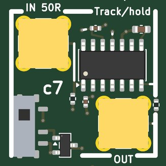</td>
<td valign="top">

<b>A track-and-hold: OUT follows IN while Pmod IO5 is high and holds when it falls.</b>  
<b>Jacks:</b> IN 50R, top left (±1 V); OUT, bottom right.  
<b>Pmod:</b> IO5 (Pmod pin 7): c7's LOGIC (high: track, low: hold)  
<b>Supply:</b> +-5 V  
<b>Expect:</b> OUT follows IN while IO5 is high and holds when it falls: 4 us to acquire, about 30 mV/s of droop, a few mV of hold step  
<b>How to use it:</b> A pulse train on Pmod IO5 (high: track); DAC to IN, OUT to an ADC.  
<b>You need:</b> Gateware on the host (the tutorial's).  
<b>Specs:</b> LF398 on +-5 V, 1 nF C0G hold capacitor; about 4 us to acquire, about 30 mV/s of droop, a few mV of hold step; IN terminated in 49.9 ohm, OUT through 49.9 ohm.  
<b>Limits:</b> IN +-1 V (on +-5 V the LF398's inputs must stay within +-1.5 V).  The hold step depends on the input level; a sine feeds through while holding.  
<b>Experiments:</b> Acquisition time, droop, pedestal (hold step) against IN, feedthrough, aperture delay against the FPGA's edge; sampling and aliasing with a slow ADC behind it.  
<b>Chip:</b> <a href="https://www.ti.com/product/LF398-N">LF398</a>  
<b>Tutorial pages:</b> Trading speed for bits.  
<b>The circuit:</b> LF398 on +-5 V (its minimum supply: inputs within +-1.5 V).  1 nF C0G: acquisition about 4 us, droop about 30 mV/s. Measure the acquisition time, the droop, the pedestal (the hold step) against IN, the feedthrough of a sine while holding, and the aperture delay against the FPGA's edge on IO5.  
<b>Parts:</b> LF398MX/NOPB (C2864267).

</td></tr></table>

### c8  comparator, TLV3201

<table><tr>
<td valign="top" width="270">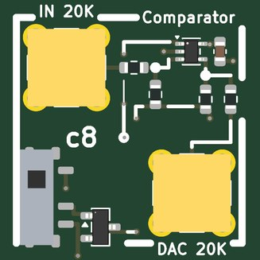</td>
<td valign="top">

<b>A comparator for a successive-approximation or tracking ADC whose DAC is the host's.</b>  
<b>Jacks:</b> IN 20K, top left (±1 V); DAC 20K, bottom right (±1 V).  
<b>Pmod:</b> IO2 (Pmod pin 2): c8's BIT (high: IN above DAC)  
<b>Supply:</b> +3.3 V  
<b>Expect:</b> BIT on Pmod IO2 is high while IN is above DAC; a SAR search in gateware gives 12 bits in 12 steps of the DAC  
<b>How to use it:</b> The signal to IN, DAC 2 to DAC; the gateware sets the DAC, reads BIT on IO2 and halves the step.  
<b>You need:</b> Gateware on the host (the tutorial's).  
<b>Specs:</b> TLV3201 (40 ns, 1.2 mV of hysteresis) on the 3.3 V rail; IN and DAC each averaged with the rail through matched 0.1 % 10 k, so the comparison is unchanged; BIT on Pmod IO2 (high: IN above DAC).  
<b>Limits:</b> IN and DAC +-1 V, each 20 k: drive them from 50 ohm sources.  The ADC is as good as the host's DAC: 12 bits needs a 12-bit DAC.  
<b>Experiments:</b> Successive approximation (12 bits in 12 steps), a tracking ADC, single-slope conversion; the host DAC's DNL and INL.  
<b>Chip:</b> <a href="https://www.ti.com/product/TLV3201">TLV3201</a>  
<b>Tutorial pages:</b> Trading speed for bits.  
<b>The circuit:</b> TLV3201 (40 ns, 1.2 mV hysteresis) on the 3.3 V rail.  Each input is averaged with the rail through a matched pair of 0.1 % 10 k, so +-1 V lands at 1.15-2.15 V on both pins and the comparison is unchanged.  20 k input impedance: drive it from a 50 ohm source, read the bit on IO2.  A successive-approximation ADC: the gateware sets the host's DAC, reads the bit, halves the step; a tracking ADC: up when high, down when low; a slope ADC with a ramp on DAC.  
<b>Parts:</b> RT0603BRD0710KL (C95204), TLV3201AQDCKRQ1 (C3658542).

</td></tr></table>

### c9  differential pair

<table><tr>
<td valign="top" width="528">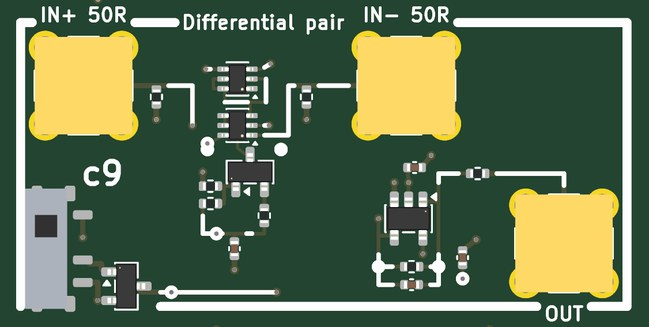</td>
<td valign="top">

<b>A differential pair on a current mirror: OUT is tanh of the input difference, linear near balance.</b>  
<b>Jacks:</b> IN+ 50R, top left (±0.2 V); IN- 50R, top of the right cell (±0.2 V); OUT, bottom right.  
<b>Supply:</b> +-5 V  
<b>Expect:</b> OUT = -1 k x (Ic1 - Ic2): +-1 V, tanh of (IN+ - IN-) / 2 VT, linear within about +-25 mV of balance  
<b>How to use it:</b> DAC 1 to IN+, DAC 2 to IN- (or IN- to a 50 ohm terminator); OUT to an ADC.  
<b>You need:</b> Nothing beyond SMA cables.  
<b>Specs:</b> A matched NPN pair on a 1 mA tail (an MMBT3904 with -3.4 V on its base), a matched PNP pair as the mirror, an OPA810 transimpedance (1 k) on the output node: OUT = -1 k x (Ic1 - Ic2), +-1 V; gm = Itail / (4 VT), about 10 mS.  IN+ and IN- terminated in 49.9 ohm.  
<b>Limits:</b> IN+ and IN- +-0.2 V; linear within about +-25 mV of balance; the offset is the pair's VBE match (2 mV).  
<b>Experiments:</b> The tanh transfer and gm; a triangle of +-72 mV into a sine (1.4 % distortion); common-mode rejection (the same signal on both inputs).  
<b>Chip:</b> <a href="https://www.lcsc.com/product-detail/C155305.html">DMMT3904W</a>, <a href="https://www.lcsc.com/product-detail/C105896.html">BCM857BS</a>, <a href="https://www.lcsc.com/product-detail/C20526.html">MMBT3904</a>, <a href="https://www.ti.com/product/OPA810">OPA810</a>  
<b>Tutorial pages:</b> Transistors.  
<b>The circuit:</b> A matched NPN pair (DMMT3904W: 2 mV of VBE, 2 % of hFE) on a 1 mA tail; a matched PNP pair as the mirror; an OPA810 holds the output node at 0 V and turns the difference current into volts.  Sweep IN+ with IN- at 0 V: the tanh, its slope gm = Itail / (4 VT), about 10 mS here; a triangle in becomes a sine-like wave out when it is driven past balance.  
<b>Parts:</b> BCM857BS-7-F (C105896), DMMT3904W-7-F (C155305), MMBT3904(RANGE:100-300) (C20526), OPA810IDBVR (C2833513).

</td></tr></table>

### c10  cascode

<table><tr>
<td valign="top" width="270">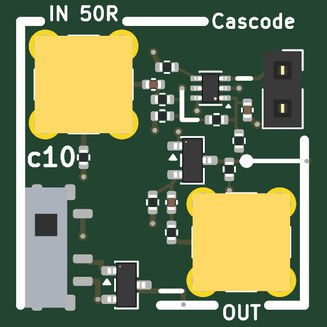</td>
<td valign="top">

<b>Common emitter against cascode on one transistor pair: the Miller effect, switched by a jumper.</b>  
<b>Jacks:</b> IN 50R, top left (±50 mV); OUT, bottom right.  
<b>Supply:</b> +5 V  
<b>Expect:</b> gain about -6 into a high impedance (-8 at Q1's collector), half that into 50 ohm; common emitter (jumper on) about 2 MHz wide, the cascode (jumper parked) several times wider  
<b>How to use it:</b> DAC to IN, OUT to an ADC; sweep the frequency once with the jumper on and once parked.  
<b>You need:</b> Nothing beyond SMA cables.  
<b>Specs:</b> Q1 at about 1.4 mA, 100 ohm in its emitter, 1 k collector load; Q2 its cascode (base at 2.4 V); Q3 an emitter follower into 1 uF and 51 ohm; IN terminated, AC-coupled and through 2.2 k.  Gain about -8 at Q1's collector, -6 from IN, -3 into 50 ohm.  
<b>Limits:</b> IN +-50 mV.  The jumper on the header shorts the cascode (common emitter, about 2 MHz wide); parked on one pin it leaves the cascode in (several times wider).  
<b>Experiments:</b> Bandwidth with and without the cascode; the Miller capacitance computed from the corner and the 2.2 k; gain against the emitter resistor.  
<b>Chip:</b> <a href="https://www.lcsc.com/product-detail/C155305.html">DMMT3904W</a>, <a href="https://www.lcsc.com/product-detail/C20526.html">MMBT3904</a>  
<b>Tutorial pages:</b> Transistors.  
<b>The circuit:</b> Q1's collector-base capacitance, multiplied by the gain (Miller), meets the 2.2 k at its base; the cascode holds Q1's collector still, so only one Ccb counts.  The jumper on the header shorts the cascode out: compare the two sweeps.  
<b>Parts:</b> DMMT3904W-7-F (C155305), MMBT3904(RANGE:100-300) (C20526).

</td></tr></table>

### c11  555, TLC555

<table><tr>
<td valign="top" width="270">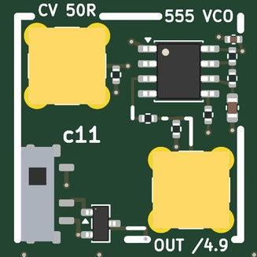</td>
<td valign="top">

<b>A 555 as a voltage-controlled oscillator: CV moves its thresholds and so its frequency.</b>  
<b>Jacks:</b> CV 50R, top left (±1 V); OUT /4.9, bottom right.  
<b>Supply:</b> +5 V  
<b>Expect:</b> a square near 6.9 kHz on OUT (5 V divided to about 1 V); CV moves it: up as CV falls, down as it rises  
<b>How to use it:</b> CV from a DAC; OUT to an ADC.  
<b>You need:</b> Nothing beyond SMA cables.  
<b>Specs:</b> TLC555 astable from the switched 5 V, 1 k and 10 k with 10 nF C0G: about 6.9 kHz; CV terminated and through 2.2 k into the control pin; OUT through 3.9 k / 1 k (about 1 V).  
<b>Limits:</b> CV +-1 V; OUT is a 800 ohm source, read it at high impedance.  The frequency falls as CV rises.  
<b>Experiments:</b> Frequency against CV; the capacitor's ramp between 1/3 and 2/3 of the supply; a voltage-to-frequency ADC counted in the FPGA.  
<b>Chip:</b> <a href="https://www.ti.com/product/TLC555">TLC555</a>  
<b>Tutorial pages:</b> Trading speed for bits.  
<b>The circuit:</b> TLC555 astable: f = 1.44 / ((1 k + 2 x 10 k) x 10 nF), the capacitor between 1/3 and 2/3 of the supply.  CV pulls the upper threshold through 2.2 k: a voltage-to-frequency converter.  Count OUT's cycles in the FPGA and you have an ADC.  
<b>Parts:</b> TLC555CDR (C6986).

</td></tr></table>

### c12  rectifier, precision

<table><tr>
<td valign="top" width="270">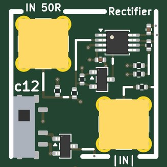</td>
<td valign="top">

<b>A precision full-wave rectifier: OUT = |IN|, with no diode drop.</b>  
<b>Jacks:</b> IN 50R, top left (±1 V); |IN|, bottom right.  
<b>Supply:</b> +-5 V  
<b>Expect:</b> OUT = |IN| from DC to about 100 kHz; above that the first stage's slew across the diodes leaves a glitch at each zero crossing  
<b>How to use it:</b> DAC to IN, OUT to an ADC.  
<b>You need:</b> Nothing beyond SMA cables.  
<b>Specs:</b> An OPA2197 inverts IN through two Schottky diodes so its node X is -IN for positive inputs and 0 for negative ones; the second half sums -(IN + 2 X); IN terminated in 49.9 ohm, OUT through 49.9 ohm.  
<b>Limits:</b> IN +-1 V; DC to about 100 kHz, above which the first stage's slew across the diodes leaves a glitch at each zero crossing.  
<b>Experiments:</b> Rectifying with no dead zone; the glitch against frequency; an AC voltmeter (rectify and average); AM detection.  
<b>Chip:</b> <a href="https://www.ti.com/product/OPA2197">OPA2197</a>, <a href="https://www.lcsc.com/product-detail/C8592.html">BAT54S</a>  
<b>Tutorial pages:</b> Transistors.  
<b>The circuit:</b> Stage 1: inverting with BAT54S in its feedback, so its node X follows -IN for positive IN and stays at 0 for negative. Stage 2: OUT = -(IN + 2 X) = |IN|.  No dead zone from the diodes (the op amp's gain hides their drop) until the op amp must slew through two diode drops at each zero crossing: watch the glitch grow with frequency.  
<b>Parts:</b> BAT54S (C8592), OPA2197IDGKR (C2867268).

</td></tr></table>

## Ground, loops and probing

Two ground loops stand in the margins; every tile's loops are on the signal they name.  The RH-5019
loops take a scope's grabber.  The SMA jacks are 50 ohm; where an input is not 50 ohm the jack's silk says so.
