# AMOD-M handbook: the motor board

Generated by `scripts/gen_docs.py` from the tiles' own declarations (`boards/amod_m.py`); the expected results come from
the same text the silkscreen quotes.  Rev A, 2026-10-25.

## The board

Eleven tiles on sixteen 20 mm cells, four layers.  m1 takes 5 V from its USB-C and makes -5 V (40 mA) and 3.3 V, as
AMOD-A's a1 does; m2 takes the motor supply, 5-16 V on a 5.5 / 2.1 mm barrel jack (centre positive), and joins the
USB's 5 V to it through Schottky diodes, so small motors run with no supply at about 4.6 V.  That rail, VMOT, runs
on a wide track down the back and is not switched.  The DC motor and the stepper take their commands from the FPGA
on the Pmod plug in the bottom margin under m3; everything else takes its command from a DAC and answers to an ADC
over SMA, as on the other boards.  A powered tile has a slide switch along its left edge (slider up: on); the motor
drivers' current limits and the buck's driver hang off it.  A port's name is in capitals on its tile's frame, a
terminated input says so (CMD 50R) and an output read through a divider says its ratio (VM /16).  The back of each
tile says what to know while cabling it.

### Pmod lines

The 2 x 6 plug on the bottom margin under m3 (pins 1-4 are IO1-4, 7-10 are IO5-8, 5 and 11 ground, 6 and 12 the FPGA's 3.3 V,
which the board does not use: every chip here runs from its own 3.3 V, so the lines are 3.3 V CMOS both ways):

- Pmod pin 1 (PMOD1): m3's IN2 (the DC motor's second input), m3
- Pmod pin 2 (PMOD2): m4's coil A IN1, m4
- Pmod pin 3 (PMOD3): m4's coil A IN2, m4
- Pmod pin 4 (PMOD4): m4's coil B IN1, m4
- Pmod pin 7 (PMOD5): m3's encoder A (3.3 V logic), m3
- Pmod pin 8 (PMOD6): m3's encoder B (3.3 V logic), m3
- Pmod pin 9 (PMOD7): m3's IN1 (the DC motor's first input), m3
- Pmod pin 10 (PMOD8): m4's coil B IN2, m4

## The tiles together

1. **Drives.**  m3 runs a brushed motor with its encoder (drive, brake or coast from two FPGA lines; its current
   and its terminal voltage on jacks, so the back-EMF shows in the coast intervals); m4 runs a bipolar stepper from
   four lines (full, half or PWM microsteps in gateware); m5 squares a DAC's pulse for a hobby servo; m6 switches
   a solenoid and shows its flyback three ways.
2. **Power stages the FPGA closes the loop on.**  m7 is a DC-coupled bridge amplifier (the load sees 4 x the DAC,
   both ways) for a voice coil, a speaker used as an actuator or a maglev's electromagnet; m8 is a synchronous
   buck's power stage, its PWM from a DAC and its inductor current and output on jacks.
3. **Sensors for those loops.**  m9 a linear hall sensor (a magnet's distance, a maglev's gap), m10 a reflective
   optical sensor (distance in the first millimetres, marks on a wheel), m11 a load cell's amplifier (force).

A position servo: m3's encoder into the gateware, its PWM back out.  A maglev: m7 drives the electromagnet, m9
under it reads the gap, the gateware closes the loop at tens of kilohertz.  Every motor tile's supply is VMOT: a
bench supply's current limit, or the USB's, is the board's only fuse.

## The tiles

Each tile in a table: its picture, then what it does, its jacks, what to expect, how to cable it, what to buy
(the links are in [KIT.md](KIT.md)), its numbers and limits, the experiments it is for and the circuit.

### m1  power, USB-C 5 V in: +5, -5, +3.3 out

<table><tr>
<td valign="top" width="270">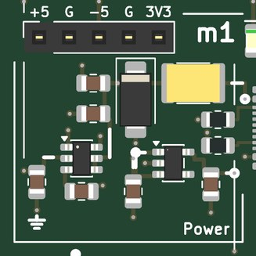</td>
<td valign="top">

<b>Power: 5 V from USB-C, and -5 V and 3.3 V made from it; a socket carries the rails to a breadboard (AMOD-A's a1).</b>  
<b>Expect:</b> +5 V from the USB-C (up to 1.5 A), -5 V at 40 mA, +3.3 V at 300 mA; the green LED says 5 V is in, the red one that -5 V is up  
<b>How to use it:</b> Plug in the USB-C (and the host's Pmod for m3 and m4); then switch on each tile you use (slider up).  
<b>You need:</b> A 5 V USB-C supply, 1.5 A or more (kit: Raspberry Pi 5.1 V 3 A supply). (<a href="KIT.md">KIT.md</a>)  
<b>Specs:</b> +5 V up to 1.5 A, -5 V at 40 mA, +3.3 V at 300 mA; green LED 5 V, red LED -5 V.  
<b>Limits:</b> -5 V is 40 mA: the op amps on +-5 V (m3, m7, m9, m10, m11) draw about 15 mA together.  The board negotiates nothing: use a plain 5 V supply.  
<b>Chip:</b> <a href="https://www.ti.com/product/LM2664">LM2664</a>, <a href="https://www.ti.com/product/TPS7A20">TPS7A20</a>  
<b>Tutorial pages:</b> Motors.  
<b>The circuit:</b> USB-C power only: 5.1 k on each CC asks any source for 5 V.  A 2 A PTC, a 5 V TVS (clamps at 9.2 V) and 20 uF. The LM2664 charge pump makes -5 V for the op-amp tiles (40 mA: four tiles at 10 mA); it is not switched per tile, an op amp with its +5 V removed draws nothing.  The TPS7A2033 makes 3.3 V for the comparator and the lines that meet the FPGA. The socket along the top carries +5, ground, -5, ground, +3.3: the bench's rails for a breadboard experiment.  
<b>Parts:</b> KT-0805G (C2297), NCD0805R1 (C84256), LM2664M6X/NOPB (C108573), MF-MSMF200-2 (C210837), TPS7A2033PDBVR (C2862740), SMAJ5.0A (C78401), TYPE-C-31-M-12 (C165948).

</td></tr></table>

### m2  motor supply, 5-16 V in

<table><tr>
<td valign="top" width="270">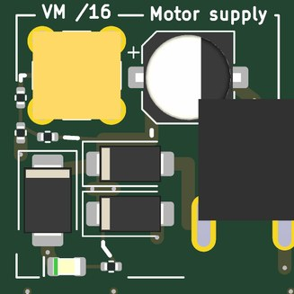</td>
<td valign="top">

<b>The motor supply VMOT: a barrel jack (5-16 V) or USB's 5 V, each through a Schottky; its voltage / 16 on a jack.</b>  
<b>Jacks:</b> VM /16, top left.  
<b>Expect:</b> VMOT = the larger of the barrel jack or terminal (5-16 V) and USB 5 V, each less a Schottky's 0.3-0.5 V; VM jack VMOT / 16  
<b>How to use it:</b> The supply on the barrel jack: 12 V for the stepper and the solenoid, about 6 V for the N20 and m7's 8 ohm speaker; VM to an ADC to watch VMOT.  
<b>You need:</b> From the kit (docs/KIT.md, Motors and actuators): a 3-12 V adjustable supply with a barrel plug (PhMOD's h4 and AMOD-B's b2 take the same one). (<a href="KIT.md">KIT.md</a>)  
<b>Specs:</b> DC-005 5.5 / 2.1 mm jack, centre positive; two SS34 (3 A) into VMOT, so VMOT is the larger input less about 0.4 V; SMBJ16A (clamps near 26 V) and 220 uF on VMOT soak up a motor's braking energy (the diodes stop it reaching the supply); green LED; VM = VMOT / 16 (15 k / 1 k) through 49.9 ohm.  
<b>Limits:</b> 5-16 V in.  VMOT is not switched and has no fuse: the supply's current limit is the board's.  With USB alone VMOT is about 4.6 V, enough for the small motors (the DRV8251A's lockout is 4.45 V at most).  VM is a 1 k source: read it at high impedance.  
<b>Experiments:</b> The supply's droop and the braking energy coming back onto VMOT (VM on an ADC while m3 brakes).  
<b>Chip:</b> <a href="https://www.lcsc.com/product-detail/C8678.html">SS34</a>, <a href="https://www.lcsc.com/product-detail/C353386.html">SMBJ16A</a>  
<b>Tutorial pages:</b> Motors.  
<b>The circuit:</b> Barrel jack (centre +) or terminal, 5-16 V: each through an SS34 into VMOT, as is USB's 5 V, so VMOT is about 4.6 V with no supply.  SMBJ16A and 220 uF on VMOT take the braking energy a motor returns.  VM: VMOT / 16 at high impedance.  
<b>Parts:</b> XT220UF25V90RV0075 (C2992606), KT-0805G (C2297), SMBJ16A (C353386), SS34 (C8678).

</td></tr></table>

### m3  DC motor, DRV8251A

<table><tr>
<td valign="top" width="528">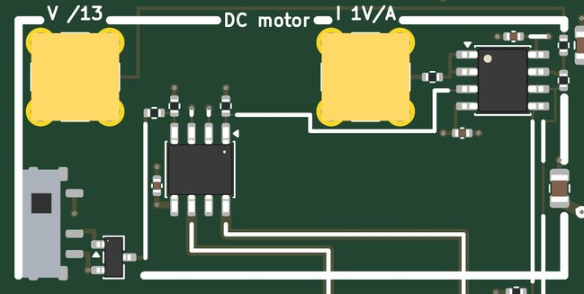</td>
<td valign="top">

<b>A brushed DC motor with its encoder: drive, brake or coast from two FPGA lines; its current and its terminal voltage on jacks.</b>  
<b>Jacks:</b> V /13, top left; I 1V/A, top of the right cell.  
<b>Pmod:</b> IO1 (Pmod pin 1): m3's IN2 (the DC motor's second input); IO5 (Pmod pin 7): m3's encoder A (3.3 V logic); IO6 (Pmod pin 8): m3's encoder B (3.3 V logic); IO7 (Pmod pin 9): m3's IN1 (the DC motor's first input)  
<b>Supply:</b> +-5 V, VMOT  
<b>Expect:</b> the motor at the duty and direction IO7 (IN1) and IO1 (IN2) set; I = its current, 0.98 V/A; V = its terminal voltage / 13 (back-EMF in coast)  
<b>How to use it:</b> PWM on IO7 (forward) or IO1 (reverse); the encoder into the gateware from IO5 and IO6; I and V to the ADCs.  
<b>You need:</b> From the kit (docs/KIT.md, Motors and actuators): an N20 or 25 mm gearmotor with a hall encoder on a JST PH 6-way lead. (<a href="KIT.md">KIT.md</a>)  
<b>Specs:</b> DRV8251A (4.1 A H-bridge) from VMOT: IN1 on Pmod IO7, IN2 on IO1 (both low: coast, then sleep after 1 ms).  Current limit 2 A (VREF 2.0 V from the switched 5 V, 620 ohm on IPROPI); I = the motor's current, 0.98 V/A, buffered by an OPA2171 through 49.9 ohm; V = (M1 - M2) / 13 through 49.9 ohm.  JST PH 6-way: 1 M1, 2 GND, 3 encoder A (IO5), 4 encoder B (IO6), 5 3.3 V (its own TPS7A2033), 6 M2.  
<b>Limits:</b> 2 A (cycle by cycle above it); IPROPI reads only while a low-side FET conducts (drive and brake, not coast).  V's +-1 V range covers +-13 V at the motor.  The encoder needs its own pull-ups or the FPGA's.  Encoder motors' pin orders differ: check yours against the PH's.  
<b>Experiments:</b> Speed against duty cycle; drive / brake against drive / coast; the back-EMF in the coast intervals as a speed sensor with no encoder; the motor constant (Kt = Ke) from V and the encoder's speed; speed and position loops in gateware; current limiting under stall.  
<b>Chip:</b> <a href="https://www.ti.com/product/DRV8251A">DRV8251A</a>, <a href="https://www.ti.com/product/OPA2171">OPA2171</a>, <a href="https://www.ti.com/product/TPS7A20">TPS7A20</a>  
<b>Tutorial pages:</b> Motors.  
<b>The circuit:</b> DRV8251A from VMOT: IN1 (IO7) and IN2 (IO1) choose forward, reverse, brake (both high) or coast (both low: then sleep). IPROPI (620 ohm, 0.98 V/A, 2 A limit) buffered onto I; (M1 - M2) / 13 onto V.  Encoder A on IO5, B on IO6, its own 3.3 V.  
<b>Parts:</b> DRV8251ADDAR (C5218844), OPA2171AIDR (C40904), TPS7A2033PDBVR (C2862740).

</td></tr></table>

### m4  stepper, 2 x DRV8251A

<table><tr>
<td valign="top" width="528">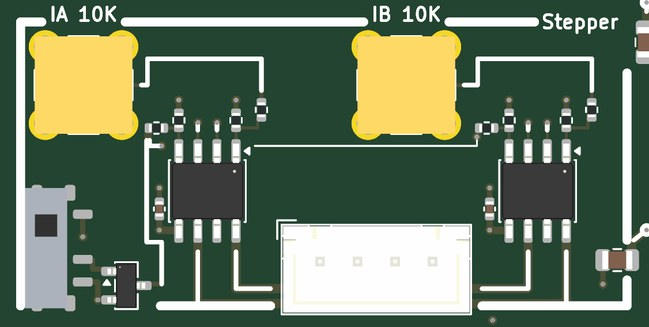</td>
<td valign="top">

<b>A bipolar stepper: two DRV8251A from four FPGA lines; each coil's current on a jack.</b>  
<b>Jacks:</b> IA 10K, top left; IB 10K, top of the right cell.  
<b>Pmod:</b> IO2 (Pmod pin 2): m4's coil A IN1; IO3 (Pmod pin 3): m4's coil A IN2; IO4 (Pmod pin 4): m4's coil B IN1; IO8 (Pmod pin 10): m4's coil B IN2  
<b>Supply:</b> +5 V, VMOT  
<b>Expect:</b> full, half or PWM microsteps at the rate the FPGA sets (IN1, IN2 per coil); IA, IB = the coil currents' size, 0.98 V/A, 1 A limit  
<b>How to use it:</b> The step sequence on IO2, IO3, IO4, IO8; IA and IB to the ADCs at high impedance.  
<b>You need:</b> From the kit (docs/KIT.md, Motors and actuators): a NEMA 17 class bipolar stepper under 1 A per phase, with a JST XH 4-way lead. (<a href="KIT.md">KIT.md</a>)  
<b>Specs:</b> Coil A IN1 on Pmod IO2, IN2 on IO3; coil B IN1 on IO4, IN2 on IO8 (each pulled down: both low is coast).  VREF 1.0 V: 1 A per coil, and the tile's switch takes the limit to zero; IA, IB = each coil's current through 10 k (0.98 V/A, read at high impedance).  JST XH 4-way: 1 A+, 2 A-, 3 B+, 4 B- (each driver's OUT2 on its coil's + pin: a stepper does not notice).  
<b>Limits:</b> 1 A per coil.  IA and IB read the current's size, not its sign, and only while a low side conducts.  
<b>Experiments:</b> Full, half and PWM microstepping in gateware; resonance and missed steps against the step rate; the coil current's rise against the supply voltage (L / R); stall detection from the current.  
<b>Chip:</b> <a href="https://www.ti.com/product/DRV8251A">DRV8251A</a>  
<b>Tutorial pages:</b> Motors.  
<b>The circuit:</b> Two DRV8251A from VMOT: coil A IN1 on IO2, IN2 on IO3; coil B IN1 on IO4, IN2 on IO8 (both low: coast, then sleep). VREF 1.0 V and 620 ohm on IPROPI: 1 A limit, 0.98 V/A through 10 k onto IA and IB.  Stepper on the XH: A+, A-, B+, B-.  
<b>Parts:</b> DRV8251ADDAR (C5218844).

</td></tr></table>

### m5  servo

<table><tr>
<td valign="top" width="270">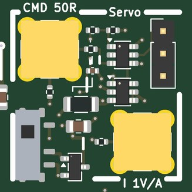</td>
<td valign="top">

<b>A hobby servo: a DAC's pulse squared to 5 V for the servo, and the servo's supply current on a jack.</b>  
<b>Jacks:</b> CMD 50R, top left (0/+1 V); I 1V/A, bottom right.  
<b>Supply:</b> +5 V  
<b>Expect:</b> a servo at the angle a 1-2 ms pulse every 20 ms sets (CMD 0 / +1 V); I = the servo's current, 1 V/A  
<b>How to use it:</b> A 1-2 ms pulse every 20 ms from a DAC on CMD; I to an ADC.  
<b>You need:</b> From the kit (docs/KIT.md, Motors and actuators): an SG90 or MG90S micro servo. (<a href="KIT.md">KIT.md</a>)  
<b>Specs:</b> CMD (0 / +1 V, terminated in 49.9 ohm) through 10 k into a TLV3501 (threshold 0.49 V) on the switched 5 V; 3-pin header S, +5 V, GND (top to bottom); the servo's ground returns through 0.05 ohm, read by an INA181A1 (x20): I = 1 V/A through 49.9 ohm.  
<b>Limits:</b> The servo runs from the switched 5 V (USB's): a micro servo's stall current (about 0.7 A) is fine, a big servo's is not.  I reads one way only.  
<b>Experiments:</b> Angle against pulse width (1-2 ms every 20 ms); the servo's current while it slews and when it is held against a load; its internal loop's step response.  
<b>Chip:</b> <a href="https://www.ti.com/product/TLV3501">TLV3501</a>, <a href="https://www.ti.com/product/INA181">INA181</a>  
<b>Tutorial pages:</b> Motors.  
<b>The circuit:</b> CMD (0 / +1 V from a DAC) through 10 k into a TLV3501 (threshold 0.49 V) makes the 5 V pulse a servo wants; the servo's ground returns through 0.05 ohm and an INA181A1 (x20) puts 1 V/A on I.  Slew the angle and watch the current.  
<b>Parts:</b> INA181A1IDBVR (C2058943), TLV3501AIDBVR (C193413).

</td></tr></table>

### m6  solenoid, NCE6020AK

<table><tr>
<td valign="top" width="528">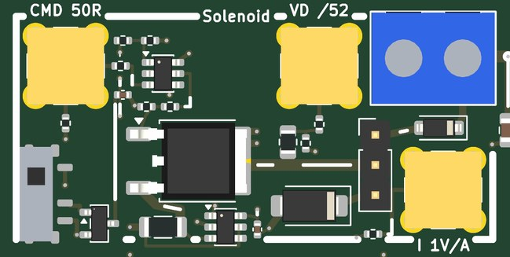</td>
<td valign="top">

<b>A solenoid's low-side switch with its flyback chosen by a jumper: a diode, a 24 V TVS, or the FET's own avalanche.</b>  
<b>Jacks:</b> CMD 50R, top left (0/+1 V); VD /52, top of the right cell; I 1V/A, bottom right.  
<b>Supply:</b> +5 V, VMOT  
<b>Expect:</b> the coil on while CMD is high; I = its current, 1 V/A (up to 2 A); VD = the drain / 52: the flyback's spike, by the jumper  
<b>How to use it:</b> A pulse on CMD from a DAC; choose the flyback with the jumper (power off); I and VD to the ADCs.  
<b>You need:</b> From the kit (docs/KIT.md, Motors and actuators): a 5-12 V solenoid under 1.5 A and a jumper cap. (<a href="KIT.md">KIT.md</a>)  
<b>Specs:</b> CMD (0 / +1 V, 49.9 ohm) through a TLV3501 into an NCE6020AK's gate (60 V, 20 A; 100 k holds it off); the coil on a screw terminal from VMOT.  Jumper on the 1 x 3 header: 1-2 a B5819W from the drain to VMOT (slow decay), 2-3 an SMAJ24A from the drain to ground (the drain clamps near 30 V: fast decay), none: the FET avalanches near 70 V.  I = the coil current, 1 V/A (0.05 ohm and an INA181A1); VD = the drain / 52 (5.1 k / 100 ohm) through 49.9 ohm.  
<b>Limits:</b> The coil's current up to about 2 A (the 0.05 ohm shunt's 0.2 W), the Schottky's 1 A average.  'None' puts the coil's whole energy into the FET each time: a demonstration, not a way to run.  VD is a 150 ohm source: high impedance for the true scale.  
<b>Experiments:</b> The coil current's L / R rise and its fall with each flyback; the drain's spike on VD (diode, TVS, avalanche); the release time of the plunger against the flyback; PWM hold-current reduction once the plunger has pulled in.  
<b>Chip:</b> <a href="https://www.ti.com/product/TLV3501">TLV3501</a>, <a href="https://www.lcsc.com/product-detail/C108639.html">NCE6020AK</a>, <a href="https://www.lcsc.com/product-detail/C64885.html">B5819W</a>, <a href="https://www.lcsc.com/product-detail/C113962.html">SMAJ24A</a>, <a href="https://www.ti.com/product/INA181">INA181</a>  
<b>Tutorial pages:</b> Motors.  
<b>The circuit:</b> CMD (0 / +1 V) through 10 k into a TLV3501 drives an NCE6020AK (60 V) that switches the coil to ground; VMOT on the coil. Jumper 1-2: a Schottky to VMOT (slow decay); 2-3: a 24 V TVS (fast decay); none: the FET avalanches.  I 1 V/A, VD drain / 52.  
<b>Parts:</b> B5819W (C64885), INA181A1IDBVR (C2058943), NCE6020AK (C108639), SMAJ24A (C113962), TLV3501AIDBVR (C193413).

</td></tr></table>

### m7  linear amp, TCA0372

<table><tr>
<td valign="top" width="528">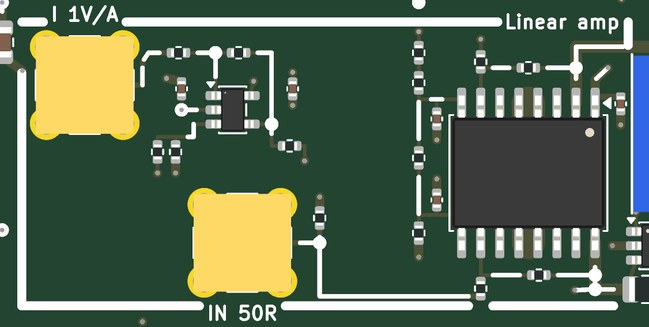</td>
<td valign="top">

<b>A DC-coupled bridge amplifier from VMOT: the load sees 4 x IN, both ways; its current on a jack.</b>  
<b>Jacks:</b> IN 50R, bottom of the left cell (+-1 V); I 1V/A, top left.  
<b>Supply:</b> VMOT, +-5 V  
<b>Expect:</b> the load at 4 x IN (+-4 V for +-1 V), about VMOT / 2 at each end; I = the load's current, 1 V/A (+-1 A)  
<b>How to use it:</b> DAC on IN; I to an ADC; the load on the terminal.  
<b>You need:</b> From the kit (docs/KIT.md, Motors and actuators): a small speaker or voice-coil actuator, 8 ohm or more. (<a href="KIT.md">KIT.md</a>)  
<b>Specs:</b> TCA0372 (two 1 A power op amps): side A = VMOT / 2 - 2 IN, side B = VMOT / 2 + 2 IN, so the load sees 4 x IN; one chain (2 x 15 k, 20 k, 10 k) sets both references from VMOT.  IN +-1 V, terminated in 49.9 ohm.  The load's current through 0.1 ohm in series, an INA181A1 about 2.5 V and an OPA810 difference amplifier: I = 1 V/A, +-1.2 A, through 49.9 ohm.  The load on a screw terminal in the right margin.  
<b>Limits:</b> About 1 W in the chip (thermal shutdown beyond): 8 ohm at 5-6 V, 30 ohm or more at 12 V.  Each output swings to about 1.3 V from either rail: at VMOT = 5 V the load gets +-2.4 V at most.  A DC offset of a few tens of millivolts with IN at 0 (the chain's resistors).  
<b>Experiments:</b> A voice coil's force against current; a maglev (with m9 under an electromagnet); a speaker as an actuator; current (force) control closed in gateware on I; the bridge's clipping against VMOT.  
<b>Chip:</b> <a href="https://www.onsemi.com/products/amplifiers-comparators/operational-amplifiers-op-amps/tca0372">TCA0372</a>, <a href="https://www.ti.com/product/INA181">INA181</a>, <a href="https://www.ti.com/product/OPA810">OPA810</a>  
<b>Tutorial pages:</b> Motors.  
<b>The circuit:</b> A TCA0372 bridge from VMOT: side A = VMOT/2 - 2 IN, side B = VMOT/2 + 2 IN, so the load sees 4 x IN.  Up to 1 A and about 1 W in the chip: 8 ohm at 5-6 V, 30 ohm or more at 12 V.  0.1 ohm + INA181 + OPA810: I = 1 V/A.  A voice coil, a maglev magnet.  
<b>Parts:</b> INA181A1IDBVR (C2058943), OPA810IDBVR (C2833513), TCA0372DWR2G (C362060).

</td></tr></table>

### m8  buck stage, TPS28225

<table><tr>
<td valign="top" width="528">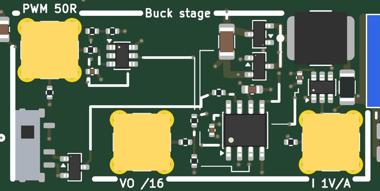</td>
<td valign="top">

<b>A synchronous buck's power stage: the FPGA's PWM (through a DAC) in, the output and the inductor current out.</b>  
<b>Jacks:</b> PWM 50R, top left (0/+1 V); VO /16, bottom of the left cell; I 1V/A, bottom right.  
<b>Supply:</b> +5 V, VMOT  
<b>Expect:</b> VO = the duty cycle x VMOT at the PWM's frequency (100-500 kHz); I = the inductor's current, 1 V/A (0 when it dips below zero); VO jack VO / 16  
<b>How to use it:</b> A square wave on PWM from a DAC; VO and I to the ADCs; a load on the terminal (a resistor, an LED string, a motor).  
<b>You need:</b> Gateware on the host (the tutorial's).  A load: a power resistor or a small motor.  
<b>Specs:</b> PWM (0 / +1 V, 49.9 ohm) squared by a TLV3501 on +5 V into a TPS28225 (adaptive dead time, its own bootstrap diode; EN from the tile's switch) driving two AO3400A from VMOT (22 uF beside them); 47 uH (SWPA6045, 1.2 A) into 2 x 22 uF; output on a screw terminal.  I = the inductor current through 0.05 ohm and an INA181A1: 1 V/A, one way; VO / 16 (15 k / 1 k) through 49.9 ohm.  
<b>Limits:</b> Up to 1 A of load; VMOT up to 16 V (the FETs are 30 V).  At light load the current dips below zero (the stage is synchronous) and I reads 0 there.  The DAC's PWM: 100-500 kHz.  VO is a 1 k source: high impedance.  
<b>Experiments:</b> VO against duty cycle open loop; voltage-mode and current-mode control in gateware; load-step response; the inductor's ripple against frequency and VMOT; efficiency.  
<b>Chip:</b> <a href="https://www.ti.com/product/TLV3501">TLV3501</a>, <a href="https://www.ti.com/product/TPS28225">TPS28225</a>, <a href="https://www.lcsc.com/product-detail/C20917.html">AO3400A</a>, <a href="https://www.ti.com/product/INA181">INA181</a>  
<b>Tutorial pages:</b> Motors.  
<b>The circuit:</b> PWM (0 / +1 V) squared by a TLV3501 into a TPS28225 driving two AO3400A from VMOT; 47 uH into 2 x 22 uF.  Close the loop in the FPGA from VO (VO / 16) and I (1 V/A); a load on the terminal, up to 1 A.  The switch holds the driver's EN low.  
<b>Parts:</b> INA181A1IDBVR (C2058943), SWPA6045S470MT (C36414), AO3400A (C20917), TLV3501AIDBVR (C193413), TPS28225DR (C52897).

</td></tr></table>

### m9  hall, DRV5055A3

<table><tr>
<td valign="top" width="270">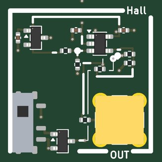</td>
<td valign="top">

<b>A linear hall sensor for a magnet's distance (a maglev's gap, a position loop's sensor).</b>  
<b>Jacks:</b> OUT, bottom right.  
<b>Supply:</b> +-5 V  
<b>Expect:</b> OUT = 9.75 mV per mT at the sensor (+-0.83 V at +-85 mT), 0 V with no field; about 20 kHz wide  
<b>How to use it:</b> Bring a magnet to the sensor (the small part top left); OUT to an ADC.  
<b>You need:</b> From the kit (docs/KIT.md, Motors and actuators): a few neodymium disc magnets. (<a href="KIT.md">KIT.md</a>)  
<b>Specs:</b> DRV5055A3 (25 mV/mT about half its 5 V supply, +-85 mT) in the top-left corner; an OPA810 on +-5 V subtracts the half (ratiometric) and scales by 0.39: OUT = 9.75 mV/mT, +-0.83 V, about 20 kHz, through 49.9 ohm.  
<b>Limits:</b> +-85 mT before the sensor saturates; a magnet's field falls with the cube of distance, so the useful range is a few millimetres to a few centimetres.  
<b>Experiments:</b> Field against distance for a disc magnet; a maglev's gap sensor (with m7); a gear tooth or a magnet on a wheel as a tachometer.  
<b>Chip:</b> <a href="https://www.ti.com/product/DRV5055">DRV5055</a>, <a href="https://www.ti.com/product/OPA810">OPA810</a>  
<b>Tutorial pages:</b> Motors.  
<b>The circuit:</b> DRV5055A3: 25 mV/mT about half its 5 V supply, ratiometric.  The OPA810 subtracts the same half (20 k / 20 k) and scales by 0.39: OUT 9.75 mV/mT.  A magnet's distance, a maglev's gap, a gear tooth; the sensor is the small part top left.  
<b>Parts:</b> DRV5055A3QDBZR (C266128), OPA810IDBVR (C2833513).

</td></tr></table>

### m10  optical, QRE1113

<table><tr>
<td valign="top" width="270">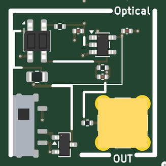</td>
<td valign="top">

<b>A reflective optical sensor: distance in the first millimetres, a mark on a wheel, an edge.</b>  
<b>Jacks:</b> OUT, bottom right.  
<b>Supply:</b> +-5 V  
<b>Expect:</b> OUT = 1 k x the phototransistor's current: about 0.1-0.9 V with white paper 1 mm above the sensor, near 0 V with nothing  
<b>How to use it:</b> Hold a surface above the sensor (the small part top left); OUT to an ADC.  
<b>You need:</b> Nothing beyond SMA cables.  
<b>Specs:</b> QRE1113GR (an IR LED at 21 mA and a phototransistor side by side) in the top-left corner; an OPA810 holds the collector at 0 V: OUT = 1 k x the collector current (0.1-0.9 V with white paper 1 mm above), 100 pF across, through 49.9 ohm.  
<b>Limits:</b> Best at about 1 mm, useful to a few; sunlight and lamps add to the reading; about 20 us response (the phototransistor).  
<b>Experiments:</b> Output against distance and surface; a tachometer from a striped wheel on m3's motor; an edge or a line.  
<b>Chip:</b> <a href="https://www.onsemi.com/products/sensors/photo-detectors/reflective-sensors/qre1113">QRE1113</a>, <a href="https://www.ti.com/product/OPA810">OPA810</a>  
<b>Tutorial pages:</b> Motors.  
<b>The circuit:</b> QRE1113GR: an IR LED (21 mA through 180 ohm) and a phototransistor side by side.  The OPA810 holds the collector at 0 V (emitter on -5 V through 100 ohm): OUT = 1 k x Ic.  Distance in the first millimetres, a mark on a wheel, a line.  
<b>Parts:</b> OPA810IDBVR (C2833513), QRE1113GR (C232862).

</td></tr></table>

### m11  load cell, INA828

<table><tr>
<td valign="top" width="270">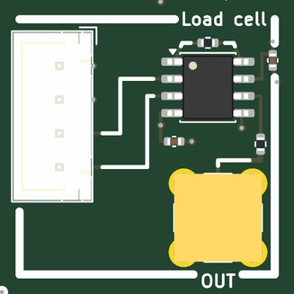</td>
<td valign="top">

<b>A load cell's amplifier: a 4-wire bridge excited from 5 V, read at a gain of 201.</b>  
<b>Jacks:</b> OUT, bottom right.  
<b>Supply:</b> +-5 V  
<b>Expect:</b> OUT = 201 x the bridge's output: about 1 V at full load for a 1 mV/V cell; about 10 kHz wide  
<b>How to use it:</b> The load cell on the XH; OUT to an ADC.  
<b>You need:</b> From the kit (docs/KIT.md, Motors and actuators): a 1-5 kg bar load cell with a JST XH 4-way lead. (<a href="KIT.md">KIT.md</a>)  
<b>Specs:</b> INA828 on +-5 V at G = 1 + 50 k / 249 = 201, REF on ground, OUT through 49.9 ohm; the bridge on a JST XH 4-way: 1 E+ red, 2 E- black, 3 S- white, 4 S+ green; always on (no switch: the bridge draws 5 mA).  
<b>Limits:</b> A 1 mV/V cell gives 5 mV at full load: about 1 V out.  The INA828's offset (about 50 uV, 10 mV out) wants a tare in software.  
<b>Experiments:</b> Weighing with a tare and a calibration weight; a force sensor for a force loop with m7 or m3; the bridge's drift with temperature.  
<b>Chip:</b> <a href="https://www.ti.com/product/INA828">INA828</a>  
<b>Tutorial pages:</b> Motors.  
<b>The circuit:</b> INA828 at G = 1 + 50 k / 249 = 201 on +-5 V, REF on ground; the bridge excited from +5 V.  Weigh, feel a force, close a force loop with the servo or the linear amplifier.  Cable: 1 red E+, 2 black E-, 3 white S-, 4 green S+.  
<b>Parts:</b> INA828IDR (C544342).

</td></tr></table>

## Ground, loops and probing

Two ground loops stand in the margins; every tile's loops are on the signal they name.  The RH-5019
loops take a scope's grabber.  The SMA jacks are 50 ohm; where an input is not 50 ohm the jack's silk says so.
