# AMOD-P handbook: the passive board

Generated by `scripts/gen_docs.py` from the tiles' own declarations (`boards/amod_p.py`); the expected results come from
the same text the silkscreen quotes.  Rev A, 2026-10-25.

## The board

Cells are 20 mm on a 21.5 mm pitch.  A tile's input is its top-left jack and its output its bottom-right jack;
each jack's name is printed on its own tile's frame, beside it.  Cable the DAC to IN and OUT to the ADC.

## The tiles

Each tile in a table: its picture, then what it does, its jacks, what to expect, how to cable it, what to buy
(the links are in [KIT.md](KIT.md)), its numbers and limits, the experiments it is for and the circuit.

### P1  pi pad, -20 dB

<table><tr>
<td valign="top" width="270">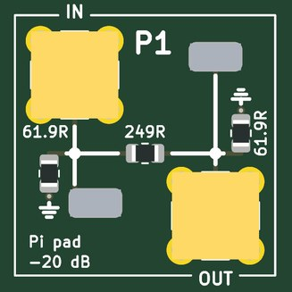</td>
<td valign="top">

<b>Divides the voltage by 10 (-20 dB) and looks like 50 ohm from both ports.</b>  
<b>Jacks:</b> IN, top left (±4 V); OUT, bottom right.  
<b>Expect:</b> -20 dB flat, 50 ohm both ways  
<b>How to use it:</b> DAC to IN, OUT to the ADC set to 50 ohm.  
<b>You need:</b> Nothing beyond SMA cables.  
<b>Specs:</b> 61.9 / 249 / 61.9 ohm pi; -20.0 dB; DC to well past 30 MHz.  
<b>Limits:</b> -20 dB only between 50 ohm on both sides (-14 dB into a high impedance); about 0.1 W (+-3 V) at IN.  
<b>Experiments:</b> A known weak signal for a receiver or LNA; padding a mismatched cable; checking the ADC's 50 ohm setting.  
<b>Tutorial pages:</b> On the air; The modem against noise.  
<b>The circuit:</b> A pi attenuator: 61.9 / 249 / 61.9 ohm is -20.0 dB and 50.0 ohm in a 50 ohm system (the tutorial's $10 SMA pad, on the board). Into a high-impedance load it is only -14 dB: the pad assumes 50 ohm on both sides.

</td></tr></table>

### P2  RC low-pass, 159 kHz

<table><tr>
<td valign="top" width="270">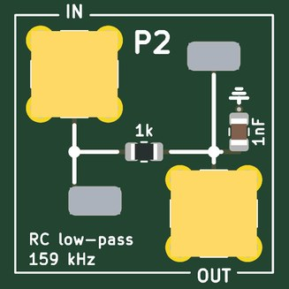</td>
<td valign="top">

<b>A first-order RC low-pass: passes below 159 kHz and falls 20 dB per decade above.</b>  
<b>Jacks:</b> IN, top left (±4 V); OUT, bottom right.  
<b>Expect:</b> -3 dB at 159 kHz, then -20 dB/decade; OUT into the ADC's high impedance  
<b>How to use it:</b> DAC to IN, OUT to the ADC on high impedance; sweep the frequency or send a step.  
<b>You need:</b> Nothing beyond SMA cables.  
<b>Specs:</b> 1 k and 1 nF; -3 dB at 159 kHz; time constant 1 us.  
<b>Limits:</b> OUT is a 1 k source: read it on the ADC's high-impedance setting (50 ohm divides it by 21).  
<b>Experiments:</b> A Bode plot, 45 degrees at the corner, the step response, the lag plant for feedback control.  
<b>Tutorial pages:</b> RC and LC circuits; Feedback control of an RC plant; Control at the speed of the cable.  
<b>The circuit:</b> 1 k and 1 nF: f = 1 / (2 pi R C) = 159 kHz.  Measure OUT with the ADC on its high-impedance setting: a 50 ohm load would make a 1 k / 50 divider of it.  The lag plant of the tutorial's feedback-control pages; the step response is 1 - exp(-t / 1 us).

</td></tr></table>

### P3  RC high-pass, 159 kHz

<table><tr>
<td valign="top" width="270">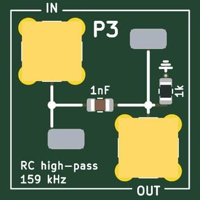</td>
<td valign="top">

<b>A first-order RC high-pass, the mirror image of P2.</b>  
<b>Jacks:</b> IN, top left (±4 V); OUT, bottom right.  
<b>Expect:</b> -3 dB at 159 kHz, +20 dB/decade below; OUT into high impedance  
<b>How to use it:</b> DAC to IN, OUT to the ADC on high impedance.  
<b>You need:</b> Nothing beyond SMA cables.  
<b>Specs:</b> 1 nF and 1 k; -3 dB at 159 kHz; +20 dB per decade below.  
<b>Limits:</b> OUT is a 1 k source: read it on high impedance.  
<b>Experiments:</b> A Bode plot, AC coupling, a differentiator (a step gives a 1 us spike).  
<b>Tutorial pages:</b> RC and LC circuits.  
<b>The circuit:</b> The mirror image of P2: the same 1 k and 1 nF the other way round.  A step in gives a spike that decays in 1 us.

</td></tr></table>

### P4  series RLC, 100uH 220pF

<table><tr>
<td valign="top" width="270">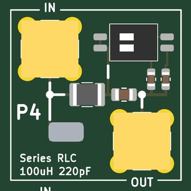</td>
<td valign="top">

<b>A series 100 uH and 220 pF resonator between 50 ohm ports: a band-pass peak that the DIP switch moves.</b>  
<b>Jacks:</b> IN, top left (±4 V); OUT, bottom right.  
<b>Expect:</b> a peak at 1.07 MHz (switches off), 0.98 with 1, 0.89 with 2, 0.83 with both; Q about 6  
<b>How to use it:</b> Sweep the DAC into IN, OUT to the ADC (50 ohm); set the DIP switch.  
<b>You need:</b> Nothing beyond SMA cables.  
<b>Specs:</b> 1.07 MHz with both switches off, 0.98 (way 1, +47 pF), 0.89 (way 2, +100 pF), 0.83 (both); Q about 6.  
<b>Limits:</b> The 50 ohm ports load it: Q is 6, where the coil alone would allow about 60.  
<b>Experiments:</b> Resonance and Q, the phase through resonance, tracking a resonance with a lock-in or a PLL, a resonant plant to control.  
<b>Tutorial pages:</b> RC and LC circuits; Control at the speed of the cable.  
<b>The circuit:</b> Series L C between 50 ohm ports: a band-pass at f = 1 / (2 pi sqrt(L C)) whose Q = sqrt(L/C) / (100 + R_coil) is about 6 (the 10 ohm coil would give 60 by itself).  The DIP switch adds 47 pF (way 1) and 100 pF (way 2) across the 220 pF to move the peak; a resonant plant for feedback control, a lockbox's cavity before the real one.  No OUT loop (the switch took its corner).  
<b>Parts:</b> DSHP02TSGET (C40735).

</td></tr></table>

### P5  LC low-pass, 9 MHz

<table><tr>
<td valign="top" width="270">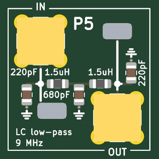</td>
<td valign="top">

<b>A 5th-order Butterworth LC low-pass at 9 MHz: the anti-alias filter for a 25 MS/s ADC, or the smoothing filter after a DAC.</b>  
<b>Jacks:</b> IN, top left (±4 V); OUT, bottom right.  
<b>Expect:</b> -3 dB at 8.9 MHz, -30 dB at 18 MHz: the anti-alias filter in front of a 25 MS/s ADC  
<b>How to use it:</b> Between the DAC and its load, or between a signal and the ADC (50 ohm).  
<b>You need:</b> Nothing beyond SMA cables.  
<b>Specs:</b> -3 dB at 8.9 MHz, -30 dB at 18 MHz; 50 ohm in and out.  
<b>Limits:</b> The response is as designed only with 50 ohm on both ports.  
<b>Experiments:</b> Aliasing with and without it; a filter's magnitude, phase and group delay; cleaning a DAC's staircase.  
<b>Tutorial pages:</b> Fast captures; Chirps, Zadoff-Chu and LoRa; RC and LC circuits.  
<b>The circuit:</b> 5th-order Butterworth, 50 ohm: 220 pF, 1.5 uH, 680 pF, 1.5 uH, 220 pF (the exact values are 219 pF, 1.43 uH, 707 pF). Before the ADC it removes the alias (the ghost image above Nyquist); after the DAC it smooths the steps.

</td></tr></table>

### P6  LC low-pass, 100 kHz

<table><tr>
<td valign="top" width="270">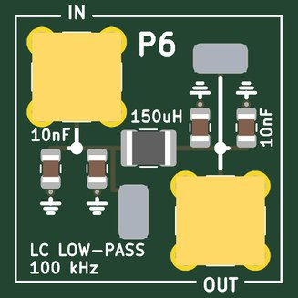</td>
<td valign="top">

<b>A 3rd-order LC low-pass near 120 kHz: turns a one-bit (delta-sigma or PWM) stream into a tone.</b>  
<b>Jacks:</b> IN, top left (±4 V); OUT, bottom right.  
<b>Expect:</b> -3 dB at 118 kHz: the reconstruction filter after a one-bit DAC  
<b>How to use it:</b> DAC (or a one-bit stream through 50 ohm) to IN, OUT to the ADC.  
<b>You need:</b> Nothing beyond SMA cables.  
<b>Specs:</b> 10 nF, 150 uH, 10 nF (C0G); -3 dB at 118 kHz; 50 ohm.  
<b>Limits:</b> Designed for 50 ohm on both ports.  
<b>Experiments:</b> One-bit DAC reconstruction, delta-sigma noise shaping seen at the output, a slow plant for control.  
<b>Tutorial pages:</b> Trading speed for bits; RC and LC circuits.  
<b>The circuit:</b> 3rd-order pi, 50 ohm: 2 x 10 nF, 150 uH, 2 x 10 nF, all C0G (JLCPCB stocks no 22 nF C0G in 0805 or 1206). Turns a one-bit (delta-sigma) DAC stream into a tone; a slow plant for feedback control, with P2.

</td></tr></table>

### P7  band-pass, 4.7-7.5 MHz

<table><tr>
<td valign="top" width="270">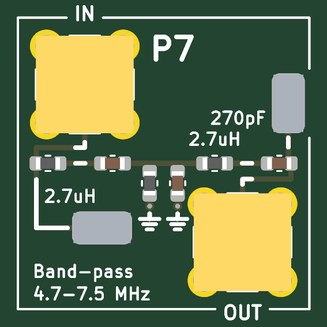</td>
<td valign="top">

<b>A 3rd-order LC band-pass, 4.7-7.5 MHz: the band round the tutorial's 6.25 MHz digital-communications carrier.</b>  
<b>Jacks:</b> IN, top left (±4 V); OUT, bottom right.  
<b>Expect:</b> the digital-communications pages' band (a 6.25 MHz carrier): a peak at 6.3 MHz, 3 dB from 4.7 to 7.5 MHz  
<b>How to use it:</b> In line between the DAC and the ADC, or ahead of a receiver.  
<b>You need:</b> Nothing beyond SMA cables.  
<b>Specs:</b> Peak at 6.3 MHz, -3 dB from 4.7 to 7.5 MHz; 50 ohm.  
<b>Limits:</b> Only 3rd order: the skirts fall about 18 dB per octave.  
<b>Experiments:</b> Band-limiting a modem's chips (spread spectrum, LoRa chirps); a transmitter's harmonics removed; a receiver's front end.  
<b>Tutorial pages:</b> Chirps, Zadoff-Chu and LoRa; A radio link; On the air.  
<b>The circuit:</b> 3rd-order Butterworth band-pass, 6.05 MHz centre, 3.1 MHz wide: series 2.7 uH + 270 pF, shunt 330 nH || 2.2 nF, series 2.7 uH + 270 pF (the exact values: 2.57 uH, 269 pF, 337 nH, 2.05 nF).  The tutorial's filtered chips in copper; it cleans a transmitter's harmonics and is a radio link's receiver front end.

</td></tr></table>

### P8  quartz crystal, 4 MHz

<table><tr>
<td valign="top" width="270">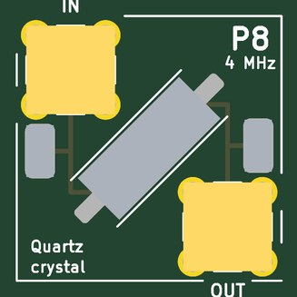</td>
<td valign="top">

<b>A 4 MHz quartz crystal in series between the jacks: a very sharp pass at its series resonance and a notch at its parallel resonance about 6 kHz above.</b>  
<b>Jacks:</b> IN, top left (±4 V); OUT, bottom right.  
<b>Expect:</b> a sharp pass at the series resonance near 4.000 MHz (-3.7 dB) and a notch 6.0 kHz above it, the parallel resonance  
<b>How to use it:</b> Sweep the DAC slowly through 4.000 MHz into IN, OUT to the ADC, lock-in detection in the gateware.  
<b>You need:</b> An SMA tee and a few capacitors (or open cable stubs) for the pulling experiment.  
<b>Specs:</b> f_s near 4.000 MHz (-3.7 dB); f_p about 6 kHz higher; Q about 50,000 (C_m 15 fF, C_0 4 pF).  
<b>Limits:</b> Needs frequency steps of a few hertz (the FPGA's NCO); keep the drive under about +-1 V (crystals have a drive-level limit near 100 uW).  
<b>Experiments:</b> Q from the width and from the ring-down; series against parallel resonance; pulling f_p with a capacitor across OUT (an SMA tee); the temperature coefficient.  
<b>Tutorial pages:</b> The Q of a quartz crystal; Your crystal against a reference; More ideas for one board.  
<b>The circuit:</b> The crystal in series between 50 ohm ports: it passes at its series resonance f_s (R_m about 50 ohm: -3.5 dB) and blocks at the parallel resonance f_p = f_s (1 + C_m / 2 C_0) a few kHz above.  A capacitor across OUT (a tee at the ADC) pulls f_p down toward f_s and leaves f_s alone: the pulling the tutorial measures against a reference.  Model: C_m 15 fF, Q 50 000, C_0 4 pF (typical HC-49S).  
<b>Parts:</b> X49SM4MSD2SC (C13774).

</td></tr></table>

### P9  ceramic res., 455 kHz

<table><tr>
<td valign="top" width="270">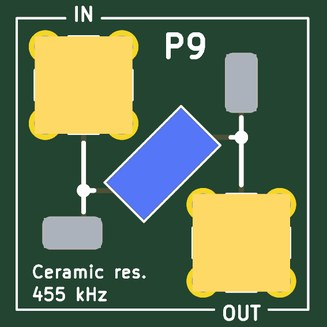</td>
<td valign="top">

<b>A 455 kHz ceramic resonator in series: a pass at 455 kHz and a notch a few kHz above; the AM superhet's IF element.</b>  
<b>Jacks:</b> IN, top left (±4 V); OUT, bottom right.  
<b>Expect:</b> a pass near 455 kHz and a notch a few kHz above: a resonator with a Q of a few hundred, between P4's LC and P8's quartz  
<b>How to use it:</b> Sweep 440-480 kHz into IN, OUT to the ADC.  
<b>You need:</b> Nothing beyond SMA cables.  
<b>Specs:</b> Q of a few hundred: between P4's LC (6) and P8's quartz (50,000).  
<b>Limits:</b> A two-terminal resonator, not a three-terminal IF filter: one peak, no flat passband.  
<b>Experiments:</b> Q compared across LC, ceramic and quartz; an IF stage for a superhet built in gateware.  
<b>Tutorial pages:</b> RC and LC circuits; The Q of a quartz crystal.  
<b>The circuit:</b> A two-terminal 455 kHz ceramic resonator in series (JLCPCB stocks no three-terminal 455 kHz filter).  It is the superhet's IF element, and here a resonance whose Q (hundreds) sits between the LC's and the crystal's.  Model: C_m 7 pF, Q 400, C_0 250 pF.

</td></tr></table>

### P10  clipper, 1N4148 ±0.6 V

<table><tr>
<td valign="top" width="270">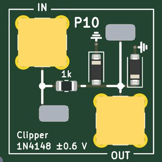</td>
<td valign="top">

<b>1 k in series and a 1N4148 diode each way to ground: clips any signal to about +-0.6 V.</b>  
<b>Jacks:</b> IN, top left (±4 V); OUT, bottom right.  
<b>Expect:</b> a sine of more than 1 V comes out flat-topped at about ±0.6 V; the ADC on high impedance  
<b>How to use it:</b> DAC sine to IN, OUT to the ADC on high impedance, FFT in the gateware or Python.  
<b>You need:</b> Nothing beyond SMA cables.  
<b>Specs:</b> Clips at +-0.6 V; a 1 k source.  
<b>Limits:</b> Read OUT on high impedance; up to +-4 V in (the 1 k holds the diode current to 4 mA).  
<b>Experiments:</b> Harmonics of a clipped sine against amplitude; odd harmonics, and even ones with a DC offset added; distortion.  
<b>Tutorial pages:</b> Harmonics: a diode clipper.  
<b>The circuit:</b> 1 k in series, then a 1N4148W each way to ground: whatever goes in, OUT stays within a diode drop.  Harmonics: the clipped sine's spectrum against the amplitude; the 1 k limits the diode current to a few milliamps from a ±4 V source.  
<b>Parts:</b> 1N4148W (C81598).

</td></tr></table>

### P11  delay line, 400 ns, a tap every 100

<table><tr>
<td valign="top" width="528">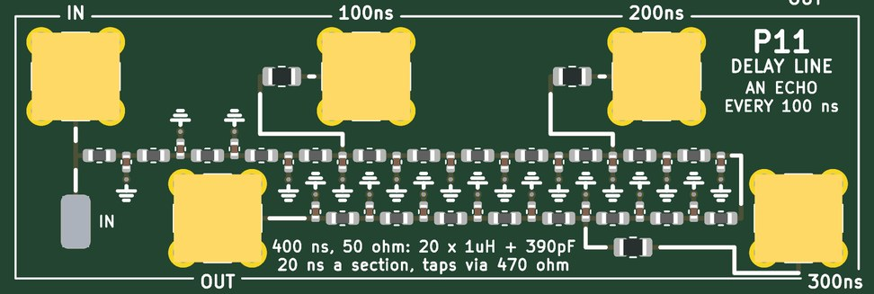</td>
<td valign="top">

<b>A 400 ns, 50 ohm delay line made of 20 LC sections, with taps every 100 ns: 260 feet of RG-58 on a board.</b>  
<b>Jacks:</b> IN, top left (±4 V); 100ns, top of the middle cell; 200ns, top of the right cell; 300ns, bottom right; OUT, bottom of the left cell.  
<b>Expect:</b> a pulse arrives at OUT 395 ns late, at the taps every 99 ns; flat to about 10 MHz, then it disperses  
<b>How to use it:</b> A pulse or chirp from the DAC into IN; OUT open, shorted or terminated; the taps and OUT to the ADCs.  
<b>You need:</b> An SMA short and a 50 ohm terminator (the kit's ANNE-50+) for the reflection experiments. (<a href="KIT.md">KIT.md</a>)  
<b>Specs:</b> Z0 51 ohm, 20 ns a section, cut-off 16 MHz, flat to about 10 MHz; taps through 470 ohm.  
<b>Limits:</b> Disperses near 16 MHz (a chirp spreads); a tap is x1 into a high impedance, /10 into 50 ohm.  
<b>Experiments:</b> Reflections from an open, a short and a matched end; time-domain reflectometry; echoes for an equalizer; a radar target on a cable; a pure-delay plant for control.  
<b>Tutorial pages:</b> A quarter-wave stub; The channel; Chirps, Zadoff-Chu and LoRa; Control at the speed of the cable.  
<b>The circuit:</b> Twenty sections of 1.0 uH and 390 pF: Z0 = sqrt(L/C) = 51 ohm, 20 ns a section, cut-off 1 / (pi sqrt(LC)) = 16 MHz. 400 ns is 260 ft of RG-58.  Leave OUT open and a pulse comes back the same way up; short it and it comes back inverted; 50 ohm on OUT and nothing comes back (the quarter-wave and reflection experiments).  The taps are a channel's echo and a radar target on a cable; near 16 MHz the phase velocity falls and a chirp spreads (below that, a pure-delay plant for control).  A tap through 470 ohm: x1 into a high-impedance scope, /10 into 50 ohm.

</td></tr></table>

### P12  LEDs

<table><tr>
<td valign="top" width="270">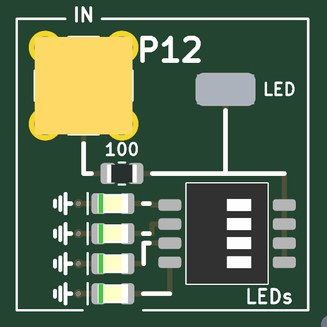</td>
<td valign="top">

<b>Four LEDs (red, yellow, green, blue) behind 100 ohm, one at a time from the DIP switch: Planck's constant from the voltage where each starts to glow.</b>  
<b>Jacks:</b> IN, top left (0-5 V).  
<b>Expect:</b> one LED at a time; the voltage where it starts to glow against 1/wavelength is h/e  
<b>How to use it:</b> Ramp the DAC (or the host's LED output) into IN and read the LED loop's voltage; one DIP way at a time.  
<b>You need:</b> Nothing (a dark room helps).  
<b>Specs:</b> 630, 596, 525 and 469 nm (DIP ways 1-4); 100 ohm in series; IN 0-5 V.  
<b>Limits:</b> The InGaN green and blue sit above the line (their knee is not just hc / e lambda); the colours are not printed, so light them.  
<b>Experiments:</b> Planck's constant; LED I-V curves (with AMOD-A's A10); light against current.  
<b>Tutorial pages:</b> More ideas for one board.  
<b>The circuit:</b> 100 ohm from the jack to the four LEDs; the 4-way switch picks one.  Drive from the DAC through the ECP5 board's unipolar LED output or a bench supply: the knee voltage of each colour against c / lambda gives Planck's constant. Way 1 red 630 nm (AlGaInP), 2 yellow 596 (AlGaInP), 3 green 525 (InGaN), 4 blue 469 nm (InGaN): the InGaN pair lie above the line.  The LED loop is after the 100 ohm: the LED's own voltage.  The colours are not on the silk: light them.  
<b>Parts:</b> DSHP04TSGET (C40736), KT-0805B (C2293), KT-0805G (C2297), NCD0805R1 (C84256), KT-0805Y (C2296).

</td></tr></table>

### P13  AM loopstick, 0.5-1.7 MHz

<table><tr>
<td valign="top" width="528">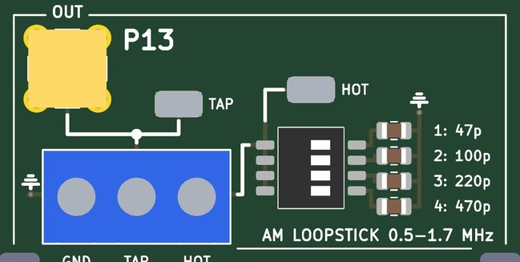</td>
<td valign="top">

<b>An AM-band antenna: a ferrite-rod coil screwed into the terminal, tuned by four switched capacitors or an external tuning capacitor on VAR C, its tap on the jack.</b>  
<b>Jacks:</b> OUT, top left (to A4).  
<b>Expect:</b> with a 330 uH loopstick: 1.28 MHz on 1, 0.88 on 2, 0.59 on 3, 0.40 MHz on 4, and the sums between (the AM band); a variable capacitor on VAR C tunes between them  
<b>How to use it:</b> Coil ends to GND and HOT, its tap (if it has one) to TAP; rod along the bottom edge with two cable ties; OUT to AMOD-A's A4, A4 to the ADC; the DIP picks the band, or a tuning capacitor on VAR C (frame to GND) tunes within it.  
<b>You need:</b> An AM loopstick coil and two cable ties (kit: Atomic-29 240 uH loopstick, Panduit PLT1M-C); optionally a 365 pF tuning capacitor with a knob (kit: Amplified Parts single-section 365 pF). (<a href="KIT.md">KIT.md</a>)  
<b>Specs:</b> With a 330 uH coil: 1.28 MHz (47 pF) down to 0.40 MHz (470 pF), and the sums between; the kit's 240 uH coil tunes about 17 % higher.  
<b>Limits:</b> The switches tune in 15 steps; continuous tuning needs a capacitor on VAR C (a polyvaricon and its dial are 20 mm square: no room on the tile).  A weak signal that needs A4's gain before the ADC.  
<b>Experiments:</b> Real AM stations; the resonance and Q of a loopstick; the tutorial's AM radio gateware.  
<b>Tutorial pages:</b> An AM radio.  
<b>The circuit:</b> Any ferrite-rod AM antenna coil (about 330 uH; 50 to 100 mm long) screws into the terminal, its tap (a quarter of the turns from the ground end) to the jack.  The switch's capacitors tune it: f = 1 / (2 pi sqrt(L C)), 1.28 MHz with 47 pF down to 0.40 MHz with 470 pF; combine positions for the steps between.  VAR C takes an external tuning capacitor (a 365 pF air variable with a big knob tunes the whole band alone, switches off); its frame to GND.  Into A4's LNA and the AM radio gateware.  
<b>Parts:</b> DSHP04TSGET (C40736).

</td></tr></table>

## Ground, loops and probing

Four ground loops stand in the margins; every tile's loops are on the signal they name.  The RH-5019
loops take a scope's grabber.  The SMA jacks are 50 ohm; where an input is not 50 ohm the jack's silk says so.
