# AMOD-P2 handbook: the second passive board

Generated by `scripts/gen_docs.py` from the tiles' own declarations (`boards/amod_p2.py`); the expected results come from
the same text the silkscreen quotes.  Rev A, 2026-10-25.

## The board

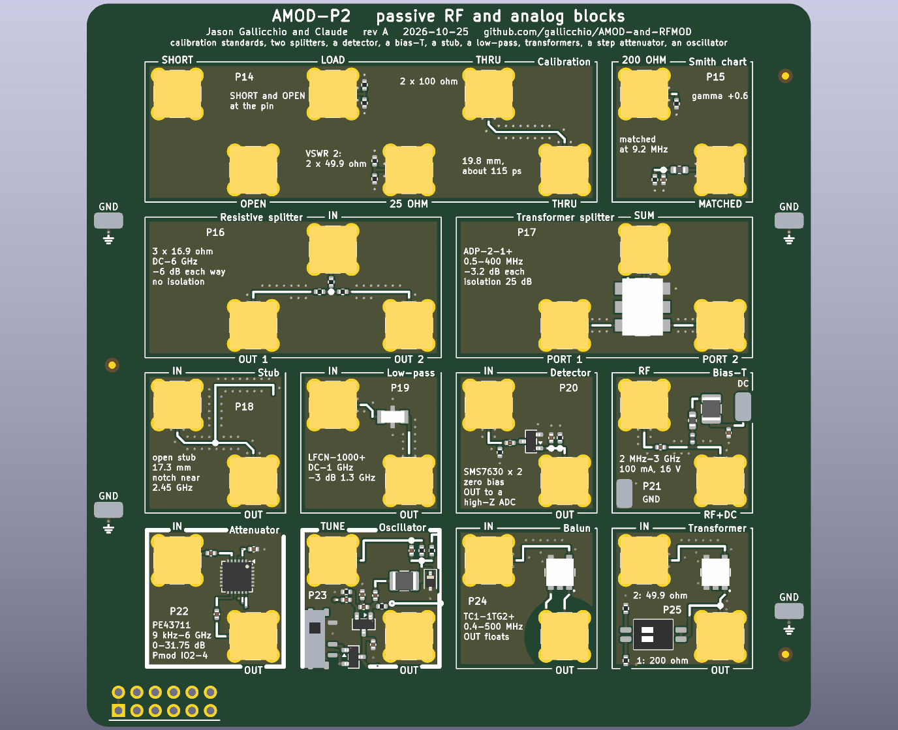

Twelve tiles on sixteen 20 mm cells, four layers, no USB.  Ten of them are passive and need nothing; P22 (the step
attenuator) and P23 (the oscillator) run on the host's 3.3 V through the Pmod plug under P22, so plug the board into the
host's Pmod (or a Pmod cable) to use them.  Every tile's input is its top-left jack and its output its bottom-right jack,
every 50 ohm line is coplanar waveguide with a via fence and every jack has RF-MOD's launch (no plane under its centre
pin), except P14's SHORT, whose centre pin is the ground pour.  On the board a tile's label is in mixed case and a port's
name in capitals.

### Pmod lines

The 2 x 6 plug on P22's bottom edge (pins 1-4 are IO1-4, 7-10 are IO5-8, 5 and 11 ground, 6 and 12 the FPGA's 3.3 V,
which powers P22 and P23, the board's only supply; the lines are 3.3 V CMOS):

- Pmod pin 2 (PMOD2): SDATA (SI) of P22's PE43711, P22
- Pmod pin 3 (PMOD3): SCLK of P22, P22
- Pmod pin 4 (PMOD4): LE of P22, P22

## The tiles together

1. **Calibrate first.**  P14's SHORT, OPEN and LOAD and its THRU calibrate a NanoVNA, or RF-MOD-2's reflectometer (X1,
   X2 and X5), at the board's surface; the 25 OHM standard checks the result (|S11| = 1/3).  Every tile's jacks are the
   same part, so a tile measured afterwards is measured from its pads.
2. **Impedance.**  P15's two loads and P25's transformer on PhMOD's reflection bridge (Y7) or the VNA: points on the
   Smith chart, a match at one frequency, the turns ratio squared.
3. **Splitting and combining.**  P16 (resistive, DC-6 GHz, no isolation) against P17 (transformer, 0.5-400 MHz, 25 dB
   of isolation).  The two DACs combined through P17 into an amplifier make a two-tone intermodulation test, with P22
   setting the level in 0.25 dB steps.
4. **Power.**  P22 makes a known level; P20 turns power into volts (square law at the bottom) to set against RF-MOD-2's
   AD8318 (log); compression points and IP3 of every amplifier and mixer on the boards follow.
5. **Lines and filters.**  P18's stub and P19's low-pass swept by RF-MOD's synthesizer into a detector, or on the VNA.
6. **An oscillator.**  P23 on the ADC; a DAC on TUNE tunes it (DC) or locks it (a tone near its frequency): the
   lock range against the tone's amplitude, FM, and its phase noise against the MAX2871's.
7. **On the air.**  P24 feeds the tutorial's HF dipole balanced; P21 powers an active antenna or an LNA through its
   cable.

Levels to remember: P22 takes +23 dBm above 48 MHz but only about +9.5 dBm below 0.5 MHz; P20 wants +10 dBm at most
and a high-impedance load; P21 passes 100 mA and 16 V; P23 gives about -22 dBm.

## The tiles

Each tile in a table: its picture, then what it does, its jacks, what to expect, how to cable it, what to buy
(the links are in [KIT.md](KIT.md)), its numbers and limits, the experiments it is for and the circuit.

### P14  calibration

<table><tr>
<td valign="top" width="528">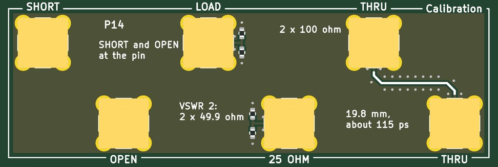</td>
<td valign="top">

<b>Calibration standards for a network analyzer, on the board: a short and an open at the jacks' pins, a 50 ohm load, a 25 ohm check standard and a thru.</b>  
<b>Jacks:</b> SHORT, top left; OPEN, bottom of the left cell; LOAD, top of the middle cell; 25 OHM, bottom of the middle cell; THRU, top of the right cell; THRU, bottom right.  
<b>Expect:</b> SHORT, OPEN and LOAD at the jacks' pins and a 19.8 mm THRU: a full SOLT calibration; the 25 ohm standard then reads |S11| = 1/3 (9.5 dB return loss)  
<b>How to use it:</b> The analyzer's port to SHORT, OPEN and LOAD in turn; its two ports to THRU A and THRU B for the two-port step; then any tile.  
<b>You need:</b> Nothing beyond SMA cables.  
<b>Specs:</b> SHORT: the centre pin poured to ground all round.  OPEN: the bare pin.  LOAD: 2 x 100 ohm at the end of 4 mm of 50 ohm line.  25 OHM: 2 x 49.9 ohm (VSWR 2, |Gamma| 1/3, 9.5 dB return loss).  THRU: 19.8 mm of 50 ohm coplanar line, about 115 ps.  
<b>Limits:</b> The standards are modelled, not measured: the open's fringing (tens of fF) and the short's inductance (tens of pH) count above about 3 GHz, and the 0402 load is a 20 dB return loss at 3 GHz.  Check them once against the NanoVNA's SMA standards.  
<b>Experiments:</b> A full SOLT calibration of RF-MOD-2's reflectometer (X1, X2, X5) or of a NanoVNA at the board's surface; the 25 ohm standard as its check; every other tile then measured from its pads with its jacks taken out (they are all the same part).  
<b>The circuit:</b> Calibration standards at the board surface.  SHORT: the centre pin poured to ground all round.  OPEN: the bare pin (fringing about 30 fF, to be measured against the NanoVNA's SMA open).  LOAD: 4 mm of 50 ohm line into 2 x 100 ohm. 25 OHM: 2 x 49.9 ohm at the end of 4.75 mm of line, a verification standard (VSWR 2).  THRU: 19.8 mm of 50 ohm line, about 115 ps (enter it as the thru's delay).  Every jack on the boards is the same part, so a calibration here measures each tile from its pads with its jacks taken out.

</td></tr></table>

### P15  two loads

<table><tr>
<td valign="top" width="270">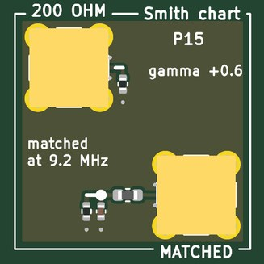</td>
<td valign="top">

<b>Two loads to read on a Smith chart: 200 ohm alone, and the same 200 ohm matched to 50 ohm at 9.2 MHz by an L-network.</b>  
<b>Jacks:</b> 200 OHM, top left; MATCHED, bottom right.  
<b>Expect:</b> 200 OHM: Gamma = +0.6 (VSWR 4) at every frequency below 100 MHz.  MATCHED: Gamma = 0 at 9.2 MHz, |Gamma| 0.5 at about 5 and 14 MHz  
<b>How to use it:</b> A DAC into PhMOD's Y7 DRIVE and its DUT jack to 200 OHM or MATCHED, the two ADCs on INC and REFL; or a VNA's port.  
<b>You need:</b> Nothing beyond SMA cables.  
<b>Specs:</b> 200 OHM: Gamma +0.6 (VSWR 4) to about 100 MHz.  MATCHED: 1.5 uH in series, 150 pF and 200 ohm to ground: Gamma 0 at 9.2 MHz, |Gamma| 0.5 near 5 and 14 MHz.  
<b>Limits:</b> HF only: above about 100 MHz the parts and the line move both points; the inductor's Q (about 35) leaves an ohm or two of loss at the match.  
<b>Experiments:</b> Both on the Smith chart with PhMOD's reflection bridge (Y7) or a VNA; the matched load passing through the chart's centre as the sweep crosses 9.2 MHz; the network designed back from the measured 200 ohm.  
<b>The circuit:</b> An L-network: 1.5 uH in series from the jack, 150 pF and 200 ohm to ground.  Z = j w L + 200 / (1 + j w 200 C) is 50 ohm where w 200 C = sqrt(3), 9.2 MHz; away from it the point circles the chart.  The 200 ohm alone is the unmatched load.

</td></tr></table>

### P16  resistive splitter

<table><tr>
<td valign="top" width="528">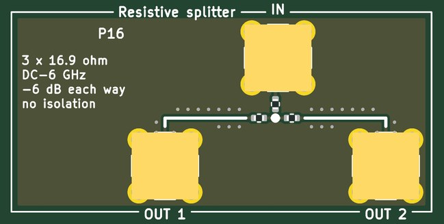</td>
<td valign="top">

<b>A resistive power splitter: three 16.9 ohm in a star, every port 50 ohm, 6 dB from any port to either other, from DC to 6 GHz.</b>  
<b>Jacks:</b> IN, top of the right cell (+20 dBm); OUT 1, bottom of the left cell; OUT 2, bottom right.  
<b>Expect:</b> -6.0 dB from IN to each OUT, DC to 6 GHz, every port 50 ohm; OUT 1 to OUT 2 also -6 dB (no isolation)  
<b>How to use it:</b> IN from the source; OUT 1 and OUT 2 to two 50 ohm loads.  Symmetric: any port can be IN.  
<b>You need:</b> Nothing beyond SMA cables.  
<b>Specs:</b> 3 x 16.9 ohm (50 / 3); -6.0 dB each way; DC-6 GHz; OUT 1 and OUT 2 on lines of equal length.  
<b>Limits:</b> No isolation (OUT 1 to OUT 2 is also -6 dB); 6 dB of loss where a transformer splitter loses 3; about +20 dBm at IN (1/16 W resistors).  
<b>Experiments:</b> One DAC into both ADCs to measure the converters' own gain and skew; the reference and test paths of a scalar network analyzer; its isolation against P17's.  
<b>The circuit:</b> Three 16.9 ohm (50 / 3) from a star to the three ports: each port sees 16.9 + (16.9 + 50) / 2 = 50 ohm, and each output gets half the input's voltage.  Symmetric, so any port is IN.  Compare P17's transformer splitter (3 dB, 25 dB of isolation, 0.5-400 MHz).

</td></tr></table>

### P17  transformer splitter

<table><tr>
<td valign="top" width="528">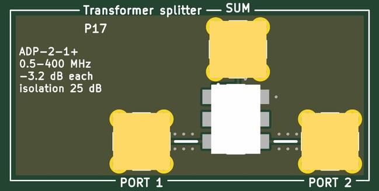</td>
<td valign="top">

<b>A transformer power splitter (and combiner): half the power to each port, 3 dB, with the two ports isolated from each other, 0.5-400 MHz.</b>  
<b>Jacks:</b> SUM, top of the right cell (+20 dBm); PORT 1, bottom of the left cell; PORT 2, bottom right.  
<b>Expect:</b> -3.1 to -3.4 dB from SUM to each port, 0.5-400 MHz; 25-34 dB between port 1 and port 2 (the datasheet)  
<b>How to use it:</b> SUM from the source (or to the load when combining); PORT 1 and PORT 2 to two loads (or from two sources).  
<b>You need:</b> Nothing beyond SMA cables.  
<b>Specs:</b> 3.1-3.4 dB from SUM to each port; 25-34 dB between port 1 and port 2; 0.5-400 MHz (the datasheet).  
<b>Limits:</b> A transformer: nothing below 0.5 MHz; the isolation holds only with 50 ohm on all three ports; pins 2 and 5 are joined and must not be grounded.  
<b>Experiments:</b> Two DACs combined into one amplifier for a two-tone intermodulation test (AMOD-A's A4, PhMOD's Y5); one reference split to two boards; isolation measured against P16's.  
<b>Chip:</b> <a href="https://www.minicircuits.com/WebStore/dashboard.html?model=ADP-2-1%2B">ADP-2-1+</a>  
<b>The circuit:</b> Mini-Circuits ADP-2-1+: a transformer splitter (a centre-tapped winding with a resistor across its ends), so the two ports are isolated from each other: a combiner for two generators (the two DACs into one amplifier, for a two-tone intermodulation test) as well as a splitter.  Pins 2 and 5 are joined and must not be grounded.  
<b>Parts:</b> ADP-2-1+ (C2683460).

</td></tr></table>

### P18  quarter-wave stub

<table><tr>
<td valign="top" width="270">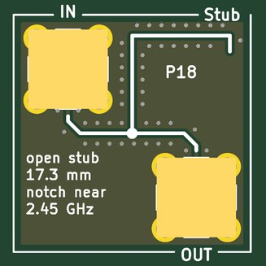</td>
<td valign="top">

<b>A quarter-wave open stub hanging off a 50 ohm line: at 2.45 GHz it is a short circuit at the junction, so the line has a notch there.</b>  
<b>Jacks:</b> IN, top left; OUT, bottom right.  
<b>Expect:</b> a notch near 2.45 GHz (and 7.35 GHz) 20 dB or more deep; 0 dB at DC, -3 dB about 0.6 GHz either side  
<b>How to use it:</b> IN from a source, OUT to a detector or a VNA's second port.  
<b>You need:</b> Nothing beyond SMA cables.  
<b>Specs:</b> 17.3 mm of 50 ohm coplanar waveguide, open at its end; a notch near 2.45 GHz and 7.35 GHz; the line passes at DC and 4.9 GHz.  
<b>Limits:</b> The notch sits where the line's effective permittivity puts it (3.1 was assumed): within a few percent of 2.45 GHz.  Its depth is set by the line's loss.  
<b>Experiments:</b> Sweep it with RF-MOD's synthesizer into RF-MOD-2's log detector, or with a VNA; read the line's effective permittivity from the notch; a Wi-Fi notch ahead of a receiver; the tutorial's coaxial quarter-wave stub at microwave frequencies.  
<b>The circuit:</b> An open stub a quarter wavelength long looks like a short circuit at its other end: the line from IN to OUT is shorted at its middle at 2.45 GHz.  At DC and at 4.9 GHz (a half wave) it is open and the line passes.  The length is 17.3 mm for an effective permittivity of 3.1; the coplanar line's real one moves the notch a few percent.

</td></tr></table>

### P19  low-pass

<table><tr>
<td valign="top" width="270">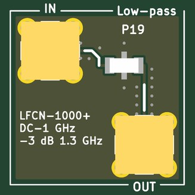</td>
<td valign="top">

<b>A low-pass filter: passes DC to 1 GHz, stops 1.9-5 GHz, so a 915 MHz synthesizer's harmonics are gone.</b>  
<b>Jacks:</b> IN, top left; OUT, bottom right.  
<b>Expect:</b> 0.3 dB at 500 MHz, 0.8 dB at 1 GHz, 3 dB at 1.3 GHz, 26 dB at 1.5 GHz, 30 dB from 1.9 to 5 GHz (the datasheet)  
<b>How to use it:</b> IN from the source, OUT to the load.  
<b>You need:</b> Nothing beyond SMA cables.  
<b>Specs:</b> 0.3 dB at 500 MHz, 0.8 dB at 1 GHz, 3 dB at 1.3 GHz, 26 dB at 1.5 GHz, 30 dB from 1.9 to 5 GHz (the datasheet).  
<b>Limits:</b> 50 ohm on both sides; the stopband rises again above about 5 GHz (20 dB at 5.5 GHz).  
<b>Experiments:</b> A MAX2871's square-ish 915 MHz made a sine (its harmonics before and after on a spectrum analyzer); an image filter ahead of a receiver below 1 GHz.  
<b>Chip:</b> <a href="https://www.minicircuits.com/WebStore/dashboard.html?model=LFCN-1000%2B">LFCN-1000+</a>  
<b>The circuit:</b> Mini-Circuits LFCN-1000+, an LTCC low-pass in a 1206: a MAX2871 at 915 MHz has its second harmonic 30 dB down after it, and the synthesizer's square-ish output becomes a sine.  
<b>Parts:</b> LFCN-1000+ (C879868).

</td></tr></table>

### P20  detector

<table><tr>
<td valign="top" width="270">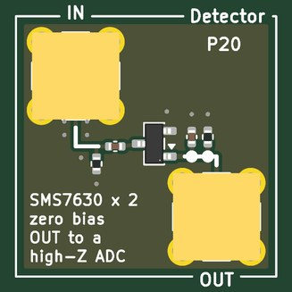</td>
<td valign="top">

<b>A diode detector: RF power in, DC out.  Two zero-bias Schottky diodes as a voltage doubler, square-law at low power and linear at high.</b>  
<b>Jacks:</b> IN, top left (+10 dBm); OUT, bottom right.  
<b>Expect:</b> about 1 mV out for -30 dBm in and 0.1 V for -10 dBm (square law, then linear toward 1 V at +10 dBm), 10 MHz to 6 GHz  
<b>How to use it:</b> IN from the RF; OUT to an ADC on its high-impedance setting.  
<b>You need:</b> Nothing beyond SMA cables.  
<b>Specs:</b> 51 ohm across IN; 10 nF in; a SMS7630 pair as a doubler; 100 pF and 100 k on OUT (about 1 us); 10 MHz-6 GHz; square law below about -20 dBm.  
<b>Limits:</b> OUT must go to a high impedance (the ADC's high-Z setting): 50 ohm shorts it.  Microvolts at the bottom (the x100 input below -40 dBm); temperature moves its zero; +10 dBm at most (the diodes' 1 V breakdown).  
<b>Experiments:</b> Square law against the AD8318's log law (RF-MOD-2); an AM envelope detector after AMOD-P's loopstick and AMOD-A's LNA; a radiometer's power detector; the shape of PhMOD's transmit pulses.  
<b>Chip:</b> <a href="https://www.skyworksinc.com/Products/Diodes/SMS7630-Series">SMS7630</a>  
<b>The circuit:</b> A voltage doubler of two zero-bias Schottky diodes (SMS7630: Is 5 uA, so about 5 k of video resistance each with no bias).  Below about -20 dBm the output voltage is proportional to the RF power; above it, to the amplitude. Read OUT with the ADC at high impedance: 50 ohm would short it.  Compare the AD8318's log output on RF-MOD-2.  
<b>Parts:</b> SMS7630-006LF (C6489012).

</td></tr></table>

### P21  bias-T

<table><tr>
<td valign="top" width="270">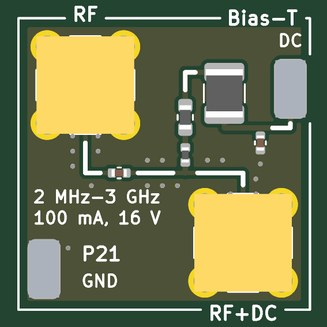</td>
<td valign="top">

<b>A bias-T: puts DC from a bench supply onto an RF line and keeps it off the RF side.</b>  
<b>Jacks:</b> RF, top left; RF+DC, bottom right.  
<b>Expect:</b> RF to RF+DC within 1 dB from about 2 MHz to 3 GHz; the DC loop's voltage on RF+DC, none on RF  
<b>How to use it:</b> RF to the instrument, RF+DC to the device, the bench supply's clips on the DC and GND loops.  
<b>You need:</b> A bench supply with clip leads.  
<b>Specs:</b> 100 nF in series; 27 nH + 330 nH + 10 uH from the DC loop to RF+DC; 100 nF across the DC; about 2 MHz-3 GHz; up to 100 mA and 16 V.  
<b>Limits:</b> Below about 2 MHz the 10 uH stops blocking; 100 mA (the 330 nH) and 16 V (the capacitors); never put RF+DC into a jack that cannot take the DC.  
<b>Experiments:</b> An active GPS antenna or an LNA at the end of a cable powered through the coax; a varactor or a detector diode biased through its own signal line; the bias-T's own leakage of RF into the supply.  
<b>The circuit:</b> 100 nF passes the RF and blocks the DC; 10 uH + 330 nH + 27 nH pass the DC and block the RF (each inductor for its own decade: 10 uH is 630 ohm at 10 MHz, 27 nH 400 ohm at 2.4 GHz).  Up to 100 mA (the 330 nH's rating) and 16 V (the capacitors').  A bench supply's clips on the DC and GND loops.  Never put RF+DC into a jack that cannot take the DC.

</td></tr></table>

### P22  step attenuator

<table><tr>
<td valign="top" width="270">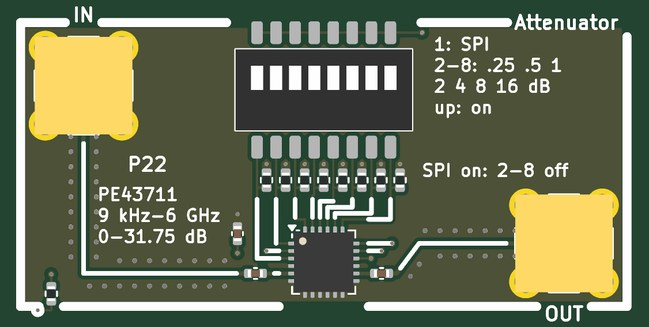</td>
<td valign="top">

<b>A digital step attenuator: 0 to 31.75 dB in 0.25 dB steps from 9 kHz to 6 GHz, set by the FPGA over three Pmod lines.</b>  
<b>Jacks:</b> IN, top left (+20 dBm); OUT, bottom right.  
<b>Pmod:</b> IO2 (Pmod pin 2): SDATA (SI) of P22's PE43711; IO3 (Pmod pin 3): SCLK of P22; IO4 (Pmod pin 4): LE of P22  
<b>Supply:</b> 3.3 V  
<b>Expect:</b> 0 to 31.75 dB in 0.25 dB steps (1.5-2.8 dB of loss at 0 dB, rising with frequency), set by an 8-bit word over the Pmod; 31.75 dB at power-up  
<b>How to use it:</b> Plug AMOD-P2 into the host's Pmod; IN from the source, OUT to the device; write the word from the FPGA (RF-MOD's SPI peripheral with its own LE).  
<b>You need:</b> Nothing beyond SMA cables.  
<b>Specs:</b> 7 bits, 0-31.75 dB in 0.25 dB; 1.5-2.8 dB of loss at 0 dB; serial: SDATA on IO2, SCLK on IO3, LE on IO4, 8 bits (bit 7 = 0, then 4 x dB), least significant first; 3.3 V and 150 uA from the Pmod; 31.75 dB at power-up.  
<b>Limits:</b> +23 dBm above 48 MHz, less below (about +9.5 dBm under 0.5 MHz, +15 dBm at 5 MHz); a few tenths of a dB of step error; needs the board plugged into the host's Pmod.  
<b>Experiments:</b> The 1 dB compression point and IP3 of every amplifier and mixer on the boards; noise figure by the Y-factor; bit-error rate against signal-to-noise for the tutorial's modems; the log detector's slope; an automatic gain control loop in gateware.  
<b>Chip:</b> <a href="https://www.lcsc.com/product-detail/C470929.html">PE43711</a>  
<b>The circuit:</b> pSemi PE43711 in serial mode: shift 8 bits (bit 7 = 0, then 4 x dB, least significant first) on SDATA (IO2) with SCLK (IO3) while LE (IO4) is low, then raise LE.  RF-MOD's MAX2871 and TRF3722 take the same three lines' timing. Below 48 MHz it takes less power: about +9.5 dBm under 0.5 MHz and +15 dBm at 5 MHz (+23 dBm above 48 MHz).  
<b>Parts:</b> PE43711B-Z (C470929).

</td></tr></table>

### P23  oscillator

<table><tr>
<td valign="top" width="270">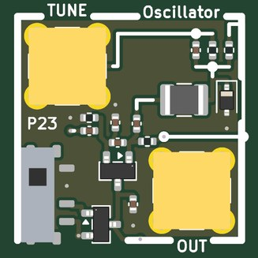</td>
<td valign="top">

<b>An oscillator made of one transistor and a tank, tunable by a voltage and lockable to an outside tone.</b>  
<b>Jacks:</b> TUNE, top left (+-2 V); OUT, bottom right.  
<b>Supply:</b> 3.3 V  
<b>Expect:</b> about 10.5 MHz with TUNE at 0 V, 9.6 MHz at -2 V and 11.5 MHz at +2 V; about -22 dBm into 50 ohm; locks to a tone on TUNE within a few kHz of it  
<b>How to use it:</b> Plug the board into the Pmod and slide the switch up; OUT to an ADC (the x10 input); TUNE from a DAC.  
<b>You need:</b> Nothing beyond SMA cables.  
<b>Specs:</b> A Clapp (series-tuned Colpitts) on an MMBT3904 at about 1.5 mA; 10 uH and a BB133 varactor; 9.6-11.5 MHz for TUNE from -2 to +2 V (10.5 MHz at 0 V); about -22 dBm into 50 ohm; the Pmod's 3.3 V, switched.  
<b>Limits:</b> Free-running LC: it drifts with temperature; the frequencies are calculated to within about 10 %; the output is small (22 pF from the emitter) so the load does not pull it.  
<b>Experiments:</b> Injection locking: a DAC tone near its frequency on TUNE pulls it in over a range that grows with the tone's amplitude (Adler's equation); FM from a DAC; its phase noise against the MAX2871's and a crystal's; a phase-locked loop closed in the FPGA (phase from an ADC, control on TUNE).  
<b>Chip:</b> <a href="https://www.lcsc.com/product-detail/C20526.html">MMBT3904</a>, <a href="https://www.lcsc.com/product-detail/C5334579.html">BB133</a>  
<b>The circuit:</b> A Clapp oscillator: the emitter follower's 220 pF / 220 pF divider feeds back what the series LC (10 uH and the BB133) passes at its resonance, f = 1 / (2 pi sqrt(L C)) with C the three capacitors in series.  The varactor's cathode is at (3.3 V + TUNE) / 2, so TUNE tunes it (an FM transmitter from a DAC, or the control of a PLL closed in the FPGA); a tone on TUNE near f also couples through 2.2 pF and the oscillator locks to it over a range that grows with the tone's amplitude (Adler's equation).  Compare its phase noise with the MAX2871's.  The switch turns it off.  
<b>Parts:</b> BB133 (C5334579), MMBT3904(RANGE:100-300) (C20526).

</td></tr></table>

### P24  1:1 transformer

<table><tr>
<td valign="top" width="270">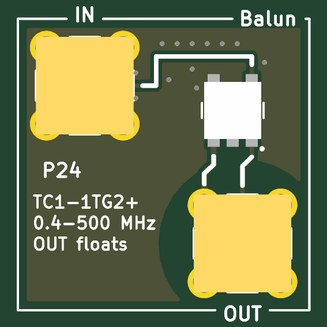</td>
<td valign="top">

<b>A 1:1 transformer whose OUT jack floats: a balun for a dipole, and a break in a ground loop.</b>  
<b>Jacks:</b> IN, top left (+20 dBm); OUT, bottom right.  
<b>Expect:</b> 0.3 dB of loss at 10 MHz, 0.5 dB at 100 MHz, 1.8 dB at 500 MHz (the datasheet); OUT's shell is not ground  
<b>How to use it:</b> IN from the source; OUT through an SMA-to-clips lead to the dipole or the floating load.  
<b>You need:</b> An SMA-to-two-clips lead (KIT.md) for a dipole. (<a href="KIT.md">KIT.md</a>)  
<b>Specs:</b> 0.4-500 MHz; 0.3 dB of loss at 10 MHz, 0.5 dB at 100 MHz, 1.8 dB at 500 MHz (the datasheet); OUT's four legs on an island with no ground within 5.6 mm on any layer.  
<b>Limits:</b> 0.25 W and 30 mA DC (the datasheet); nothing below 0.4 MHz; the island's few pF to the board limit the common-mode isolation as the frequency rises.  
<b>Experiments:</b> The tutorial's HF dipole fed balanced (OUT's pin and shell to its two halves); a ground loop between the host and a mains-powered instrument broken (watch the hum go); a floating measurement.  
<b>Chip:</b> <a href="https://www.minicircuits.com/WebStore/dashboard.html?model=TC1-1TG2%2B">TC1-1TG2+</a>  
<b>The circuit:</b> Mini-Circuits TC1-1TG2+: two windings, so OUT's centre and shell are a balanced pair: a balun for a dipole (an SMA to two-clip lead on OUT), or a break in a ground loop between the host and a mains-earthed instrument.  OUT's legs are their own net with no copper of the board's ground within 5.6 mm on any layer.  
<b>Parts:</b> TC1-1TG2+ (C3305009).

</td></tr></table>

### P25  1:4 transformer

<table><tr>
<td valign="top" width="270">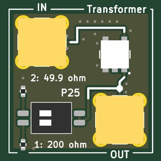</td>
<td valign="top">

<b>A 1:4 transformer: OUT's impedance is four times IN's and its voltage twice; a DIP switch puts a known load on OUT.</b>  
<b>Jacks:</b> IN, top left (+20 dBm); OUT, bottom right.  
<b>Expect:</b> IN reads 50 ohm with switch 1 on (200 ohm across OUT) and 12.5 ohm with switch 2; OUT's voltage is twice IN's, 0.8 dB of loss at 10 MHz  
<b>How to use it:</b> IN from the source or the analyzer; OUT open, to a load, or loaded by the switch.  
<b>You need:</b> Nothing beyond SMA cables.  
<b>Specs:</b> 3-800 MHz; 0.8 dB mid-band, 1.1 dB at 3 MHz, 2.2 dB at 800 MHz (the datasheet); switch 1: 200 ohm across OUT (IN reads 50); switch 2: 49.9 ohm (IN reads 12.5).  
<b>Limits:</b> Nothing below 3 MHz; OUT is referenced to ground (the secondary's low end is grounded), so it is a step-up transformer here, not a balun.  
<b>Experiments:</b> The turns ratio squared measured: IN's impedance with each load (PhMOD's Y7 or a VNA); a 200 ohm source or load matched to 50 ohm; twice the voltage at OUT.  
<b>Chip:</b> <a href="https://www.minicircuits.com/WebStore/dashboard.html?model=TC4-1W%2B">TC4-1W+</a>  
<b>The circuit:</b> Mini-Circuits TC4-1W+: the secondary has twice the primary's turns, so it carries twice the voltage at half the current and any load on OUT looks a quarter of itself at IN.  200 ohm on OUT (switch 1) is a match; 49.9 ohm (switch 2) reads 12.5 ohm.  The centre tap is left open.  
<b>Parts:</b> DSHP02TSGET (C40735), TC4-1W+ (C879855).

</td></tr></table>

## Ground, loops and probing

Four ground loops stand in the margins; every tile's loops are on the signal they name.  The RH-5019
loops take a scope's grabber.  The SMA jacks are 50 ohm; where an input is not 50 ohm the jack's silk says so.
