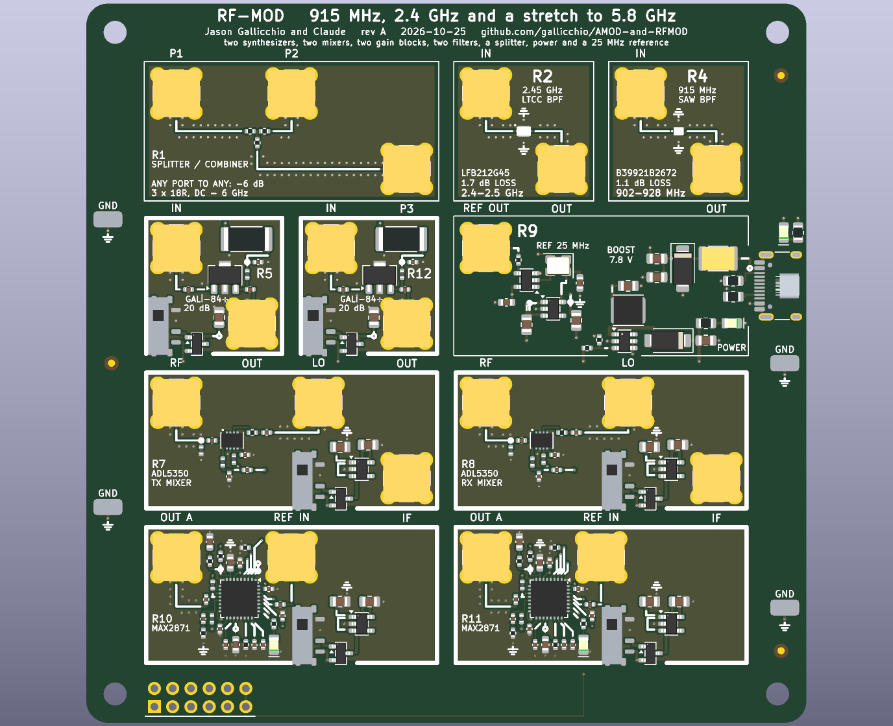

# RF-MOD handbook: the RF board

Generated by `scripts/gen_docs.py` from the tiles' own declarations (`boards/rf_mod.py`); the expected results come from
the same text the silkscreen quotes.  Rev A, 2026-10-25.

## The board

Cells are 20 mm on a 21.5 mm pitch; a tile's number sits between its jacks, the tutorial sections it serves under
the number.  IN is the top-left jack, OUT the top-right; cable the DAC to IN and OUT to the ADC.

## The tiles

### R1  splitter, 3 x 18 ohm, 6 dB

Cells (0,0), (1,0).
Jacks: TL P1 (+20 dBm); TM P2; BR P3.

**Expect:** 6.2 dB from any port to either other port, every port within 2 ohm of 50, DC to 6 GHz (the resistors' parasitics set the top)

Three 18 ohm resistors to one node: the textbook resistive divider, 6 dB per path and no isolation between the two outputs beyond those 6 dB (a Wilkinson would give 3 dB and 20 dB of isolation, at one band).  Feed R9's REF OUT to both synthesizers' REF IN, one synthesizer's OUT A to both mixers, or two tones into one gain block.

### R2  2.45 GHz filter

Cell (2,0).
Jacks: TL IN (+10 dBm); BR OUT.

**Expect:** 1.7 dB of loss from 2.4 to 2.5 GHz, 30 dB or more below 2.2 GHz and above 2.7 GHz (the datasheet); 50 ohm in and out

Murata LFB212G45SG8A127, a 2012-size LTCC band-pass.  The line to each jack is 50 ohm coplanar waveguide (0.29 mm wide, 0.25 to the ground pour) with a via fence; the jack's centre pin has no plane under it (a 2.2 mm void). Sweep it with the synthesizer R10 or R11 into a power meter, or with a DAC harmonic comb and the ADC.

Parts: LFB212G45SG8A127 (C341536).

### R4  915 MHz filter

Cell (3,0).
Jacks: TL IN (+10 dBm); BR OUT.

**Expect:** 1.1 dB of loss from 902 to 928 MHz, 40 dB or more 30 MHz outside the band (the datasheet); 50 ohm in and out

RF360 B39921B2672P810: a surface-acoustic-wave filter for the 915 MHz ISM band, 26 MHz wide, in a 1411 package; its skirts are much steeper than the LTCC's.  Lines, fences and launch voids as on R2.

Parts: B39921B2672P810 (C1518004).

### R5  gain block, GALI-84+

Cell (0,1); +8 V.
Jacks: TL IN (0 dBm); BR OUT.

**Expect:** 20 dB of gain from 50 MHz to 2.5 GHz (datasheet: 21.9 dB at 1 GHz, 1 dB compression at +20 dBm out); 97 mA from 7.8 V

Mini-Circuits GALI-84+: a Darlington MMIC that sets its own current; the 22 ohm from the 7.8 V rail drops to its 5.8 V device voltage (0.2 W in the 2512).  The 27 nH choke (415 ohm at 2.45 GHz, 155 at 915 MHz) feeds the output pin; 100 pF blocks keep the DC off the jacks.  Keep the input under 0 dBm for linear gain.  The slide switch and P-FET gate the tile's 7.8 V as on AMOD-A.

Parts: GALI-84+ (C3193261), 25121WJ0220T4E (C27258).

### R7  TX mixer, ADL5350

Cells (0,2), (1,2); +5 V.
Jacks: TL RF (+10 dBm); TMr LO (0 to +6 dBm); BR IF.

**Expect:** RF x LO to IF (or IF x LO to RF) with 7-9 dB of loss from 400 MHz to 2.5 GHz and an IF of 0.1-30 MHz; +4 dBm of LO is enough

ADL5350: a GaAs FET switch mixer with its own LO buffer; the RF and IF pins are one node, split by a crossover (series 15 pF + shunt 47 nH toward RF, series 47 nH + shunt 15 pF toward IF, corner 200 MHz) in place of the datasheet's band-tuned tanks: a few dB more loss, every band at once.  The LO's series element is 0 ohm (fit the datasheet's 3-8 nH for one band); the LO bias choke is 10 nH (the datasheet: 24 nH at 780 MHz, 2 nH at 2 GHz). Passive, so the same tile up-converts a DAC tone (IF in, RF out) or down-converts an antenna's signal (RF in, IF out). Both images appear: filter the RF side with R2 or R4.

Parts: ADL5350ACPZ-R7 (C206667), TPS7A2033PDBVR (C2862740).

### R8  RX mixer, ADL5350

Cells (2,2), (3,2); +5 V.
Jacks: TL RF (+10 dBm); TMr LO (0 to +6 dBm); BR IF.

**Expect:** RF x LO to IF (or IF x LO to RF) with 7-9 dB of loss from 400 MHz to 2.5 GHz and an IF of 0.1-30 MHz; +4 dBm of LO is enough

ADL5350: a GaAs FET switch mixer with its own LO buffer; the RF and IF pins are one node, split by a crossover (series 15 pF + shunt 47 nH toward RF, series 47 nH + shunt 15 pF toward IF, corner 200 MHz) in place of the datasheet's band-tuned tanks: a few dB more loss, every band at once.  The LO's series element is 0 ohm (fit the datasheet's 3-8 nH for one band); the LO bias choke is 10 nH (the datasheet: 24 nH at 780 MHz, 2 nH at 2 GHz). Passive, so the same tile up-converts a DAC tone (IF in, RF out) or down-converts an antenna's signal (RF in, IF out). Both images appear: filter the RF side with R2 or R4.

Parts: ADL5350ACPZ-R7 (C206667), TPS7A2033PDBVR (C2862740).

### R9  power, USB-C 5 V in: +5, +7.8 V; 25 MHz reference

Cells (2,1), (3,1).
Jacks: TL REF OUT (25 MHz, 1.6 Vpp into 50 ohm).

**Expect:** +5 V from the USB-C (up to 1.5 A), +7.8 V at 250 mA for the gain blocks (yellow LED), a 25 MHz square wave on REF OUT

USB-C power only: 5.1 k on each CC asks any source for 5 V; a 2 A PTC, a 5 V TVS and 20 uF.  The MT3608 boosts to 7.8 V (0.6 V x 13 from 12 k / 1 k) for the two GALI-84+ tiles (200 mA); the +8V rail is a strip under row 1 that their headers reach with a via.  The TPS7A2033 makes 3.3 V for the TC32H4 TCXO (+-2 ppm) and the 74LVC1G17 that drives REF OUT (51 ohm: 1.6 Vpp into 50 ohm, 3.3 Vpp into a synthesizer's unterminated REF IN; a tee feeds both synthesizers). The TCXO's pad 1 (enable or no connection on the drawing) floats, as CostasLink's review settled.

Parts: XRNR4030-22uH/M (C5289362), KT-0805G (C2297), KT-0805Y (C2296), SN74LVC1G17DBVR (C7836), MT3608 (C84817), MF-MSMF200-2 (C210837), SS34 (C8678), TC32H4-25.000-33GNDTNL (C5119013), TPS7A2033PDBVR (C2862740), SMAJ5.0A (C78401), TYPE-C-31-M-12 (C165948).

### R10  synthesizer, MAX2871

Cells (0,3), (1,3); +5 V.
Jacks: TL OUT A; TM REF IN (25 MHz, 3.3 V CMOS).

**Expect:** any frequency from 23.5 MHz to 6 GHz on OUT A (-4 to +5 dBm in steps), locked to the 25 MHz on REF IN; the red LED says locked

MAX2871 as CostasLink built it: fractional-N PLL with four VCOs, programmed over SPI from the Pmod (SCLK, SDATA, LE; MUXOUT back).  The loop filter is third order, 80-120 kHz with 61 degrees of margin for both 915 MHz (VCO / 4) and 2.4 GHz (VCO / 2) at ICP 2.56 mA (RSET 5.1 k, CP = 7).  RFOUTA+ feeds the jack through 27 nH to 3.3 V and 100 pF; RFOUTA- is terminated in 51 ohm the same way; RFOUTB is open and must stay disabled.  CE and RFOUT_EN are tied high, LE has 100 k down.  REF IN is unterminated: one REF OUT drives both synthesizers through a tee.

Parts: NCD0805R1 (C84256), MAX2871ETJ+T (C7458627), TPS7A2033PDBVR (C2862740).

### R11  synthesizer, MAX2871

Cells (2,3), (3,3); +5 V.
Jacks: TL OUT A; TM REF IN (25 MHz, 3.3 V CMOS).

**Expect:** any frequency from 23.5 MHz to 6 GHz on OUT A (-4 to +5 dBm in steps), locked to the 25 MHz on REF IN; the red LED says locked

MAX2871 as CostasLink built it: fractional-N PLL with four VCOs, programmed over SPI from the Pmod (SCLK, SDATA, LE; MUXOUT back).  The loop filter is third order, 80-120 kHz with 61 degrees of margin for both 915 MHz (VCO / 4) and 2.4 GHz (VCO / 2) at ICP 2.56 mA (RSET 5.1 k, CP = 7).  RFOUTA+ feeds the jack through 27 nH to 3.3 V and 100 pF; RFOUTA- is terminated in 51 ohm the same way; RFOUTB is open and must stay disabled.  CE and RFOUT_EN are tied high, LE has 100 k down.  REF IN is unterminated: one REF OUT drives both synthesizers through a tee.

Parts: NCD0805R1 (C84256), MAX2871ETJ+T (C7458627), TPS7A2033PDBVR (C2862740).

### R12  gain block, GALI-84+

Cell (1,1); +8 V.
Jacks: TL IN (0 dBm); BR OUT.

**Expect:** 20 dB of gain from 50 MHz to 2.5 GHz (datasheet: 21.9 dB at 1 GHz, 1 dB compression at +20 dBm out); 97 mA from 7.8 V

Mini-Circuits GALI-84+: a Darlington MMIC that sets its own current; the 22 ohm from the 7.8 V rail drops to its 5.8 V device voltage (0.2 W in the 2512).  The 27 nH choke (415 ohm at 2.45 GHz, 155 at 915 MHz) feeds the output pin; 100 pF blocks keep the DC off the jacks.  Keep the input under 0 dBm for linear gain.  The slide switch and P-FET gate the tile's 7.8 V as on AMOD-A.

Parts: GALI-84+ (C3193261), 25121WJ0220T4E (C27258).

## Ground, loops and probing

Four ground loops stand in the margins (two a side); every tile's loops are on the signal they name.  The RH-5019
loops take a scope's grabber.  The SMA jacks are 50 ohm; where an input is not 50 ohm the jack's silk says so.
