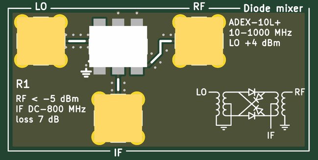
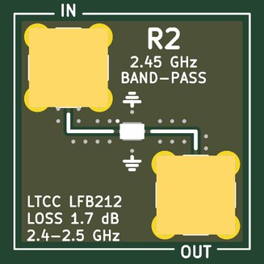
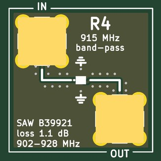
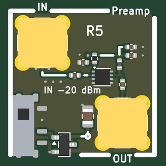
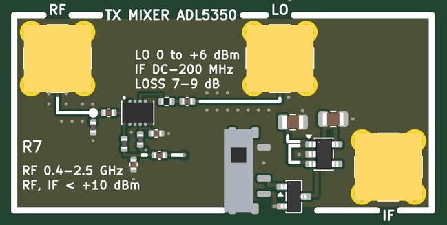
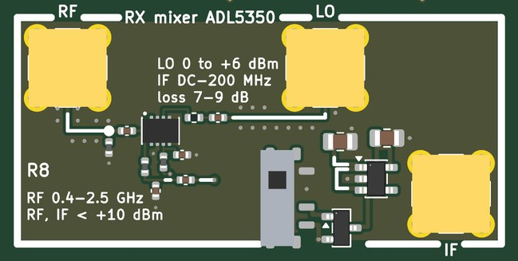
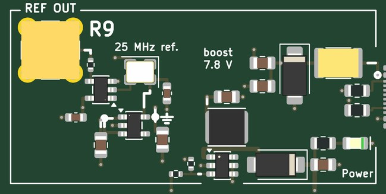
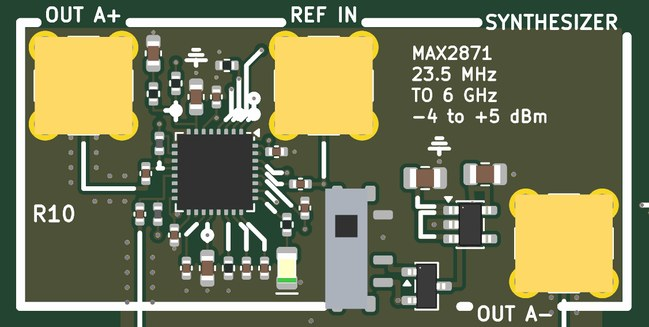
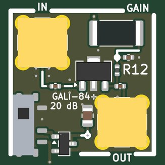
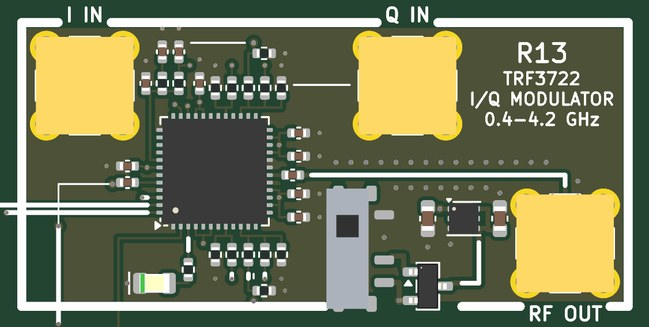

# RF-MOD handbook: the RF board

Generated by `scripts/gen_docs.py` from the tiles' own declarations (`boards/rf_mod.py`); the expected results come from
the same text the silkscreen quotes.  Rev A, 2026-10-25.

## The board

Ten tiles on sixteen 20 mm cells, four layers, USB-C power on R9.  Every tile's input is its top-left jack and its output its
bottom-right jack, so neighbouring jacks are at least 14.85 mm apart.  Every 50 ohm line is coplanar waveguide (0.29 mm on
0.21 mm of prepreg over ground, 0.25 mm gaps, a via fence) and every jack's centre pin has no plane under it.  The powered
tiles have the AMOD-A slide switch (up: on) and P-FET.  Rev A built what JLCPCB stocked on 2026-10-25: a QPL9547 LNA and a
GALI-84+ gain block, two ADL5350 mixers, a MAX2871 synthesizer and a TRF3722 quadrature transmitter fed by the ECP5 board's
two DACs.  The printed antennas moved off the board (see the end of this handbook).

### Pmod lines

The 2 x 6 plug on R10's bottom edge (pins 1-4 are IO1-4, 7-10 are IO5-8, 5 and 11 ground, 6 and 12 the FPGA's 3.3 V,
which the board does not use: every chip here runs from its own 3.3 V, so the lines are 3.3 V CMOS both ways):

- Pmod pin 1 (PMOD1): MUXOUT of R10, R10
- Pmod pin 2 (PMOD2): SDATA to R10 and R13, R10, R13
- Pmod pin 3 (PMOD3): SCLK to R10 and R13, R10, R13
- Pmod pin 4 (PMOD4): LE of R10, R10
- Pmod pin 7 (PMOD5): readback of R13, R13
- Pmod pin 8 (PMOD6): LE of R13 (TRF3722), R13

## The tiles together

The board is one end of a radio link, or both ends on a cable.  One 25 MHz reference drives everything, so every
frequency on the board is locked to every other and phase means something.

1. **Reference.**  R9's REF OUT into R10's REF IN (the ECP5 board's CLK OUT works as well); a trace on the back takes it
   on to R13's TRF3722, so both synthesizers share it.
2. **Transmitter, image-free.**  The ECP5 board's DAC 1 into R13's I IN and DAC 2 into Q IN (+-1 V into 50 ohm each); R13's
   RF OUT through R2 (2.45 GHz) or R4 (915 MHz), then R12 for 20 dB if a cable needs it.  The digital-communications waveforms with
   no image: the sideband suppression is about 42 dB untrimmed, better after the DACs' gain and phase are trimmed.
3. **Receiver.**  The antenna or cable into R5 (the QPL9547: 0.3 dB of noise figure, 19.5 dB of gain), then R4 or R2, then
   R8's RF; R10's OUT A+ into R8's LO; R8's IF into an ADC.  R7 is a second, identical mixer: on R10's OUT A- it is a
   second coherent receive channel (direction finding), or a transmit mixer for a real IF.  R1, the diode ring, does R8's
   job passively (R10 at its top power is its +4 dBm LO): compare the two mixers' loss, isolation and intermodulation.
4. **Instruments.**  R10 or R13 alone is a signal generator; R13 at f (a DC on I) and R10 at f - IF into R8 is a network
   analyzer and a stepped-frequency radar on one reference; R10 swept into R8 behind R5 is a spectrum analyzer that sees
   Wi-Fi, Bluetooth and LoRa; two tones from R13's I and Q into R12 show its intermodulation.

Levels to remember: a synthesizer gives -4 to +5 dBm; R13 gives about -3 dBm at full scale; an ADL5350 wants +4 dBm of LO
and loses 7-9 dB; a GALI-84+ gives 20 dB and compresses at +20 dBm out; the QPL9547 takes no more than +22 dBm at its input
(put 30 dB of attenuation before it on any cable from a transmitter); the filters lose 1-2 dB; R1 wants +4 dBm of LO
and loses about 7 dB.

## Antennas

The plan's printed inverted-F antennas (TI DN023 at 915 MHz, AN043 at 2.4 GHz) need bare board on every layer for a
quarter of the board and a pi network tuned on the bench, and TI's dimensions are for their stack, not this one.  Use
SMA whip antennas on R12's OUT and R5's IN instead (a 2.4 GHz 'rubber duck' is $2; 915 MHz ones are as cheap), or make
a monopole from a jack and 31 mm (2.4 GHz) or 78 mm (915 MHz) of wire.

## The tiles

Each tile in a table: its picture, then what it does, its jacks, what to expect, how to cable it, what to buy
(the links are in [KIT.md](KIT.md)), its numbers and limits, the experiments it is for and the circuit.

### R1  diode mixer, ADEX-10L+

<table><tr>
<td valign="top" width="528"></td>
<td valign="top">

<b>A double-balanced diode-ring mixer: two baluns and four Schottky diodes (drawn on the silk) multiply RF by a +-1 square wave at the LO rate.  Passive: no power.</b>  
<b>Jacks:</b> LO, top left (+4 dBm); RF, top of the right cell (-5 dBm); IF, bottom of the left cell.  
<b>Expect:</b> about 7 dB of conversion loss from 10 MHz to 1 GHz with +4 dBm of LO (R10 at its top power), IF from DC to 800 MHz, 60 dB L-R isolation  
<b>How to use it:</b> LO from R10's OUT A+ at its top power (+5 dBm) or a DAC (+4 dBm is 1 V peak into 50 ohm); RF from an antenna, a filter or a DAC; IF to an ADC, or through a filter to anything.  
<b>You need:</b> Nothing beyond SMA cables (a 50 ohm terminator on an unused output of R10).  
<b>Specs:</b> RF and LO 10-1000 MHz; IF DC-800 MHz (DC-coupled); LO +4 dBm (+1 to +7); 7.2 dB conversion loss; 60 dB LO-RF isolation; 1 dB compression at +1 dBm RF, IP3 +16 dBm.  
<b>Limits:</b> Needs +4 dBm of LO (R10 at its top setting); keep RF under -5 dBm for clean products; spec'd from 10 MHz (more loss below); every port wants 50 ohm (an unterminated IF spoils the intermodulation); the LO's odd harmonics mix too.  
<b>Experiments:</b> The diode ring against the Gilbert cell (AMOD-A's A9, at 10-30 MHz) and against the ADL5350 (R8, at 915 MHz): conversion loss, LO leakage, intermodulation; a phase detector (RF and LO at one frequency, DC at IF); a DSB modulator (audio into IF, out at RF).  
<b>Chip:</b> <a href="https://www.minicircuits.com/WebStore/dashboard.html?model=ADEX-10L%2B">ADEX-10L+</a>  
<b>The circuit:</b> Mini-Circuits ADEX-10L+: two wideband baluns and a ring of four Schottky diodes (drawn beside it on the silk).  The LO (+4 dBm, +1 to +7) turns the diodes on in pairs, so the RF is multiplied by +-1 at the LO rate: the IF is RF x square wave, the sum and difference plus odd LO harmonics.  Passive and DC-coupled at IF (a phase detector when RF and LO share a frequency); 1 dB compression at +1 dBm of RF, IP3 +16 dBm.  Compare R7/R8 (ADL5350) and AMOD-A's A9 (MC1496).  
<b>Parts:</b> ADEX-10L+ (C118997).

</td></tr></table>

### R2  2.45 GHz filter

<table><tr>
<td valign="top" width="270"></td>
<td valign="top">

<b>A 2.4-2.5 GHz band-pass filter (the Wi-Fi and Bluetooth band).</b>  
<b>Jacks:</b> IN, top left (+10 dBm); OUT, bottom right.  
<b>Expect:</b> 1.7 dB of loss from 2.4 to 2.5 GHz, 30 dB or more below 2.2 GHz and above 2.7 GHz (the datasheet); 50 ohm in and out  
<b>How to use it:</b> In line, either direction.  
<b>You need:</b> Nothing beyond SMA cables.  
<b>Specs:</b> 1.7 dB of loss in the band; 30 dB or more below 2.2 GHz and above 2.7 GHz.  
<b>Limits:</b> A fixed band, about 100 MHz wide: it does not reject an image 20 MHz away.  
<b>Experiments:</b> A transmitter's image and harmonics removed; a receiver preselected; a filter measured with a swept synthesizer.  
<b>Chip:</b> <a href="https://www.murata.com/en-us/products/productdetail?partno=LFB212G45SG8A127">LFB212G45</a>  
<b>The circuit:</b> Murata LFB212G45SG8A127, a 2012-size LTCC band-pass.  The line to each jack is 50 ohm coplanar waveguide (0.29 mm wide, 0.25 to the ground pour) with a via fence; the jack's centre pin has no plane under it (a 2.2 mm void). Sweep it with R10 or R13 into a power meter, or with a DAC harmonic comb and the ADC.  
<b>Parts:</b> LFB212G45SG8A127 (C341536).

</td></tr></table>

### R4  915 MHz filter

<table><tr>
<td valign="top" width="270"></td>
<td valign="top">

<b>A 902-928 MHz SAW band-pass filter (the 915 MHz ISM band: LoRa, RFID).</b>  
<b>Jacks:</b> IN, top left (+10 dBm); OUT, bottom right.  
<b>Expect:</b> 1.1 dB of loss from 902 to 928 MHz, 40 dB or more 30 MHz outside the band (the datasheet); 50 ohm in and out  
<b>How to use it:</b> In line, either direction.  
<b>You need:</b> Nothing beyond SMA cables.  
<b>Specs:</b> 1.1 dB of loss in the band; 40 dB or more 30 MHz outside it.  
<b>Limits:</b> Keep the input under about +10 dBm; a fixed 26 MHz band.  
<b>Experiments:</b> A transmitter cleaned up; a receiver preselected; steep SAW skirts against R2's LTCC.  
<b>Chip:</b> <a href="https://www.lcsc.com/product-detail/C1518004.html">B39921B2672</a>  
<b>The circuit:</b> RF360 B39921B2672P810: a surface-acoustic-wave filter for the 915 MHz ISM band, 26 MHz wide, in a 1411 package; its skirts are much steeper than the LTCC's.  Lines, fences and launch voids as on R2.  
<b>Parts:</b> B39921B2672P810 (C1518004).

</td></tr></table>

### R5  LNA, QPL9547

<table><tr>
<td valign="top" width="270"></td>
<td valign="top">

<b>A low-noise amplifier: +19.5 dB with a 0.3 dB noise figure, the first stage of any receiver here.</b>  
<b>Jacks:</b> IN, top left (-20 dBm); OUT, bottom right.  
<b>Supply:</b> +5 V  
<b>Expect:</b> 19.5 dB of gain and a 0.3-0.5 dB noise figure from 0.5 to 3 GHz (datasheet: 0.3 dB at 1.9 GHz, OIP3 +39 dBm); 65 mA from 5 V  
<b>How to use it:</b> Antenna to IN, OUT to a filter or a mixer's RF.  
<b>You need:</b> An SMA (not RP-SMA) antenna for the band (kit: L-com LCANRBD1044 at 2.4 GHz, LCANRBD1057 at 915 MHz). (<a href="KIT.md">KIT.md</a>)  
<b>Specs:</b> 0.1-6 GHz; 19.5 dB; NF 0.3-0.5 dB from 0.5 to 3 GHz; OIP3 +39 dBm; 65 mA.  
<b>Limits:</b> Linear below about -20 dBm in; +22 dBm at the input is the absolute maximum: never cable a transmitter into it without 30 dB of attenuation.  
<b>Experiments:</b> Receiver sensitivity; a noise figure with a noise source; Wi-Fi, LoRa, ADS-B and GPS heard over the air.  
<b>Chip:</b> <a href="https://www.qorvo.com/products/p/QPL9547">QPL9547</a>  
<b>The circuit:</b> Qorvo QPL9547: a GaAs pHEMT LNA, internally matched to 50 ohm, 0.1-6 GHz.  It sets the noise figure of every receiver here, so put it first (before the filter) unless a strong neighbour overloads it; +39 dBm OIP3 makes that rare. The 18 nH wire-wound choke (Qorvo's value) feeds 5 V into the output pin; 3.3 k from 5 V to Vbias sets 65 mA. Never cable a transmitter into it without 30 dB of attenuation (22 dBm absolute maximum at the input).  
<b>Parts:</b> QPL9547TR7 (C5367093).

</td></tr></table>

### R7  TX mixer, ADL5350

<table><tr>
<td valign="top" width="528"></td>
<td valign="top">

<b>A passive mixer: moves a signal between RF and IF with an LO, up or down (the same tile does both).</b>  
<b>Jacks:</b> RF, top left (+10 dBm); LO, top of the right cell (0 to +6 dBm); IF, bottom right.  
<b>Supply:</b> +5 V  
<b>Expect:</b> RF x LO to IF (or IF x LO to RF) with 7-9 dB of loss from 400 MHz to 2.5 GHz and an IF of 0.1-30 MHz; +4 dBm of LO is enough  
<b>How to use it:</b> Transmit: DAC to IF, R10 to LO, RF through a filter to the antenna.  Receive: antenna through R5 and a filter to RF, R10 (at the carrier minus the IF) to LO, IF to an ADC.  
<b>You need:</b> An LO: R10 (or R13's output used as a CW source).  
<b>Specs:</b> RF 0.4-2.5 GHz (to 4 GHz with more loss); IF DC-200 MHz; LO 0 to +6 dBm (+4 dBm best); conversion loss 7-9 dB; IIP3 +25 dBm; RF and IF up to about +10 dBm.  
<b>Limits:</b> Makes both sidebands (an image): filter the RF side with R2 or R4.  The LO leaks to RF and IF.  
<b>Experiments:</b> A DAC's 5-10 MHz moved to 915 MHz or 2.4 GHz and back; a heterodyne receiver whose I and Q are made in the gateware; a link on a cable or over the air.  
<b>Chip:</b> <a href="https://www.analog.com/en/products/adl5350.html">ADL5350</a>  
<b>The circuit:</b> ADL5350: a GaAs FET switch mixer with its own LO buffer; the RF and IF pins are one node, split by a crossover (series 15 pF + shunt 47 nH toward RF, series 47 nH + shunt 15 pF toward IF, corner 200 MHz) in place of the datasheet's band-tuned tanks: a few dB more loss, every band at once.  The LO's series element is 0 ohm (fit the datasheet's 3-8 nH for one band); the LO bias choke is 10 nH (the datasheet: 24 nH at 780 MHz, 2 nH at 2 GHz). Passive, so the same tile up-converts a DAC tone (IF in, RF out) or down-converts an antenna's signal (RF in, IF out). Both images appear: filter the RF side with R2 or R4.  
<b>Parts:</b> ADL5350ACPZ-R7 (C206667), TPS7A2033PDBVR (C2862740).

</td></tr></table>

### R8  RX mixer, ADL5350

<table><tr>
<td valign="top" width="528"></td>
<td valign="top">

<b>A passive mixer: moves a signal between RF and IF with an LO, up or down (the same tile does both).</b>  
<b>Jacks:</b> RF, top left (+10 dBm); LO, top of the right cell (0 to +6 dBm); IF, bottom right.  
<b>Supply:</b> +5 V  
<b>Expect:</b> RF x LO to IF (or IF x LO to RF) with 7-9 dB of loss from 400 MHz to 2.5 GHz and an IF of 0.1-30 MHz; +4 dBm of LO is enough  
<b>How to use it:</b> Transmit: DAC to IF, R10 to LO, RF through a filter to the antenna.  Receive: antenna through R5 and a filter to RF, R10 (at the carrier minus the IF) to LO, IF to an ADC.  
<b>You need:</b> An LO: R10 (or R13's output used as a CW source).  
<b>Specs:</b> RF 0.4-2.5 GHz (to 4 GHz with more loss); IF DC-200 MHz; LO 0 to +6 dBm (+4 dBm best); conversion loss 7-9 dB; IIP3 +25 dBm; RF and IF up to about +10 dBm.  
<b>Limits:</b> Makes both sidebands (an image): filter the RF side with R2 or R4.  The LO leaks to RF and IF.  
<b>Experiments:</b> A DAC's 5-10 MHz moved to 915 MHz or 2.4 GHz and back; a heterodyne receiver whose I and Q are made in the gateware; a link on a cable or over the air.  
<b>Chip:</b> <a href="https://www.analog.com/en/products/adl5350.html">ADL5350</a>  
<b>The circuit:</b> ADL5350: a GaAs FET switch mixer with its own LO buffer; the RF and IF pins are one node, split by a crossover (series 15 pF + shunt 47 nH toward RF, series 47 nH + shunt 15 pF toward IF, corner 200 MHz) in place of the datasheet's band-tuned tanks: a few dB more loss, every band at once.  The LO's series element is 0 ohm (fit the datasheet's 3-8 nH for one band); the LO bias choke is 10 nH (the datasheet: 24 nH at 780 MHz, 2 nH at 2 GHz). Passive, so the same tile up-converts a DAC tone (IF in, RF out) or down-converts an antenna's signal (RF in, IF out). Both images appear: filter the RF side with R2 or R4.  
<b>Parts:</b> ADL5350ACPZ-R7 (C206667), TPS7A2033PDBVR (C2862740).

</td></tr></table>

### R9  power, USB-C 5 V in: +5, +7.8 V; 25 MHz reference

<table><tr>
<td valign="top" width="528"></td>
<td valign="top">

<b>Power from USB-C (+5 V, and +7.8 V boosted for R12) and the board's 25 MHz reference oscillator.</b>  
<b>Jacks:</b> REF OUT, top left (25 MHz, 1.6 Vpp into 50 ohm).  
<b>Expect:</b> +5 V from the USB-C (up to 1.5 A), +7.8 V at 250 mA for the gain blocks (yellow LED), a 25 MHz square wave on REF OUT  
<b>How to use it:</b> Plug in the USB-C; REF OUT to R10's REF IN (R13 takes it from there on the back).  
<b>You need:</b> A 5 V USB-C supply (kit: Raspberry Pi 5.1 V 3 A supply). (<a href="KIT.md">KIT.md</a>)  
<b>Specs:</b> TCXO +-2 ppm; REF OUT a 25 MHz square wave, 1.6 V p-p into 50 ohm (3.3 V into a high impedance).  
<b>Limits:</b> One REF OUT (R10's REF IN passes it on to R13 by a back trace); a second board needs a splitter.  
<b>Experiments:</b> Everything on one reference (the ECP5 board too), so phase means something; the TCXO against GPS.  
<b>Chip:</b> <a href="https://www.lcsc.com/product-detail/C5119013.html">TC32H4 TCXO</a>, <a href="https://www.lcsc.com/product-detail/C84817.html">MT3608</a>, <a href="https://www.ti.com/product/TPS7A20">TPS7A20</a>, <a href="https://www.ti.com/product/SN74LVC1G17">SN74LVC1G17</a>  
<b>The circuit:</b> USB-C power only: 5.1 k on each CC asks any source for 5 V; a 2 A PTC, a 5 V TVS and 20 uF.  The MT3608 boosts to 7.8 V (0.6 V x 13 from 12 k / 1 k) for the GALI-84+ tile, R12 (100 mA); the +8V rail is a strip under row 1 that their headers reach with a via.  The TPS7A2033 makes 3.3 V for the TC32H4 TCXO (+-2 ppm) and the 74LVC1G17 that drives REF OUT (51 ohm: 1.6 Vpp into 50 ohm, 3.3 Vpp into a synthesizer's unterminated REF IN; R10's REF IN passes it to R13). The TCXO's pad 1 (enable or no connection on the drawing) floats, as CostasLink's review settled.  
<b>Parts:</b> XRNR4030-22uH/M (C5289362), KT-0805G (C2297), KT-0805Y (C2296), SN74LVC1G17DBVR (C7836), MT3608 (C84817), MF-MSMF200-2 (C210837), SS34 (C8678), TC32H4-25.000-33GNDTNL (C5119013), TPS7A2033PDBVR (C2862740), SMAJ5.0A (C78401), TYPE-C-31-M-12 (C165948).

</td></tr></table>

### R10  synthesizer, MAX2871

<table><tr>
<td valign="top" width="528"></td>
<td valign="top">

<b>A frequency synthesizer: any frequency from 23.5 MHz to 6 GHz, locked to a 25 MHz reference and set over SPI from the FPGA.  Two outputs, OUT A+ and OUT A-, the same frequency and power 180 degrees apart: two mixers' LOs at once.</b>  
<b>Jacks:</b> OUT A+, top left; REF IN, top middle (25 MHz, 3.3 V CMOS); OUT A-, bottom right.  
<b>Pmod:</b> IO1 (Pmod pin 1): MUXOUT of R10; IO2 (Pmod pin 2): SDATA to R10 and R13; IO3 (Pmod pin 3): SCLK to R10 and R13; IO4 (Pmod pin 4): LE of R10  
<b>Supply:</b> +5 V  
<b>Expect:</b> any frequency from 23.5 MHz to 6 GHz on OUT A+ and OUT A- (each -4 to +5 dBm in steps, 180 degrees apart), locked to the 25 MHz on REF IN; the red LED says locked  
<b>How to use it:</b> REF IN from R9's REF OUT; program it over the Pmod (SPI); OUT A+ and OUT A- to two mixers' LOs (R7 and R8, or R8 and R1) or a filter; a 50 ohm terminator on an output left unused.  
<b>You need:</b> Nothing (the SPI gateware or driver); the kit's 50 ohm terminator for an unused output. (<a href="KIT.md">KIT.md</a>)  
<b>Specs:</b> -4 to +5 dBm on each of OUT A+ and OUT A-; fractional-N; 80-120 kHz loop; a red LED when locked.  
<b>Limits:</b> Below 3 GHz the output is divided down: a square-ish wave with strong harmonics (filter it); fractional spurs; about a millisecond to relock.  
<b>Experiments:</b> The mixers' LO; a signal generator; a swept source for filters; FSK and chirps by reprogramming; phase noise.  
<b>Chip:</b> <a href="https://www.analog.com/en/products/max2871.html">MAX2871</a>  
<b>The circuit:</b> MAX2871 as CostasLink built it: fractional-N PLL with four VCOs, programmed over SPI from the Pmod (SCLK, SDATA, LE; MUXOUT back).  The loop filter is third order, 80-120 kHz with 61 degrees of margin for both 915 MHz (VCO / 4) and 2.4 GHz (VCO / 2) at ICP 2.56 mA (RSET 5.1 k, CP = 7).  RFOUTA+ and RFOUTA- each feed a jack through 27 nH to 3.3 V and 100 pF: two outputs, 180 degrees apart; put a 50 ohm terminator on one that is unused.  RFOUTB is open and must stay disabled.  CE and RFOUT_EN are tied high, LE has 100 k down.  REF IN is unterminated; a back trace takes it on to R13.  
<b>Parts:</b> NCD0805R1 (C84256), MAX2871ETJ+T (C7458627), TPS7A2033PDBVR (C2862740).

</td></tr></table>

### R12  gain block, GALI-84+

<table><tr>
<td valign="top" width="270"></td>
<td valign="top">

<b>A gain block: +20 dB from DC to 6 GHz, up to +20 dBm out.</b>  
<b>Jacks:</b> IN, top left (0 dBm); OUT, bottom right.  
<b>Supply:</b> +8 V  
<b>Expect:</b> 20 dB of gain from 50 MHz to 2.5 GHz (datasheet: 21.9 dB at 1 GHz, 1 dB compression at +20 dBm out); 97 mA from 7.8 V  
<b>How to use it:</b> Signal to IN, OUT to the load; 10 dB of attenuation after a synthesizer.  
<b>You need:</b> A 10 dB SMA attenuator after a synthesizer (kit: VAT-10A+). (<a href="KIT.md">KIT.md</a>)  
<b>Specs:</b> 20 dB (21.9 dB at 1 GHz); 1 dB compression at +20 dBm out; 97 mA from 7.8 V.  
<b>Limits:</b> Keep the input under 0 dBm; its noise figure (about 4 dB) makes it a driver, not an LNA.  
<b>Experiments:</b> Driving an antenna or a mixer's LO; two-tone intermodulation; the compression curve.  
<b>Chip:</b> <a href="https://www.minicircuits.com/WebStore/dashboard.html?model=GALI-84%2B">GALI-84+</a>  
<b>The circuit:</b> Mini-Circuits GALI-84+: a Darlington MMIC that sets its own current; the 22 ohm from the 7.8 V rail drops to its 5.8 V device voltage (0.2 W in the 2512).  The 27 nH choke (415 ohm at 2.45 GHz, 155 at 915 MHz) feeds the output pin; 100 pF blocks keep the DC off the jacks.  Keep the input under 0 dBm for linear gain.  The slide switch and P-FET gate the tile's 7.8 V as on AMOD-A.  
<b>Parts:</b> GALI-84+ (C3193261), 25121WJ0220T4E (C27258).

</td></tr></table>

### R13  I/Q transmitter, TRF3722

<table><tr>
<td valign="top" width="528"></td>
<td valign="top">

<b>A quadrature (I/Q) transmitter with its own synthesizer: two DAC signals, I and Q, become RF anywhere from 0.4 to 4.2 GHz with no image.</b>  
<b>Jacks:</b> I IN, top left (+-1 V into 50 ohm); Q IN, top of the right cell (+-1 V into 50 ohm); RF OUT, bottom right.  
<b>Pmod:</b> IO2 (Pmod pin 2): SDATA to R10 and R13; IO3 (Pmod pin 3): SCLK to R10 and R13; IO5 (Pmod pin 7): readback of R13; IO6 (Pmod pin 8): LE of R13 (TRF3722)  
<b>Supply:</b> +5 V  
<b>Expect:</b> I + jQ from two DACs on 0.4-4.2 GHz, about -3 dBm, image-free (-42 dBc untrimmed)  
<b>How to use it:</b> DAC 1 to I IN, DAC 2 to Q IN; program it over SPI (it shares the bus with R10); RF OUT through R2 or R4.  
<b>You need:</b> Nothing beyond SMA cables.  
<b>Specs:</b> I and Q +-1 V into 50 ohm; RF about -3 dBm; sideband suppression about 42 dB untrimmed; referenced to the 25 MHz on R10's REF IN.  
<b>Limits:</b> Its LO is inside the chip, so it cannot feed a demodulator; the carrier leak and the image depend on trimming the DACs' offset, gain and phase.  
<b>Experiments:</b> SSB, QPSK, QAM, OFDM and chirps on a real carrier; image rejection; a coherent link with R8 and R10 as the receiver.  
<b>Chip:</b> <a href="https://www.ti.com/product/TRF3722">TRF3722</a>  
<b>The circuit:</b> TRF3722 (PLL, VCO, I/Q modulator) on SPI from the Pmod (LE IO6, readback IO5); reference from R10's REF IN.  Each DAC: 56 ohm at the jack, 270 ohm to a node held at 0.25 V (+-0.25 V for +-1 V).  DC on I alone is a CW carrier.  
<b>Parts:</b> NCD0805R1 (C84256), TLV75733PDRVR (C2868428), TRF3722IRGZR (C1850395).

</td></tr></table>

## Ground, loops and probing

Four ground loops stand in the margins; every tile's loops are on the signal they name.  The RH-5019
loops take a scope's grabber.  The SMA jacks are 50 ohm; where an input is not 50 ohm the jack's silk says so.
