# RF-MOD-2 handbook: the second-level RF board

Generated by `scripts/gen_docs.py` from the tiles' own declarations (`boards/rf_mod_2.py`); the expected results come from
the same text the silkscreen quotes.  Rev A, 2026-10-25.

## The board

Eleven tiles on sixteen 20 mm cells, four layers, USB-C power on X10.  The board is built for the ECP5-2ADC-2DAC board: its two
DACs drive X1's I and Q, its two ADCs read X2's I and Q, and X3's two outputs (OUT A+ and OUT A-) are the LOs of both, so transmitter and receiver share
one phase.  Every 50 ohm line is coplanar waveguide with a via fence; every jack's centre pin has no plane under it.

### Pmod lines

The 2 x 6 plug on X3's bottom edge (pins 1-4 are IO1-4, 7-10 are IO5-8, 5 and 11 ground, 6 and 12 the FPGA's 3.3 V,
which the board does not use: every chip here runs from its own 3.3 V, so the lines are 3.3 V CMOS both ways):

- Pmod pin 1 (PMOD1): MUXOUT of X3, X3
- Pmod pin 2 (PMOD2): SDATA to X3, X3
- Pmod pin 3 (PMOD3): SCLK to X3, X3
- Pmod pin 4 (PMOD4): LE of X3, X3
- Pmod pin 7 (PMOD5): V1 of X11 (RF1 on), X11
- Pmod pin 8 (PMOD6): X7's noise on, X7
- Pmod pin 10 (PMOD8): V2 of X11 (RF2 on), X11

## The tiles together

X3 (the MAX2871, locked to the 25 MHz on its REF IN: the ECP5 board's CLK OUT) drives X1's LO from OUT A+ and X2's from OUT A-, so the
transmitter and the receiver share one phase.  The ECP5 board's DACs are X1's I and Q, its ADCs read X2's I and Q: a complete
coherent I/Q transceiver from 0.4 to 6 GHz whose baseband is the ECP5 board's 30 MHz.

1. **A radio link, any modulation.**  DAC 1 and DAC 2 into X1's I IN and Q IN, X1's RF OUT on a cable (or an antenna) into X4
   (the LNA) and X2's RF IN, X2's I OUT and Q OUT into the ADCs: QPSK, 16-QAM, OFDM, FSK, chirps, with the constellation
   on the screen and the carrier, timing and equalisation in gateware.  X11 switches one antenna between transmit and receive.
2. **A vector network analyzer.**  X1 makes a tone (a DC on I), the device under test sits between X1 and X2, and X2's I and
   Q are its transmission, magnitude and phase, at every frequency X3 steps to: filters, cables, the board's own LNA.
3. **Radar.**  X3 stepped (or X1 chirped), X1's RF OUT to one antenna, X2's RF IN on another: a stepped-frequency or FMCW
   radar whose range bins are an FFT of X2's samples, and whose phase gives millimetre motion (breathing, a pendulum).
4. **Diamond NV centres (ODMR).**  X3 near 2.87 GHz through X1 (the DACs make the sweep and the modulation) and an amplifier
   into X9's loop under a diamond plate; green light from PhMOD's Y10 (pulsed with IO5) and a photodiode on an ADC: the
   resonance dip, its Zeeman splitting under a magnet (a magnetometer), Rabi oscillations, a Ramsey sequence.
5. **GNSS.**  An active antenna on X8 (bias on its centre pin, the MAX2659 and two SAW filters), X2's LO at 1575.42 MHz minus
   a few MHz, I and Q into the ADCs: GPS L1 C/A acquisition by correlation, Doppler and code phase, then a position fix.
6. **Power and noise.**  X6 (the AD8318, 25 mV per dB) is a power meter from 1 MHz to 8 GHz on an ADC (antenna patterns, a
   filter's sweep); X7 (IO6) is a switched noise source for the Y-factor noise figure of X4 or the whole receiver, and with X11
   switching between an antenna and a load, a Dicke radiometer (the Sun at 2.4 GHz).

Levels to remember: X3 gives -4 to +5 dBm on each output; X5's FWD and REFL are 25 dB below the waves they sample; X1 wants 0 dBm of LO and gives about 0 dBm at
full scale; X2's amplified I and Q reach the ADCs' full scale near -10 dBm of RF (measure it) and it wants -6 to +6 dBm of LO; X4 gives 19 dB (no more
than +20 dBm in); X6 reads -60 to 0 dBm; X9 is a through line rated for 1 W from an external amplifier.

## The tiles

Each tile in a table: its picture, then what it does, its jacks, what to expect, how to cable it, what to buy
(the links are in [KIT.md](KIT.md)), its numbers and limits, the experiments it is for and the circuit.

### X1  I/Q modulator, ADL5375

<table><tr>
<td valign="top" width="528">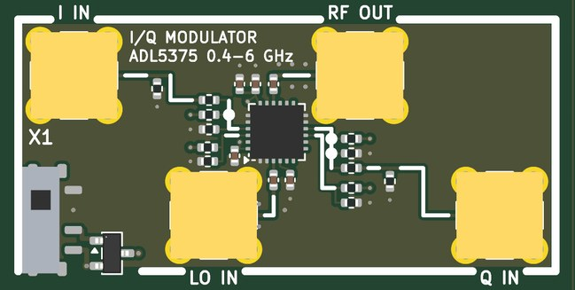</td>
<td valign="top">

<b>An I/Q modulator with an outside LO: the two DACs' I and Q onto a carrier from 0.4 to 6 GHz.  It shares its LO with X2, so the two work as a coherent pair.</b>  
<b>Jacks:</b> I IN, top left (+-1 V into 50 ohm); LO IN, bottom of the left cell (0 dBm); RF OUT, top of the right cell; Q IN, bottom right (+-1 V into 50 ohm).  
<b>Supply:</b> +5 V  
<b>Expect:</b> about 0 dBm of single-sideband RF at full scale (I and Q +-1 V at 1 V p-p differential equivalent), 0.4-6 GHz, sideband and carrier suppression near 40 dB untrimmed; baseband flat to 95 MHz, far past the DACs' 12 MHz  
<b>How to use it:</b> DAC 1 to I IN, DAC 2 to Q IN, X3's OUT A+ to LO IN; RF OUT to the antenna, the device under test or X5's IN.  
<b>You need:</b> Nothing beyond SMA cables.  
<b>Specs:</b> I and Q +-1 V into 50 ohm; LO 0 dBm (-6 to +6 dBm); about 0 dBm of RF; sideband and carrier suppression near 40 dB untrimmed; baseband flat to 95 MHz.  
<b>Limits:</b> Needs an LO (X3's OUT A+); trim the carrier with DC offsets and the sideband with the DACs' gain and phase.  
<b>Experiments:</b> A QPSK, QAM or OFDM transmitter; the source of a network analyzer or a radar; ODMR sweeps.  
<b>Chip:</b> <a href="https://www.analog.com/en/products/adl5375.html">ADL5375</a>  
<b>The circuit:</b> ADI ADL5375-05: two Gilbert-cell mixers and a quadrature LO splitter, 0.4-6 GHz, baseband bias 0.5 V.  Each input is single-ended from a DAC: 68 ohm at the jack, 150 ohm into 510 / 91 ohm from 5 V (0.50 V, gain 0.34); the other pin of each pair sits at 0.50 V on 510 / 56 ohm.  LO in single-ended through 100 pF (0 dBm; -6 to +6 dBm works); RF out is 50 ohm through 100 pF.  Trim the carrier with small DC offsets on I and Q, the sideband with the DACs' gain and phase.  
<b>Parts:</b> ADL5375-05ACPZ-R7 (C579150).

</td></tr></table>

### X2  I/Q demodulator, ADL5380

<table><tr>
<td valign="top" width="528">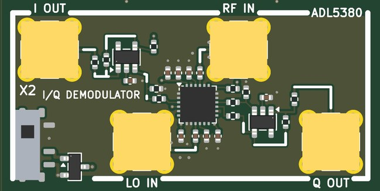</td>
<td valign="top">

<b>An I/Q demodulator: brings RF from 0.4 to 6 GHz down to baseband I and Q for the two ADCs.</b>  
<b>Jacks:</b> I OUT, top left (+-1 V); LO IN, bottom of the left cell (0 dBm); RF IN, top of the right cell (-10 dBm); Q OUT, bottom right (+-1 V).  
<b>Supply:</b> +5 V  
<b>Expect:</b> I and Q of the RF input against the LO, 0.4-6 GHz: about 7 dB of conversion gain from the chip, x2 in the amplifiers, +-1 V at the ADC for about -4 dBm of RF; flat from DC to beyond the ADCs' 23 MHz  
<b>How to use it:</b> RF IN from X4, an antenna, the device under test or X5's REFL; LO IN from X3's OUT A-; I OUT to ADC 1, Q OUT to ADC 2.  
<b>You need:</b> Nothing beyond SMA cables.  
<b>Specs:</b> About -4 dBm of RF gives +-1 V at the ADCs; LO 0 dBm (-6 to +6 dBm); baseband from DC past the ADCs' bandwidth.  
<b>Limits:</b> Zero-IF: DC offsets and I/Q imbalance to calibrate; a strong signal saturates it (use a pad).  
<b>Experiments:</b> Constellations of a real link; a network analyzer's receiver; FMCW and stepped-frequency radar; GPS.  
<b>Chip:</b> <a href="https://www.analog.com/en/products/adl5380.html">ADL5380</a>, <a href="https://www.ti.com/product/OPA810">OPA810</a>  
<b>The circuit:</b> ADI ADL5380: a quadrature demodulator, 0.4-6 GHz, 390 MHz of baseband, I and Q as differential pairs at 2.5 V.  Two OPA810 difference amplifiers (499 ohm in, 1 k feedback and to ground: gain 2) make each pair one output about 0 V from +5 / -5 V; 49.9 ohm out.  RF and LO single-ended through 100 pF, the other pin to ground through 100 pF (a balun would gain 1-3 dB and IP2).  ADJ 1.5 k to 5 V suits 0.4-3 GHz (open it above 5 GHz).  With X3's two outputs on the LOs: one coherent radio.  
<b>Parts:</b> ADL5380ACPZ-R7 (C579152), OPA810IDBVR (C2833513).

</td></tr></table>

### X3  synthesizer, MAX2871

<table><tr>
<td valign="top" width="528">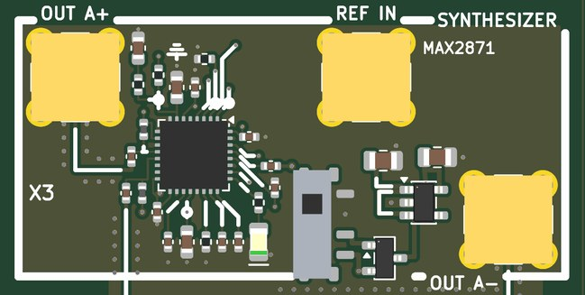</td>
<td valign="top">

<b>The synthesizer: any frequency from 23.5 MHz to 6 GHz, locked to 25 MHz, set over SPI.  Its two outputs (OUT A+ and OUT A-, 180 degrees apart) are the LOs of X1 and X2 at once.</b>  
<b>Jacks:</b> OUT A+, top left; REF IN, top of the right cell (25 MHz, 3.3 V CMOS); OUT A-, bottom right.  
<b>Pmod:</b> IO1 (Pmod pin 1): MUXOUT of X3; IO2 (Pmod pin 2): SDATA to X3; IO3 (Pmod pin 3): SCLK to X3; IO4 (Pmod pin 4): LE of X3  
<b>Supply:</b> +5 V  
<b>Expect:</b> any frequency from 23.5 MHz to 6 GHz on OUT A+ and OUT A- (each -4 to +5 dBm, 180 degrees apart), locked to the 25 MHz on REF IN (the ECP5 board's CLK OUT or RF-MOD's REF OUT): OUT A+ is X1's LO and OUT A- X2's, one phase for both  
<b>How to use it:</b> REF IN from the ECP5 board's CLK OUT (or RF-MOD's REF OUT); program it over the Pmod; OUT A+ to X1's LO IN, OUT A- to X2's LO IN.  
<b>You need:</b> Nothing (the SPI gateware).  
<b>Specs:</b> -4 to +5 dBm on each of OUT A+ and OUT A- (set -1 dBm: X1 wants 0, X2 -6 to +6); 80-120 kHz loop; red LED when locked.  
<b>Limits:</b> Divided-down outputs below 3 GHz have strong harmonics; fractional spurs; about a millisecond to relock.  
<b>Experiments:</b> The coherent LO of the transceiver; stepped-frequency radar and network analysis; a signal generator.  
<b>Chip:</b> <a href="https://www.analog.com/en/products/max2871.html">MAX2871</a>  
<b>The circuit:</b> MAX2871 as CostasLink built it: fractional-N PLL with four VCOs, programmed over SPI from the Pmod (SCLK, SDATA, LE; MUXOUT back).  The loop filter is third order, 80-120 kHz with 61 degrees of margin for both 915 MHz (VCO / 4) and 2.4 GHz (VCO / 2) at ICP 2.56 mA (RSET 5.1 k, CP = 7).  RFOUTA+ and RFOUTA- each feed a jack through 27 nH to 3.3 V and 100 pF: two outputs, 180 degrees apart; put a 50 ohm terminator on one that is unused.  RFOUTB is open and must stay disabled.  CE and RFOUT_EN are tied high, LE has 100 k down.  REF IN is unterminated (3.3 V CMOS): the ECP5 board's CLK OUT or RF-MOD's REF OUT.  OUT A+ into X1's LO and OUT A- into X2's at -1 dBm (X1 wants 0, X2 -6 to +6).  
<b>Parts:</b> NCD0805R1 (C84256), MAX2871ETJ+T (C7458627), TPS7A2033PDBVR (C2862740).

</td></tr></table>

### X4  LNA, QPL9547

<table><tr>
<td valign="top" width="270">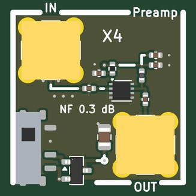</td>
<td valign="top">

<b>A low-noise amplifier: +19.5 dB with a 0.3 dB noise figure (RF-MOD's R5).</b>  
<b>Jacks:</b> IN, top left (-20 dBm); OUT, bottom right.  
<b>Supply:</b> +5 V  
<b>Expect:</b> 19.5 dB of gain and a 0.3-0.5 dB noise figure from 0.5 to 3 GHz (datasheet: 0.3 dB at 1.9 GHz, OIP3 +39 dBm); 65 mA from 5 V  
<b>How to use it:</b> Antenna to IN, OUT to X2's RF IN or X6.  
<b>You need:</b> An SMA antenna for the band (kit: L-com LCANRBD1044 or LCANRBD1057). (<a href="KIT.md">KIT.md</a>)  
<b>Specs:</b> 0.1-6 GHz; 19.5 dB; NF 0.3-0.5 dB; OIP3 +39 dBm.  
<b>Limits:</b> Linear below about -20 dBm in; +22 dBm absolute maximum at the input.  
<b>Experiments:</b> The receiver's first stage; noise figure with X7; radiometry.  
<b>Chip:</b> <a href="https://www.qorvo.com/products/p/QPL9547">QPL9547</a>  
<b>The circuit:</b> Qorvo QPL9547: a GaAs pHEMT LNA, internally matched to 50 ohm, 0.1-6 GHz.  It sets the noise figure of every receiver here, so put it first (before the filter) unless a strong neighbour overloads it; +39 dBm OIP3 makes that rare. The 18 nH wire-wound choke (Qorvo's value) feeds 5 V into the output pin; 3.3 k from 5 V to Vbias sets 65 mA. Never cable a transmitter into it without 30 dB of attenuation (22 dBm absolute maximum at the input).  
<b>Parts:</b> QPL9547TR7 (C5367093).

</td></tr></table>

### X5  coupler, 2 x HHM22137A1

<table><tr>
<td valign="top" width="528">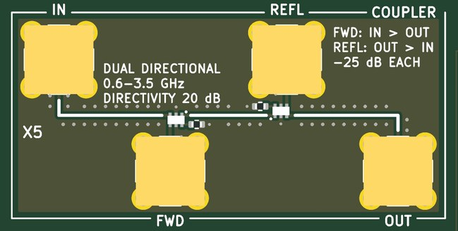</td>
<td valign="top">

<b>A dual directional coupler: a 50 ohm line from IN to OUT that hands a sample of the wave going forward to FWD and of the wave coming back from OUT to REFL.  With X1 and X2, a vector network analyzer that measures reflection (S11) as well as transmission.</b>  
<b>Jacks:</b> IN, top left (+30 dBm); FWD, bottom of the left cell; REFL, top of the right cell; OUT, bottom right.  
<b>Expect:</b> FWD 25 dB below the wave going from IN to OUT and REFL 25 dB below the wave coming back from OUT, 0.6-2.7 GHz (27 dB at 0.6, 14 dB at 3.5 GHz); 0.3 dB through; about 20 dB of directivity: with a device on OUT, REFL / FWD is its reflection coefficient  
<b>How to use it:</b> X1's RF OUT to IN, the device under test on OUT, REFL to X2's RF IN (or X6 for power alone), FWD to X6 or through X11 to X2 for the ratio; terminate whichever coupled port is unused.  
<b>You need:</b> The kit's 50 ohm terminators (the load, and on an unused port); for calibration an open (a cable's bare end) and an SMA short (a NanoVNA calibration set: see KIT.md). (<a href="KIT.md">KIT.md</a>)  
<b>Specs:</b> Two couplers back to back; FWD and REFL 25 dB below their waves from 0.67 to 2.7 GHz (27 dB at 0.6 GHz, 14 dB at 3.5 GHz); about 20 dB of directivity; 0.3 dB through; +35 dBm through.  
<b>Limits:</b> 0.6 to 3.5 GHz only (above 2.7 GHz the coupling rises and the directivity falls); uncalibrated, about 20 dB of directivity hides reflections under about 0.1 (|S11| of -20 dB); calibrating with an open, a short and a load removes most of that; an unused coupled port wants 50 ohm.  
<b>Experiments:</b> An antenna's match (S11 and its resonance) at 915 MHz, 2.4 GHz and GPS; a filter's return loss; the ODMR loop's match at 2.87 GHz; standing waves on a cable; a time-domain reflectometer by stepping X3.  
<b>Chip:</b> <a href="https://www.lcsc.com/product-detail/C415328.html">HHM22137A1</a>  
<b>The circuit:</b> Two TDK HHM22137A1 directional couplers back to back, each with its isolated port in 51 ohm: the first samples the wave going from IN to OUT (FWD), the second, turned round, the wave coming back from OUT (REFL).  X1 on IN, a device on OUT, REFL into X2 (and FWD into X6 or through X11): the device's S11 in magnitude and phase.  Directivity (about 20 dB) limits the smallest reflection it sees; calibrate with open, short and load.  +35 dBm through; terminate an unused port in 50 ohm.  
<b>Parts:</b> HHM22137A1 (C415328).

</td></tr></table>

### X6  log detector, AD8318

<table><tr>
<td valign="top" width="270">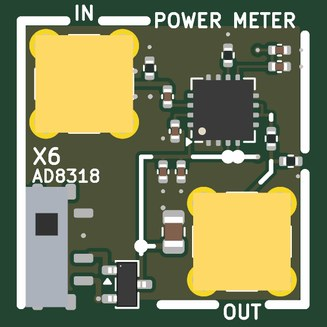</td>
<td valign="top">

<b>A power meter: a logarithmic detector whose voltage falls 25 mV for every dB of RF from -60 to 0 dBm, 1 MHz to 8 GHz.</b>  
<b>Jacks:</b> IN, top left (0 dBm); OUT, bottom right (0.23-0.95 V open).  
<b>Supply:</b> +5 V  
<b>Expect:</b> VOUT falls 25 mV per dB of input from -60 to 0 dBm, 1 MHz-8 GHz (2.1 V at -60 dBm, 0.6 V at 0 dBm at the chip); at the jack 0.45 x that from 50 ohm: 0.27-0.95 V into the ADC's high impedance, half into 50 ohm; 10 ns response  
<b>How to use it:</b> RF to IN, OUT to an ADC on high impedance.  
<b>You need:</b> Nothing beyond SMA cables.  
<b>Specs:</b> -60 to 0 dBm; 25 mV/dB; 10 ns response; OUT 0.27-0.95 V into a high impedance (half into 50 ohm).  
<b>Limits:</b> Power only, no phase; the slope and intercept move with frequency: calibrate at the frequency you use.  
<b>Experiments:</b> Antenna patterns; a filter's response with X3 (a scalar network analyzer); pulse envelopes; path loss with distance.  
<b>Chip:</b> <a href="https://www.analog.com/en/products/ad8318.html">AD8318</a>  
<b>The circuit:</b> ADI AD8318: a nine-stage log amplifier with detectors, 60 dB of range to 8 GHz, temperature-compensated (499 ohm on TADJ suits 0.9-2.2 GHz).  VSET = VOUT: -25 mV/dB with an intercept near +20 dBm.  CLPF is open, so it follows a pulse in 10 ns: a radar's or a pulsed experiment's envelope at the ADC's 65 MS/s.  The 110 / 91 ohm divider keeps the 0.5-2.1 V inside the ADC's +-1 V and makes the output a 50 ohm source.  A power meter, a scalar network analyzer with X3, antenna patterns.  
<b>Parts:</b> AD8318ACPZ-REEL7 (C578694).

</td></tr></table>

### X7  noise source, ADL5611

<table><tr>
<td valign="top" width="270">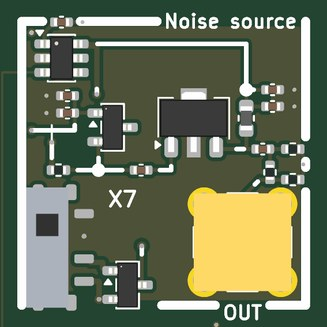</td>
<td valign="top">

<b>A switched noise source: avalanche noise from a transistor junction, amplified, from 50 MHz to 4 GHz.  Pmod IO6 turns it on.</b>  
<b>Jacks:</b> OUT, bottom right.  
<b>Pmod:</b> IO6 (Pmod pin 8): X7's noise on  
<b>Supply:</b> +5 V  
<b>Expect:</b> IO6 high: a flat noise spectrum from 50 MHz to 4 GHz, roughly 15-30 dB ENR at OUT (measure it); IO6 low: a 50 ohm load at room temperature; 20 dB of pad keeps OUT matched in both states  
<b>How to use it:</b> OUT to the amplifier or receiver under test; toggle IO6 and compare the powers.  
<b>You need:</b> For calibration: a 50 ohm load in ice water and in boiling water, or in liquid nitrogen.  
<b>Specs:</b> IO6 high: a flat floor about 15-30 dB above kT (measure its ENR); IO6 low: a 50 ohm load at room temperature (a 20 dB pad keeps OUT matched).  
<b>Limits:</b> The ENR must be calibrated against a hot and a cold load before it gives absolute noise figures.  
<b>Experiments:</b> The Y-factor noise figure of X4 or the whole receiver; a Dicke radiometer with X11; a filter's shape on a spectrum analyzer.  
<b>Chip:</b> <a href="https://www.analog.com/en/products/adl5611.html">ADL5611</a>, <a href="https://www.ti.com/product/TPS22917">TPS22917</a>  
<b>The circuit:</b> Avalanche noise: the MMBT3904's base-emitter junction breaks down near 8 V (6 V minimum), its base on -5 V and its emitter fed from the switched 5 V through 680 ohm.  The ADL5611 (22 dB, 43 nH choke, ADI's values) lifts it; the 20 dB pad makes the output 50 ohm whether the amplifier is on or off, so the cold state is a room-temperature termination. Calibrate the ENR against a 50 ohm load in ice water and in boiling water (273 and 373 K) or in liquid nitrogen (77 K).  
<b>Parts:</b> ADL5611ARKZ-R7 (C208262), MMBT3904(RANGE:100-300) (C20526), TPS22917DBVR (C2681320).

</td></tr></table>

### X8  GNSS front end, MAX2659

<table><tr>
<td valign="top" width="270">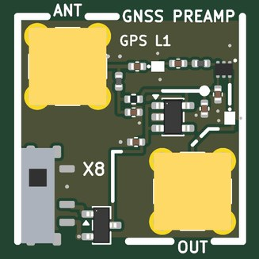</td>
<td valign="top">

<b>A GNSS (GPS L1) front end: SAW filter, low-noise amplifier, SAW filter, with 3.3 V on the antenna jack for an active antenna.</b>  
<b>Jacks:</b> ANT, top left (3.3 V on the centre); OUT, bottom right.  
<b>Supply:</b> +5 V  
<b>Expect:</b> about 19 dB of gain from 1559 to 1606 MHz (GPS L1, Galileo E1, BeiDou B1, GLONASS L1), 1.5 dB noise figure with the first SAW, 50 dB or more of rejection at 900 MHz and 2.4 GHz; 3.3 V for an active antenna on ANT  
<b>How to use it:</b> Active antenna on ANT; OUT to X2's RF IN with X3 near 1575.42 MHz; I and Q to the ADCs.  
<b>You need:</b> An active GPS antenna with an SMA plug (kit: Adafruit 960) and a DC block for a passive one (BLK-89-S+). (<a href="KIT.md">KIT.md</a>)  
<b>Specs:</b> About 19 dB of gain from 1559 to 1606 MHz (GPS L1, Galileo E1, BeiDou B1, GLONASS L1); 1.5 dB noise figure; 50 dB of rejection at 900 MHz and 2.4 GHz.  
<b>Limits:</b> The L1 band only; a passive antenna sees the 3.3 V (put a DC block in line).  
<b>Experiments:</b> GPS acquisition by correlation, Doppler and code phase, then a position fix in software.  
<b>Chip:</b> <a href="https://www.analog.com/en/products/max2659.html">MAX2659</a>, <a href="https://www.murata.com/en-us/products/productdetail?partno=SAFFB1G56KB0F0AR1X">SAFFB1G56</a>  
<b>The circuit:</b> SAW - LNA - SAW, the front end of every GNSS receiver.  Murata's SAFFB1G56 passes 1561, 1575 and 1602 MHz with 1.6 dB of loss; Maxim's MAX2659 gives 20.5 dB with a 0.8 dB noise figure at 4 mA, its output matched and DC-blocked inside, its input matched by 470 pF and 6.8 nH (the datasheet's values).  The bias-T feeds 3.3 V through 10 ohm and 18 nH to an active antenna's LNA (10-30 mA).  OUT to X2's RF IN with X3 at 1575.42 MHz: the satellites' codes at the ADCs.  
<b>Parts:</b> MAX2659ELT+T (C28043), SAFFB1G56KB0F0AR1X (C91647), TPS7A2033PDBVR (C2862740).

</td></tr></table>

### X9  ODMR loop

<table><tr>
<td valign="top" width="270">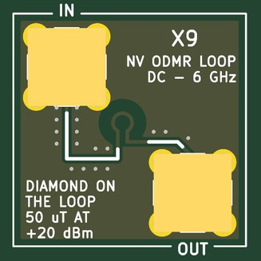</td>
<td valign="top">

<b>A one-turn, 1.6 mm loop in a 50 ohm through-line: the microwave field for optically detected magnetic resonance (ODMR) of NV centres in diamond.</b>  
<b>Jacks:</b> IN, top left (+30 dBm); OUT, bottom right.  
<b>Expect:</b> a 50 ohm through line (the loop adds about 1.5 nH); at its centre about 50 uT (0.5 G) of microwave field for +20 dBm through it into 50 ohm, a Rabi frequency near 1 MHz for NV centres; twice that with OUT shorted  
<b>How to use it:</b> X3 through X1 and an amplifier into IN; OUT to a 50 ohm load; the diamond on the loop, green light from above (PhMOD's Y10), red light to a photodiode on an ADC.  
<b>You need:</b> An NV diamond (kit: Thorlabs DNVB14 or DNVB1, per lab), a 532 nm laser (CPS532), a 600 nm long-pass filter, a 0.7-3.5 GHz amplifier (ZRL-3500+), a 1 W 50 ohm load, a magnet, laser goggles. (<a href="KIT.md">KIT.md</a>)  
<b>Specs:</b> About 50 uT (0.5 G) at its centre for +20 dBm through it into 50 ohm; DC-6 GHz, no tuning; a Rabi frequency near 1 MHz.  
<b>Limits:</b> Needs watts-level drive for fast Rabi oscillations; the NV diamond is expensive; copper is cleared round it on every layer.  
<b>Experiments:</b> The ODMR dip at 2.87 GHz, its Zeeman splitting (a magnetometer), Rabi oscillations, a Ramsey sequence.  
<b>The circuit:</b> A one-turn loop, 1.6 mm across (0.3 mm track), in series with a 50 ohm line between IN and OUT.  B at its centre is mu0 I / 2a: 63 mA peak (+20 dBm into 50 ohm) gives 50 uT.  No resonance, so no tuning: sweep 2.6-3.2 GHz for ODMR in any bias field.  Copper is cleared on every layer within 2 mm of the loop.  Lay the diamond on the loop, shine green on it from above and read the red with the ECP5 board's photodiode.

</td></tr></table>

### X10  power, USB-C 5 V in: +5, -5 out

<table><tr>
<td valign="top" width="270">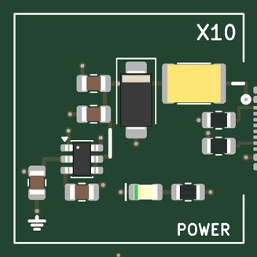</td>
<td valign="top">

<b>Power: 5 V from USB-C and -5 V made from it.</b>  
<b>Expect:</b> +5 V from the USB-C (up to 1.5 A), -5 V at 40 mA; the green LED says 5 V is in, the red one that -5 V is up  
<b>How to use it:</b> Plug in the USB-C; switch on each tile you use.  
<b>You need:</b> A 5 V USB-C supply (kit: Raspberry Pi 5.1 V 3 A supply). (<a href="KIT.md">KIT.md</a>)  
<b>Specs:</b> +5 V up to 1.5 A; -5 V at 40 mA (25 used).  
<b>Chip:</b> <a href="https://www.ti.com/product/LM2664">LM2664</a>  
<b>The circuit:</b> USB-C power only: 5.1 k on each CC asks any source for 5 V.  A 2 A PTC, a 5 V TVS (clamps at 9.2 V) and 20 uF. The LM2664 charge pump makes -5 V for X2's difference amplifiers and X7's noise junction (40 mA available, 25 used). Every powered tile switches its own +5 V with a slide switch and a P-FET, and regulates its own 3.3 V where it needs one.  
<b>Parts:</b> KT-0805G (C2297), NCD0805R1 (C84256), LM2664M6X/NOPB (C108573), MF-MSMF200-2 (C210837), SMAJ5.0A (C78401), TYPE-C-31-M-12 (C165948).

</td></tr></table>

### X11  switch, SKY13370

<table><tr>
<td valign="top" width="528">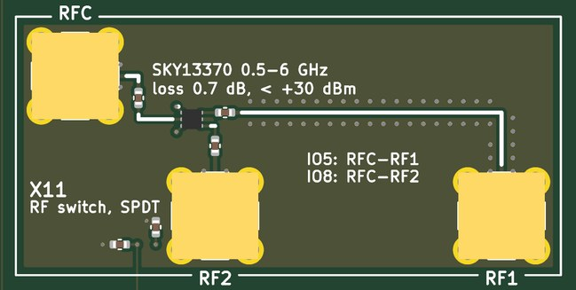</td>
<td valign="top">

<b>An RF switch (single pole, double throw): connects RFC to RF1 or to RF2 under FPGA control; the unused throw is terminated in 50 ohm.</b>  
<b>Jacks:</b> RFC, top left (+30 dBm); RF2, bottom of the left cell; RF1, bottom right.  
<b>Pmod:</b> IO5 (Pmod pin 7): V1 of X11 (RF1 on); IO8 (Pmod pin 10): V2 of X11 (RF2 on)  
<b>Expect:</b> 0.7 dB through, 31 dB of isolation at 2.5 GHz (0.5-6 GHz); the off throw is a 50 ohm load; switches in about 100 ns  
<b>How to use it:</b> IO5 high and IO8 low: RFC to RF1; IO5 low and IO8 high: RFC to RF2.  
<b>You need:</b> Nothing beyond SMA cables.  
<b>Specs:</b> 0.5-6 GHz; 0.7 dB through; 31 dB isolation at 2.5 GHz; switches in about 100 ns; up to +30 dBm.  
<b>Limits:</b> Pmod IO5 and IO8 must be opposite (one high, one low).  
<b>Experiments:</b> A transmit/receive switch for one antenna; an antenna switch for direction finding; a Dicke radiometer (antenna against X7's load); pulse gating.  
<b>Chip:</b> <a href="https://www.skyworksinc.com/Products/Switches/SKY13370-374LF">SKY13370</a>  
<b>The circuit:</b> Skyworks SKY13370: an absorptive SPDT, both throws matched in every state, so a Dicke radiometer's reference (X7 off: a room-temperature load) and its antenna see the same receiver.  V1 high and V2 low connects RFC to RF1; the reverse to RF2. Pmod IO5 drives V1 and IO8 V2 from the FPGA, so the switching is synchronous with the ADC's samples.  A T/R switch for one antenna, an antenna switch for two, a Dicke switch, a pulse gate.  
<b>Parts:</b> SKY13370-374LF (C105628).

</td></tr></table>

## Ground, loops and probing

Three ground loops stand in the margins; every tile's loops are on the signal they name.  The RH-5019
loops take a scope's grabber.  The SMA jacks are 50 ohm; where an input is not 50 ohm the jack's silk says so.
