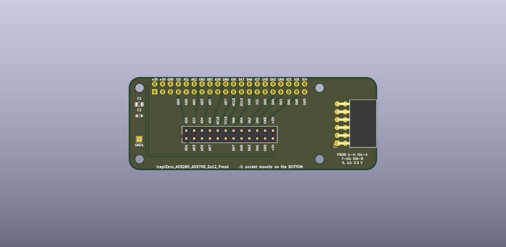

# The Icepi Zero adapter with a Pmod (the fourth board)

The tutorial's 2x12 adapter (`~/mudd/133electronics/icepi-zero-dac-adc/adapter_board/`) with a 2 x 6 right-angle Pmod
socket on a 15 mm extension of its right-hand end, so an Icepi Zero can drive AMOD-A's and RF-MOD's Pmod plugs while
the AD9280/AD9708 module sits on top as before.

- **Source of truth:** `~/OpticsPCBs/IcepiZeroADCDAC/adapters/make_boards.py`, board `adda12p` (the generator that drew
  every adapter).  These files are copies of its `out/IcepiZero_AD9280_AD9708_2x12_Pmod/`; rebuild there with
  `KICAD=10 ../kicad-python.sh make_boards.py adda12p` and copy back.  Its README section "The 2x12 with a Pmod" has
  the reasons.
- **80 x 30 mm, four layers, DRC clean (KiCad 10.0.7, 2026-10-25), no unconnected pads.**  The eight Pmod lines run on
  In2 between the through-hole pads, In1 is solid ground, the outer layers keep the original fan-out unchanged.
- **Pins** (`*-pinmap.csv`, `*.lpf`): the `.lpf` names them `pmod[0]` ... `pmod[7]` for the Pmod standard's IO1-8.

| Pmod | pin | Icepi header pin | GPIO | ECP5 ball |
|---|---|---|---|---|
| IO1 | 1 | 10 | 15 | N1 |
| IO2 | 2 | 27 | 0 | G3 |
| IO3 | 3 | 36 | 16 | H3 |
| IO4 | 4 | 40 | 21 | F2 |
| IO5 | 7 | 8 | 14 | P1 |
| IO6 | 8 | 22 | 25 | J2 |
| IO7 | 9 | 28 | 1 | K3 |
| IO8 | 10 | 38 | 20 | F1 |
| GND | 5, 11 | | | |
| 3.3 V | 6, 12 | 1 | | |

Header pins 3 and 5 (GPIO2, GPIO3; T2, R2) are spare.

- **Order:** upload `IcepiZero_AD9280_AD9708_2x12_Pmod-gerbers.zip` at JLCPCB as a 4-layer, 1.6 mm board (the price was not
  checked on the day).  Hand-solder J1 (2 x 20 female, 2.54 mm, on the BOTTOM: it takes the Icepi Zero's header), J2 (2 x 12 male, top,
  for the module) and J3 (2 x 6 right-angle female, 2.54 mm, e.g. HC-PM254-8.5H-2x6PW, LCSC C22373932; housing face at
  the board edge).  Nothing else changes from the 2x12 adapter's instructions.
- **Heights.**  The adapter's board sits about 11 mm above the Icepi Zero's (the header's 2.5 mm of plastic plus J1's
  8.5 mm), and an AMOD board's plug mates only with its own board level with the adapter's: raise the AMOD board on a
  spacer under its feet, or use a 2 x 6 Pmod extension cable (the easier way, and the ECP5 board needs none).
