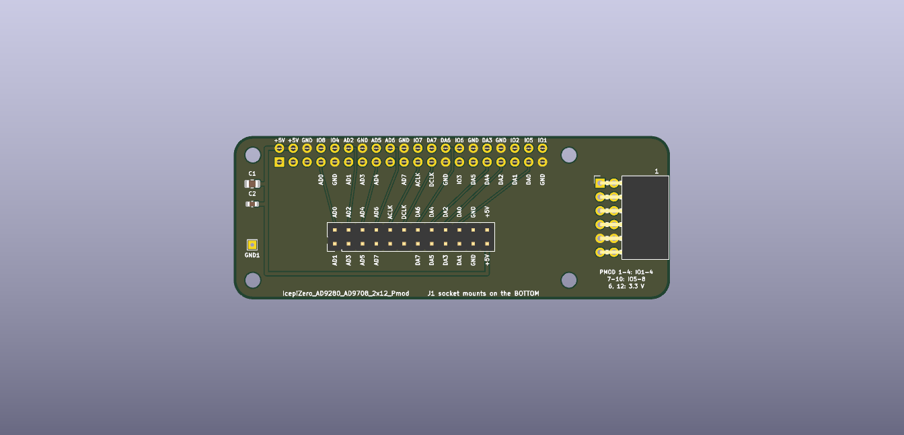

# The Icepi Zero adapter with a Pmod (the fourth board)

The tutorial's 2x12 adapter (`~/mudd/133electronics/icepi-zero-dac-adc/adapter_board/`) with a 2 x 6 right-angle Pmod
socket on a 15 mm extension of its right-hand end, so an Icepi Zero can drive a Pmod board while the AD9280/AD9708 module
sits on top as before.  Never built.

- **Its socket follows the Pmod specification (since 2026-11-16).**  J3 is the spec's figure 5, a host socket on an east
  edge: pin 1 at the north end (toward the Icepi header), IO1-4 on the row far from the opening, 3.3 V and ground at the
  south end.  A Digilent module, or any module drawn to the spec, plugs in component side up.  Until 2026-11-16 the
  socket was mirrored end to end, as ECP5-2ADC-2DAC rev A's J303/J304 are; the old files are in this folder's git history.
- **The AMOD and RF-MOD rev A plugs are not standard** (`../bringup/REVB.md` 1.15): one fits this socket **only upside
  down**, with `pmod[0..3]` and `pmod[4..7]` swapped in the `.lpf`.  The right way up it puts its 3.3 V on IO1 and IO5
  and its ground on IO2 and IO6: never plug one in that way.  Rev B's plugs follow the spec and fit the right way up.
- **Source of truth:** `~/OpticsPCBs/IcepiZeroADCDAC/adapters/make_boards.py`, board `adda12p` (`PMOD_LAYOUT = "spec"`).
  These files are copies of its `out/IcepiZero_AD9280_AD9708_2x12_Pmod/`, taken 2026-11-16 at 15:03 from that
  repository's working tree (uncommitted there at the time, on top of 677b57e); rebuild there with
  `KICAD=10 ../kicad-python.sh make_boards.py adda12p` and copy back.  Its README section "The 2x12 with a Pmod" has the
  reasons, and `~/OpticsPCBs/tools/pin_audit/connectors/IcepiZero_pmod_adapter.py` checks J3 against the spec by position.
- **80 x 30 mm, four layers.**  Checked here on the copy: KiCad 10.0.7's DRC finds 0 violations, 0 unconnected pads and
  0 schematic-parity issues, and every J3 pad's net is the spec's for its pin (Pmod pin k on pad 13-2k, pin k+6 on pad
  14-2k: IO1-4 on pads 11, 9, 7, 5; IO5-8 on 12, 10, 8, 6; ground on 3 and 4; 3.3 V on 1 and 2).  The eight Pmod lines
  run on In2 between the through-hole pads, In1 is solid ground, the outer layers keep the original fan-out.
- **Pins** (`*-pinmap.csv`, `*.lpf`): the `.lpf` names them `pmod[0]` ... `pmod[7]` for IO1-8 as before, **but the balls
  behind the names moved** with the redraw (`pmod[0]` was N1, now F2):

| Pmod | pin | Icepi header pin | GPIO | ECP5 ball |
|---|---|---|---|---|
| IO1 | 1 | 40 | 21 | F2 |
| IO2 | 2 | 36 | 16 | H3 |
| IO3 | 3 | 27 | 0 | G3 |
| IO4 | 4 | 10 | 15 | N1 |
| IO5 | 7 | 38 | 20 | F1 |
| IO6 | 8 | 28 | 1 | K3 |
| IO7 | 9 | 22 | 25 | J2 |
| IO8 | 10 | 8 | 14 | P1 |
| GND | 5, 11 | | | |
| 3.3 V | 6, 12 | 1 | | |

Header pins 3 and 5 (GPIO2, GPIO3; T2, R2) are spare.

- **Order:** upload `IcepiZero_AD9280_AD9708_2x12_Pmod-gerbers.zip` at JLCPCB as a 4-layer, 1.6 mm board (the price was not
  checked on the day).  Hand-solder J1 (2 x 20 female, 2.54 mm, on the BOTTOM: it takes the Icepi Zero's header), J2 (2 x 12 male, top,
  for the module) and J3 (2 x 6 right-angle female, 2.54 mm, e.g. HC-PM254-8.5H-2x6PW, LCSC C22373932; housing face at
  the board edge).  Nothing else changes from the 2x12 adapter's instructions.
- **Heights.**  The adapter's board sits about 11 mm above the Icepi Zero's (the header's 2.5 mm of plastic plus J1's
  8.5 mm), and a Pmod board's plug mates only with its own board level with the adapter's: raise the board on a
  spacer under its feet, or use a 2 x 6 Pmod extension cable (the easier way, and the ECP5 board needs none).
